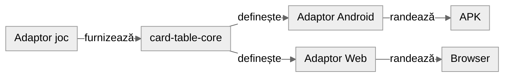
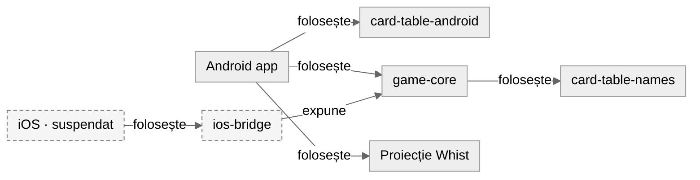
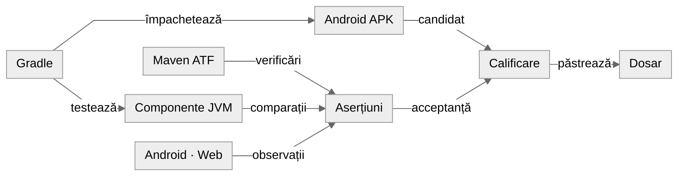
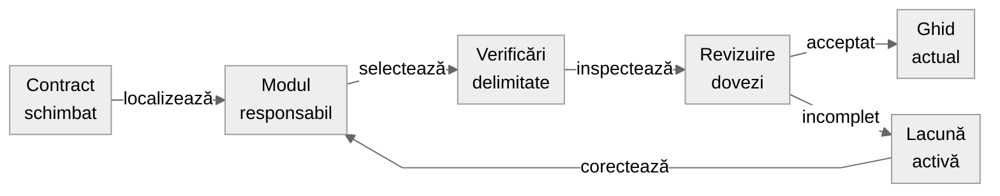

# Whist Lab

## Pe scurt

Whist Lab este un joc local de levate pentru 3–6 jucători și un laborator pentru verificarea regulilor, interfețelor și politicilor sale de joc. Edițiile Android și browser folosesc același motor Java; proiectul păstrează corectitudinea jocului, comportamentul randat și calificarea livrării ca responsabilități de verificare distincte.

| Zonă | Ce oferă |
|---|---|
| Joc | Comenzi legale, licitație, levate, calculul punctajului și istoricul scorului. |
| Aplicații | Adaptoare Android și Web active; puntea iOS este suspendată. |
| Cercetare | Comparații offline ale politicilor pe distribuiri controlate, separate de acceptanța livrării. |
| Dovezi | Comparații JVM, verificări de platformă, rapoarte Extent și un dosar de versiune. |

## Jocul

- **[Descarcă APK 0.24.0](https://github.com/crististefanita/whist/releases/download/v0.24.0/WhistLab-0.24.0.apk)**
- **[Joacă Whist online](https://crististefanita.github.io/whist/)**

## Harta modulelor

### Un joc, două interfețe active

Motorul jocului deține jocul legal și starea. Trei module de prezentare separă contractele portabile de randarea Android și browser. Proiecțiile specifice rămân la joc; calculele comune nu fac singure pixelii desenați identici.



<details>
<summary>Legendă — comenzi, stare și afișare</summary>

- Fluxul descrie responsabilități la execuție, fără a reprezenta dependențe de build. Motorul validează comenzile și expune starea; adaptoarele dețin interacțiunea cu ecranul și măsurătorile de platformă.
- Android folosește interfața nativă a mesei. Browserul rulează printr-un server JVM local sau un Web Worker TeaVM; ediția statică păstrează comenzile pe dispozitiv după încărcare.
- Contractele portabile de geometrie și tipografie cer verificări randate separate pentru fonturi, insets și ținte tactile. [Contractul Android–Web](atf-ui-browser/README.md#what-android-and-web-share)

</details>

### Motorul și platformele

Această hartă arată dependențele directe ale aplicațiilor native. Traseul browserului este descris mai sus; puntea suspendată rămâne vizibilă deoarece este încă declarată în buildul Gradle implicit.



<details>
<summary>Legendă — direcția dependențelor și scopul suspendat</summary>

- Săgețile pleacă de la consumator spre dependență. Inventarul modulelor și configurațiile dependențelor de mai jos sunt verificate față de POM-uri și fișierele Gradle.
- `game-core` deține regulile, calculul scorului și deciziile AI. O politică de joc primește mâna proprie și informațiile publice ale mesei; evaluarea offline aparține `ai-lab`.
- Android deține ecranele, preferințele și checkpointurile. Puntea iOS suspendată nu implică un build IPA activ sau calificarea pe simulator. [Scopul platformei](docs/platform/ATF_iOSDelivery.md)

</details>

| Zonă | Responsabil și ghid |
|---|---|
| Reguli și politici | [game-core](whist-lab-app/game-core/README.md) · [card-table-names](whist-lab-app/card-table-names/README.md) · [ai-lab](whist-lab-app/ai-lab/README.md) |
| Aplicații active | [Android](whist-lab-app/app/src/main/java/ro/whistlab/app/README.md) · [Core](whist-lab-app/card-table-core/README.md) · [Adaptor Android pentru masă](whist-lab-app/atf-card-table-ui/README.md) · [Web](atf-ui-browser/README.md) |
| Validare și scenarii pe dispozitiv | [atf-validation](atf-validation/README.md) · [atf-test-android](atf-test-android/README.md) |
| Verificare și audit | [atf-tests](atf-tests/README.md) · [test-audit](whist-lab-app/test-audit/README.md) · [Build JVM](whist-lab-app/algorithm-build/README.md) |
| Execuție și livrare | [Scripturi](scripts/README.md) · [Catalogul livrărilor](release/README.md) |

<details>
<summary>Declarațiile verificate din Maven și Gradle</summary>

| Build | Module declarate |
|---|---|
| Maven | atf-validation, atf-test-android, atf-tests |
| Gradle | app, game-core, whist-presentation, card-table-core, card-table-android, card-table-web, card-table-names, ai-lab, test-audit, ios-bridge |
| Gradle JVM | game-core, ai-lab, card-table-names, test-audit |

Dependențele directe folosesc configurația din modulul consumator.

| Build | Consumator | Configurație | Dependențe directe |
|---|---|---|---|
| Maven | atf-validation | compile | atf-core |
| Maven | atf-validation | test | atf-test-kit |
| Maven | atf-test-android | compile | atf-core, atf-reporting, atf-test-kit |
| Maven | atf-test-android | test | atf-console |
| Maven | atf-tests | compile | atf-test-kit, atf-core, atf-test-android, atf-reporting |
| Maven | atf-tests | test | atf-console, atf-mock |
| Gradle | app | implementation | game-core, card-table-android, whist-presentation |
| Gradle | app | testImplementation | card-table-core |
| Gradle | card-table-android | api | card-table-core |
| Gradle | card-table-web | api | card-table-core |
| Gradle | card-table-web | implementation | card-table-names |
| Gradle | whist-presentation | api | game-core, card-table-core |
| Gradle | game-core | implementation | card-table-names |
| Gradle | game-core | testImplementation | ai-lab |
| Gradle | ios-bridge | implementation | game-core |
| Gradle | fixture-uri comune | testImplementation | test-audit |

Tabelul Gradle descrie modulele buildului implicit și dependențele directe între ele. Rândul `fixture-uri comune` descrie configurarea partajată a testelor. Maven listează dependențele directe din grupul ATF și folosește `compile` când POM-ul omite scope-ul.

</details>

### De la surse la livrare

Ieșirile buildului și dovezile de acceptanță au responsabili separați. Un rezultat JVM demonstrează contractul exercitat; acceptanța pe dispozitiv sau browser cere propria observație de platformă.



<details>
<summary>Legendă — ce demonstrează calificarea</summary>

- Gradle construiește aplicația Android și rulează verificări JVM. Maven adaugă modulele ATF, scenariile Android și guvernanța proiectului; probele de browser urmează ghidul adaptorului lor.
- Extent înregistrează aserțiuni și diagnostice pentru verificările selectate. Un rezultat de componentă nu înlocuiește geometria pictată sau comportamentul pe dispozitiv.
- Calificarea RAG asociază verificările selectate cu identitatea sursei și a candidatului. Dosarul păstrează proveniența APK, calificarea și verificarea descărcării; este evidența versiunii, fără a deveni o prezentare generală a proiectului. [Contract de calificare](docs/testing/ATF_ReleaseQualification.md)

</details>

## Verificare și ghiduri

Din rădăcina repository-ului, folosește Java 21, PowerShell 7 și Node.js. Colecția rapidă pregătește o rulare izolată și verifică reguli și contexte publice; consultă ghidul colecțiilor înainte de a alege regresii mai largi, verificări pe dispozitiv sau cercetare.

```powershell
.\scripts\run-whist-collection.ps1 -Collection quick
```

### Schimbare, dovezi și întreținere



<details>
<summary>Legendă — guvernanță și documentație durabilă</summary>

- Guvernanța verifică informațiile modulelor, convențiile de cod și teste, structura documentației, linkurile și paritatea edițiilor. Testele de comportament și de platformă își demonstrează propriile contracte.
- Selectează colecțiile de cercetare pentru dovezi privind politicile; compară intrări controlate și limite declarate înainte de a interpreta forța de joc. Acceptanța livrării rămâne o decizie separată.
- Actualizează ghidul responsabil când o corecție schimbă un contract durabil. Păstrează criteriile de acceptanță nerezolvate în feedback și elimină narațiunea rezultatelor încheiate. Edițiile EN/RO păstrează căile, comenzile și topologia diagramelor.

</details>

| Întrebare | Ghid |
|---|---|
| Ce verificări trebuie rulate? | [Strategia de testare](docs/testing/README.md) · [Matrice modul × nivel](docs/testing/ATF_TestingGuide.md#matrice-detaliată-modul--nivel-de-testare) · [Colecții](docs/testing/ATF_Collections.md) · [Android](docs/testing/ATF_Android.md) |
| Ce protejează codul și documentația? | [Guvernanța calității](docs/governance/README.md) · [Standardul documentației](docs/governance/ATF_Documentation.md) |
| Cum sunt definite jocul și evaluarea politicilor? | [Reguli](docs/game/README.md) · [Arhitectura AI](docs/ai/README.md) |
| Unde sunt contractele detaliate și lacunele deschise? | [Indexul documentației](docs/README.md) · [Feedback activ](docs/feedback/README.md) |

Contractele dependențelor și proveniența sunt reunite în [indexul local al bibliotecilor](lib/README.md).
