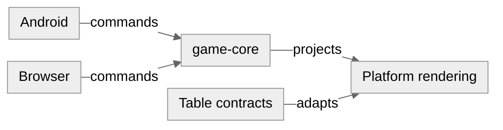
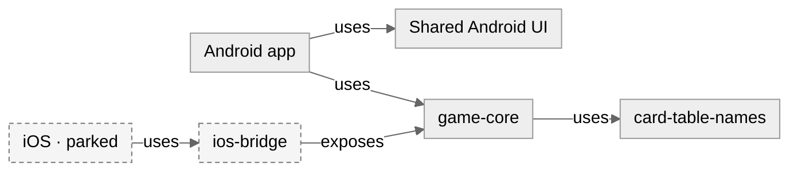
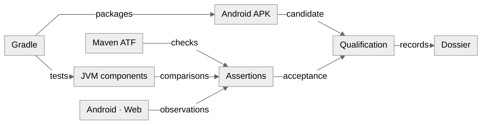
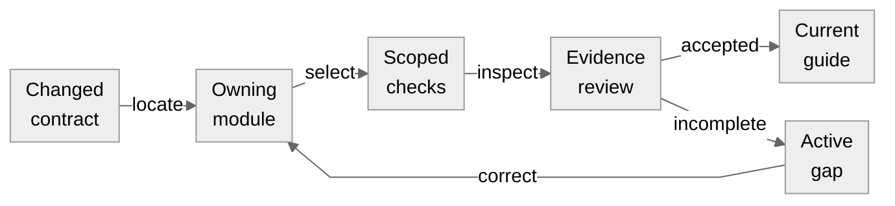

# Whist Lab

## Overview

Whist Lab is a local trick-taking game for 3–6 players and a laboratory for verifying its rules, interfaces and playing policies. Android and browser editions use the same Java engine; the project keeps game correctness, rendered behavior and release qualification as distinct verification responsibilities.

| Area | What it provides |
|---|---|
| Game | Legal commands, bidding, tricks, settlement and score history. |
| Applications | Active Android and Web adapters; the iOS bridge is parked. |
| Research | Offline policy comparisons on controlled deals, separate from release acceptance. |
| Evidence | JVM comparisons, platform checks, Extent reports and a versioned release dossier. |

## Game

- **[Download APK 0.23.2](https://github.com/crististefanita/whist/releases/download/v0.23.2/WhistLab-0.23.2.apk)**
- **[Play Whist online](https://crististefanita.github.io/whist/)**

## Module map

### One game, two active interfaces

The engine owns legal play and game state. Platform adapters translate interaction into commands and render the public projection; shared table calculations do not make native and browser rendering identical by themselves.



<details>
<summary>Legend — commands, state and display</summary>

- The flow describes runtime responsibilities, not build dependencies. The engine validates commands and exposes state; adapters own screen interaction and platform measurements.
- Android uses the native table UI. The browser runs through a local JVM server or a TeaVM Web Worker; the static edition keeps commands on the device after loading.
- The portable geometry and typography contracts require separate rendered checks for fonts, insets and touch targets. [Android–Web contract](atf-ui-browser/README.md#what-android-and-web-share)

</details>

### Engine and platforms

This map shows direct native application dependencies. The browser path is described above; the parked bridge remains visible because it is still declared by the default Gradle build.



<details>
<summary>Legend — dependency direction and parked scope</summary>

- Arrows point from consumer to dependency. The module inventory and dependency configurations below are checked against the POMs and Gradle files.
- `game-core` owns rules, scoring and AI decisions. A playing policy receives its own hand and public table information; offline evaluation belongs to `ai-lab`.
- Android owns screens, preferences and checkpoints. The parked iOS bridge does not imply an active IPA build or simulator qualification. [Platform scope](docs/platform/ATF_iOSDelivery.md)

</details>

| Area | Owner and guide |
|---|---|
| Rules and policies | [game-core](whist-lab-app/game-core/README.md) · [card-table-names](whist-lab-app/card-table-names/README.md) · [ai-lab](whist-lab-app/ai-lab/README.md) |
| Active applications | [Android](whist-lab-app/app/src/main/java/ro/whistlab/app/README.md) · [Shared table UI](whist-lab-app/atf-card-table-ui/README.md) · [Web](atf-ui-browser/README.md) |
| Validation and device scenarios | [atf-validation](atf-validation/README.md) · [atf-test-android](atf-test-android/README.md) |
| Verification and audit | [atf-tests](atf-tests/README.md) · [test-audit](whist-lab-app/test-audit/README.md) · [JVM build](whist-lab-app/algorithm-build/README.md) |
| Execution and delivery | [Scripts](scripts/README.md) · [Release catalog](release/README.md) |

<details>
<summary>Verified Maven and Gradle declarations</summary>

| Build | Declared modules |
|---|---|
| Maven | atf-validation, atf-test-android, atf-tests |
| Gradle | app, game-core, atf-card-table-ui, card-table-names, ai-lab, test-audit, ios-bridge |
| Gradle JVM | game-core, ai-lab, card-table-names, test-audit |

Direct dependencies use the configuration declared by the consuming module.

| Build | Consumer | Configuration | Direct dependencies |
|---|---|---|---|
| Maven | atf-validation | compile | atf-core |
| Maven | atf-validation | test | atf-test-kit |
| Maven | atf-test-android | compile | atf-core, atf-reporting, atf-test-kit |
| Maven | atf-test-android | test | atf-console |
| Maven | atf-tests | compile | atf-test-kit, atf-core, atf-test-android, atf-reporting |
| Maven | atf-tests | test | atf-console, atf-mock |
| Gradle | app | implementation | game-core, atf-card-table-ui |
| Gradle | game-core | implementation | card-table-names |
| Gradle | game-core | testImplementation | ai-lab |
| Gradle | ios-bridge | implementation | game-core |
| Gradle | shared fixtures | testImplementation | test-audit |

The Gradle table describes default-build modules and direct dependencies between them. The `shared fixtures` row describes shared test configuration. Maven lists direct dependencies from the ATF group and uses `compile` when a POM omits scope.

</details>

### From source to release

Build output and acceptance evidence have separate owners. A JVM result establishes the exercised contract; device or browser acceptance requires its own platform observation.



<details>
<summary>Legend — what qualification establishes</summary>

- Gradle builds the Android application and runs JVM checks. Maven adds the ATF modules, Android scenarios and project governance; browser probes follow their own adapter guide.
- Extent records assertions and diagnostics for the selected checks. A component result does not stand in for painted geometry or device behavior.
- RAG qualification relates the selected checks to source and candidate identity. The dossier retains APK provenance, qualification and download verification; it is the release record rather than a general project overview. [Qualification contract](docs/testing/ATF_ReleaseQualification.md)

</details>

## Verification and guides

From the repository root, use Java 21, PowerShell 7 and Node.js. The quick collection prepares an isolated run and checks rules and public contexts; consult the collection guide before choosing broader regression, device or research work.

```powershell
.\scripts\run-whist-collection.ps1 -Collection quick
```

### Change, proof and maintenance



<details>
<summary>Legend — governance and lasting documentation</summary>

- Governance checks module facts, source/test conventions, documentation structure, links and edition parity. Behavior and platform tests establish their own contracts.
- Select research collections for policy evidence; compare controlled inputs and declared limits before interpreting strength. Release acceptance remains a separate decision.
- Update the owner guide when a fix changes a lasting contract. Keep unresolved acceptance criteria in feedback and remove completed-result narration. EN/RO editions preserve paths, commands and diagram topology.

</details>

| Question | Guide |
|---|---|
| Which checks should run? | [Test strategy](docs/testing/README.md) · [Collections](docs/testing/ATF_Collections.md) · [Android](docs/testing/ATF_Android.md) |
| What protects code and documentation? | [Quality governance](docs/governance/README.md) · [Documentation standard](docs/governance/ATF_Documentation.md) |
| How are play and policy evaluation defined? | [Rules](docs/game/README.md) · [AI architecture](docs/ai/README.md) |
| Where are deeper contracts and open gaps? | [Documentation index](docs/README.md) · [Active feedback](docs/feedback/README.md) |

Dependency contracts and provenance are collected in the [local library index](lib/README.md).
