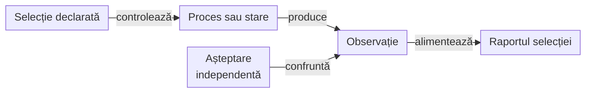

# Testele adaptorului și ale aplicației Android

## Pe scurt

Acest catalog explică intrările JUnit ale adaptorului Android. [Strategia comună](../../../docs/testing/README.md) deține alegerea nivelului și acceptarea rezultatului; testul deține comparația, iar infrastructura deține comanda și observația.

## Selecții și resurse

| Intrare | Scop și precondiții |
|---|---|
| [AndroidComponentSuite](java/atf/android/suites/AndroidComponentSuite.java) | Suită primară: toate componentele Maven ale adaptorului, fără emulator. |
| [AndroidDisplayComponentSuite](java/atf/android/suites/AndroidDisplayComponentSuite.java) | Profile, driver, istoric și oracole geometrice cu intrări controlate. |
| [AndroidHistoryComponentSuite](java/atf/android/suites/AndroidHistoryComponentSuite.java) | Selecție focalizată a istoricului; împărtășește clase cu selecția display. |
| [AndroidUiFlowTimingComponentSuite](java/atf/android/e2e/support/AndroidUiFlowTimingComponentSuite.java) | Intervalele măsurate ale fluxului, cu ceas și procese controlate. |
| [AndroidGameplayE2eSuite](java/atf/android/suites/AndroidGameplayE2eSuite.java) | Interacțiune pe APK-ul identificat; necesită activare, dispozitiv rezervat și restaurarea stării. |

[Catalogul](../../../config/atf-test-suites.json) declară suitele primare pentru fiecare nivel și părinții selecțiilor focalizate. Display, istoric și timing sunt submulțimi ale suitei primare de componentă; gameplay este submulțime a intrării E2E, care rămâne activată separat.

## Fluxul verificării

Legendă: o singură execuție și două tipuri de mediu

Componentele controlează procesele, ceasul și observațiile. E2E capturează o interacțiune nouă pe dispozitiv; republicarea unei observații existente păstrează identitatea originală și nu execută din nou Android.

## Execuție și interpretare

### Execuția și deținerea acțiunilor

| Responsabil | Contract |
|---|---|
| [Fațada driverului](java/atf/android/e2e/driver/AndroidUiDriver.java) | Rezolvă țintele ierarhiei curente, reîncercările și pauzele de stabilizare; metodele publice rămân API-ul adaptorului de testare. |
| [Executorul acțiunilor](java/atf/android/e2e/driver/actions/AndroidUiActions.java) | Execută comanda o singură dată, măsoară numai execuția, numerotează înregistrările și păstrează cauza originală. Eșecul raportării devine excepție suprimată a unei comenzi eșuate; raportarea eșuată după o comandă acceptată nu inventează o altă comandă eșuată. |
| Apelantul fluxului | Deține fazele de pregătire/corp, checkpoint-urile și intervalele capturilor. Acceptarea comenzii nu demonstrează singură rezultatul aplicației. |

[Componentele controlate](java/atf/android/e2e/driver/actions/AndroidUiActionsComponentTest.java) folosesc porturi de proces și ceas fără dispozitiv, pauze reale sau poze. Componentele existente pentru ierarhie și derulare păstrează acoperirea selecției și reîncercărilor; E2E nativ califică separat aplicația.

Folosiți [intrările izolate ale modulului](../../README.md#verificare-fără-dispozitiv) și [ghidul componentelor](../../../docs/testing/ATF_DisplayComponents.md). Selectați suita sau clasele sale, cu suprapunerea declarată; directoarele temporare și rapoartele aparțin rulării externe.

- **Audit:** [AndroidComponentAudit](java/atf/android/component/AndroidComponentAudit.java) leagă invocarea de Kit. [Contractele adaptorului](java/atf/android/component/AndroidComponentReportContractTest.java) verifică publicarea și refuzurile; eșecurile intenționate sunt delimitate de rezultatul produsului.

- **Rezultat:** JUnit identifică execuția, iar HTML-ul auditat păstrează inputul, expected/actual și verdictul. [Calificarea producătorilor](../../../docs/reporting/ATF_Audit.md#inventarul-guvernat-al-producătorilor) rămâne distinct de trecerea JUnit.

[Modulul Android](../../README.md) · [Strategia comună](../../../docs/testing/README.md) · [Auditul rapoartelor](../../../docs/reporting/ATF_Audit.md)
