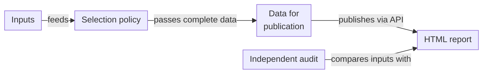

# Integration of libraries and publication of results

## Overview

This module verifies library integration, project governance and Whist result publication. The consumer selects records, preserves original comparisons and reconciles published output with captured input.

Reporting owns HTML presentation through the API selected by the [parent POM](../pom.xml). Publication contracts, data selection and binary acceptance have separate checks.

## Flow and responsibilities



<details>
<summary>Legend: identity of execution prior to presentation</summary>

A record describes an original invocation: identity, parameters, intervals, comparisons and verdict. Selection keeps invocations whole and declares omissions; the adapter supplies data and Reporting renders it.

</details>

## Organization

| Mechanism | Responsibility |
|---|---|
| [Selection](src/main/java/atf/tests/learning/EvidenceSelection.java) | Keeps results different from PASS, mandatory collections, population guards and selected deterministic examples. |
| [Composition](src/main/java/atf/tests/learning/LearningRunReport.java) | Checks records and supplies original comparisons. |
| [Publication session](src/main/java/atf/tests/reporting/GameReportSession.java) | Isolates publication configuration, context and phases. |
| [Audit HTML](src/main/java/atf/tests/learning/LearningReportHtmlAudit.java) | Reconciles published identities, rows, values and scope with source data. |
| [Download APK](src/main/java/atf/tests/distribution/GitHubApkDownload.java) | Checks GitHub metadata, complete transfer, SHA-256 and CRC; main owns support, while tests own local HTTP fixtures and live acceptance. |

[Presentation policy](../docs/reporting/ATF_Presentation.md) holds the rules of volume and navigation. The reusable code is in `src/main/java`; JUnit entries and negative samples are in `src/test/java`.

## Key contracts

- Each selected claim shall retain the binding verdict, cause and comparison.
- The inventory of omissions shows what was executed and what is not individually presented in HTML.
- The budget of the optional context retains the expected, observed and verdict values; [GameEvidenceBodies](src/main/java/atf/tests/reporting/GameEvidenceBodies.java) refuses indivisible entries too high.
- Republishing consumes captured data and retains original execution identity; historical or synthetic images are explicitly labeled.

## Focused verification

From an isolated copy with the project POM, required modules, physical JAR/POM pairs and a dedicated Maven cache:

```powershell
mvn -B -pl atf-tests -am '-Dtest=GameReportComponentSuite,LearningRunReportContractTest,EvidenceSelectionContractTest' '-Dsurefire.failIfNoSpecifiedTests=false' test
```

Choose the check after the changed contract:

| Purpose | Entry point JUnit |
|---|---|
| Policy, JSON/TEXT payloads, redaction and publication | [GameReportComponentSuite](src/test/java/atf/tests/reporting/GameReportComponentSuite.java). |
| Ownership of values and deliberate mutations of published data | [LearningRunReportContractTest](src/test/java/atf/tests/learning/LearningRunReportContractTest.java). |
| Population, thresholds and selection | [EvidenceSelectionContractTest](src/test/java/atf/tests/learning/EvidenceSelectionContractTest.java). |
| Binaries and module composition | [CoreReportingConsumerContractTest](src/test/java/atf/tests/publishing/CoreReportingConsumerContractTest.java). |
| PNG capture through the API | [AndroidInlineScreenshotReportContractTest](src/test/java/atf/tests/contracts/AndroidInlineScreenshotReportContractTest.java). |
| Examples from the guides against the physical JARs | [LibraryReadmeExamplesIntegrationTest](src/test/java/atf/libraries/LibraryReadmeExamplesIntegrationTest.java). |
| Version link and refusal of an incomplete APK | [Distribution components](src/test/java/atf/tests/governance/documentation/release/download/ApkDownloadComponentTest.java), without GitHub access. |
| Actual GitHub download | [Explicit acceptance](src/test/java/atf/tests/governance/documentation/release/download/PublishedApkDownloadAcceptanceTest.java), separate from the offline suite by tag. |

[LearningRunReportTest](src/test/java/atf/tests/learning/LearningRunReportTest.java) publishes an explicit selection by its dedicated activation. [DeepSuiteExtentReportTest](src/test/java/atf/tests/publishing/DeepSuiteExtentReportTest.java) composes an aggregate publication with separate preconditions and activation.

## Android intervals at republishing

[Time measurement contract](../docs/reporting/ATF_PhaseTiming.md) keeps the original ranges and their association with the actions. The verification of this contract on captured logs has a different purpose from executing new Android interactions.

## Levels and governance

Components check selection, adapters and publication; integration checks physical binaries, configuration and composition of modules. [Test layer matrix](../docs/testing/ATF_Architecture.md) is confronted with test statements.

[Quality Suite](src/test/java/atf/tests/governance/AtfQualityGovernanceSuite.java) checks the sources, documentation and contracts of libraries. [Governance Launcher](../scripts/run-atf-governance.ps1) prepares its own temporary copy and Maven cache, retains external results and detects changes in source during the verification.

[Governance](../docs/governance/README.md) · [Publication architecture](../docs/reporting/README.md) · [Documentation index](../docs/README.md)

## Limits and qualification

The consumer must retain auditability for large or predominantly failing inputs. [Volume feedback](../docs/feedback/ATF_Reporting.md#cost-of-consumer-inputs) tracks cost qualification; [result handoff](../docs/reporting/ATF_Handoff.md) owns identity and rejection of contradictory provenance.

For another game, the [transfer contract](../docs/learning/ATF_GameTransfer.md) separates the semantics of the records from the library API. The new adapter keeps comparisons and provenance; the generic requirements of the JAR follow [Feedback owners](../docs/feedback/README.md).

## Test catalogue

[Inputs and responsibilities of tests](src/test/README.md) explains the selection, preconditions and interpretation of the result, through the same common strategy for all deliveries.
