# Integration and governance tests

## Overview

The module verifies the integration of common binaries, publication data and project contracts. [Common strategy](../../../docs/testing/README.md) defines the levels; this guide defines entry points and their limits.

```mermaid
%%{init: {"themeVariables":{"fontSize":"15px"},"themeCSS":".edgeLabel, .edgeLabel p { font-size: 12px !important; } .node rect { rx: 6px; ry: 6px; }","flowchart":{"curve":"linear","nodeSpacing":24,"rankSpacing":22,"padding":6},"sequence":{"mirrorActors":false,"messageMargin":24,"wrap":true}}}%%
flowchart LR
    Witness["Valid fixture"] -->|changes one condition| Negative["Negative input"]
    Negative -->|exercises| Guard["Guard under test"]
    Guard -->|must reject| Refusal["Expected refusal"]
    Refusal -->|asserts contract| Test["Component verdict"]
```

Legend — ownership and verification boundary

A passing negative control establishes the guard’s specified refusal; it does not convert an application failure into PASS. The original valid witness, changed condition, observed diagnostic and assertion remain attributable to the same test. Publication and rendered-report acceptance have their own checks.

## Collections and responsibilities

[Catalog](../../../config/atf-test-suites.json) declares unit and integration entries plus distinct primary component owners. The [component owner map](../../../docs/testing/ATF_Collections.md#independent-atf-component-owners) separates source structure, documentation, provenance, Android, GitHub, orchestration and reporting; focused suites declare their primary parents.

| Family | Entry and limit |
|---|---|
| Publication Whist | [GameReportComponentSuite](java/atf/tests/reporting/GameReportComponentSuite.java) is a focused selection for the policy and data captured on the physical JAR. |
| Governance | [AtfQualityGovernanceSuite](java/atf/tests/governance/AtfQualityGovernanceSuite.java) reads the code, documents and contracts of binary; Android is not running. |
| Integrity release | [ReleaseIntegrityGovernanceTest](java/atf/tests/governance/documentation/release/ReleaseIntegrityGovernanceTest.java) checks the real folder; [focused checks](java/atf/tests/governance/documentation/release/integrity/) injects defects in temporary fixtures. |
| hygiene workspace | [WorkspaceHygieneGovernanceTest](java/atf/tests/governance/source/workspace/WorkspaceHygieneGovernanceTest.java) detects temporary directories and files generated in the root without erasing anything. |

## How to pick evidence

- Pure policies use unit checks, with valid and invalid neighbours.
- Components exercise files, serialization, publication or actual JUnit cycle on controlled data.
- Binary integration verifies the physical surface and examples of guides; the identity of the library does not qualify for Android interaction.

From an isolated copy, [module controls](../../README.md#focused-verification) choose the suites. The governance launcher shall maintain the inventory and refuse to assign the result to sources exchanged in parallel.

## Reading of the result

A controlled failure qualifies the validator's refusal without becoming a new failure of the application. The component report shall publish the data evaluated; the results of an execution and audit notes belong in the external store or identified release dossier, in accordance with the common strategy.

Markdown guides inside source directories remain editorial inputs. Markdown under `src/<set>/resources`, `res` or `assets` remains fixture data and requires the owning test controls.

[Integration module](../../README.md) · [Common strategy](../../../docs/testing/README.md) · [Governance](../../../docs/governance/README.md)
