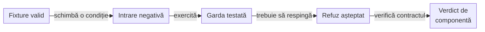

# Testele integrării și ale guvernanței

## Pe scurt

Modulul verifică integrarea binarelor comune, datele pentru publicare și contractele proiectului. [Strategia comună](../../../docs/testing/README.md) definește nivelurile; aici se aleg intrările și se interpretează limitele lor.

Legendă — responsabilitate și limita verificării

Un control negativ trecut demonstrează refuzul cerut al gărzii; nu transformă un eșec al aplicației în PASS. Martorul valid inițial, condiția schimbată, diagnosticul observat și aserțiunea rămân atribuibile aceluiași test. Publicarea și acceptanța raportului randat au verificări proprii.

## Colecții și responsabilități

[Catalogul](../../../config/atf-test-suites.json) declară intrările unitare și de integrare, plus responsabili primari distincți pentru componente. [Harta responsabililor componentelor](../../../docs/testing/ATF_Collections.md#responsabili-independenți-pentru-componentele-atf) separă structura sursei, documentația, proveniența, Android, GitHub, orchestrarea și raportarea; suitele focalizate declară părinții lor primari.

| Familie | Intrare și limită |
|---|---|
| Publicare Whist | [GameReportComponentSuite](java/atf/tests/reporting/GameReportComponentSuite.java) este selecție focalizată pentru politica și datele capturate pe JAR-ul fizic. |
| Guvernanță | [AtfQualityGovernanceSuite](java/atf/tests/governance/AtfQualityGovernanceSuite.java) citește codul, documentele și contractele binarelor; nu rulează Android. |
| Integritate release | [ReleaseIntegrityGovernanceTest](java/atf/tests/governance/documentation/release/ReleaseIntegrityGovernanceTest.java) verifică dosarul real; [probele mici](java/atf/tests/governance/documentation/release/integrity/) injectează defecte în fixture-uri temporare. |
| Igiena workspace-ului | [WorkspaceHygieneGovernanceTest](java/atf/tests/governance/source/workspace/WorkspaceHygieneGovernanceTest.java) detectează directoare temporare și fișiere generate în rădăcină, fără a șterge nimic. |

## Cum se aleg probele

- Politicile pure se verifică unitar, cu vecini valizi și invalizi.
- Componentele exercită fișiere, serializare, publicare ori ciclul JUnit real pe date controlate.
- Integrarea binară verifică suprafața fizică și exemplele ghidurilor; identitatea bibliotecii nu califică interacțiunea Android.

Dintr-o copie temporară proprie, [comenzile modulului](../../README.md#verificare-focalizată) aleg suitele. Lansatorul de guvernanță păstrează inventarul și refuză atribuirea rezultatului unor surse schimbate în paralel.

## Citirea rezultatului

Un eșec controlat califică refuzul validatorului, fără a deveni un eșec nou al aplicației. Raportul componentei publică datele evaluate; rezultatele unei execuții și notele auditului aparțin dosarului extern sau release-ului identificat, conform strategiei comune.

Ghidurile Markdown din directoarele de surse rămân intrări editoriale. Markdown din `src/<set>/resources`, `res` ori `assets` rămâne date de fixture și cere controalele testelor proprietare.

[Modulul de integrare](../../README.md) · [Strategia comună](../../../docs/testing/README.md) · [Guvernanță](../../../docs/governance/README.md)
