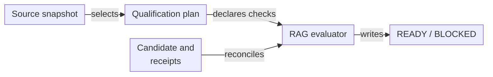

# Entry tools for publication

## Overview

These Node.js tools belong to the reporting consumer and to the delivery governance. They validate the identity of the captured records, select full claims and record the integrity of the fixed file without recalculating the outcome of the game.




<details>
<summary>Legend — ownership and verification boundary</summary>

The selector derives required checks from identified inputs; the evaluator reconciles the plan, source, candidate and collected evidence. It writes a decision for review, rather than executing a missing Android journey or granting publication authority. The commands below retain separate input and output locations.

</details>

## Contract and verification

[whist-report-input.mjs](whist-report-input.mjs) has the selection and inventory of the native population. [Its tests](whist-report-input.test.mjs) checks duplicate identities, contradictory sources, omissions and the preservation of declared failures.

From the root of the project:

```powershell
node --test atf-tests/tools/whist-report-input.test.mjs
```

The selected data remains the same objects evaluated in the declared order. [Presentation policy](../../docs/reporting/ATF_Presentation.md) and [publication audit](../../docs/reporting/ATF_Audit.md) define the subsequent stages.

## Registration of delivery integrity

[record-release-integrity.mjs](record-release-integrity.mjs) reads the active version of the index and records the size and SHA-256 for all its files without the self-referential manifest. Refuse symbolic paths and change of inventory or manifest during preparation; writing uses a temporary file and atomic replacement.

```powershell
node atf-tests/tools/record-release-integrity.mjs
```

`--project <root>` and `--version <version>` allow an explicit root and edition. The tool does not perform tests and does not promote qualification; [Java verifier](../src/test/java/atf/tests/governance/documentation/release/integrity/ReleaseIntegrity.java) checks bytes and JUnit outcomes separately. [Manifest components](../src/test/java/atf/tests/governance/documentation/release/integrity/ManifestIntegrityComponentTest.java) exercise the actual launcher on temporary files, including paths with spaces and diacritics.

## Candidate RAG evaluation

The [selector](plan-release-tests.mjs) compares the pinned inventory with the last relevant published source in the catalog. It generates the selection plan and required E2E groups before the build; the [evaluator](evaluate-release-rag.mjs) recomputes selection and reconciles the plan, manifest, payload and APK snapshot. [Selection command](../../docs/testing/ATF_ReleaseQualification.md#selection-of-diff-tests)

- [Scope suite](component-evidence-scope.mjs) determines when an execution can be reused. For Gradle collections, the documentation and entries exclusively of Maven or Android E2E do not invalidate the proof of the application; sources, compilation configuration, dependencies and unknown pathways require new selection. [Preparation of evidence](prepare-component-reuse.mjs) and the evaluator use the same checks for receipts and hashes. The component launcher uses this preparation when requested.
- The version policy sets out Maven and Gradle mandatory groups. Each group has its own Extent and Receipt.

```powershell
$ProjectRoot = (Get-Location).Path
node .\atf-tests\tools\evaluate-release-rag.mjs `
  --project-root $ProjectRoot `
  --candidate-dir $CandidateDir `
  --source-root $SourceSnapshotDir `
  --plan-file $QualificationPlan `
  --output $VerdictFile
```

The JSON verdict cites paths, SHA-256 and JSON Pointer/line. It embeds UTF-8 plan bytes as Base64 in `qualificationPlan.contentBase64`; the hash preserves plan identity for review without another temporary copy. The only write is `$VerdictFile`, outside all inputs.

- Code `0` means `READY_FOR_HUMAN_REVIEW`; `2` means `BLOCKED`; `1` indicates invalid entry or invocation.
- Human review requires hash-bound receipts for components, APK build, identity and signing.
- The published status also requires a download receipt in the declared access mode. For GitHub, the retention of the two editions, including tags and assets. [Collection command](../../docs/testing/ATF_ReleaseQualification.md#retention-on-github-after-publication)
- [Per-flow plan](prepare-android-e2e.mjs) and the evaluator use the same checks for HTML, PNG and receipts. [Import](apply-android-e2e.mjs) imports new evidence into the pinned candidate. [The contract of the launcher](../../docs/testing/ATF_ReleaseQualification.md#starting-and-resuming-a-game-on-the-signed-apk)
- Unexecuted E2E remains `NOT_RUN`; changing a user flow requires passing E2E Extent groups.

The evaluator reconciles the complete snapshot inventory with the manifest. Operator review checks the Git index, promotion tree and publication; the contract and oracles are in [release qualification](../../docs/testing/ATF_ReleaseQualification.md) and [evaluator's regression](../../docs/testing/ATF_ReleaseQualification.md#evaluator-regression-tests).

[Integration module](../README.md) · [AI lab](../../whist-lab-app/ai-lab/README.md)

## Measurement and reproduction

- [Chronology](assemble-release-timeline.mjs) combines process receipts and keeps the overlapping intervals. [Qualification procedure](../../docs/testing/ATF_ReleaseQualification.md#qualification-timeline)
- [Git verifier](verify-release-git-snapshot.mjs) compares inventory and bytes, including EOL, and checks the payload published prior to cleaning. [Retention contract](../../docs/platform/ATF_ReleaseRetention.md#local-cleaning-after-delivery)

- For a separate checkout, option `--local-release` synchronizes only the current edition after the check of the verdict, tag and payload in Git. [Synchronisation procedure](../../docs/platform/ATF_ReleaseRetention.md#synchronisation-of-local-file-with-current-version)
