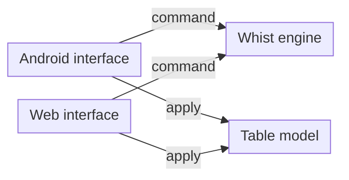
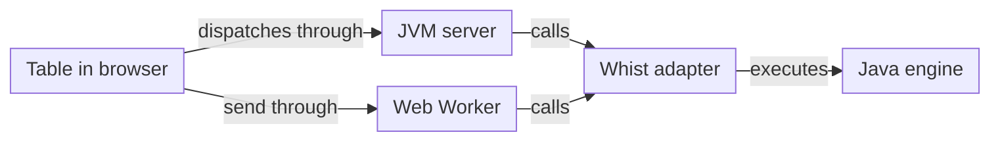
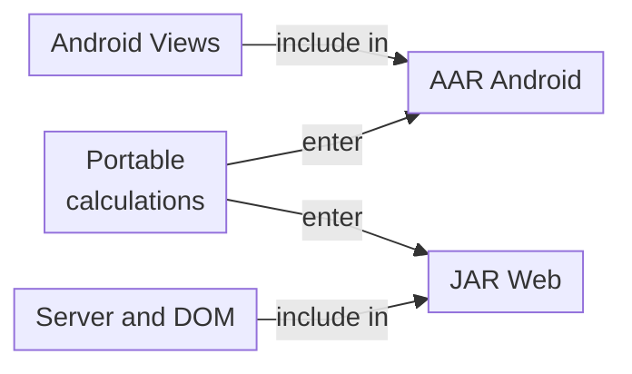
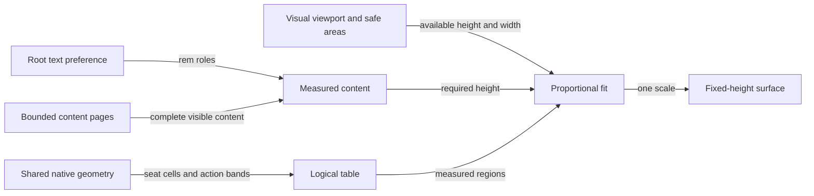
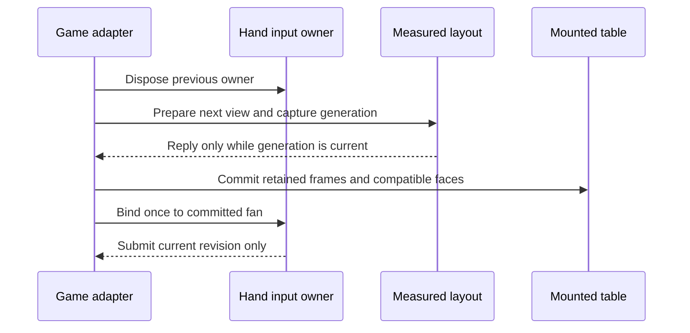
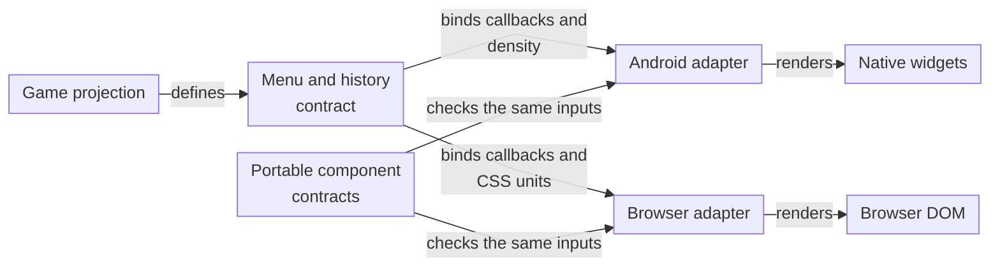

# Card Table Browser adapter

## Overview

Whist uses the Java engine and portable table contracts in both APK and browser. Web runs either via local JVM server or as a static site with the engine compiled via TeaVM. Rentz and Hold'em integrate fixed versions of the Web library through their own adapters.

**Quick links** · [Android–Web contract](#what-android-and-web-share) · [Run on the Web](#web-execution-paths) · [JAR and AAR](#adapter-library) · [Verification](#verification)

<a id="what-android-and-web-share"></a>

## What Android and Web share

| Shared presentation contract | Responsibility |
|---|---|
| Actor label | An optional consumer-owned `actorLabel` preserves the visible game action, including the human seat. Hidden headings are excluded before layout. |
| Seat text | `SeatTypography` supplies roles; measured text fits horizontally without changing row height. |
| Seat measurement | Fitted native-style names and facts keep one line, complete text and a stable intrinsic height across unknown, one-digit and two-digit values. Legacy multiline facts are scoped to unfitted direct children. Active-state colors do not change the footprint. |
| Score text | `ScoreTypography` supplies logical sizes to native sp and Web rem adapters; accessibility scaling applies once. |
| Frame identity | Prepared redraws keep the view, board, header, trump, compatible seat rows and deposited faces mounted. A delegated unchanged hand retains its fan, face nodes and scroll; incompatible tables and changed hands mount fresh content. |
| Input ownership | The adapter disposes the old hand owner before preparing a view and binds one owner to the committed fan. Disposed replies and lift completions cannot paint or submit a command; ordinary cancellation keeps the current listener usable. Fresh menu callbacks retain the open state. |
| Trick continuity | Native-style tables attach controls only for visible actions. Automatic-only and action-free states create no empty sibling or extra flex gap; real bidding controls and legacy prompts remain visible. |
| Component boundary | Checks execute the delivered constructor and adapters. Native raster and painted geometry have separate platform acceptance. |

The two interfaces share game rules and portable table calculations. Each adapter measures and draws with the tools of its platform.



<details>
<summary>Legend on rules, geometry and rendering</summary>

- The engine validates the bids and the cards, settles the score and sets the actor. Adapters publish visible table state and available player actions.
- The table model includes geometry, fan, card appearance and timing. Android applies it through Views, and Web through font measurements and DOM elements.
- Typography and system insets shall be measured separately. Samples with the same inputs check the formulae, and the APK-browser comparison on the device measures the rendered result. [Display components](../docs/testing/ATF_DisplayComponents.md)

</details>

<a id="web-execution-paths"></a>

## Web execution paths



<details>
<summary>Legend on the route of controls and local data</summary>

- JVM server runs the game in local process and serves Web resources. The server owns each match session and associates it with its browser tab.
- The static site loads the adapter and engine compiled into JavaScript. The messages to Web Worker remain on the device. Local transport keeps the profile and checkpoint through browser storage.
- The diagram follows a command; its response returns the revision, legal options and public state through the same transport. [Transport of the static edition](pages/web/local-transport.mjs)

</details>

| Layer | Responsibility |
|---|---|
| [The game contract](src/main/java/ro/cardtable/browser/BrowserGame.java) | Publishes seats, permitted cards, legal commands and scores. Each game engine owns validation. |
| [Server](src/main/java/ro/cardtable/browser/BrowserServer.java) | Serves same-origin resources, isolates matches by tab, validates revisions and rejects repeated commands. |
| [Geometry](src/main/java/ro/cardtable/browser/BrowserGeometry.java) | Apply the Java plan used in Android for seats and fans. Whist measures the usable viewport, applies a height-led proportional fit and retains native table geometry; existing consumers keep their legacy adapter. |
| [Adapter Whist](whist/src/main/java/ro/whistlab/browser/WhistBrowser.java) | Uses dealing, AI policies and engine settlement. Recommendations use the same human-player selection as Android. |

## Whist on GitHub Pages

The static edition distributes the Java engine compiled with TeaVM in a Web Worker. The table sends the same commands and reads the same public projection through local messages. After loading resources, bidding, AutoGame and settlement shall not make requests to an API.

| Contract shared with Android | Application in browser |
|---|---|
| [Header typography](../whist-lab-app/app/src/main/java/ro/whistlab/app/theme/GameHeaderTypography.java) and [palette](../whist-lab-app/atf-card-table-ui/src/main/java/ro/cardtable/ui/theme/TableColors.java) | The adapter transmits the text's roles and colors. The contract applies to the header, menu and table. |
| [Table reservation](../whist-lab-app/app/src/main/java/ro/whistlab/app/table/TableLayoutMetrics.java) | Measure the window and keep the same centre reserved for all hands of the variant. |
| [Bidding controls](../whist-lab-app/app/src/main/java/ro/whistlab/app/bidding/BidGridMetrics.java) | The bid value and confirmation retain a touch target of 48 logical units. Outlines are inset; column count and the dismissible row follow APK policy. |
| [Move pacing](../whist-lab-app/atf-card-table-ui/src/main/java/ro/cardtable/ui/turn/TurnPacing.java) | Each automatic card appears after the delay defined by APK. The adapter plays the actor, card and collection in order produced by the engine. |

[Table contract](../whist-lab-app/atf-card-table-ui/src/main/java/ro/cardtable/ui/table/TableGeometry.java) receives the measured dimensions and phase reservation. Android applies the rectangle in the ViewGroup, and the web applies it in the DOM.
[Collection curve](../whist-lab-app/atf-card-table-ui/src/main/java/ro/cardtable/ui/animation/TrickCollectionMotion.java) assesses progress on Android and provides web-based frames that the browser interpolates.

| Data | Retention in the static edition |
|---|---|
| Language | The Romanian or English option is saved in the browser. The menu, rules, table status and achievements use the texts of the APK. |
| Profiles, Achievements and Rankings | The browser saves the name, progress and leaderboards in the same local record as the game. The leaderboards use the top, the filter by configuration and the AI and Example markings in the APK. |
| Match | The menu allows for the resuming after reopening. The browser saves the checkpoint at each accepted command and uses the same validation as the APK. |
| Site data | Wiping the site storage or changing the browser starts a new profile. If storage is disabled, the session uses the memory of the tab. |

- [Checkpoint codec](../whist-lab-app/app/src/main/java/ro/whistlab/app/persistence/GameCheckpointCodec.java) restores distribution, tricks and history at the last accepted command. The identity of the match remains stable and prevents duplication of results. A damaged checkpoint can be removed independently of profile and progress.
- Web Locks serializes writes between supporting tabs. A tab with an outdated revision reloads the checkpoint before its next command. If the browser refuses writing, the game can continue in memory and display the storage error.
- The history displays all hands and total after each hand in column P. A red diagonal marks the missed bid. In column P, a box marks the streak bonus, and a red box marks the penalty.
- Settings use [Same default values as APK](../whist-lab-app/app/src/main/java/ro/whistlab/app/screens/MatchSetup.java). The change of language keeps the options on the screen, and the rules dialogue shows the schedule of the option for the selected number of players.
- In the game menu, the current score opens up the history when there are completed hands. At the last score, **Play again** retains the configuration and replaces the local game with a new deal and identifier.
- Player boxes display the name, bid and tricks won from the APK projection. The gold tag shows the playable cards. The total appears in score and history.
- [Hand adapter](src/main/java/ro/cardtable/browser/BrowserHandAdapter.java) sends gestures to the common model used in the APK. The refusal highlights the pressed card and legal options for 1,100 ms. When choosing a legal card, the play follows a 150 ms card lift. The adapter projects the same fan curve and layers as the APK.
- Whist card faces use the Android hand design. The rank and symbol in the corner, the central symbol and the inverted corner shall be proportionately scaled in the trick. Collection animates copies of the card faces away from the table. Accessible text includes the player and the card.
- Whist’s main menu uses the Android locale’s dedication and the same photo, copied from application resources during the build.
- [The contract of the trump box](../whist-lab-app/atf-card-table-ui/src/main/java/ro/cardtable/ui/table/trump/TrumpTileMetrics.java) provides the basic dimensions and typography. Android measures with native font, and Web with Canvas. [Shared text-fit cases](../whist-lab-app/app/src/test/resources/whist-trump-text-fit.tsv) checks both adapters.
- The collection shall apply the time-setting in the common module. The complete trick and the winner's current trick count are in the collection event. The hand is laid out again immediately after a card is played, and the stable table contains the cards in the current trick. Resize can remove the temporary drawing, and the next card retains its scheduled delay.
- AutoGame is activated for the current hand. Pending commands and open dialogs pause scheduling while preserving selection; completion resumes it only when both owners release the gate. Deselection cancels the next decision and committed moves finish. A rejected automated command stops without retries. Score and the main menu clear selection.

- The build requires PowerShell 7, JDK 21, Maven and the environment of generating the catalogue. `$WorkRoot` and `$EvidenceRoot` indicate external directories.
- The Node.js check verifies the public inventory and play through the compiled engine. For gestures and profile reopening, run [scenarios Playwright](#verification).

```powershell
$Site = .\atf-ui-browser\Build-WhistPages.ps1 -WorkRoot $WorkRoot
node .\atf-ui-browser\pages\verify.mjs $Site $EvidenceRoot
```

- For bidding changes, AutoGame, language or achievements, run `node .\atf-ui-browser\pages\verify-controls.mjs $Site $EvidenceRoot`. The sample uses the engine compiled and replaces the timer and the browser storage in controlled cases.
- Add `--ui-only` to geometry and rhythm of the moves. To include the visual path, cross the path to Chrome or Edge before option. `--browser-only` selects only the visual course and asks the executable.
- For score history and checkpoint compatibility, generate legal data with [WhistRecordsFixture](pages/WhistRecordsFixture.java) and run [checking Pages](pages/verify-records.mjs) with site directory, evidence file and JSON data file. The fixture compiles with the JVM launcher and `ScoredHandFixture` of the application tests.
- For language, settings, navigation and Play again, run `node .\atf-ui-browser\pages\verify-navigation.mjs $Site $EvidenceRoot`. The sample also produces a local checkpoint for visual check of resumption from the final score.
- For bookmarking, trick order and resize, run `node .\atf-ui-browser\pages\verify-effects.mjs $Site $EvidenceRoot`.
- For reaction to card pressing, lifting and trick face, run `node .\atf-ui-browser\pages\verify-card-adapter.mjs $Site $EvidenceRoot`. The JVM check and the UI module test consume the same [gestures scenario](../whist-lab-app/atf-card-table-ui/src/test/resources/hand-feedback.tsv).
- Use `--contract-only` to check only geometry on phases and curve samples from the compiled artifact. For this selection, omit the browser executable.

The workflow [.github/workflows/whist-pages.yml](https://github.com/crististefanita/whist/blob/main/.github/workflows/whist-pages.yml) builds and verifies the static site before deploying it from `main` through GitHub Actions. After deployment, open the public URL in an anonymous session and verify the assets and the start of a hand.

The artifacts of static distribution are on the publishing branch. The [TeaVM dependencies](pages/teavm-dependencies.xml) file serves the Pages building independently of the Maven ATF reactor.

## Running locally

Run the project command with PowerShell 7, JDK 21 and the environment Gradle Android configured for the catalog generation. `$WorkRoot` indicates the external directory for the build and profile data. Open the full terminal address in Edge or Chrome.

```powershell
.\atf-ui-browser\Start-WhistBrowser.ps1 -WorkRoot $WorkRoot
```

For a phone connected to the test network, `-ListenAddress $LocalLanAddress` selects the local address accessible. Open the full address in your phone browser.

## Data in the JVM server

| Date | Where to store |
|---|---|
| Name and identifier | On the device, for the same web origin as defined by protocol, host and port. In a new tab, Whist gets his profile back. The browser copy can remake the name if his file is missing from the server. |
| Achievements | In `$WorkRoot/whist-profile-data`, associated with the identifier and credited from the results confirmed by the engine. |
| Party | Independent on the tab. The same tab can resume the game by recharging while the server process is running. |

- Wiping the site data, changing the browser or changing the origin creates a new profile. In private mode, retention follows browser policy.
- Whist uses Android's task of generating the catalogue and dependence `org.json:json:20240205`. `-JsonLibrary` selects JAR from another directory, and `-CatalogSource` reuses the output generated from the same checkout.

## Adapter library

Whist builds Web and APK from sources. The library for other games is exported in two formats with own checks on each consumer.



<details>
<summary>Legend on the content of the packages</summary>

- [Android AAR](../whist-lab-app/atf-card-table-ui/README.md#packaging-and-consumption) contains the widgets, themes, resources and portable calculations selected by Gradle.
- [Web launcher](Start-CardTableBrowser.ps1) compiles an explicit selection of portable sources, including the contents of the seats, table cards, colors and the rhythm of the moves. The JAR includes the server, adaptor contract and DOM resources. Each game provides the engine and adapter.
- The Web test archive is exported separately. It checks resources, revisions, menus, card lift, collection and browser frames. Exported JARs have adjacent SHA-256 files.
- Whist site uses [alt build](Build-WhistPages.ps1), which produces static resources from the Whist adapter and engine. Pages test and JARs acceptance by Rentz or Hold'em have different inputs.

</details>

### Current qualified package: 0.5

The adjacent `browser-build.json` binds this release to its source commit, input inventory and artifact hashes.

- Runtime: [Card Table Browser 0.5](lib/atf-ui-browser-0.5.jar) · [SHA-256](lib/atf-ui-browser-0.5.jar.sha256)
- Shared tests: [Card Table Browser tests 0.5](lib/atf-ui-browser-0.5-tests.jar) · [SHA-256](lib/atf-ui-browser-0.5-tests.jar.sha256)
- Provenance: [browser-build.json](lib/browser-build.json)

The admitted package retains the legacy viewport API with a 414 × 896 logical desktop frame and bounded readability floor. Whist's current source uses the adaptive contract below; existing consumers retain their pin until a new export is qualified. Package identity never implies acceptance of a game's native renderer.

The source packaging plan exports pagination, mounted-board continuity, automation ownership, delayed layout and responsive-dialog components. For a matching export, extract resources and tests externally and set `ATF_BROWSER_WEB_ROOT` and `ATF_BROWSER_RUNTIME_JAR` before running Node. `ATF_COMPONENT_CAPTURE_DIR` collects comparisons and photographs; consumer engine and adapter checks remain separate.

## Adaptive Whist surface

The [viewport policy](src/main/web/viewport.mjs) and [DOM adapter](src/main/web/surface-fit.mjs) fit the whole presentation into usable height. Labels, frames, cards and commands keep coherent proportions. Android retains its native renderer; both adapters use the same logical table and card policies.

| Responsibility | Contract |
|---|---|
| Available space | Measure visual-viewport width, height, offsets and safe areas. Phones use their actual useful CSS dimensions as logical native units. Desktop uses the native-calibrated 393 × 626 reference, centered with one scale constrained by both window height and width. Content measurement can extend the required logical height before fitting. |
| Text roles | Native menu title, section, action, selection and helper roles map 25/13/16/14/14 sp to rem at a 16 px root. Dropdown options inherit their control's size. Root text enlargement is distinct from the subsequent scene fit; names, bids, tricks, cards and frames all share that fit. |
| Fixed-height surfaces | Bidding, play, menus and non-history dialogs fit without vertical page or panel scrolling. Short dialogs retain native content height and scene zoom; achievement catalogues and rankings use the available height. Ranking summaries reserve a 0.75 rem gap before their first dropdown. Measure content before fitting; hiding a scrollbar does not prove that content fits. |
| Long content | Rules, achievement groups and rankings use bounded pages; Previous/Next navigate and Close dismisses the reader. Original nodes, progress, IDs and handlers remain intact; forms retain all fields together. Score history alone retains internal vertical scrolling. |
| Table adaptation | The Java port receives logical measured regions and text scale. Measure intrinsic seat content independently of the previous assigned height; shared PlayerSeatMetrics retains the native heading reserve and frame expansion. Reserve the measured bidding/playing label band above every frame, including hidden labels, before positioning the cells. The actual logical height selects the native compact policy. |
| Stable phases | Keep the table footprint for the same match, viewport, language and text scale. Bid selection, fact values, hand size, player turns and collection must not resize the seat frames. Collection overlays and AutoGame toggles do not request a new fit. |
| Geometry ownership | Whist explicitly enables `usesMeasuredSeatFrames`; borrowing its visual theme does not select this policy. Other adapters retain raw seat geometry and own the reservation of their action-label band. |
| Intrinsic reservation | `minimumBoardHeight` exposes the native requirement independently of allocated `boardHeight`. The adapter combines it with measured non-board flow, prepares the hidden table at that height and commits one fit. Previously positioned absolute children cannot enlarge the next hand. |
| Policy viewport | The phone's useful CSS height, or the desktop native reference height, selects compact/short-window policy. Enlarging the logical scene for fitting cannot change that policy. JVM and static-page adapters use the same geometry projection. |
| Paging controls | Navigation inherits explicit surface colors, including disabled states. Compact outlines sit inside 48-unit touch regions and remain clear of the complete localized label. |
| Keyboard and lifecycle | Follow visual-viewport offsets when the keyboard pans the page. Observe root text changes; coalesce callbacks and disconnect observers when the adapter is disposed. |
| Compatibility | Whist opts into the fitted surface. Existing consumers and immutable exports retain their admitted adapter until a new runtime/test package is qualified. |



<details>
<summary>Legend — measured fit and independent native acceptance</summary>

- [Controlled components](tests/responsive-surface.test.mjs) exercise the production shell, localized menus, paging, profile form, text enlargement and a panned keyboard viewport. Negative inputs and collection/lifecycle isolation remain component boundaries.
- [Typography components](tests/score-typography.test.mjs) compare dropdown labels/options, score headings, values and dialog roles while preserving supplied cells and command bindings. [Lifecycle components](tests/surface-lifecycle.test.mjs) reject stale paging, observer and animation callbacks after disposal.
- [Paint continuity components](tests/seat-paint.test.mjs) preserve mounted views, boards, rows, hand faces and deposited cards through changed facts and actors. They reject identical-looking replacement rows, detect unmounts and redundant style writes, and check changed hands and legacy callbacks. Supplied rectangles isolate the DOM contract; native geometry and real-game sampling remain separate checks.
- [Intrinsic measurement components](tests/seat-measurements.test.mjs) execute the delivered CSS and fitter with unknown and 0–17 fact values, narrow/roomy widths, RO/EN and enlarged text. Preserve the native `FittedSeatLine` single-line boundary; a one-unit height mutation must fail the oracle.
- [Hand lifecycle components](tests/hand-lifecycle.test.mjs) control pending replies, completed lifts and disposal on a retained fan. A fresh owner receives one click; an abandoned owner cannot paint, submit or keep a listener. [Asset revision](tests/asset-revision.test.mjs) runs separately from native geometry so the entry point cannot load an obsolete hand adapter.
- [Automation ownership components](tests/automation-handoff.test.mjs) run the production command owner and gate with controlled transport and presentation. Cover selection while busy, deselection, overlapping dialogs, rejected commands and rapid toggles; a negative control rejects the former gate that ignored pending commands.
- [Layout delivery components](tests/layout-delivery.test.mjs) acquire ownership before awaiting fonts and execute production placement with delayed and reordered replies. Expired font continuations cannot measure, style or request layout; old replies and errors cannot overwrite newer geometry. Navigation and a new commit invalidate pending measurements.
- [Real-game verification](tests/responsive-game.mjs) uses the JVM engine across the game variants and retains the identical hand while changing viewport, language and text. It checks the reserved action band, phase-stable frames and access to the native horizontal hand fan.
- [Successive-hand verification](tests/match-continuity.mjs) follows the complete one-card prefix and subsequent two/three-card hands in Romanian Whist. Named four/five-seat profiles measure all frames, header/board/hand bounds and deposited-card slots through manual play, AutoGame and collection. Acknowledgement of achievement notices completes before advancing; timeout diagnostics retain the original scene and trace.
- Logical agreement and browser captures do not establish native font identity. The [remaining acceptance](../docs/feedback/ATF_UiBrowser.md#web-16-responsive-game-surface-and-menu-typography) compares an identified APK and Chrome on the same Android; iOS is outside this qualification.

</details>



<details>
<summary>Legend: retained display and replaceable command ownership</summary>

- Display identity and input ownership have separate lifecycles: stable nodes do not retain old command callbacks.
- `retainHand` is explicit because legacy cards may own direct listeners. A changed composition receives a fresh hand.
- Font and transport continuations validate the same generation before applying any geometry.

</details>

- The presentation scale is `min(usableHeight / requiredHeight, usableWidth / logicalWidth)`. Apply it once to the scene rather than enlarging individual labels independently. Modal text uses the same logical roles before its own single fit.
- On phones, CSS pixels are logical units; Android reference measurements first exclude system bars and divide physical pixels by density. Do not substitute screenshot pixels or browser device-pixel ratio for logical geometry.
- Whist bundles the regular and bold Roboto faces used by the Android reference so Windows does not substitute Segoe UI. Font completion requests a fresh geometry measurement; local JVM routes and Pages serve these assets. [Roboto notice](src/main/web/Roboto-NOTICE.txt) accompanies the fonts.

Pass the JVM classpath produced by `Start-WhistBrowser.ps1 -BuildOnly`, a new external evidence directory and optionally a Chromium executable to `tests/responsive-game.mjs`. Evidence records viewport, browser, language, text, bounds and game facts; the [publisher](tests/Publish-BrowserExtent.ps1) embeds captures in standard English Extent. Horizontal hand navigation preserves the APK contract for dense hands; it is distinct from vertical page scrolling.

### Packaging and portable adapters

```powershell
.\atf-ui-browser\Package-CardTableBrowser.ps1 -WorkRoot $WorkRoot -Version $BrowserLibraryVersion
```

- Choose `$BrowserLibraryVersion` and start out from a clean checkout Git. The packager writes both JARs, checksums and `browser-build.json` into the external version directory. The receipt binds those files to their source commit and input inventory.
- Check the commit and SHA-256 at adoption. The manifest installed near the two JARs shows which version each adapter uses.
- Packaging reuses an existing version only after comparing its inputs and bytes. Changed inputs require a new version. Consumer verification starts the first match through the packaged JARs, adapter and game dependencies.
- Promote the same bytes and same fingerprints in qualified consumers. The version of the HTML cache aims at updating the site's resources. [Consumer verification](#verification)

### Portable Web and APK adapter contracts

Whist uses the same native table policy through [WhistBoardAdapter](whist/src/main/java/ro/whistlab/browser/presentation/WhistBoardAdapter.java). The browser supplies measured CSS units and root text scale; Android supplies density and system text scale. A browser reference therefore compares logical regions rather than raw physical pixels.

| Component boundary | Checked contract |
|---|---|
| Table geometry | All modes, 3–6 seats, compact and wide widths, 1–17 cards and enlarged text; bidding and play retain identical seat anchors. |
| Unit adaptation | Normalize Android density to Web logical coordinates. The rounding bound accounts for repeated dimension conversions and integer placement in each renderer; unit-density coordinates must match exactly. Whist supplies logical regions before the height-led presentation fit; legacy desktop scaling remains in its own adapter. |
| Card presentation | All 52 rank/suit combinations retain visible marks, color role and proportional sizing through the actual hand adapters. |
| Interaction | The shared gesture fixture checks rejection, legal highlights, stale expiry and one accepted deposit; collection keyframes are compared through both adapters. |
| Acceptance limit | These components execute portable production code, not Android Views or browser font rasterization. Same-device visual acceptance remains separate. |

[Adapter components](tests/whist-surface-contract.test.mjs) compile only the portable dependency closure with the JDK, without Gradle, SDK or emulator. Their [JUnit owner](../atf-tests/src/test/java/atf/tests/governance/documentation/release/rag/nativeproof/WhistSurfaceAdapterComponentTest.java) captures actual observations in Extent. The default text scale remains unchanged; invalid scale inputs are rejected at the layout boundary.

## Verification

The table menu exposes score history directly in Whist and Rentz through the common menu adapter. Opening history pauses automatic scheduling; closing the dialog resumes the same table without replaying commands. Component checks cover localized labels, one callback per choice, outside-click dismissal and immutable menu plans.

- The Web adapter enlarges the 2–A ranks of regular cards by 50%. It centres indices in the same band, measured with `10`, and limits compact-face ranks to the available space. Card faces, suit symbols and the trump retain their reference dimensions.
- The width of the visible index sets the overlap in the fan, including `10` and 17 cards.
- The Web header retains the APK anchors for the title, progress and trump. Progress and bid summaries, the game menu, the main menu and settings use text enlarged by 50% on Web. The trump tile retains the natural height of its two rows and constrains text to the available width.
- In the Web, the button is the player's only visual prompt to manually bid.
- Touching the table outside the game menu closes the menu. Probe inside and outside targets separately, including after redrawing the table.
- After opponents move, the visible board retains its geometry until the next state is laid out. The component fixture delays measurement just before the player's turn returns. The trump tile retains its position and colours during manual play, AutoGame and collection.
- Player frames retain the same coordinates during bidding, play and collection. The component fixture compares every frame in one-card hands with five and six players, during manual play and AutoGame.
- [Turn continuity](tests/turn-continuity.mjs) samples actual manual and automatic tricks at five and six seats. Run it with a JVM classpath or published URL and a new external output directory; each profile has independent storage. It records frame/row identity, displacement, collection and deselection without claiming native pixel acceptance.
- The symbols of the cards use the same face ink in hand, on the table and when collecting. The theme provides the colors, and the Web adapter requires the rendering of symbols as text.
- In Whist Web, explicit bid-summary and selection roles preserve the approved 90% and 75% proportions respectively. The check at 360 and 414 px measures the Normal/Hard selector on the same row as its Romanian label.
- The viewport contract compares phone portrait/landscape, desktop height-limited and width-limited sizes, monotonic scale, narrow-window fallback, and invalid measurements. The browser check reads the actual frame after resize and confirms its centering and scale from the useful viewport.

Use `-BuildOnly` with the three launchers and pass the returned classpaths to the component suite. JVM processes serve the adapters on loopback; the suite sends HTTP requests and checks public state. `$EvidenceRoot` identifies an existing external directory dedicated to the run.

```powershell
node .\atf-ui-browser\tests\run-components.mjs $EvidenceRoot $WhistClasses $RentzClasses $HoldemClasses
java -cp $WhistClasses .\atf-ui-browser\tests\WhistParity.java > (Join-Path $EvidenceRoot 'whist-parity.json')
```

For UI checks, prepare the Pages edition in `$Site` and generate `hand-fixture.json` with `verify-card-adapter.mjs`. The run uses Playwright Java with headless Chromium, role locators and an isolated context for each scenario. [Playwright locators and expectations](https://playwright.dev/docs/locators)

`-BrowserExecutable` allows the choice of a Chrome or Edge installation. Compatible chromium should be available when the parameter is omitted.

```powershell
node .\atf-ui-browser\pages\verify-card-adapter.mjs $Site $AdapterEvidence
.\atf-ui-browser\tests\Run-BrowserUi.ps1 -Site $Site -HandFixture (Join-Path $AdapterEvidence 'hand-fixture.json') -EvidenceRoot $EvidenceRoot
.\atf-ui-browser\tests\Publish-BrowserExtent.ps1 -EvidenceRoot $EvidenceRoot -MavenClasspathFile $MavenClasspath
```

- `-Check viewport` checks the reference-frame contract of exported packages in Edge or Chrome. The current fitted Whist source uses `tests/responsive-surface.test.mjs` and `tests/responsive-game.mjs` for its viewport, menus and table.
- The browser check waits for page content and the resize event, then verifies the logical frame, CSS transform and centering.
- The shared JAR includes the independent Node component contract for phone, desktop, monotonic resize, invalid dimensions and overflow on both axes.

`$MavenClasspath` is the dependency list produced by the Maven [component gate](../docs/testing/README.md). The report links comparisons and inline images to the browser run. [Open parity criteria](../docs/feedback/ATF_UiBrowser.md)

| Test layer | Responsibility |
|---|---|
| Component | Check revisions, refusals, geometry, profile and settlement through HTTP contract or Pages engine with controlled storage and timing. |
| UI Web | Check the Chromium index `10` and access to the last card in a hand of 17 cards, including text at 200%. Check the keyboard bid, rejected touch, AutoGame and post-reload profile. Write `browser-ui-checks.json` and the captures in the running directory. |
| UI desktop | Check in Chrome and Edge with browser zoom 100% and 125%, frame at 1280 × 720, 1920 × 1080 and in a narrow window. Measure the useful viewport and frame position. Confirm visible focus and profile, bid and legal card path from the keyboard. |
| Comparison on Android | Compare APK and Chrome at the same viewport during bidding and play. Check header and trump positions in EN and RO, with card, symbol and no-trump presentations, including enlarged text. Record viewport, density and APK SHA in `paired-android.json`. |
| Reporting | Extent reads the results of each level and attaches the captures of PNG inline. |

The trump tile loads a local subset of Noto Sans Symbols 2 containing the four suit symbols. [OFL licence](src/main/web/card-suits-OFL.txt)

### Action-label clearance

| Contract | Responsibility |
|---|---|
| Measurement | The shell supplies `actorClearance` for the label above the seat frame. |
| DOM probe | An invisible node is measured in CSS units and removed immediately; scene scaling does not change the reservation. |
| Adapter | Match the native seat cell: add the phase-independent badge band to its measured height, then place the visible frame below that band. The center and other frames remain disjoint from the label. |
| Compatibility | Games that do not consume the parameter retain their existing geometry. |
| Components | Visible or hidden labels, different heights and probe removal. |

### Score text and shared playback checks

- `ScoreTypography` owns the logical score sizes. Android uses sp and the Whist Web adapter exports the same roles as rem at a 16 px root. The score does not inherit menu-role sizes; root text enlargement and the coherent surface fit each apply once. Legacy consumers retain their own viewport policy.
- A focusable scroll region with intrinsic column minima keeps enlarged score columns accessible in narrow windows. Native score sizes and game scoring are preserved.

- The shared tests execute the real Web constructor and collection code with a controlled DOM and clock. Actor cues precede cards; measured faces retain their origins, dimensions and destination until collection finishes.
- Premature clearing is a negative control. Game-specific trick winners, awards and sequence rules remain in each consumer's tests.

- `shared-presentation.test.mjs` is shipped in the test JAR. Set `ATF_BROWSER_WEB_ROOT` to the extracted runtime's Web resources, `ATF_BROWSER_RUNTIME_JAR` to the delivered runtime JAR and `ATF_BROWSER_EXECUTABLE` to Edge or Chrome, then run `node --test shared-presentation.test.mjs`. Browser profiles use the external temporary root; audio is muted. Typography checks use controlled game content and the production DOM/CSS, rather than an Android raster.
- Browser teardown requests a graceful exit and waits for the owned process. Profile cleanup is asynchronous with bounded retries so Windows handle release can finish before directory removal.

## Result action typography

Score actions have dedicated shared roles: primary actions use 24 logical units and secondary actions use 21, a 50% increase over the legacy 16/14 roles. Android consumes sp and Web consumes rem; user accessibility scaling applies once.

- The native adapter uses `ScreenViews.scoreActionButton` or `addScoreAction`. Wrapped labels use content height with a minimum 48-unit touch target; fixed-height quiet controls remain separate.
- The Web adapter uses the same exported `ScoreTypography` tokens. Whist fits the complete score page into usable height, including enlarged localized actions. Only score history retains internal vertical scrolling.
- Numeric columns, history cells, card ranks, generic dialogs and other menus keep their own roles. Game adapters own localized captions, confirmed values and callbacks.
- Consumer tests execute the delivered renderer and compare the actual AAR/JAR roles. Cover RO/EN, short windows, enlarged text, reachable actions, unchanged callback order and rejection of stale or double-scaled styles.

## Shared menu and history adapters

| Contract | Android adapter | Browser adapter |
|---|---|---|
| Localized menu plan | Bind immutable TableMenuContent entries to lifecycle-owned callbacks. | Bind the same entry IDs, labels and order through menuFromEntries. |
| History appearance | Pass HistoryAppearance to the shared ScoreHistoryView. | Apply its exported CSS tokens to the shared history renderer. |
| Visibility | The game defines confirmed-result availability; the platform hides Stop when automation is off. | The same availability applies without inventing unsupported in-game routes. |

The regular history profile removes bold headings and uses two logical units with the Whist divider color. Existing callers retain the legacy native constructor and the unchanged default Web appearance. Appearance is per table; clearing it restores defaults without changing unrelated styles.

New shared UI coordinates use two-part 0.x versions. Existing three-part coordinates may only be reused after their input manifest and artifact hashes are verified; changed bytes require a new coordinate. Runtime, portable tests and checksums are delivered together.

### Shared contract, separate platform adapters



<details>
<summary>Legend: shared intent and platform rendering</summary>

- Games supply localized entries, availability and confirmed history values; the shared library owns immutable presentation policies.
- Adapters own navigation and lifecycle callbacks. Android density and browser CSS units normalize to logical dimensions.
- Component contracts verify models, ordering, styles and callback isolation. Native raster, keyboard and gesture acceptance remains separate from DOM measurements.

</details>
