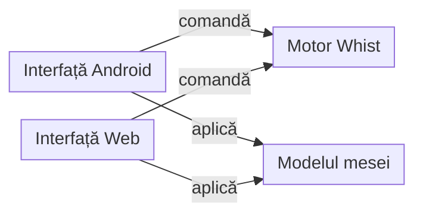
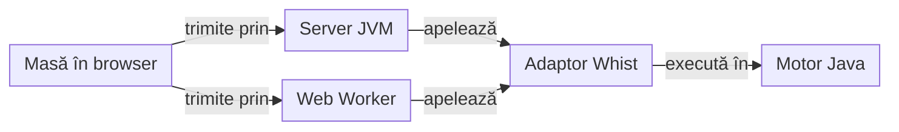
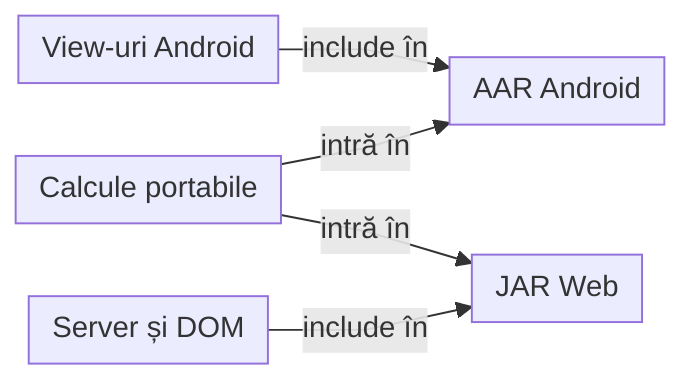
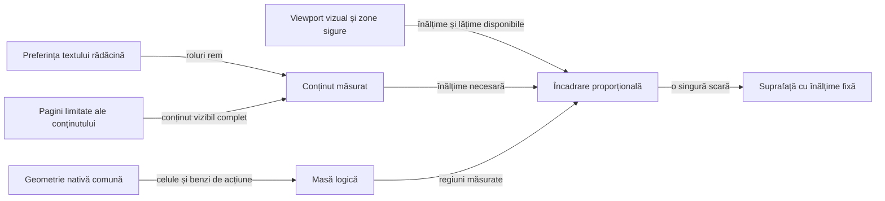
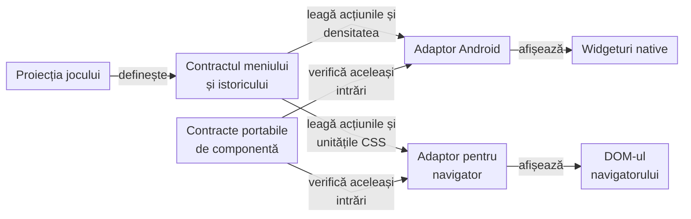

# Adaptor browser Card Table

## Pe scurt

Whist folosește motorul Java și contractele portabile ale mesei atât în APK, cât și în browser. Web rulează fie prin serverul JVM local, fie ca site static cu motorul compilat prin TeaVM. Rentz și Hold’em integrează versiuni fixate ale bibliotecii Web prin adaptoare proprii.

**Trasee rapide** · [Contract Android–Web](#ce-folosesc-împreună-android-și-web) · [Rulare Web](#traseele-de-execuție-web) · [JAR și AAR](#bibliotecă-pentru-adaptoare) · [Verificare](#verificare)

<a id="what-android-and-web-share"></a>

## Ce folosesc împreună Android și Web

| Contract comun de prezentare | Responsabilitate |
|---|---|
| Eticheta actorului | Un `actorLabel` opțional, furnizat de consumator, păstrează acțiunea vizibilă a jocului, inclusiv la locul uman. Antetele ascunse sunt excluse înainte de layout. |
| Textul locului | `SeatTypography` furnizează rolurile; textul măsurat se încadrează orizontal fără schimbarea înălțimii rândului. |
| Textul scorului | `ScoreTypography` transmite dimensiuni logice adaptoarelor sp native și rem Web; mărirea accesibilă se aplică o singură dată. |
| Identitatea chenarului | Reafișările pregătite păstrează chenarele, rândurile, textul încadrat și nodurile numerice compatibile. Se scriu numai atributele sau textele schimbate; structurile incompatibile primesc conținut nou. |
| Continuitatea levatei | Mesele native atașează controale doar pentru acțiuni vizibile. Stările fără acțiuni sau doar automate nu creează vecini goi ori spațiu flex suplimentar; licitarea reală și mesajele vechi rămân vizibile. |
| Limita componentelor | Probele execută constructorul și adaptoarele livrate. Rasterul nativ și geometria pictată au acceptanță separată pe platformă. |

Cele două interfețe împart regulile jocului și calculele portabile ale mesei. Fiecare adaptor măsoară și desenează cu instrumentele platformei sale.



<details>
<summary>Legendă privind regulile, geometria și randarea</summary>

- Motorul validează licitațiile și cărțile, decontează scorul și stabilește actorul. Adaptoarele publică starea vizibilă a mesei și opțiunile jucătorului.
- Modelul mesei cuprinde geometria, evantaiul, aspectul cărților și temporizarea. Android îl aplică prin View-uri, iar Web prin măsurători ale fonturilor și elemente DOM.
- Tipografia și zonele de sistem se măsoară separat. Probele cu aceleași intrări verifică formulele, iar comparația APK–browser pe dispozitiv măsoară rezultatul randat. [Componentele de afișare](../docs/testing/ATF_DisplayComponents.md)

</details>

<a id="web-execution-paths"></a>

## Traseele de execuție Web



<details>
<summary>Legendă privind traseul comenzilor și datele locale</summary>

- Serverul JVM rulează jocul în procesul local și servește resursele Web. Sesiunea partidei aparține serverului și rămâne asociată filei.
- Site-ul static încarcă adaptorul și motorul transpuse în JavaScript. Mesajele către Web Worker rămân pe dispozitiv. Transportul local păstrează profilul și checkpointul prin stocarea browserului.
- Diagrama urmărește comanda. Răspunsul întoarce revizia, opțiunile legale și starea publică pe același traseu. [Transportul ediției statice](pages/web/local-transport.mjs)

</details>

| Strat | Responsabilitate |
|---|---|
| [Contractul jocului](src/main/java/ro/cardtable/browser/BrowserGame.java) | Publică locurile, cărțile permise, comenzile legale și punctajele. Validarea rămâne în motorul fiecărui joc. |
| [Serverul](src/main/java/ro/cardtable/browser/BrowserServer.java) | Servește resursele din aceeași origine. Izolează partidele pe filă, validează reviziile și respinge comenzile repetate. |
| [Geometria](src/main/java/ro/cardtable/browser/BrowserGeometry.java) | Aplică planul Java folosit în Android pentru locuri și evantai. Whist măsoară viewport-ul util, aplică încadrarea proporțională după înălțime și păstrează geometria nativă; consumatorii existenți își păstrează adaptorul anterior. |
| [Adaptorul Whist](whist/src/main/java/ro/whistlab/browser/WhistBrowser.java) | Folosește distribuirea, politicile AI și decontarea din motor. Recomandarea vine din aceeași selecție umană ca pe Android. |

## Whist pe GitHub Pages

Ediția statică distribuie motorul Java compilat cu TeaVM într-un Web Worker. Masa trimite aceleași comenzi și citește aceeași proiecție publică prin mesaje locale. După încărcarea resurselor, licitarea, AutoGame și decontarea nu fac cereri către un API.

| Contract preluat din Android | Aplicare în browser |
|---|---|
| [Tipografia antetului](../whist-lab-app/app/src/main/java/ro/whistlab/app/theme/GameHeaderTypography.java) și [paleta](../whist-lab-app/atf-card-table-ui/src/main/java/ro/cardtable/ui/theme/TableColors.java) | Adaptorul transmite rolurile textului și culorile. DOM-ul le aplică antetului, meniului și mesei. |
| [Rezervarea mesei](../whist-lab-app/app/src/main/java/ro/whistlab/app/table/TableLayoutMetrics.java) | Măsoară fereastra și păstrează același centru rezervat pentru toate mâinile variantei. |
| [Controalele de licitare](../whist-lab-app/app/src/main/java/ro/whistlab/app/bidding/BidGridMetrics.java) | Cifra și confirmarea păstrează ținta tactilă de 48 de unități logice. Conturul este retras în interior, iar numărul de coloane și rândul derulabil vin din politica APK. |
| [Ritmul mutărilor](../whist-lab-app/atf-card-table-ui/src/main/java/ro/cardtable/ui/turn/TurnPacing.java) | Fiecare carte automată apare după întârzierea definită de APK. Adaptorul redă actorul, cartea și colectarea în ordinea produsă de motor. |

[Contractul mesei](../whist-lab-app/atf-card-table-ui/src/main/java/ro/cardtable/ui/table/TableGeometry.java) primește dimensiunile măsurate și rezervarea fazei. Android aplică dreptunghiurile în ViewGroup, iar web le aplică în DOM.
[Curba de colectare](../whist-lab-app/atf-card-table-ui/src/main/java/ro/cardtable/ui/animation/TrickCollectionMotion.java) evaluează progresul pe Android și furnizează în web cadrele pe care browserul le interpolează.

| Date | Retenție în ediția statică |
|---|---|
| Limba | Opțiunea Română sau English se salvează în browser. Meniul, regulile, starea mesei și realizările folosesc textele din APK. |
| Profil, Realizări și clasamente | Browserul salvează numele, progresul și clasamentele în aceeași înregistrare locală cu partida. Clasamentele folosesc topul, filtrul după configurație și marcajele AI și Exemplu din APK. |
| Partidă | Meniul permite reluarea după redeschidere. Browserul salvează checkpointul la fiecare comandă acceptată și folosește aceeași validare ca APK-ul. |
| Datele site-ului | Ștergerea stocării site-ului sau schimbarea browserului pornește un profil nou. Dacă stocarea este dezactivată, sesiunea folosește memoria filei. |

- [Codec-ul checkpointului](../whist-lab-app/app/src/main/java/ro/whistlab/app/persistence/GameCheckpointCodec.java) reface distribuirea, levatele și istoricul la ultima comandă acceptată. Identitatea partidei rămâne stabilă și împiedică duplicarea rezultatelor. Un checkpoint deteriorat poate fi eliminat independent de profil și progres.
- Web Locks serializează scrierile între filele compatibile. O filă cu o revizie depășită recitește checkpointul înainte de următoarea comandă. Dacă browserul refuză scrierea, partida poate continua în memorie și afișează eroarea de stocare.
- Istoricul afișează toate mâinile și totalul după fiecare mână în coloana P. O diagonală roșie marchează licitația ratată. În coloana P, un chenar marchează bonusul de serie, iar un chenar roșu marchează penalizarea.
- Setările folosesc [aceleași valori implicite ca APK-ul](../whist-lab-app/app/src/main/java/ro/whistlab/app/screens/MatchSetup.java). Schimbarea limbii păstrează opțiunile de pe ecran, iar dialogul de reguli arată programul variantei pentru numărul selectat de jucători.
- În meniul jocului, scorul curent deschide istoricul când există mâini încheiate. La ultimul scor, **Joacă din nou** păstrează configurația și înlocuiește partida locală cu o distribuire și un identificator noi.
- Chenarele mesei preiau numele, licitația și levatele din proiecția APK. Marcajul auriu arată cărțile jucabile. Totalul apare în scor și istoric.
- [Adaptorul mâinii](src/main/java/ro/cardtable/browser/BrowserHandAdapter.java) trimite gesturile la modelul comun folosit în APK. Refuzul evidențiază cartea apăsată și opțiunile legale timp de 1.100 ms. La alegerea unei cărți legale, depunerea urmează ridicării de 150 ms. API-ul proiectează aceeași curbă și aceleași straturi ale evantaiului ca în APK.
- Fața Whist preia reperul din mâna Android. Rangul și simbolul din colț, simbolul central și colțul inversat se scalează proporțional în levată. Colectarea copiază fața de pe masă. Textul accesibil include jucătorul și cartea.
- Meniul principal Whist preia dedicația din localizarea folosită pe Android. Site-ul folosește aceeași fotografie, copiată la build din resursele aplicației.
- [Contractul chenarului de atu](../whist-lab-app/atf-card-table-ui/src/main/java/ro/cardtable/ui/table/trump/TrumpTileMetrics.java) furnizează dimensiunile și tipografia de bază. Android măsoară cu fontul nativ, iar Web cu Canvas. [Aceleași cazuri de încadrare](../whist-lab-app/app/src/test/resources/whist-trump-text-fit.tsv) verifică ambele adaptoare.
- Colectarea aplică temporizarea din modulul comun. Levata completă și numărătoarea actualizată a câștigătorului sunt în evenimentul de colectare. Mâna se recentrează imediat după depunere, iar masa stabilă conține cărțile din levata curentă. Redimensionarea poate înlătura desenul temporar, iar următoarea carte respectă intervalul deja programat.
- AutoGame se activează pentru mâna curentă. Debifarea anulează următoarea decizie în locul jucătorului. Mutările acceptate se încheie, iar meniurile și dialogurile suspendă următoarea decizie cât timp sunt deschise. Scorul sau revenirea la meniul principal sting bifa.

- Buildul cere PowerShell 7, JDK 21, Maven și mediul de generare a catalogului. `$WorkRoot` și `$EvidenceRoot` indică directoare externe.
- Proba Node.js verifică inventarul public și joacă prin motorul compilat. Pentru gesturi și redeschiderea profilului, rulați [scenariile Playwright](#verificare).

```powershell
$Site = .\atf-ui-browser\Build-WhistPages.ps1 -WorkRoot $WorkRoot
node .\atf-ui-browser\pages\verify.mjs $Site $EvidenceRoot
```

- Pentru modificările de licitare, AutoGame, limbă sau realizări, rulați `node .\atf-ui-browser\pages\verify-controls.mjs $Site $EvidenceRoot`. Proba folosește motorul compilat și înlocuiește temporizatoarele și stocarea browserului în cazurile controlate.
- Adăugați `--ui-only` pentru geometrie și ritmul mutărilor. Pentru a include parcursul vizual, treceți calea către Chrome sau Edge înainte de opțiune. `--browser-only` selectează doar parcursul vizual și cere executabilul.
- Pentru istoricul scorului și compatibilitatea checkpointului, generați datele legale cu [WhistRecordsFixture](pages/WhistRecordsFixture.java) și rulați [verificarea Pages](pages/verify-records.mjs) cu directorul site, dosarul de dovezi și fișierul JSON al datelor. Fixture-ul compilează cu classpath-ul lansatorului JVM și `ScoredHandFixture` din testele aplicației.
- Pentru limbă, setări, navigare și Joacă din nou, rulați `node .\atf-ui-browser\pages\verify-navigation.mjs $Site $EvidenceRoot`. Proba produce și un checkpoint local pentru verificarea vizuală a reluării de la scorul final.
- Pentru marcajul cărților, ordinea levatelor și redimensionare, rulați `node .\atf-ui-browser\pages\verify-effects.mjs $Site $EvidenceRoot`.
- Pentru reacția la apăsarea cărții, ridicare și fața din levată, rulați `node .\atf-ui-browser\pages\verify-card-adapter.mjs $Site $EvidenceRoot`. Proba și testul JVM al modulului UI consumă același [scenariu de gesturi](../whist-lab-app/atf-card-table-ui/src/test/resources/hand-feedback.tsv).
- Folosiți `--contract-only` pentru a verifica doar geometria pe faze și mostrele curbei din artefactul compilat. Pentru această selecție, omiteți executabilul browserului.

Workflow-ul [.github/workflows/whist-pages.yml](https://github.com/crististefanita/whist/blob/main/.github/workflows/whist-pages.yml) construiește și verifică site-ul static înainte de publicarea din `main` prin GitHub Actions. După publicare, deschideți URL-ul public într-o sesiune anonimă și verificați resursele și pornirea unei mâini.

Artefactele distribuției statice se află pe ramura de publicare. Fișierul [dependențelor TeaVM](pages/teavm-dependencies.xml) servește buildului Pages independent de reactorul Maven ATF.

## Pornire locală

Rulați comanda din proiect cu PowerShell 7, JDK 21 și mediul Gradle Android configurat pentru generarea catalogului. `$WorkRoot` indică directorul extern pentru build și datele profilului. Deschideți adresa completă din terminal în Edge sau Chrome.

```powershell
.\atf-ui-browser\Start-WhistBrowser.ps1 -WorkRoot $WorkRoot
```

Pentru un telefon conectat la rețeaua de test, `-ListenAddress $LocalLanAddress` selectează adresa locală accesibilă. Deschideți adresa completă în browserul telefonului.

## Datele în rularea cu server JVM

| Date | Unde se păstrează |
|---|---|
| Nume și identificator | Pe dispozitiv, pentru aceeași origine web, definită prin protocol, gazdă și port. Într-o filă nouă, Whist recuperează profilul. Copia browserului poate reface numele dacă fișierul său lipsește de pe server. |
| Realizări | În `$WorkRoot/whist-profile-data`, asociate identificatorului și creditate din rezultatele confirmate de motor. |
| Partidă | Independentă pe filă. Aceeași filă poate relua partida prin reîncărcare cât timp rulează procesul serverului. |

- Ștergerea datelor site-ului, schimbarea browserului sau schimbarea originii creează un profil nou. În modul privat, retenția urmează politica browserului.
- Whist folosește sarcina Android de generare a catalogului și dependența `org.json:json:20240205`. `-JsonLibrary` selectează JAR-ul din alt director, iar `-CatalogSource` refolosește ieșirea generată din același checkout.

## Bibliotecă pentru adaptoare

Whist construiește Web și APK din surse. Biblioteca pentru celelalte jocuri se exportă în două formate, cu verificări proprii la fiecare consumator.



<details>
<summary>Legendă privind conținutul pachetelor</summary>

- [AAR-ul Android](../whist-lab-app/atf-card-table-ui/README.md#împachetare-și-consum) conține widgeturi, teme, resurse și calculele portabile selectate de Gradle.
- [Lansatorul Web](Start-CardTableBrowser.ps1) compilează o selecție explicită de surse portabile, inclusiv conținutul locurilor, cărțile de pe masă, culorile și ritmul mutărilor. JAR-ul include serverul, contractul adaptorului și resursele DOM. Fiecare joc furnizează motorul și adaptorul.
- Arhiva de teste Web se exportă separat. Probează resursele, reviziile, meniul, ridicarea, colectarea, încadrarea atuului și chenarele în browser. JAR-urile exportate au fișiere SHA-256 alăturate.
- Site-ul Whist folosește [alt build](Build-WhistPages.ps1), care produce resurse statice din adaptorul și motorul Whist. Proba Pages și acceptanța JAR-ului de către Rentz sau Hold’em au intrări diferite.

</details>

### Pachetul calificat curent: 0.5

Fișierul alăturat `browser-build.json` leagă această versiune de commitul sursă, inventarul intrărilor și hash-urile artefactelor.

- Runtime: [Card Table Browser 0.5](lib/atf-ui-browser-0.5.jar) · [SHA-256](lib/atf-ui-browser-0.5.jar.sha256)
- Teste comune: [Testele Card Table Browser 0.5](lib/atf-ui-browser-0.5-tests.jar) · [SHA-256](lib/atf-ui-browser-0.5-tests.jar.sha256)
- Proveniență: [browser-build.json](lib/browser-build.json)

Contractul publicat anterior păstrează pe desktop cadrul logic de 414 × 896, îl scalează uniform după înălțimea și lățimea utilă și menține pragul de lizibilitate 0,68 numai când încap ambele dimensiuni. Sursa Whist curentă adoptă suprafața adaptivă de mai jos; pachetul publicat imuabil și consumatorii existenți își păstrează contractul admis până la calificarea unui pachet nou. Consumatorii adoptă arhivele de execuție și teste din același receipt și le verifică octeții.

## Suprafața Whist adaptivă

[Politica viewport-ului](src/main/web/viewport.mjs) și [adaptorul DOM](src/main/web/surface-fit.mjs) încadrează întreaga prezentare în înălțimea utilă. Etichetele, chenarele, cărțile și comenzile păstrează proporții coerente. Android își păstrează randarea nativă; ambele adaptoare folosesc aceleași politici logice ale mesei și cărților.

| Responsabilitate | Contract |
|---|---|
| Spațiul disponibil | Măsoară lățimea, înălțimea, deplasările și zonele sigure ale viewport-ului vizual. Telefoanele folosesc dimensiunile CSS utile reale ca unități logice native. Desktopul folosește referința 393 × 626 calibrată după APK, centrată cu o singură scară limitată de înălțimea și lățimea ferestrei. Măsurarea conținutului poate extinde înălțimea logică necesară înaintea încadrării. |
| Rolurile textului | Rolurile native pentru titlu, secțiune, acțiune, selecție și text ajutător transpun 25/13/16/14/14 sp în rem la o rădăcină de 16 px. Opțiunile listelor moștenesc dimensiunea controlului. Mărirea textului rădăcină este distinctă de încadrarea ulterioară a scenei; numele, licitațiile, levatele, cărțile și chenarele împart această încadrare. |
| Suprafețe cu înălțime fixă | Licitarea, jocul, meniurile și dialogurile fără istoric încap fără derulare verticală a paginii sau panoului. Dialogurile scurte păstrează înălțimea nativă a conținutului și mărirea scenei; catalogul realizărilor umple cadrul. Măsoară conținutul înaintea încadrării; ascunderea barei de derulare nu dovedește încadrarea. |
| Conținut lung | Regulile, grupele de realizări și clasamentele folosesc pagini limitate cu navigare vizibilă. Nodurile originale, progresul, ID-urile și acțiunile rămân intacte; formularele păstrează împreună toate câmpurile. Numai istoricul scorului păstrează derularea verticală internă. |
| Adaptarea mesei | Portul Java primește regiunile logice măsurate și scara textului. Măsoară conținutul intrinsec al chenarelor independent de înălțimea atribuită anterior; PlayerSeatMetrics comun păstrează rezerva nativă a titlului și extinderea chenarului. Rezervă banda măsurată a etichetelor de licitare/joc deasupra fiecărui chenar, inclusiv a celor ascunse, înaintea poziționării celulelor. Înălțimea logică reală selectează politica nativă compactă. |
| Faze stabile | Păstrează înălțimea necesară a mesei pentru aceeași mână, același viewport și aceeași scară de text. Selecția licitației, turele și colectarea nu trebuie să redimensioneze chenarele. Suprapunerile colectării și bifarea AutoGame nu solicită o nouă încadrare. |
| Comenzile paginării | Navigarea moștenește culori explicite ale suprafeței, inclusiv în starea inactivă. Contururile compacte stau în interiorul zonelor de apăsare de 48 de unități și înconjoară integral eticheta localizată. |
| Tastatură și ciclu de viață | Urmărește deplasările viewport-ului vizual când tastatura deplasează pagina. Observă schimbările textului rădăcină; grupează callback-urile și deconectează observatorii la eliberarea adaptorului. |
| Compatibilitate | Whist adoptă suprafața încadrată. Consumatorii existenți și exporturile imuabile păstrează adaptorul admis până la calificarea unui pachet nou de execuție/teste. |



<details>
<summary>Legendă — încadrare măsurată și acceptanță nativă independentă</summary>

- [Componentele controlate](tests/responsive-surface.test.mjs) exercită învelișul de producție, meniurile localizate, paginarea, formularul profilului, textul mărit și un viewport deplasat de tastatură. Intrările negative și izolarea colectării/ciclului de viață rămân granițe de componentă.
- [Componentele tipografice](tests/score-typography.test.mjs) compară etichetele/opțiunile listelor, antetele scorului, valorile și rolurile dialogurilor, păstrând celulele furnizate și legăturile comenzilor. [Componentele ciclului de viață](tests/surface-lifecycle.test.mjs) resping callback-urile vechi de paginare, observare și animație după eliberare.
- [Componentele continuității desenării](tests/seat-paint.test.mjs) păstrează identitatea rândurilor și textului la schimbarea valorilor și actorilor, resping înlocuirea rândurilor identice și detectează rescrierea inutilă a stilurilor chenarelor. Dreptunghiurile furnizate izolează contractul DOM; geometria nativă și probele cu joc real rămân verificări separate.
- [Verificarea jocului real](tests/responsive-game.mjs) folosește motorul JVM pentru variantele de joc și păstrează aceeași mână la schimbarea viewport-ului, limbii și textului. Verifică banda rezervată acțiunii, chenarele stabile între faze și accesul la evantai prin navigarea orizontală nativă.
- Concordanța logică și capturile browserului nu stabilesc identitatea fonturilor native. [Acceptanța rămasă](../docs/feedback/ATF_UiBrowser.md#web-16-suprafața-de-joc-responsivă-și-tipografia-meniurilor) compară un APK identificat și Chrome pe același Android; iOS este în afara acestei calificări.

</details>

- Scara prezentării este `min(usableHeight / requiredHeight, usableWidth / logicalWidth)`. Aplic-o o singură dată scenei, fără mărirea independentă a etichetelor. Textul modal folosește aceleași roluri logice înaintea propriei încadrări unice.
- Pe telefon, pixelii CSS sunt unități logice; măsurătorile Android de referință exclud întâi barele sistemului și împart pixelii fizici la densitate. Nu înlocui geometria logică prin pixelii capturii sau raportul pixelilor dispozitivului.
- Whist include fețele Roboto obișnuită și îngroșată folosite de Androidul de referință, astfel încât Windows să nu substituie Segoe UI. Terminarea încărcării fonturilor solicită o măsurare nouă a geometriei; rutele JVM locale și Pages servesc aceste resurse. [Notificarea Roboto](src/main/web/Roboto-NOTICE.txt) însoțește fonturile.

Transmite classpath-ul JVM produs de `Start-WhistBrowser.ps1 -BuildOnly`, un dosar nou extern de dovezi și, opțional, un executabil Chromium către `tests/responsive-game.mjs`. Dovezile consemnează viewport-ul, browserul, limba, textul, limitele și faptele jocului; [publicatorul](tests/Publish-BrowserExtent.ps1) include capturile în Extent standard în engleză. Navigarea orizontală a mâinii păstrează contractul APK pentru mâini dense; este distinctă de derularea verticală a paginii.

### Împachetare și adaptoare portabile

```powershell
.\atf-ui-browser\Package-CardTableBrowser.ps1 -WorkRoot $WorkRoot -Version $BrowserLibraryVersion
```

- Alegeți `$BrowserLibraryVersion` și porniți dintr-un checkout Git curat. Exportul scrie cele două JAR-uri, amprentele și `browser-build.json` în directorul extern al versiunii. Registrul leagă fișierele de commitul sursă și de inventarul intrărilor.
- Verificați commitul și SHA-256 la adoptare. Manifestul instalat lângă cele două JAR-uri arată ce versiune folosește fiecare adaptor.
- Exportul reutilizează directorul aceleiași versiuni după confruntarea intrărilor și a octeților. Schimbarea intrărilor cere o versiune nouă. Proba de integrare pornește prima partidă prin JAR-ul fizic, adaptor și dependențele jocului.
- Promovați aceiași octeți și aceleași amprente în consumatorii calificați. Versiunea cache-ului din HTML urmărește actualizarea resurselor site-ului. [Verificarea în consumatori](#verificare)

### Contractele portabile ale adaptoarelor Web și APK

Whist folosește aceeași politică nativă a mesei prin [WhistBoardAdapter](whist/src/main/java/ro/whistlab/browser/presentation/WhistBoardAdapter.java). Browserul furnizează unitățile CSS măsurate și scara textului rădăcinii; Android furnizează densitatea și scara textului din sistem. Referința browserului compară astfel regiuni logice, nu pixeli fizici bruți.

| Frontieră de componentă | Contract verificat |
|---|---|
| Geometria mesei | Toate modurile, 3–6 locuri, lățimi compacte și mari, 1–17 cărți și text mărit; licitarea și jocul păstrează aceleași ancore ale jucătorilor. |
| Adaptarea unităților | Normalizarea densității Android la coordonatele logice Web. Limita de rotunjire ține cont de conversiile repetate ale dimensiunilor și de plasarea întreagă în fiecare renderer; la densitate unitară, coordonatele trebuie să coincidă exact. Whist furnizează regiunile logice înaintea încadrării proporționale după înălțime; scalarea desktop anterioară rămâne în adaptorul său. |
| Prezentarea cărților | Cele 52 de combinații rang/culoare păstrează marcajele, rolul culorii și proporțiile prin adaptoarele reale ale mâinii. |
| Interacțiune | Scenariul comun verifică refuzul, evidențierile legale, expirarea întârziată și o singură depunere acceptată; cadrele colectării sunt comparate prin ambele adaptoare. |
| Limita acceptanței | Componentele execută cod portabil de producție, nu View-uri Android sau rasterizarea fonturilor din browser. Acceptanța vizuală pe același dispozitiv rămâne separată. |

[Componentele adaptorului](tests/whist-surface-contract.test.mjs) compilează numai dependențele portabile cu JDK, fără Gradle, SDK sau emulator. [Responsabilul JUnit](../atf-tests/src/test/java/atf/tests/governance/documentation/release/rag/nativeproof/WhistSurfaceAdapterComponentTest.java) capturează observațiile reale în Extent. Scara implicită a textului rămâne neschimbată; intrările de scară invalide sunt refuzate la frontiera geometriei.

## Verificare

Meniul mesei expune direct istoricul scorului în Whist și Rentz prin adaptorul comun de meniu. Deschiderea istoricului suspendă programarea automată; închiderea dialogului reia aceeași masă fără repetarea comenzilor. Componentele verifică etichetele localizate, un callback per alegere, închiderea la click în exterior și planurile de meniu imuabile.

- Adaptorul Web mărește cu 50% rangurile 2–A ale cărților obișnuite. Centrează indicii în aceeași bandă, măsurată cu `10`, și limitează rangul feței compacte la spațiul disponibil. Fețele, simbolurile culorilor și atuul își păstrează dimensiunile de referință.
- Lățimea indicelui vizibil stabilește suprapunerea în evantai, inclusiv pentru `10` și pentru mâinile de 17 cărți.
- Antetul Web păstrează ancorele titlului, progresului și atuului din APK. Progresul și sumarul licitațiilor, meniul de joc, meniul principal și setările folosesc text cu 50% mai mare în Web. Chenarul de atu păstrează înălțimea naturală a celor două rânduri și restrânge textul care depășește lățimea disponibilă.
- În Web, butonul este singurul îndemn vizual al jucătorului la licitarea manuală.
- Atingerea mesei în afara meniului de joc închide meniul. Probează separat țintele din interior și din exterior, inclusiv după redesenarea mesei.
- După mutările adversarilor, tabla vizibilă își păstrează geometria până când următoarea stare este așezată. Proba de componentă întârzie măsurarea chiar înainte să revină rândul jucătorului. Chenarul atuului își păstrează poziția și culorile în jocul manual, în AutoGame și în timpul colectării.
- Chenarele au aceleași coordonate la licitare, joc și colectare. Proba de componentă compară toate chenarele în mâini de o carte la cinci și șase jucători, manual și cu AutoGame.
- [Continuitatea turelor](tests/turn-continuity.mjs) eșantionează levate reale, manuale și automate, la cinci și șase jucători. Rulați proba cu un classpath JVM sau URL publicat și un director extern nou; fiecare profil are stocare independentă. Proba înregistrează identitatea chenarelor/rândurilor, deplasarea, colectarea și deselectarea fără a pretinde acceptarea pixelilor nativi.
- Simbolurile cărților folosesc cerneala aceleiași fețe în mână, pe masă și la colectare. Tema furnizează culorile, iar adaptorul Web cere randarea simbolurilor ca text.
- În Whist Web, rolurile explicite ale sumarului licitațiilor și selecției păstrează proporțiile aprobate de 90%, respectiv 75%. Verificarea la 360 și 414 px măsoară selectorul Normal/Dificil pe același rând cu eticheta românească.
- Contractul de viewport compară telefonul portret/landscape, desktopul limitat de înălțime sau lățime, scalarea monotonă, fereastra îngustă și măsurătorile nevalide. Proba din browser citește cadrul efectiv după redimensionare și confirmă centrarea și scara față de viewportul util.

Folosiți `-BuildOnly` la cele trei lansatoare și treceți valorile de classpath returnate către suita de componente. Procesele JVM servesc adaptoarele pe loopback, iar suita trimite cereri HTTP și verifică starea publică. `$EvidenceRoot` indică un director extern, existent și dedicat rulării.

```powershell
node .\atf-ui-browser\tests\run-components.mjs $EvidenceRoot $WhistClasses $RentzClasses $HoldemClasses
java -cp $WhistClasses .\atf-ui-browser\tests\WhistParity.java > (Join-Path $EvidenceRoot 'whist-parity.json')
```

Pentru UI, pregătiți ediția Pages în `$Site` și generați `hand-fixture.json` cu proba `verify-card-adapter.mjs`. Rularea folosește Playwright Java cu Chromium headless, locatori după rol și câte un context izolat pentru fiecare scenariu. [Locatori și așteptări Playwright](https://playwright.dev/docs/locators)

`-BrowserExecutable` permite alegerea unei instalări Chrome sau Edge. Chromium compatibil trebuie să fie disponibil atunci când parametrul este omis.

```powershell
node .\atf-ui-browser\pages\verify-card-adapter.mjs $Site $AdapterEvidence
.\atf-ui-browser\tests\Run-BrowserUi.ps1 -Site $Site -HandFixture (Join-Path $AdapterEvidence 'hand-fixture.json') -EvidenceRoot $EvidenceRoot
.\atf-ui-browser\tests\Publish-BrowserExtent.ps1 -EvidenceRoot $EvidenceRoot -MavenClasspathFile $MavenClasspath
```

- `-Check viewport` verifică referința cadrului din pachetele exportate în Edge sau Chrome. Sursa Whist încadrată curentă folosește `tests/responsive-surface.test.mjs` și `tests/responsive-game.mjs` pentru viewport, meniuri și masă.
- Proba așteaptă conținutul paginii și evenimentul de redimensionare, apoi verifică cadrul logic, transformarea CSS și centrarea.
- JAR-ul comun include contractul Node independent pentru telefon, desktop, redimensionare monotonă, dimensiuni nevalide și depășirea ambelor axe.

`$MavenClasspath` este lista de dependențe produsă de poarta Maven de [componente](../docs/testing/README.md). Raportul leagă comparațiile și imaginile inline de rularea browserului. [Criteriile de paritate încă deschise](../docs/feedback/ATF_UiBrowser.md)

| Nivel | Responsabilitate |
|---|---|
| Componentă | Verifică reviziile, refuzurile, geometria, profilul și decontarea prin contractul HTTP sau motorul Pages, cu stocare și temporizare controlate. |
| UI Web | Verifică în Chromium indicele `10` și accesul la ultima carte într-o mână de 17 cărți, inclusiv cu text la 200%. Verifică și licitarea de la tastatură, atingerea respinsă, AutoGame și profilul după reîncărcare. Scrie `browser-ui-checks.json` și capturile în directorul rulării. |
| UI desktop | Verifică în Chrome și Edge, cu zoom de browser 100% și 125%, cadrul la 1280 × 720, 1920 × 1080 și într-o fereastră îngustă. Măsoară viewportul util și poziția cadrului. Confirmă focusul vizibil și parcursul profil, licitare și carte legală de la tastatură. |
| Comparație pe Android | Compară APK și Chrome la același viewport, la licitare și joc. Verifică în RO și EN pozițiile antetului și ale atuului din carte, din simbol și fără atu, inclusiv la text mărit. Înregistrează viewportul, densitatea și SHA-ul APK-ului în `paired-android.json`. |
| Raportare | Extent citește rezultatele fiecărui nivel și atașează capturile PNG inline. |

Chenarul de atu încarcă local un subset Noto Sans Symbols 2 cu cele patru simboluri de suită. [Licența OFL](src/main/web/card-suits-OFL.txt)

### Spațiul etichetei de acțiune

| Contract | Responsabilitate |
|---|---|
| Măsurare | Shell-ul transmite `actorClearance` pentru eticheta aflată deasupra chenarului. |
| Probă DOM | Nod invizibil, măsurat în unități CSS și eliminat imediat; scalarea scenei nu schimbă rezerva. |
| Adaptor | Respectă celula nativă: adaugă banda etichetei independentă de fază la înălțimea măsurată, apoi plasează chenarul vizibil sub bandă. Centrul și celelalte chenare rămân disjuncte față de etichetă. |
| Compatibilitate | Jocurile care nu consumă parametrul păstrează geometria existentă. |
| Componente | Etichetă vizibilă sau ascunsă, înălțimi diferite și eliminarea probei. |

### Textul scorului și verificările comune de redare

- `ScoreTypography` deține dimensiunile logice ale punctajului. Android folosește sp, iar adaptorul Whist Web exportă aceleași roluri ca rem la o rădăcină de 16 px. Scorul nu moștenește dimensiunile rolurilor meniului; mărirea textului rădăcină și încadrarea coerentă a suprafeței se aplică fiecare o singură dată. Consumatorii anteriori își păstrează politica viewport-ului.
- O zonă derulabilă, accesibilă prin focus, cu minime de coloană determinate de text, păstrează coloanele mărite accesibile în ferestre înguste. Dimensiunile native ale scorului și calculul jocului se păstrează.

- Testele comune execută constructorul Web și colectarea reale, cu DOM și ceas controlate. Actorul este semnalizat înaintea cărții; fețele măsurate își păstrează originea, dimensiunile și destinația până la terminarea colectării.
- Ștergerea prematură este control negativ. Câștigătorii levatelor, premiile și regulile secvențelor rămân în testele fiecărui consumator.

- `shared-presentation.test.mjs` este livrat în JAR-ul de teste. Setați `ATF_BROWSER_WEB_ROOT` către resursele Web din execuția extrasă, `ATF_BROWSER_RUNTIME_JAR` către JAR-ul de execuție livrat și `ATF_BROWSER_EXECUTABLE` către Edge sau Chrome, apoi rulați `node --test shared-presentation.test.mjs`. Profilele browserului folosesc rădăcina temporară externă; sunetul este oprit. Probele de tipografie folosesc conținut de joc controlat și DOM/CSS de producție, nu raster Android.
- Închiderea browserului cere ieșirea normală și așteaptă procesul propriu. Curățarea profilului este asincronă, cu reîncercări limitate, pentru ca Windows să elibereze handle-urile înaintea ștergerii directorului.

## Tipografia acțiunilor de rezultat

Acțiunile scorului au roluri comune dedicate: acțiunile principale folosesc 24 de unități logice, iar cele secundare 21, cu 50% peste rolurile vechi 16/14. Android consumă sp, iar Web rem; mărirea accesibilă se aplică o singură dată.

- Adaptorul nativ folosește `ScreenViews.scoreActionButton` sau `addScoreAction`. Etichetele împachetate folosesc înălțimea conținutului, cu țintă tactilă minimă de 48 de unități; controalele discrete cu înălțime fixă rămân separate.
- Adaptorul Web folosește aceleași tokenuri `ScoreTypography` exportate. Whist încadrează pagina completă a scorului în înălțimea utilă, inclusiv acțiunile localizate mărite. Numai istoricul scorului păstrează derularea verticală internă.
- Coloanele numerice, celulele istoricului, rangurile cărților, dialogurile generice și celelalte meniuri își păstrează rolurile. Adaptoarele jocurilor dețin textele localizate, valorile confirmate și callback-urile.
- Testele consumatorilor execută rendererul livrat și compară rolurile reale din AAR/JAR. Acoperiți RO/EN, ferestre scunde, text mărit, acțiuni accesibile, ordinea neschimbată a callback-urilor și respingerea stilurilor vechi sau scalate dublu.

## Adaptoare comune pentru meniu și istoric

| Contract | Adaptor Android | Adaptor pentru navigator |
|---|---|---|
| Plan localizat al meniului | Leagă intrările imuabile TableMenuContent de acțiunile deținute de ciclul de viață. | Leagă aceleași identități, etichete și ordine prin menuFromEntries. |
| Aspectul istoricului | Transmite HistoryAppearance vizualizării comune ScoreHistoryView. | Aplică proprietățile CSS exportate de acesta în reprezentarea comună a istoricului. |
| Vizibilitate | Jocul definește disponibilitatea rezultatului confirmat; platforma ascunde oprirea când automatizarea este oprită. | Aceeași disponibilitate se aplică fără introducerea unor rute nesuportate în timpul jocului. |

Profilul obișnuit al istoricului elimină antetele îngroșate și folosește două unități logice cu nuanța separatorului Whist. Apelanții existenți păstrează constructorul nativ anterior și aspectul implicit neschimbat pentru navigator. Aspectul aparține fiecărui tabel; eliminarea lui restabilește valorile implicite fără modificarea altor stiluri.

Coordonatele UI comune noi folosesc versiuni 0.x cu două segmente. Coordonatele existente cu trei segmente se pot doar reutiliza după verificarea manifestului intrărilor și a hash-urilor; octeții modificați cer o coordonată nouă. Biblioteca de execuție, testele portabile și hash-urile se livrează împreună.

### Contract comun, adaptoare separate pe platformă



<details>
<summary>Legendă: intenție comună și afișare pe platformă</summary>

- Jocurile furnizează intrările localizate, disponibilitatea și valorile confirmate ale istoricului; biblioteca comună deține politicile imuabile de prezentare.
- Adaptoarele dețin navigarea și acțiunile ciclului de viață. Densitatea Android și unitățile CSS se normalizează la dimensiuni logice.
- Contractele de componentă verifică modelele, ordinea, stilurile și izolarea acțiunilor. Acceptanța rasterului nativ, a tastaturii și a gesturilor rămâne separată de măsurătorile DOM.

</details>
