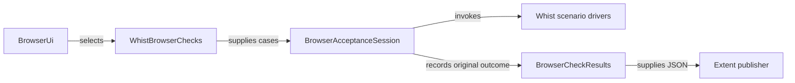

# Table verification index

<!-- table-audit-contract: TABLE-PHASE-CONTINUITY -->
<!-- table-audit-levels: component,e2e -->
<!-- table-audit-steps: GIVEN,WHEN,THEN -->

## Overview

Shared contract for components and E2E. The adapter owns the platform protocol; the common source owns the matrix and assertions. [Java support](../src/test/README.md) documents session and evidence ownership.

## Contract

[Matrix and ownership](../../docs/testing/ATF_TableContinuity.md)

## Components

Core owns neutral observations and the continuity oracle; Whist supplies legal schedules and both adapters. Components verify all legal combinations, actors and winners without pictures, capturing preconditions and original comparisons in Extent. [Executable module × level matrix](../../docs/testing/ATF_TestingGuide.md)

The test-only [static host](../src/test/java/ro/cardtable/testing/browser/StaticSiteHost.java) admits a flat delivered-site snapshot before starting HTTP. It serves imported modules, styles and reference fonts with their original bytes and MIME types; missing local dependencies stop startup. Controlled [HTTP components](static-host.test.mjs) verify admission, rejected methods/paths and snapshot immutability without starting a browser or creating pictures.

## Diagnostic runner boundaries

The diagnostic entry delegates selection, lifecycle and publication to separately tested collaborators. Scenario bodies and their independent geometry assertions keep their existing case IDs, input profiles and ordering.

Legend: execution and evidence ownership

- The session owns Playwright, the browser and each context; scenario callbacks own only application actions and observations.
- The result writer retains the existing JSON schema and completed prefix. A failing case keeps its original cause and secondary cleanup errors; later cases cannot erase it.
- Mocked lifecycle and selection components create no browser process or PNG. Rendered game acceptance remains a separate short journey.

| Boundary | Owner and verification |
|---|---|
| Selection | [WhistBrowserChecks](../src/test/java/ro/cardtable/testing/browser/WhistBrowserChecks.java): all diagnostic selectors, original ordered case IDs and viewports. Unknown selections fail before browser startup. |
| Lifecycle | [BrowserAcceptanceSession](../src/test/java/ro/cardtable/testing/browser/BrowserAcceptanceSession.java): muted headless launch, owned cleanup, original failures and capture-port isolation. |
| Results | [BrowserCheckResults](../src/test/java/ro/cardtable/testing/browser/BrowserCheckResults.java): immutable case images, unique identities, completed-prefix publication and refusal to overwrite another run. |
| Scenario drivers | Layout, card and table collaborators under `src/test/java/ro/cardtable/testing/browser`; shared assertions have their own support class. These sources are test-only and covered by package governance. |
| Component execution | [Runner components](../../atf-tests/src/test/java/atf/tests/browser/runner/BrowserRunnerComponentTest.java) and [selection components](../../atf-tests/src/test/java/atf/tests/browser/runner/WhistBrowserChecksComponentTest.java) run in the orchestration collection, with Extent and no pictures. The pinned Playwright client excludes bundled browser drivers in this mocked boundary. |

## E2E

Select an explicit short journey with Given/When/Then, before/after comparisons and inline pictures. The default `four-sanity` profile uses one 1664 × 916 viewport, one manual hand and one AutoGame hand, with at most four normal captures.

The [shared APK/Web plan](../../config/table-sanity-plan.json) drives the ordered semantic roles. The runner rejects `all` or more than two hands before browser startup; the publisher independently reconciles actual rounds, roles and image references. Resolution matrices remain in components.

- Use the compiled Pages site through the same static host for the short journey.
- The legacy `Run-BrowserUi.ps1` diagnostic compiles its Java driver and shared host into the external evidence directory; its viewport expectations follow the adaptive scene contract.
- Historical multi-profile selections do not replace the bounded sanity plan or qualify unexecuted native pixels.
- Report narration is English; observed application labels retain their selected language.

## Artifacts

[APK catalog and status](../../release/README.md)

[Web dossier and shared components](../../release/WEB/README.md)

## Limits

Policy results do not qualify widgets or pixels of an installed APK. Unexecuted native evidence is not inherited from the browser.
