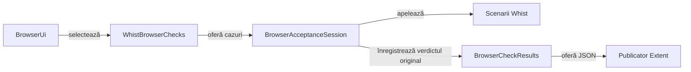

# Indexul verificării mesei

<!-- table-audit-contract: TABLE-PHASE-CONTINUITY -->
<!-- table-audit-levels: component,e2e -->
<!-- table-audit-steps: GIVEN,WHEN,THEN -->

## Pe scurt

Contract comun pentru componente și E2E. Adaptorul deține protocolul platformei; sursa comună deține matricea și aserțiunile.

## Contract

[Matrice și proprietate](../../docs/testing/ATF_TableContinuity.md)

## Componente

Core deține observațiile neutre și oracolul de continuitate; Whist oferă programele legale și ambele adaptoare. Componentele verifică toate combinațiile legale, actorii și câștigătorii fără poze, capturând precondițiile și comparațiile originale în Extent. [Matricea executabilă modul × nivel](../../docs/testing/ATF_TestingGuide.md)

[Gazda statică](../src/test/java/ro/cardtable/testing/browser/StaticSiteHost.java), folosită numai la testare, admite un snapshot plat al site-ului livrat înainte să pornească HTTP. Servește modulele importate, stilurile și fonturile de referință cu octeții și tipurile MIME originale; dependențele locale lipsă opresc pornirea. [Componentele HTTP](static-host.test.mjs) controlate verifică admiterea, metodele/căile respinse și imuabilitatea snapshotului fără browser sau poze.

## Granițele runnerului de diagnostic

Intrarea de diagnostic deleagă selecția, ciclul de viață și publicarea unor colaboratori testați separat. Corpurile scenariilor și aserțiunile geometrice independente își păstrează ID-urile, profilurile și ordinea existente.

Legendă: proprietatea execuției și a dovezilor

- Sesiunea deține Playwright, browserul și fiecare context; callback-urile scenariilor dețin numai acțiunile și observațiile aplicației.
- Scriitorul rezultatelor păstrează schema JSON și prefixul încheiat. Un caz eșuat păstrează cauza originală și erorile secundare de curățare; cazurile ulterioare nu le șterg.
- Componentele cu mock pentru ciclu de viață și selecție nu creează proces de browser sau PNG. Acceptanța jocului randat rămâne un parcurs scurt separat.

| Graniță | Responsabil și verificare |
|---|---|
| Selecție | [WhistBrowserChecks](../src/test/java/ro/cardtable/testing/browser/WhistBrowserChecks.java): toți selectorii de diagnostic, ID-urile originale ordonate și viewport-urile. Selecțiile necunoscute sunt refuzate înaintea pornirii browserului. |
| Ciclu de viață | [BrowserAcceptanceSession](../src/test/java/ro/cardtable/testing/browser/BrowserAcceptanceSession.java): pornire headless fără audio, curățare proprie, erori originale și izolarea portului de captură. |
| Rezultate | [BrowserCheckResults](../src/test/java/ro/cardtable/testing/browser/BrowserCheckResults.java): imagini imuabile per caz, identități unice, publicarea prefixului încheiat și refuzul suprascrierii altei rulări. |
| Scenarii | Colaboratori pentru afișare, cărți și masă în `src/test/java/ro/cardtable/testing/browser`; aserțiunile comune au propria clasă suport. Sursele sunt numai pentru teste și intră în guvernanța pachetelor. |
| Componente executate | [Componentele runnerului](../../atf-tests/src/test/java/atf/tests/browser/runner/BrowserRunnerComponentTest.java) și [ale selecției](../../atf-tests/src/test/java/atf/tests/browser/runner/WhistBrowserChecksComponentTest.java) rulează în colecția de orchestrare, cu Extent și fără poze. Clientul Playwright fixat exclude driverele de browser împachetate la această graniță cu mock. |

## E2E

Selectați un parcurs scurt explicit, cu Given/When/Then, comparații înainte/după și imagini inline. Profilul implicit `four-sanity` folosește un singur viewport 1664 × 916, o mână manuală și o mână AutoGame, cu cel mult patru capturi normale.

[Planul comun APK/Web](../../config/table-sanity-plan.json) conduce rolurile semantice ordonate. Runnerul respinge `all` sau mai mult de două mâini înainte să pornească browserul; publicatorul reconciliază independent rundele, rolurile și referințele imaginilor reale. Matricele de rezoluție rămân în componente.

- Folosiți site-ul Pages compilat prin aceeași gazdă statică pentru parcursul scurt.
- Diagnosticul vechi `Run-BrowserUi.ps1` compilează driverul Java și gazda comună în directorul extern de dovezi; așteptările de viewport urmează contractul scenei adaptive.
- Selecțiile istorice cu mai multe profiluri nu înlocuiesc planul sanity limitat și nu califică pixeli nativi neobservați.
- Relatarea raportului este în engleză; etichetele observate păstrează limba selectată în aplicație.

## Artefacte

[Catalogul APK și starea](../../release/README.md)

[Dosarul Web și componentele comune](../../release/WEB/README.md)

## Limite

Rezultatele politicilor nu califică widgeturile sau pixelii APK-ului instalat. Dovezile native neexecutate nu sunt moștenite din browser.
