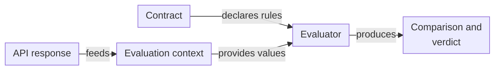

# Semantic validation API

## Overview

The module evaluates response contracts and produces comparisons and renderer-independent verdicts. Transport supplies the response, rules define expectations, and the outcome policy interprets evaluated comparisons.

Complete values determine the verdict. Publication and preview limits apply after evaluation, preserving the cause and compared values.

## Responsibilities



<details>
<summary>Legend: local context and unique evaluation</summary>

[ContractEvaluation](src/main/java/atf/validation/contract/ContractEvaluation.java) parses the JSON body lazily at the first rule that needs it and reuses that document only within the current evaluation. Header rules work independently; publication consumes the captured result without reevaluating shortened text.

</details>

## JSON contracts

- Invalid paths, absence and present values are distinct; an explicit `null` is present.
- Simple paths and JSON Pointer have an explicit subset; general selections, filters and recursive search are denied.
- Schema prevalidation includes branches not reached by the instance; unknown keywords are rejected.
- Each schema evaluation owns its compiled traversal and regular expressions; repeated values reuse the expression within that evaluation, without a shared cache across evaluations or file changes.
- Strict policy is failing and warning policy retains negative comparisons and status `WARNING`.

<details>
<summary>Schema subset and contract sources</summary>

| Surface | Meaning |
|---|---|
| Schema | Object or boolean; prevalidation is independent of the instance. |
| Types and values | `type`, `enum`, exact value equality and numerical comparisons; `integer` accepts a total numerical value. |
| Objects | `required`, `properties` and `additionalProperties` boolean or schema. |
| arrays | `items` boolean or schema, `minItems` and `maxItems`. |
| Strings | Limits in Unicode code points and valid Java regular expressions. |
| Numbers | `minimum` and `maximum` inclusive, by `BigDecimal`. |
| Metadata | `$schema` accepts the 2020-12 Draft Identifier; the other permitted metadata are annotations. |
| Rejections | Key and unsupported forms including `const`, `$ref` and `format`. |

[JsonSchemaCapabilities](src/main/java/atf/validation/contract/schema/JsonSchemaCapabilities.java) defines the vocabulary and accepted forms and [JsonSchemaValidator](src/main/java/atf/validation/contract/JsonSchemaValidator.java) evaluates the instance. The accepted URI is `https://json-schema.org/draft/2020-12/schema`; the module implements the declared subset with explicit refusal outside it.

[JsonPathSupport](src/main/java/atf/validation/contract/JsonPathSupport.java) resolves paths. Scalar rules reject objects and arrays rather than converting them to empty strings.

</details>

## Type of content and common parser

`contentTypeJson()` delegates the classification of the concrete type to `MediaTypes.isJson` of Core. Header classification and body syntax are checked separately.

- Type and subtype comparisons ignore case, and the subtypes with suffix `+json` use the common vocabulary.
- Missing types, wildcards and type lists are rejected; parameters do not convert `text/plain` into JSON.
- `contentTypeContains` maintains the literal comparison of compatibility.
- [JsonDocument](src/main/java/atf/validation/contract/json/JsonDocument.java) uses the full parser of Core, with the refusal of duplicate keys and the content after the root.

## Levels and verification

From an isolated copy with the project POM, selected libraries and a dedicated Maven cache:

```powershell
mvn -B -pl atf-validation -am test
```

| Contract | Verification |
|---|---|
| Presence and scalar values | [JsonPresenceContractTest](src/test/java/atf/validation/JsonPresenceContractTest.java). |
| Supported schema subset and rejection cases | [JsonSchemaContractTest](src/test/java/atf/validation/JsonSchemaContractTest.java). |
| Header classification | [JsonMediaTypeContractTest](src/test/java/atf/validation/media/JsonMediaTypeContractTest.java). |

[Test architecture](../docs/testing/ATF_Architecture.md) separates the rules from the components of the contract evaluation and the collaboration through the Public API. [POM](pom.xml) defines the dependencies and the limit of the module.

## Cost and limits

The JSON subset explicitly rejects unsupported constructs. Further qualification must bound prevalidation and evaluation cost for large, deep or repetitive structures.

- [Validation feedback](../docs/feedback/ATF_TestInfrastructure.md#cost-of-validating-api) tracks volume and depth budgets. Evaluation-local expression reuse must preserve prevalidation, Java regex semantics, paths and violation order; components also verify independence between successive evaluations.

- Keep measurements and input identities externally. Accept optimizations through semantic parity and measurement, keeping publication separate from complete-value evaluation.

## Test catalogue

[Inputs and responsibilities of tests](src/test/README.md) explains the selection, preconditions and interpretation of the result, through the same common strategy for all deliveries.
