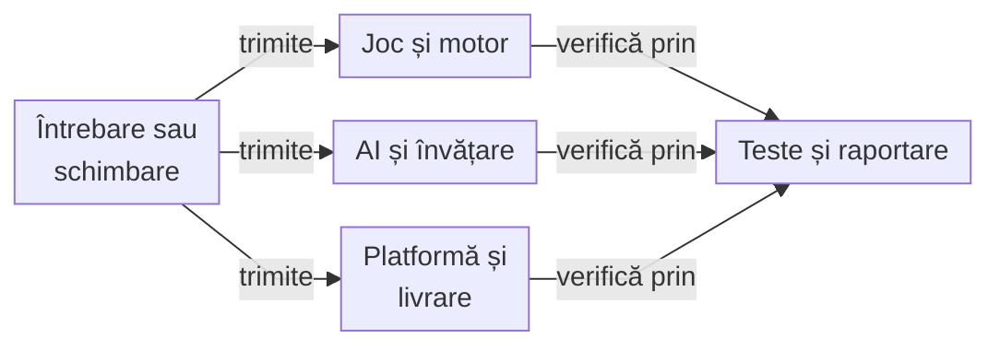

# Documentația Whist Lab

## Pe scurt

Documentația explică regulile jocului, arhitectura jucătorilor și mecanismele prin care îi dezvoltăm și verificăm.
Fiecare arie are un singur README de orientare și ghiduri complementare, cu responsabilități și surse explicite.

Legendă — responsabilitate și limita verificării

Aceasta este o hartă de lectură, fără a reprezenta dependențe de build. Alege aria care deține contractul, inspectează codul său și folosește nivelul de test și dovezi care observă schimbarea; guvernanța și feedback-ul mențin contractul rezultat și lacunele rămase.

## Arii de documentație

| Arie | Întrebarea principală |
|---|---|
| [Joc](game/README.md) | Care sunt regulile, variantele, nivelurile și datele scorului? |
| [Jucători AI](ai/README.md) | Cum se transformă informația permisă într-o decizie? |
| [Învățare offline](learning/README.md) | Cum folosim corpusul, comparațiile și evaluarea rezervată? |
| [Testare](testing/README.md) | Ce nivel, colecție și oracol verifică schimbarea? [Matrice modul × nivel](testing/ATF_TestingGuide.md#matrice-detaliată-modul--nivel-de-testare). |
| [Raportare](reporting/README.md) | Cum păstrăm rezultatele și verificăm publicarea lor? |
| [Platformă](platform/README.md) | Cum integrăm bibliotecile binare și livrăm aplicația Android? |
| [Guvernanță](governance/README.md) | Cum menținem calitatea codului, documentelor și schimbărilor? |
| [Feedback](feedback/README.md) | Ce lacune sau calificări rămân deschise și cine le deține? |

## Trasee uzuale

- Pentru o regulă de joc: profilul variantei, motorul, componenta independentă și ajutorul bilingv.
- Pentru o politică AI: [construirea și îmbunătățirea](learning/ATF_PolicyEvolution.md), observația permisă, modelul deciziei, regresia locală și protocolul evaluării.
- Pentru alt joc: [inventarul transferului și admiterea domeniului](learning/ATF_GameTransfer.md), oracolul independent, adaptorul și componentele înaintea antrenării.
- Pentru o modificare Android: aplicația identificată, componentele, scenariul pe dispozitiv și capturile aceleiași stări.
- Pentru o reorganizare: proprietarul documentului, referințele din cod și documente, apoi guvernanța.

## Surse și limite

[Proiectul](../README.md) prezintă produsul și modulele. Ghidurile trimit la codul, POM-ul sau testul care deține afirmația; datele unei rulări și evaluările editoriale se păstrează în arhiva externă.

[Bunele practici documentare](governance/ATF_Documentation.md) definesc redactarea, organizarea și revizia. O regulă stabilă are un singur document responsabil, iar feedback-ul păstrează lacuna rămasă.
