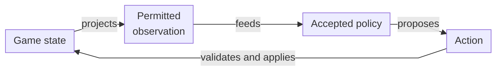
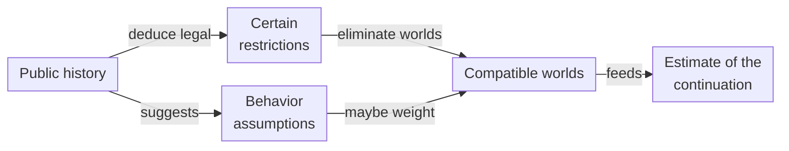

# AI Player Architecture

## Overview

A policy turns its own hand and public information into a legal decision for the remaining contract. Its algorithm and parameters are identified; changes follow the separate [offline qualification cycle](../learning/README.md).

For the complete workflow, start with [building and improving AI](../learning/ATF_PolicyEvolution.md). Play updates context and estimates; changes to rules, weights and implementation are qualified between experiments.

## Complementary guides

| Mechanism | Guide |
|---|---|
| Observation, simulation, utility and certificates | [Decision model](ATF_DecisionModel.md) |
| Manifest roles and contextual activation | [Rules and configuration](ATF_RulesConfiguration.md) |
| Remaining need, opportunities and legal actions | [Context game](ATF_ContextualPlay.md) |
| Budget, cancellation and measurement on JVM environment | [Cost of AI qualification](ATF_CostQualification.md) |
| Honors and coverage patterns with research status | [Romanian](https://github.com/crististefanita/whist/blob/main_RO/docs/ai/ATF_HandPatternsRo.md) and [English](ATF_HandPatternsEn.md) |

## Decision during the game

Legend: the decision during the game

The observation contains the actor's hand, known contracts, public cards, remaining need and scores. The engine checks legality before changing state; the policy does not receive opponents' actual hands.

## Layer and source of truth

| Layer | Responsibility | Implementation |
|---|---|---|
| Domain | Legality, dealing, transitions and scoring | [game-core](../../whist-lab-app/game-core/README.md) |
| Runtime policy | Bidding and choosing the card in the permitted observation | `AiPolicy`, Normal and `MonteCarloAi` policies |
| Independent policy | Separate model for verification and comparison | [ai-lab](../../whist-lab-app/ai-lab/README.md) |
| Corpus | Game validation and explicit development-data selection | [whist-corpus](../../whist-lab-app/ai-lab/tools/corpus/whist-corpus.mjs), [whist-active-corpus](../../whist-lab-app/ai-lab/tools/corpus/whist-active-corpus.mjs) |
| Patterns | Combination descriptions and descriptive calibration | [catalogue and limits](https://github.com/crististefanita/whist/blob/main_RO/docs/ai/ATF_HandPatternsRo.md) |
| Experiment | Isolated copy, identified candidate and paired comparisons | [collection runner](../../scripts/run-whist-collection.ps1), [arena](../learning/ATF_Arena.md) |
| Promotion | Fixed criteria, an unexposed evaluation set and preserved domain guards | [evaluation protocol](../learning/README.md) |

## The role of YAML

Manifests connect conditions to verification sources; their executable effect depends on the code that reads them. [Rules and configuration](ATF_RulesConfiguration.md) owns each manifest’s status, fixed parameters and contextual activation.

The pattern catalog remains a research tool. The [honor guide](https://github.com/crististefanita/whist/blob/main_RO/docs/ai/ATF_HandPatternsRo.md) explains its interpretation separately from runtime policy.

## Data support mechanism

- The schema, validators, selection and criteria belong to project source.
- Games, calibrations, concrete selections, evaluation-set registers and results are external data.
- [Corpus configuration](../../config/learning-corpus.json) identifies the archive and active pointer; active-corpus analysis reads the selected and verified manifest. [Honor calibration](https://github.com/crististefanita/whist/blob/main_RO/docs/ai/ATF_HandPatternsRo.md) uses separate input: all development files in the explicitly supplied archive.
- The selection eliminates duplicate traces, keeps the origins protected and follows new categories within the budget limit.
- An observed category measures dataset variety; it establishes neither code coverage nor action optimality.
- Default regression keeps small generated or constructed cases for a general property, with an independent expectation.

## Interpretation of opponents

Legend: certainty and estimation

Following suit or mandatory trumping can establish that a suit is absent. Bids and voluntary choices suggest intentions only under a declared model; a forced card does not prove an intention to win or avoid a trick.

For 2–8 cards, Hard uses known contracts as targets and constrains worlds through public information; general weighting from opponent behavior remains research. One-card bidding has a specialized model conditioned on observed bids, with its own scope and fallback, described in the [decision model](ATF_DecisionModel.md#estimate-of-alternatives).

## Conditions for progress

The [offline protocol](../learning/README.md) owns diagnosis, components, candidate selection, held-out evaluation and promotion. The [arena](../learning/ATF_Arena.md) owns comparisons on identical deals and seats; [component design](../testing/ATF_AiComponents.md) owns independent justification of the small case.

An architecture change preserves permitted observations and the evaluated policy’s identity. Concurrent changes require source reconciliation before qualification.

## Transfer limits to other systems

| Reusable abstraction | Domain specific adapter |
|---|---|
| Projection of the observation | What information is allowed to each actor. |
| Action filter | Legality defined by the game option. |
| Reduction of history | Facts and constraints deduced from public actions. |
| World generator | Distributions compatible with the observation and assumptions of the sampler. |
| Utility and priorities | The contract, the score, the series and the policy objective. |
| Verification and promotion | Independent properties, controlled comparisons and criteria. |

[Decision model](ATF_DecisionModel.md), [rules and weights](ATF_RulesConfiguration.md) and [test design](../testing/ATF_AiComponents.md) explain these boundaries independently of a particular match.
