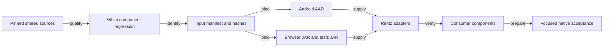

# Common card game interface

## Overview

Whist integrates the shared Android module. This register tracks native and consumer acceptance, Unicode name limits and extensions that need a shared contract. [Library contract](../../whist-lab-app/atf-card-table-ui/README.md)

## Priorities and closing conditions

| ID | What remains | Closure criterion |
|---|---|---|
| UIX01 · UIX02 | Geometry and drawing in consumers | With each game's pinned AAR, compare anchors, rounding and readability on the same screen profile. Record configuration, captured region and APK identity. |
| UIX03 | Keyboard, selection and focus on APK | In RO/EN, type and paste ten non-BMP characters, reject eleven and preserve selection and focus. [Input components](../testing/ATF_Android.md#profile-history-leaderboards-and-series) qualify the Whist rule and simulated Android input ranges. |
| UIX04 | Table positions and projections | Complete the Whist [Android matrix](ATF_Android.md#native-acceptance-of-proportions-and-order). Each consumer verifies its own seat order and applies a legal move exactly once. |
| UIX05 | Adoption of common score and history widgets | `score` now owns neutral content, Android rendering, measured columns and synchronized panes. Keep Whist and Rentz captions, awards and row actions in their adapters. Qualify native scrolling, focus, restoration and unchanged game-specific columns in each consumer before closing parity. [Widget contract](../../whist-lab-app/atf-card-table-ui/src/main/java/ro/cardtable/ui/score/README.md) |
| UIX06 | Cost and acceptance of AAR consumers | Compare the source build with the AAR on the same inputs. Run native samples on the admitted version and retain its identity. [Packaging and consumption](../../whist-lab-app/atf-card-table-ui/README.md#packaging-and-consumption) |

## Shared AutoGame control

- Check touch targets and control spacing on compact APKs and with enlarged text in both languages. Rebuilding the header preserves the game-provided value, and one tap produces one intent. [Header contract](../../whist-lab-app/atf-card-table-ui/README.md#table-header)
- Keep the active control stoppable while an AI response is pending. A controlled executor delivers that response after stopping; the revision and command journal must remain unchanged.
- Verify the ticker during bidding, score stops, pause and replay in Whist. Separately check header placement in each AAR consumer. [Native acceptance](ATF_Android.md#native-acceptance-of-proportions-and-order)

For UIX06, record each consumer's AAR coordinate and native verdict for the header, checkboxes and notifications. [Adapter documentation](../../atf-ui-browser/README.md#adapter-library) owns Web JAR packaging and qualification.

## Regression and delivery

Legend

- Sources and manifests identify the reusable library independently of each game adapter.
- Consumer components verify integration; native acceptance observes platform rendering and input.

- Run the UI library and Whist display, command, bidding, history and achievement components in one Gradle launch; verify each Extent report against JUnit. Keep rule and documentation checks as a distinct selection. [Component process](../testing/README.md)
- Reuse a passed selection only when its relevant production inputs, tests and evidence are unchanged. A failed documentation control requires a corrected rerun of that selection without repeating unrelated display tests.
- Compare production manifests and artifacts before building: unchanged inputs reuse the same AAR/JAR bytes, while changed inputs require a new version. Deliver runtime, tests, checksums and provenance receipts together.
- Rentz verifies binary adoption, the shared viewport contract and its public projections. Keep sequence layout, scoring and rules in game adapters; require consumer evidence before closing UIX06.

The shared matrix covers 3–6 seats, compact and tall windows, enlarged fonts and anchors that remain fixed across phases. Browser components cover the 414 × 896 reference frame, phone viewports and desktop height/width constraints; browser checks measure the actual DOM and scaling. [Display strategy](../testing/ATF_DisplayComponents.md)

## Result action acceptance

The shared roles and adapter components qualify the logical text and callback contract. Native raster acceptance must additionally observe complete wrapped labels, vertical scrolling and the last action on identified Whist and Rentz APKs, with RO/EN and enlarged text. A source or AAR comparison alone does not certify Android clipping.

## Planned three-module presentation boundary

**Planned work; these three build modules do not exist yet.** Preserve current Whist behavior and compatibility facades while extracting the already portable presentation code.

| ID | Priority | Source-based gap | Required outcome |
|---|---|---|---|
| UI-03 | P1 | Portable policies and Android widgets share one module; browser launchers maintain source-file lists and import presentation classes from the Android application. | A pure `card-table-core` JAR owns shared presentation; `card-table-android` consumes it as an AAR dependency and `card-table-web` through its JVM/compiled-page adapter. Module manifests replace source copying. |
| UI-04 | P1 | The shared phase contract compares policy plans. Menu typography still has separate Java/CSS definitions, and policy equality cannot detect a remounted DOM node or native font clipping. | Shared roles, normalized observations and one oracle cover geometry, menus, score, cards and lifecycle; renderer checks preserve actual measurements and their platform boundary. |
| TEST-04 | P1 | Diagnostic runners can select `all` and long prefixes; the existing four-player Oh Hell profile spans three hands, and the native responsive runner accepts up to five. | Enforce a one/two-hand budget per E2E game before startup and publication. Few paired navigation scenarios use the same IDs, assertions and audit structure through APK/Web drivers. |

Legend: target ownership, not a current build declaration

Core owns models, geometry, typography, spacing, input transitions and animation plans without Android, DOM, storage or game-engine imports. Games own rules, legal choices, scoring and public projections; adapters own measurement, rendering, navigation bindings and platform lifetime.

## Common component ownership

The common module must carry the bulk of display testing. Keep Whist-specific schedules and data in the game test provider; publish neutral fixture/oracle support as a tests artifact of core.

| Boundary | Component responsibility |
|---|---|
| Display matrix | Legal game cases for every seat; compact/tall/wide windows, logical dimensions, density, text scale, RO/EN, insets and minimum visible regions. Keep the full matrix in components without pictures. |
| Observation adapters | Normalize Android pixels/density/insets and Web CSS coordinates/scene scaling into one immutable observation. Preserve seat/card IDs, fact rows, header, trump, controls, hand, visible bounds and scroll state. |
| Independent assertions | Compare against the contract, not two copies of the same algorithm. Mutate upper/lower frames, row height, control overlap, missing seats, wrong card order and delayed callbacks; every mutation must be rejected. |
| Menus and text | One typed role set controls title, action, selection, helper, spacing and targets. Generate Web tokens and map Android units from the same definitions; platform fitting receives real text measurements and applies accessibility scale once. |
| Time and lifecycle | Controlled clocks/executors reproduce bid/play handoffs, collection, AutoGame stop, resize, font completion, dialogs and navigation cancellation. Stale owners cannot repaint or submit another command. |
| Complete offline games | Game component suites use the real engine with a seed, legal deal/checkpoint and controlled clock/storage/executors. Shared UI tests receive public projections; core does not import the engine, and mocks do not decide scoring or legality. |
| Renderer checks | Keep the small platform-specific checks for actual fonts, focus, gestures, accessibility and painted bounds. Policy or mock results do not certify physical APK/Web parity. |

## Migration and closure order

1. Inventory current portable classes, resources, public APIs, test owners and binary consumers. Freeze reference observations and declare compatibility mappings before moving files.
2. Extract core without changing rules or visual defaults; keep existing facades until callers migrate. Core must build and run its components without Android SDK, browser startup or emulator.
3. Make Android and Web depend on the same core identity. Remove cross-imports from browser into Android application packages and eliminate manual portable-source copying; keep game-specific presentation with its game.
4. Unify menu roles and scene models, then connect observation/command/clock ports to the shared contracts. Migrate assertions before retiring duplicate tests; retain case IDs, negative controls and coverage.
5. Enforce the E2E budget and admit the focused APK/Web journeys. Package and distribute only after Whist acceptance; existing consumer and physical-renderer criteria remain open until observed.

## Minimal E2E and suite delivery

| Boundary | Acceptance criterion |
|---|---|
| Hand budget | At most two dealt/scored hands per game; one when sufficient. Reject over-budget primary selections before starting a browser/emulator and again before publication; explicit diagnostic runs remain outside qualification. |
| Essential journeys | Cover home/settings, profile, bidding/play, hand score/history and next/main navigation. Resume a legal near-final checkpoint for final results, achievements and Play again rather than replaying a whole match. |
| Journey length | Two hands are a ceiling, not a target. Select a short hand or near-final checkpoint; long card sequences and whole games are verified in screenshot-free components. |
| Capture budget | Propose at most four relevant captures per normal scenario, configurable and declared before startup; one extra capture preserves the first visual failure. Do not capture each card, actor or resolution combination. |
| Report size | Deduplicate identical captures through the existing Reporting API and shorten UI selection. Preserve assertions and diagnostic context; compression or preview limits cannot change verdicts or conceal differences. |
| Checkpoint validity | Components prove checkpoint legality, restoration and score. E2E records the exact fixture and performs the real transitions; injected finished screens cannot replace the last-hand flow. |
| One scenario, two drivers | Reuse scenario definitions, IDs, expected outcomes and Given/When/Then roles. APK accessibility observations and browser DOM observations use separate drivers with bounded waits. |
| Current artifacts | `release/` exposes the current qualified test dossier and relative README links to canonical suite HTML. Replace incorporated duplicates; retain reused evidence with its actual revision, and clearly separate reference, rejected and unexecuted scope. |
| Extent audit | Group results by component, adapter/renderer, governance and E2E suite; identify selected cases, preconditions, commands versus observations, expected/actual assertions and source/artifact identities. Component continuity reports have no pictures; few E2E captures remain inline and owned by their steps. |
| Reuse and RAG | Reuse only unchanged validated evidence, including transitive dependencies, tests, resources, generator/toolchain and selection identity. A changed core invalidates affected adapter contracts even when their own files are unchanged. |

## Governance required before closure

- Govern dependency direction, source-set inventory and the absence of duplicate core classes in packages. A reviewed list of filenames is not a substitute for a module boundary.
- Version core and adapter compatibility explicitly; runtime/test packages retain manifests and SHA-256. Keep source-module ownership and EN/RO documentation aligned.
- Add negative component controls for forbidden imports, divergent core versions, missing suite cases, stale evidence, broken relative links, component captures and over-budget primary E2E input.
- Use existing Reporting APIs; this plan concerns test organization and producer input, not changes to the Reporting JAR. [Testing contract](../testing/ATF_TableContinuity.md) · [Current evidence](../../release/WEB/README.md)
