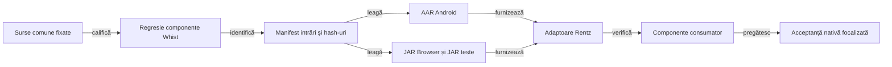

# Interfața comună pentru jocuri de cărți

## Pe scurt

Whist integrează deja modulul Android comun. Registrul urmărește verificările pe APK și în ceilalți consumatori, limita Unicode a numelui și extinderile care au nevoie de un contract comun. [Contractul bibliotecii](../../whist-lab-app/atf-card-table-ui/README.md)

## Priorități și condiții de închidere

| ID | Ce rămâne | Criteriu de închidere |
|---|---|---|
| UIX01 · UIX02 | Geometria și desenul la consumatori | Pe AAR-ul fixat pentru fiecare joc, compară ancorele, rotunjirile și lizibilitatea la același profil de ecran. Consemnează configurația, regiunea capturată și APK-ul. |
| UIX03 | Tastatura, selecția și focusul pe APK | Confirmați în RO/EN tastarea și lipirea a zece litere non-BMP, refuzul la 11 și păstrarea selecției și a focusului. [Componentele de intrare](../testing/ATF_Android.md#profil-istoric-clasamente-și-serii) califică regula Whist și intervalele Android simulate. |
| UIX04 | Pozițiile și proiecțiile mesei | Urmează [matricea Android](ATF_Android.md#acceptanța-nativă-a-proporțiilor-și-ordinii) pentru Whist. Pentru fiecare consumator confruntă ordinea locală a locurilor și o mutare legală aplicată o singură dată. |
| UIX05 | Adoptarea widgeturilor comune de scor și istoric | `score` deține conținutul neutru, randarea Android, coloanele măsurate și panourile sincronizate. Păstrați etichetele Whist și Rentz, premiile și acțiunile rândurilor în adaptoare. Calificați derularea nativă, focusul, reluarea și coloanele specifice în fiecare consumator înainte de închiderea parității. [Contractul widgeturilor](../../whist-lab-app/atf-card-table-ui/src/main/java/ro/cardtable/ui/score/README.md) |
| UIX06 | Costul și acceptanța consumatorilor AAR | Comparați buildul din sursă cu AAR pe aceleași intrări. Rulați probele native pe versiunea admisă și păstrați identitatea ei. [Împachetare și consum](../../whist-lab-app/atf-card-table-ui/README.md#împachetare-și-consum) |

## Controlul comun „Automat”

- Verificați atingerea și spațiul controlului pe APK compact și cu text mărit în ambele limbi. Refacerea antetului păstrează valoarea furnizată de joc, iar o atingere produce o singură intenție. [Contractul antetului](../../whist-lab-app/atf-card-table-ui/README.md#antetul-mesei)
- Păstrați oprirea controlului activ disponibilă cât un răspuns AI este în așteptare. Un executant controlat livrează răspunsul după oprire; revizia și jurnalul comenzilor trebuie să rămână neschimbate.
- Confruntați bifarea la licitație, oprirea la scor, pauza și reluarea în Whist. Verificați separat poziționarea antetului în consumatorul care folosește AAR-ul. [Acceptanța nativă](ATF_Android.md#acceptanța-nativă-a-proporțiilor-și-ordinii)

Pentru fiecare consumator, atașați la UIX06 coordonata AAR și verdictul nativ pentru antet, chenare și notificări. Criteriul de împachetare și calificare a JAR-ului Web aparține [documentației adaptorului](../../atf-ui-browser/README.md#bibliotecă-pentru-adaptoare).

## Regresie și livrare

Legendă

- Sursele și manifestele identifică biblioteca reutilizabilă independent de adaptorul fiecărui joc.
- Componentele consumatorului verifică integrarea; acceptanța nativă observă randarea și intrarea platformei.

- Rulați componentele bibliotecii UI și colecțiile Whist de afișaj, comenzi, licitare, istoric și realizări într-o singură lansare Gradle; confruntați fiecare raport Extent cu JUnit. Păstrați regulile și documentația ca selecție distinctă. [Procesul componentelor](../testing/README.md)
- Refolosiți o selecție trecută numai când intrările sale relevante de producție, testele și dovezile sunt neschimbate. Un control documentar eșuat cere rerularea corectată a selecției respective fără repetarea testelor de afișaj neafectate.
- Comparați manifestele de producție și artefactele înaintea construirii: intrările neschimbate reutilizează aceiași octeți AAR/JAR, iar intrările schimbate cer versiune nouă. Livrați împreună runtime-ul, testele, checksum-urile și receipt-urile de proveniență.
- Rentz verifică adopția binară, contractul comun de viewport și proiecțiile sale publice. Păstrați dispunerea secvențelor, punctajul și regulile în adaptoarele jocurilor; cereți dovada consumatorului înaintea închiderii UIX06.

Matricea comună acoperă 3–6 locuri, ferestre compacte și înalte, font mărit și ancore fixe între faze. Componentele Browser acoperă cadrul de referință 414 × 896, viewport-uri de telefon și constrângerile desktop de înălțime/lățime; verificările de browser măsoară DOM-ul și scalarea efectivă. [Strategia afișajului](../testing/ATF_DisplayComponents.md)

## Acceptanța acțiunilor de rezultat

Rolurile comune și componentele adaptoarelor califică textul logic și contractul callback-urilor. Acceptanța raster nativă trebuie să observe suplimentar etichetele împachetate complete, derularea verticală și ultima acțiune pe APK-uri Whist și Rentz identificate, cu RO/EN și text mărit. O comparație de surse sau AAR nu certifică singură lipsa tăierii pe Android.

## Acceptanța prezentării comune

Modelele portabile, geometria, rolurile textului și efectele deterministe aparțin `card-table-core`. Proiectele Android și Web depind de acest core; `whist-presentation` păstrează proiecțiile jocului în afara Android. Pachetele Java și identitățile componentelor existente rămân stabile. [Arhitectură și matrice executabilă](../testing/ATF_TestingGuide.md)

| ID | Prioritate | Graniță rămasă | Criteriu de închidere |
|---|---|---|---|
| UI-04 | P1 | Observații ale rendererului fizic | Conectați măsurătorile native reale ale rândurilor, antetului, atuului și cărților la portul neutru de observații. Respingeți tăierea și redesenarea întârziată de un proprietar vechi; planurile portabile egale nu califică fonturile desenate. Păstrați verificările DOM controlate existente. |
| TEST-04 | P1 | Orchestrarea parcursurilor scurte pe ambele platforme | Refolosiți o identitate de scenariu și un plan semantic de comenzi prin drivere APK/Web și aplicați bugetul declarat de capturi publicatorului APK. Admiterea și publicarea Web impun deja două mâini/patru capturi normale; limita nativă de mâini este impusă separat. |

## E2E minim și livrare pe suite

- Păstrați combinațiile de rezoluție, text, mâini legale, actori și câștigători în suite de componentă fără poze. Seturile unitare nu publică Extent; componentele păstrează precondițiile și aserțiunile evaluate.
- E2E verifică tranzițiile esențiale între ferestre la un viewport lizibil, cel mult două mâini și puține capturi inline asociate checkpointurilor. Selectați mâini scurte legale sau un checkpoint aproape de final validat în componente; fără ecran final injectat.
- Păstrați primul eșec și cauza lui originală. Reporting rămâne rendererul rezultatelor capturate; această lucrare schimbă intrările producătorului și organizarea suitelor.
- Păstrați HTML-ul suitelor curente și navigarea README relativă în `release/WEB/`. Dovezile refolosite păstrează sursa, identitatea artefactului și verdictul; referințele nu devin acceptanță nativă curentă.
- Împachetați și distribuiți numai după acceptanța Whist. UIX01–UIX06 păstrează propriile condiții de închidere pentru nativ și consumatori; nu le deduceți din compilarea sursei.

[Proprietatea componentelor](../../whist-lab-app/card-table-core/README.md) · [Continuitate comună](../testing/ATF_TableContinuity.md) · [Dovezi curente](../../release/WEB/README.md)
