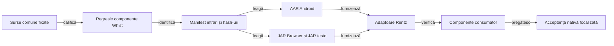
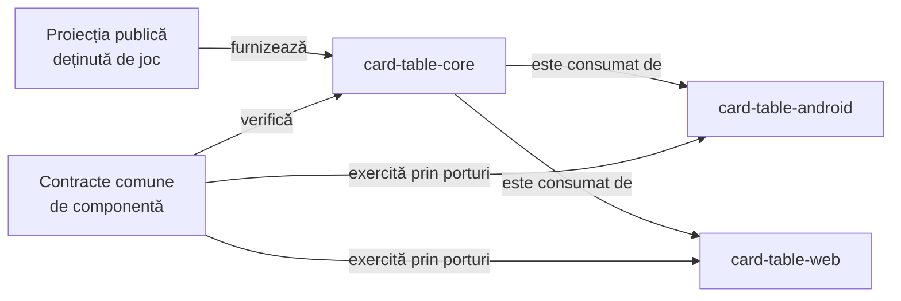

# Interfața comună pentru jocuri de cărți

## Pe scurt

Whist integrează deja modulul Android comun. Registrul urmărește verificările pe APK și în ceilalți consumatori, limita Unicode a numelui și extinderile care au nevoie de un contract comun. [Contractul bibliotecii](../../whist-lab-app/atf-card-table-ui/README.md)

## Priorități și condiții de închidere

| ID | Ce rămâne | Criteriu de închidere |
|---|---|---|
| UIX01 · UIX02 | Geometria și desenul la consumatori | Pe AAR-ul fixat pentru fiecare joc, compară ancorele, rotunjirile și lizibilitatea la același profil de ecran. Consemnează configurația, regiunea capturată și APK-ul. |
| UIX03 | Tastatura, selecția și focusul pe APK | Confirmați în RO/EN tastarea și lipirea a zece litere non-BMP, refuzul la 11 și păstrarea selecției și a focusului. [Componentele de intrare](../testing/ATF_Android.md#profil-istoric-clasamente-și-serii) califică regula Whist și intervalele Android simulate. |
| UIX04 | Pozițiile și proiecțiile mesei | Urmează [matricea Android](ATF_Android.md#acceptanța-nativă-a-proporțiilor-și-ordinii) pentru Whist. Pentru fiecare consumator confruntă ordinea locală a locurilor și o mutare legală aplicată o singură dată. |
| UIX05 | Adoptarea widgeturilor comune de scor și istoric | `score` deține conținutul neutru, randarea Android, coloanele măsurate și panourile sincronizate. Păstrați etichetele Whist și Rentz, premiile și acțiunile rândurilor în adaptoare. Calificați derularea nativă, focusul, reluarea și coloanele specifice în fiecare consumator înainte de închiderea parității. [Contractul widgeturilor](../../whist-lab-app/atf-card-table-ui/src/main/java/ro/cardtable/ui/score/README.md) |
| UIX06 | Costul și acceptanța consumatorilor AAR | Comparați buildul din sursă cu AAR pe aceleași intrări. Rulați probele native pe versiunea admisă și păstrați identitatea ei. [Împachetare și consum](../../whist-lab-app/atf-card-table-ui/README.md#împachetare-și-consum) |

## Controlul comun „Automat”

- Verificați atingerea și spațiul controlului pe APK compact și cu text mărit în ambele limbi. Refacerea antetului păstrează valoarea furnizată de joc, iar o atingere produce o singură intenție. [Contractul antetului](../../whist-lab-app/atf-card-table-ui/README.md#antetul-mesei)
- Păstrați oprirea controlului activ disponibilă cât un răspuns AI este în așteptare. Un executant controlat livrează răspunsul după oprire; revizia și jurnalul comenzilor trebuie să rămână neschimbate.
- Confruntați bifarea la licitație, oprirea la scor, pauza și reluarea în Whist. Verificați separat poziționarea antetului în consumatorul care folosește AAR-ul. [Acceptanța nativă](ATF_Android.md#acceptanța-nativă-a-proporțiilor-și-ordinii)

Pentru fiecare consumator, atașați la UIX06 coordonata AAR și verdictul nativ pentru antet, chenare și notificări. Criteriul de împachetare și calificare a JAR-ului Web aparține [documentației adaptorului](../../atf-ui-browser/README.md#bibliotecă-pentru-adaptoare).

## Regresie și livrare

Legendă

- Sursele și manifestele identifică biblioteca reutilizabilă independent de adaptorul fiecărui joc.
- Componentele consumatorului verifică integrarea; acceptanța nativă observă randarea și intrarea platformei.

- Rulați componentele bibliotecii UI și colecțiile Whist de afișaj, comenzi, licitare, istoric și realizări într-o singură lansare Gradle; confruntați fiecare raport Extent cu JUnit. Păstrați regulile și documentația ca selecție distinctă. [Procesul componentelor](../testing/README.md)
- Refolosiți o selecție trecută numai când intrările sale relevante de producție, testele și dovezile sunt neschimbate. Un control documentar eșuat cere rerularea corectată a selecției respective fără repetarea testelor de afișaj neafectate.
- Comparați manifestele de producție și artefactele înaintea construirii: intrările neschimbate reutilizează aceiași octeți AAR/JAR, iar intrările schimbate cer versiune nouă. Livrați împreună runtime-ul, testele, checksum-urile și receipt-urile de proveniență.
- Rentz verifică adopția binară, contractul comun de viewport și proiecțiile sale publice. Păstrați dispunerea secvențelor, punctajul și regulile în adaptoarele jocurilor; cereți dovada consumatorului înaintea închiderii UIX06.

Matricea comună acoperă 3–6 locuri, ferestre compacte și înalte, font mărit și ancore fixe între faze. Componentele Browser acoperă cadrul de referință 414 × 896, viewport-uri de telefon și constrângerile desktop de înălțime/lățime; verificările de browser măsoară DOM-ul și scalarea efectivă. [Strategia afișajului](../testing/ATF_DisplayComponents.md)

## Acceptanța acțiunilor de rezultat

Rolurile comune și componentele adaptoarelor califică textul logic și contractul callback-urilor. Acceptanța raster nativă trebuie să observe suplimentar etichetele împachetate complete, derularea verticală și ultima acțiune pe APK-uri Whist și Rentz identificate, cu RO/EN și text mărit. O comparație de surse sau AAR nu certifică singură lipsa tăierii pe Android.

## Limita de prezentare planificată în trei module

**Lucru planificat; aceste trei module de build nu există încă.** Păstrați comportamentul Whist și fațadele de compatibilitate în timpul extragerii codului de prezentare deja portabil.

| ID | Prioritate | Lacună observată în surse | Rezultat cerut |
|---|---|---|---|
| UI-03 | P1 | Politicile portabile și widgeturile Android sunt în același modul; launcherele browser mențin liste de surse și importă clase de prezentare din aplicația Android. | JAR-ul pur `card-table-core` deține prezentarea comună; `card-table-android` îl consumă ca dependență a AAR-ului, iar `card-table-web` prin adaptorul JVM/paginii compilate. Manifestele modulelor înlocuiesc copierea surselor. |
| UI-04 | P1 | Contractul comun al fazelor compară planuri de politică. Tipografia meniurilor are încă definiții Java/CSS separate, iar egalitatea politicilor nu detectează remontarea unui nod DOM sau textul nativ tăiat. | Rolurile comune, observațiile normalizate și un singur oracle acoperă geometria, meniurile, scorul, cărțile și ciclul de viață; verificările rendererelor păstrează măsurătorile reale și granița platformei. |
| TEST-04 | P1 | Runnerele de diagnostic pot selecta `all` și prefixe lungi; profilul Oh Hell la patru jucători parcurge trei mâini, iar runnerul responsiv nativ acceptă până la cinci. | Impuneți un buget de una/două mâini per joc E2E înaintea pornirii și publicării. Puține scenarii pereche de navigare folosesc aceleași ID-uri, aserțiuni și structură de audit prin drivere APK/Web. |

Legendă: responsabilități țintă, nu declarații curente de build

Core deține modelele, geometria, tipografia, spațierea, tranzițiile intrării și planurile animațiilor fără importuri Android, DOM, stocare sau motoare de joc. Jocurile dețin regulile, alegerile legale, punctajul și proiecțiile publice; adaptoarele dețin măsurarea, desenarea, legarea navigării și ciclul de viață al platformei.

## Responsabilitatea componentelor comune

Modulul comun trebuie să preia greul testelor de afișaj. Păstrați programările și datele specifice Whist în furnizorul de teste al jocului; publicați suportul neutru pentru fixture-uri/oracle ca artefact de teste al core.

| Graniță | Responsabilitatea componentelor |
|---|---|
| Matricea afișajului | Cazuri legale ale jocului pentru fiecare loc; ferestre compacte/înalte/late, dimensiuni logice, densitate, scară a textului, RO/EN, zone rezervate și regiuni minime vizibile. Păstrați matricea completă în componente fără poze. |
| Adaptoare de observație | Normalizați pixelii/densitatea/zonele Android și coordonatele CSS/scalarea scenei Web într-o observație imuabilă comună. Păstrați ID-urile locurilor/cărților, rândurile informațiilor, antetul, atuul, controalele, mâna, limitele vizibile și derularea. |
| Aserțiuni independente | Comparați cu contractul, nu două copii ale aceluiași algoritm. Modificați chenarele de sus/jos, înălțimea rândurilor, suprapunerea controalelor, locurile lipsă, ordinea cărților și callback-urile întârziate; fiecare mutație trebuie respinsă. |
| Meniuri și text | Un singur set tipizat de roluri controlează titlul, acțiunea, selecția, ajutorul, spațierea și țintele. Generați tokenurile Web și mapați unitățile Android din aceleași definiții; încadrarea platformei primește măsurători reale și aplică o singură dată scara accesibilității. |
| Timp și ciclu de viață | Ceasurile/executanții controlați reproduc trecerile licitare/joc, colectarea, oprirea AutoGame, redimensionarea, încărcarea fonturilor, dialogurile și anularea prin navigare. Responsabilii expirați nu pot redesena sau trimite altă comandă. |
| Partide complete offline | Suitele de componentă ale jocului folosesc motorul real cu seed, distribuire/checkpoint legal și ceas/stocare/executanți controlați. Testele comune UI primesc proiecțiile publice; core nu importă motorul, iar mock-urile nu decid scorul sau legalitatea. |
| Verificări de renderer | Păstrați verificările mici ale platformei pentru fonturi reale, focus, gesturi, accesibilitate și limite desenate. Rezultatele de politică sau mock nu certifică paritatea fizică APK/Web. |

## Ordinea migrării și închiderii

1. Inventariați clasele portabile, resursele, API-urile publice, responsabilitățile testelor și consumatorii binari existenți. Fixați observațiile de referință și declarați mapările de compatibilitate înaintea mutării fișierelor.
2. Extrageți core fără schimbarea regulilor ori valorilor vizuale implicite; păstrați fațadele existente până la migrarea apelanților. Core trebuie construit și testat fără SDK Android, pornirea browserului sau emulator.
3. Faceți Android și Web dependente de aceeași identitate core. Eliminați importurile browserului din pachetele aplicației Android și copierea manuală a surselor portabile; păstrați prezentarea specifică în jocul său.
4. Unificați rolurile meniului și modelele scenei, apoi conectați porturile de observație/comandă/ceas la contractele comune. Migrați aserțiunile înaintea eliminării testelor duplicate; păstrați ID-urile cazurilor, controalele negative și acoperirea.
5. Impuneți bugetul E2E și admiteți parcursurile APK/Web focalizate. Împachetați și distribuiți după acceptanța Whist; criteriile consumatorilor și rendererelor fizice rămân deschise până la observare.

## E2E minim și livrare pe suite

| Graniță | Criteriu de acceptare |
|---|---|
| Bugetul mâinilor | Cel mult două mâini distribuite/punctate per joc; una când este suficientă. Respingeți selecțiile primare peste buget înaintea browserului/emulatorului și din nou înaintea publicării; diagnosticele explicite rămân în afara calificării. |
| Parcursuri esențiale | Acoperiți meniul/configurarea, profilul, licitarea/jocul, scorul/istoricul mâinii și navigarea continuă/principală. Reluați un checkpoint legal aproape de final pentru rezultate, realizări și Joacă din nou, fără rejucarea întregii partide. |
| Durata parcursului | Două mâini reprezintă un plafon, nu ținta. Alegeți o mână scurtă sau un checkpoint aproape de final; secvențele lungi de cărți și partidele complete sunt verificate în componente, fără poze. |
| Bugetul capturilor | Propuneți cel mult patru capturi relevante per scenariu normal, configurabile și declarate înaintea pornirii; o captură suplimentară păstrează primul eșec vizual. Nu capturați fiecare carte, actor sau combinație de rezoluție. |
| Dimensiunea raportului | Deduplicați capturile identice prin API-ul Reporting existent și scurtați selecția UI. Păstrați aserțiunile și contextul necesar diagnosticului; compresia sau limitarea afișării nu poate schimba verdictul ori ascunde diferențe. |
| Validitatea checkpoint-ului | Componentele dovedesc legalitatea, restaurarea și scorul checkpoint-ului. E2E înregistrează fixture-ul exact și execută tranzițiile reale; ecranele finale injectate nu înlocuiesc parcursul ultimei mâini. |
| Un scenariu, două drivere | Refolosiți definițiile, ID-urile, rezultatele așteptate și rolurile Given/When/Then. Observațiile de accesibilitate APK și DOM browser folosesc drivere separate cu așteptări limitate. |
| Artefacte curente | `release/` expune dosarul curent calificat și legături README relative spre HTML-ul canonic al suitelor. Înlocuiți duplicatele încorporate; păstrați dovezile refolosite cu revizia reală și separați clar referințele, respingerile și domeniul neexecutat. |
| Audit Extent | Grupați rezultatele pe suite de componente, adaptoare/renderere, guvernanță și E2E; identificați cazurile selectate, precondițiile, comenzile versus observațiile, aserțiunile așteptat/real și identitățile sursei/artefactului. Rapoartele componentelor de continuitate nu au poze; puținele capturi E2E rămân inline și aparțin pașilor lor. |
| Refolosire și RAG | Refolosiți numai dovezi validate neschimbate, inclusiv dependențe tranzitive, teste, resurse, generator/toolchain și identitatea selecției. Core modificat invalidează contractele adaptoarelor afectate chiar dacă fișierele lor nu s-au schimbat. |

## Guvernanța cerută înaintea închiderii

- Guvernați direcția dependențelor, inventarul seturilor de surse și lipsa claselor core duplicate în pachete. O listă revizuită de fișiere nu înlocuiește o graniță de modul.
- Versionați explicit compatibilitatea core/adaptoare; pachetele runtime/teste păstrează manifeste și SHA-256. Aliniați responsabilitățile modulelor din surse și documentația EN/RO.
- Adăugați controale negative de componentă pentru importuri interzise, versiuni core divergente, cazuri lipsă din suite, dovezi expirate, legături relative rupte, capturi în componente și intrări E2E primare peste buget.
- Folosiți API-urile Reporting existente; planul privește organizarea testelor și intrarea producătorilor, nu schimbarea JAR-ului Reporting. [Contractul testării](../testing/ATF_TableContinuity.md) · [Dovezi curente](../../release/WEB/README.md)
