# Feedback Whist Lab

## Overview

This register groups the gaps, research limits and qualifications still required.
Stable contracts belong to thematic guidelines; each criterion remains open until the required level is verified.

## Active registers

[Active release dossier](../../release/README.md) holds the qualified APK and evidence. Intermediate candidates stay in external staging; [release qualification](../testing/ATF_ReleaseQualification.md) controls replacement of the active dossier.

| Area | Ownership and criteria |
|---|---|
| [AI players](ATF_Ai.md) | Inference, estimates, policy qualification on new data, and remaining laboratory volume/recovery limits. |
| [Android](ATF_Android.md) | Full history, persistence, geometry, location and accessibility. |
| [Shared interface](ATF_CardUi_Extraction.md) | Boundaries between reusable presentation and the Whist adapter: menu, profile, table, history and animation. |
| [Browser](ATF_UiBrowser.md) | Responsive viewport, menu typography and parity with APKs for the shared Edge and Chrome adapter. |
| [Reporting](ATF_Reporting.md) | Autonomy, original comparisons, renderer allocation and cost beyond the admitted consumer-input profiles. |
| [Governance](ATF_Governance.md) | Reusable API, explicit perimeter and code cohesion. |
| [Local infrastructure](ATF_TestInfrastructure.md) | Kit concurrency, configuration isolation and API-validation cost. |
| [Whist Achievements](ATF_Achievements.md) | Restoring the status of the Android screen and calibration with human players. |

## Prioritized ToDos

- The 1–100 score expresses priority within each track, not quality or completion percentage.
- Offline work packages have bounded component/governance criteria; acceptance and research gates retain their device, consumer, library or fresh-data requirements.
- Each ID is unique across tracks and links to its owning register.

- Select explicit IDs before an iteration and name them in the final audit and reply.
- A qualified subcriterion does not close its parent gate; remove only completed criteria and state the remaining boundary.
- The index prioritizes work from the thematic registers; its row count is not a count of completed iterations.
- This revision has three offline work packages and fourteen aggregate acceptance or research gates.

### Offline work packages

| ID | Priority | Score | ToDo remaining and short closing criterion |
|---|---:|---:|---|
| GOV-08 | P1 | 88 | Reconcile Maven/Gradle collection inventories, primary suite ownership and test-layer declarations so missing or overlapping owners fail in focused governance. [Register](ATF_Governance.md#framework-selection-boundaries) |
| RAG-36 | P2 | 84 | The safe fallback is qualified: rerun the complete selected bundle after an isolated driver correction and refuse promotion when shared input changes. Selective passing-control reuse remains open until per-control closures and original JUnit/report identities can be admitted. [Register](ATF_Governance.md#qualification-of-claims-and-launchers) |
| LAB-02 | P2 | 82 | The generic publisher's hard-stop recovery is qualified. Still qualify full archive traversal, peak resources and recovery during an actual corpus-scale run before closing the laboratory-scale criterion. [Register](ATF_Ai.md#autonomous-laboratory-verification) |

### Acceptance and research gates

| ID | Priority | Score | ToDo remaining and short closing criterion |
|---|---:|---:|---|
| AND-02 | P1 | 92 | Qualify the active actor, stable geometry and visible hand in bidding, play and AutoGame on the APK, for 3–6 players, RO/EN and enlarged text. [Register](ATF_Android.md) |
| AI-01 | P1 | 91 | Calibrate Hard inference at 2–8 cards on fresh lots; atomic sample admission and finite-model frequency oracles do not establish posterior calibration or playing-strength gains. [Register](ATF_Ai.md) |
| UI-04 | P1 | 90 | Qualify mounted Whist bindings, native font visibility and late-owner repaint on an identified renderer; controlled binding components remain separate from glyph acceptance. [Register](ATF_CardUi_Extraction.md#ui-three-module-plan) |
| ACH-01 | P1 | 90 | Qualify the activity-owned Achievements snapshot on the APK: native scroll/selection restoration and notification resumption before and after acknowledgement. [Register](ATF_Achievements.md) |
| AND-03 | P1 | 89 | Qualify API 37, navigation of the system, resumption, enlarged fonts and memory on an identified device. [Register](ATF_Android.md) |
| RPT-03 | P1 | 88 | Qualify independent library memory peaks, full-copy reduction and a broader resource envelope; real consumer-process failure recovery is separate from library allocation. [Register](ATF_Reporting.md#rpt-bounded-report-heap---safe-completion-for-large-suites) |
| WEB-16 | P1 | 88 | Qualify native-calibrated scene zoom, seat text, dropdowns, score typography and action bands on one Android, RO/EN and enlarged text; score history is the sole vertical-scroll exception. [Register](ATF_UiBrowser.md#web-16-responsive-game-surface-and-menu-typography) |
| UI-01 | P1 | 86 | Qualify headers, player boxes and notifications on consumer APKs, including Unicode name entry. [Register](ATF_CardUi_Extraction.md#priorities-and-closing-conditions) |
| UI-02 | P2 | 84 | Qualify shared command and supporting action roles and scrolling on the consumer APKs in RO/EN with enlarged text. [Register](ATF_CardUi_Extraction.md#result-action-acceptance) |
| RAG-21 | P2 | 84 | The plan-only pilot proves source-bound restart and selector parity; full report/JUnit parity and the recovery-time gate remain open. [Register](ATF_Governance.md#langgraph-shadow-pilot) |
| AI-02 | P2 | 82 | Measure opportunities, conversions to 500, ranking impact and latency on new batches; separate natural play from controlled prefixes. [Register](ATF_Ai.md#playing-for-zero) |
| WEB-07 | P2 | 79 | Qualify settings, resume, Play again and history in APK and Chrome on the same Android in RO/EN and with increased text. [Register](ATF_UiBrowser.md#qualification-on-the-same-device) |
| WEB-11 | P2 | 78 | Qualify ranks and suit glyphs in a 17-card hand with enlarged text in Android Chrome. [Register](ATF_UiBrowser.md#qualification-on-the-same-device) |
| WEB-15 | P2 | 77 | Complete adoption qualification in remaining consumers, preserving matching runtime/test JAR hashes and game-specific adapters. [Register](ATF_UiBrowser.md#shared-package-adoption) |

## Change ownership

```mermaid
%%{init: {"themeVariables":{"fontSize":"15px"},"themeCSS":".edgeLabel, .edgeLabel p { font-size: 12px !important; } .node rect { rx: 6px; ry: 6px; }","flowchart":{"curve":"linear","nodeSpacing":24,"rankSpacing":22,"padding":6},"sequence":{"mirrorActors":false,"messageMargin":24,"wrap":true}}}%%
flowchart LR
    ISSUE["Locked gap"] -->|assigns| OWNER["Owner"]
    OWNER -->|define| CRITERION["Criterion and level"]
    CRITERION -->|checks| CHECK["Reproducible result"]
    CHECK -->|promote the rule in| CONTRACT["Owning document"]
```

Legend: Closure of criteria

Each criterion states required behavior, its source and verification level. Stable rules belong in the owning document; concrete results and investigation material stay in the external audit.

Core, Reporting, Console and Mock are consumed as pinned JAR/POM pairs. This project verifies the contracts it uses, pair provenance, local integration and observed limits; coordinates and hashes define binary identity.
[Whist editorial guide](../governance/ATF_Documentation.md) defines documentation rules and local verification.

## Closure and promotion

- Distinguish demonstrated defects, missing qualification and research hypotheses.
- Check the nominal case, relevant rejection cases and source identity before closure.
- Move stable rules into their owning guide and remove only demonstrated closure criteria.
- Each open item has one owning register; READMEs explain the mechanism and link to that criterion.
- Keep the technical checks active until their explicit reconciliation.
- Update references after consolidation; moving a directory does not prove a behavior fix.

## Joint contract of autonomy

Reports must remain readable and auditable without a runner, additional JARs or auxiliary files. HTML retains context, comparisons and inline captures; consumers verify this contract through [reporting feedback](ATF_Reporting.md).

## Common test support

The Kit is consumed as a pinned JAR/POM pair. Local tests verify integration, lifecycle, concurrency and invocation propagation; library results do not replace Android-adapter or product-suite qualification.
