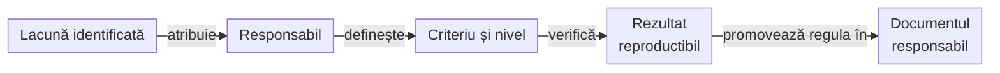

# Feedback Whist Lab

## Pe scurt

Acest registru grupează lacunele, limitele de cercetare și calificările încă necesare.
Contractele stabile aparțin ghidurilor tematice; fiecare criteriu rămâne deschis până la verificarea nivelului cerut.

## Registre active

[Dosarul activ](../../release/README.md) reunește APK-ul și dovezile versiunii calificate. Candidații intermediari rămân în staging extern; [calificarea livrării](../testing/ATF_ReleaseQualification.md) condiționează înlocuirea dosarului activ.

| Arie | Responsabilitate și criterii |
|---|---|
| [Jucători AI](ATF_Ai.md) | Inferență, estimări, calificarea politicilor pe date noi și limitele rămase de volum/recuperare ale laboratorului. |
| [Android](ATF_Android.md) | Istoric complet, persistență, geometrie, localizare și accesibilitate. |
| [Interfață comună](ATF_CardUi_Extraction.md) | Limitele dintre prezentarea reutilizabilă și adaptorul Whist: meniu, profil, masă, istoric și animații. |
| [Browser](ATF_UiBrowser.md) | Viewport responsiv, tipografia meniurilor și paritatea cu APK-urile pentru adaptorul comun Edge și Chrome. |
| [Raportare](ATF_Reporting.md) | Autonomie, comparații originale, alocarea rendererului și costul în afara profilurilor de intrări admise ale consumatorului. |
| [Guvernanță](ATF_Governance.md) | API reutilizabil, perimetru explicit și coeziunea codului. |
| [Infrastructură locală](ATF_TestInfrastructure.md) | Concurența Kitului, izolarea configurației și costul validării API. |
| [Realizări Whist](ATF_Achievements.md) | Restaurarea stării ecranului Android și calibrarea cu jucători umani. |

## ToDo-uri prioritizate

- Scorul 1–100 exprimă prioritatea în fiecare categorie, nu calitatea ori procentul de finalizare.
- Pachetele offline au criterii delimitate de componentă/guvernanță; pragurile de acceptanță și cercetare păstrează cerințele de dispozitiv, consumator, bibliotecă ori date noi.
- Fiecare ID este unic între categorii și indică registrul proprietar.

- Selectați ID-uri explicite înaintea unei iterații și numiți-le în auditul și răspunsul final.
- Un subcriteriu calificat nu închide pragul părinte; eliminați doar criteriile finalizate și precizați limita rămasă.
- Indexul prioritizează lucrări din registrele tematice; numărul rândurilor sale nu numără iterațiile finalizate.
- Această ediție are trei pachete de lucru offline și paisprezece praguri agregate de acceptanță sau cercetare.

### Pachete de lucru offline

| ID | Prioritate | Scor | ToDo rămas și criteriul scurt de închidere |
|---|---:|---:|---|
| GOV-08 | P1 | 88 | Aliniați inventarele colecțiilor Maven/Gradle, proprietarii primari ai suitelor și declarațiile straturilor astfel încât guvernanța focalizată să respingă proprietarii lipsă sau suprapuși. [Registru](ATF_Governance.md#framework-selection-boundaries) |
| RAG-36 | P2 | 84 | Varianta sigură de rezervă este calificată: reluați întregul lot selectat după corectarea izolată a unui driver și refuzați promovarea dacă se schimbă o intrare comună. Reutilizarea selectivă a controalelor trecute rămâne deschisă până la admiterea închiderilor per control și a identităților JUnit/raport originale. [Registru](ATF_Governance.md#calificarea-afirmațiilor-și-lansatoarelor) |
| LAB-02 | P2 | 82 | Recuperarea generică după oprirea publicatorului este calificată. Mai trebuie calificate parcurgerea completă a arhivei, vârful resurselor și recuperarea în timpul unei rulări reale la scară de corpus înainte de închiderea criteriului de scalare a laboratorului. [Registru](ATF_Ai.md#verificarea-autonomă-a-laboratorului) |

### Praguri de acceptanță și cercetare

| ID | Prioritate | Scor | ToDo rămas și criteriul scurt de închidere |
|---|---:|---:|---|
| AND-02 | P1 | 92 | Califică pe APK actorul, geometria stabilă și mâna vizibilă în licitație/joc/AutoGame pentru 3–6 locuri, RO/EN și text mărit. [Registru](ATF_Android.md) |
| AI-01 | P1 | 91 | Calibrați inferența Hard la 2–8 cărți pe loturi noi; admiterea atomică a eșantioanelor și oracolele frecvențelor din modele finite nu stabilesc calibrarea posteriorului sau câștiguri de forță de joc. [Registru](ATF_Ai.md) |
| UI-04 | P1 | 90 | Calificați legăturile Whist montate, vizibilitatea fonturilor native și redesenarea unui proprietar vechi pe un renderer identificat; componentele controlate de legare rămân separate de acceptanța glifelor. [Registru](ATF_CardUi_Extraction.md#ui-three-module-plan) |
| ACH-01 | P1 | 90 | Calificați pe APK snapshot-ul Realizărilor deținut de activitate: restaurarea nativă a derulării/selecției și reluarea notificărilor înainte și după confirmare. [Registru](ATF_Achievements.md) |
| AND-03 | P1 | 89 | Califică API 37, navigarea sistemului, reluarea, fonturile mărite și memoria pe un dispozitiv identificat. [Registru](ATF_Android.md) |
| RPT-03 | P1 | 88 | Calificați vârfurile independente de memorie ale bibliotecii, reducerea copiilor integrale și un profil de resurse mai larg; recuperarea după eșecul real al procesului consumatorului este separată de alocările bibliotecii. [Registru](ATF_Reporting.md#rpt-bounded-report-heap--finalizare-sigură-pentru-suite-mari) |
| WEB-16 | P1 | 88 | Calificați mărirea scenei calibrată după APK, textul chenarelor, listele, tipografia scorului și benzile acțiunilor pe un Android, RO/EN și text mărit; numai istoricul are derulare verticală. [Registru](ATF_UiBrowser.md#web-16-suprafața-de-joc-responsivă-și-tipografia-meniurilor) |
| UI-01 | P1 | 86 | Califică antetul, chenarele și notificările pe APK-urile consumatorilor și verifică nativ intrarea Unicode a numelui. [Registru](ATF_CardUi_Extraction.md#priorități-și-condiții-de-închidere) |
| UI-02 | P2 | 84 | Calificați rolurile comune ale comenzilor și acțiunilor secundare și derularea pe APK-urile consumatorilor în RO/EN cu text mărit. [Registru](ATF_CardUi_Extraction.md#acceptanța-acțiunilor-de-rezultat) |
| RAG-21 | P2 | 84 | Pilotul doar de planificare demonstrează reluarea legată de sursă și paritatea selectorului; paritatea completă a rapoartelor/JUnit și pragul de timp rămân deschise. [Registru](ATF_Governance.md#pilot-langgraph-în-umbră) |
| AI-02 | P2 | 82 | Măsoară ocaziile, conversiile la 500, efectul asupra clasamentului și latența pe loturi noi, cu joc natural separat de prefixul controlat. [Registru](ATF_Ai.md#joc-la-0) |
| WEB-07 | P2 | 79 | Califică setările, reluarea, Joacă din nou și istoricul în APK și Chrome pe același Android, în RO/EN și cu text mărit. [Registru](ATF_UiBrowser.md#calificarea-pe-același-dispozitiv) |
| WEB-11 | P2 | 78 | Califică rangurile și glifele într-o mână de 17 cărți, la text mărit pe Chrome Android. [Registru](ATF_UiBrowser.md#calificarea-pe-același-dispozitiv) |
| WEB-15 | P2 | 77 | Finalizează calificarea adoptării în consumatorii rămași, păstrând hash-urile JAR-urilor de execuție/teste și adaptoarele specifice jocului. [Registru](ATF_UiBrowser.md#adoptarea-pachetului-comun) |

## Responsabilitatea schimbării

Legendă: închiderea unui criteriu

Un criteriu numește comportamentul, sursa și nivelul de verificare necesar. Regula stabilă se documentează la responsabil, iar rezultatele concrete și materialele de investigație rămân externe.

Core, Reporting, Console și Mock sunt consumate ca perechi binare versionate JAR/POM. Acest proiect deține verificarea contractelor pe care le folosește, proveniența perechii, integrarea locală și documentarea oricărei limitări observate; hash-ul și coordonatele sunt sursa de identitate.
[Ghidul editorial Whist](../governance/ATF_Documentation.md) deține regulile documentare și verificarea lor în checkout.

## Închiderea și promovarea

- Păstrați distincte defectul demonstrat, calificarea lipsă și ipoteza de cercetare.
- Verificați cazul nominal, refuzul relevant și identitatea surselor înainte de închidere.
- Promovați regula stabilă în ghidul său și eliminați numai criteriul demonstrat.
- Fiecare lucrare deschisă are un singur registru responsabil; README-urile explică mecanismul și trimit la acel criteriu.
- Păstrați controalele tehnice active până la reconcilierea lor explicită.
- Actualizați toate referințele la consolidare; o schimbare de director nu dovedește rezolvarea comportamentului.

## Contractul comun de autonomie

Rapoartele trebuie să se deschidă și să poată fi auditate fără runner, JAR adițional sau fișiere auxiliare. HTML-ul păstrează contextul, comparațiile și capturile inline; consumatorul verifică acest contract în [feedback-ul raportării](ATF_Reporting.md).

## Suportul comun al testelor

Kitul este consumat după perechea JAR/POM fixată. Testele locale verifică integrarea, lifecycle-ul, concurența folosită și propagarea cauzelor; rezultatele unei biblioteci nu înlocuiesc calificarea adaptorului Android sau a suitei de produs.
