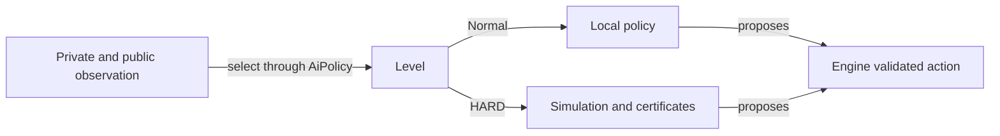

# Normal and Hard

## Overview

[AiDifficulty](../../whist-lab-app/game-core/src/main/java/ro/whistlab/core/config/AiDifficulty.java) defines game levels and [AiPolicy](../../whist-lab-app/game-core/src/main/java/ro/whistlab/core/ai/policy/AiPolicy.java) selects implementation. Difficulty changes the decision of the AI in the same rule contract.

## Responsibilities

Legend: difficulty does not alter legality

Both policies use the same variant and the permitted observation. The engine checks the action before changing the condition; no difficulty receives the actual hands of the opponents.

## Objectives

| Policy | Behaviour |
|---|---|
| Normal at bidding | Estimate the power of your own hand and choose an allowed bid. |
| Normal before contract | Search for the tricks still needed and keep future chances when the current trick cannot be taken. |
| Normal after contract | Avoid additional tricks and discard future risk within legal limits. |
| Hard with recoverable contract | Prioritize the estimated chance of exact, own points and the score of the main rival. |
| Hard when exact completion is publicly impossible | Protect first the estimated own points, then track the estimated adverse failures. |
| Normal and Hard with playing for zero | They switch to targeting exactly zero once public score bounds rule out a top-two finish through conventional scoring and zero is still reachable in the remaining schedule. |

[Decision model](../ai/ATF_DecisionModel.md#priority-objectives) holds the order of criteria, domains and runtime certificates. [Objective manifest](../../config/whist-play-objectives.yaml) links the intention of implementation and components; exact parameters and conditions are read from the code.

## Information and adaptation

- The requirements of each place shall be recalculated after completed tricks.
- The actor’s cards, played cards, current table and exposed trump are excluded from the hypothetical unseen-card pool.
- Proven suit voids narrow down the feasible hands.
- Known bids are contract targets in simulated continuances.
- For 2–8-card hands, general weighting by opponent behavior remains research; one-card bidding already has the specialized conditioning model and the fallback described in the [decision model](../ai/ATF_DecisionModel.md#estimate-of-alternatives).
- A Monte Carlo estimate and a complete certificate have different levels of certainty.

## Compatibility

The difficulty parser converts the old name EXPERT into HARD without a third menu option. Unknown names and invalid checkpoints are treated by explicit validations of persistence.

[Contract tests](../../whist-lab-app/game-core/src/test/java/ro/whistlab/core/ai/policy/DifficultyContractTest.java) checks the enumeration, the display and migration. [Collections](../testing/ATF_Collections.md) distinguish the domain regressions from the comparison of policies and the integration of Android.

[Decision model](../ai/ATF_DecisionModel.md) formalises the observation, estimation and order of objectives.
