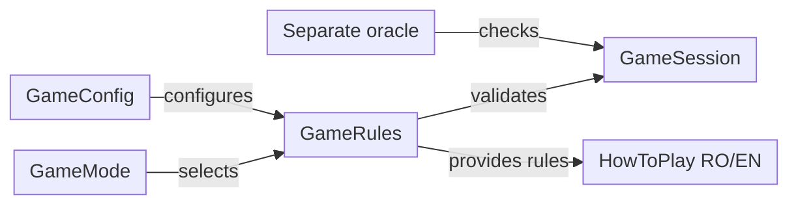

# The contracts of the Whist variants

## Overview

Each variant defines its deck, hand schedule, trump, bidding and scoring contract. A similar game name does not authorize transferring rules between profiles.

## Complementary guides

| Question | Guide |
|---|---|
| How to play Romanian Whist? | [Rules in Romanian](https://github.com/crististefanita/whist/blob/main_RO/docs/game/ATF_RulesRo.md) and [English](ATF_RulesEn.md). |
| What changes with player difficulty? | [Normal and Hard](ATF_Levels.md). |
| What data is recorded for each completed hand? | [Score history](ATF_ScoreHistory.md). |
| How do players set their name and retain rankings? | [Player profile and local leaderboards](ATF_PlayerRecords.md). |
| How are progression objectives organized and awarded? | [Whist achievements](ATF_Achievements.md). |

## Responsibilities

Legend: same variant in the game and verification

Configuration selects the rules before dealing. Help and tests use the same variant identity; an independent implementation checks rules and scoring.

## Romanian Profile Contract

| Aspect | Rule |
|---|---|
| Deck | A reduced deck based on player count, with high ranks defined by GameRules. |
| Program | A schedule determined by variant and seat count; endpoint blocks follow that profile. |
| Bidding | Contract in the legal range; the last offer cannot equalize the amount with the size of the hand. |
| Suit | Follow the led suit when holding it. |
| Trump | When void in the led suit, play a trump if available; overtrumping is not mandatory. |
| trick | The highest trump wins, otherwise the highest card of the led suit; the winner leads. |
| Score and series | Contract, deviation and streak points are defined in the table below. |
| Playing for zero | Default check option in both Romanian variants. After the last hand, each total exactly 0 is displayed and ranked as 500. The history of hands retains the calculated total. |

## Score and series

| Rule | 1–8–1 | 8–1–8 |
|---|---:|---:|
| Points added to tricks for an exact contract | 5 | 5 |
| Points per trick of deviation | -1 | -1 |
| Eligible hands before a series payout | 5 | 5 |
| Bonus and penalty with option 5 | 5, -5 | 5, -5 |
| Bonus and penalty with option 10 | 10, -10 | 10, -10 |
| Series penalty in the historical asymmetric profile | -5 | -5 |

At one card, a result of the same kind preserves the streak. The opposite result interrupts it, and a streak payout resets the counter.

[Factual test](../../whist-lab-app/game-core/src/test/java/ro/whistlab/core/rules/documentation/DocumentedScoringComponentTest.java) compares the table with engine formulas and rejects incorrect claims.

## Principles of implementation

- [GameMode](../../whist-lab-app/game-core/src/main/java/ro/whistlab/core/rules/GameMode.java) identifies the profile.
- [GameConfig](../../whist-lab-app/game-core/src/main/java/ro/whistlab/core/config/GameConfig.java) validates the configuration and migration of compatible values.
- [GameRules](../../whist-lab-app/game-core/src/main/java/ro/whistlab/core/rules/GameRules.java) owns the deck, schedule, legal actions and trick winner.
- [RomanianScoring](../../whist-lab-app/game-core/src/main/java/ro/whistlab/core/rules/RomanianScoring.java) owns scoring and streaks.
- [HowToPlay](../../whist-lab-app/game-core/src/main/java/ro/whistlab/core/rules/HowToPlay.java) produces Romanian and English help.

## Governance of changes in rules

1. Identify the exact variant and condition prior to the change.
2. Express the rule and its boundaries through independent components.
3. Check the transitions, score and restoration of the session.
4. Update RO/EN help and affected manifests.
5. Check Android integration separately through explicitly activated scenarios.

[Rule engine](../../whist-lab-app/game-core/README.md) · [RO rules](https://github.com/crististefanita/whist/blob/main_RO/docs/game/ATF_RulesRo.md) · [Rules EN](ATF_RulesEn.md) · [Collections](../testing/ATF_Collections.md)
