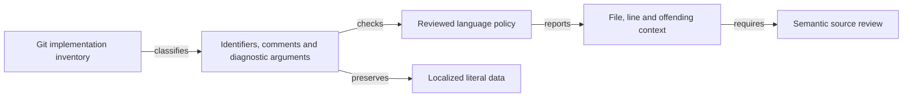

# Implementation language

## Overview

Implementation uses English on both documentation branches. Identifiers, comments, Javadoc, developer diagnostics and test explanations belong to this contract. Romanian guides and localized game strings remain Romanian data; switching documentation editions does not switch implementation language.

## Scope and classification

The [governor](../../atf-tests/tools/source-language.mjs) inventories tracked and nonignored implementation inputs, plus ignored sources within declared owners from the configured Git checkout. It checks Java, JavaScript, PowerShell, Python, shell and build scripts, plus comments in configuration, markup, CSS and `.gitignore`. 

Release payloads remain immutable observations, not current implementation. The parked iOS adapter is outside this iteration's qualification.

| Input | Required treatment |
|---|---|
| Identifiers | English, including camelCase and snake_case words. Domain proper names retain their identity. |
| Comments and Javadoc | English explanations, with the diagnostic pointing to the offending line. |
| Developer diagnostics | English errors, assertions, audit descriptions and build-task explanations at recognized call boundaries. |
| Localized literals | Preserve user text, names, YAML rules and quoted fixtures as data. A fixture literal never exempts the rest of its file. |
| Unknown language or syntax | Semantic review remains required; lexical success is not proof of arbitrary English prose or a substitute for compilation. |

## Verification flow

Legend: implementation and localized data have distinct responsibilities

Classification happens at lexical boundaries, not through whole-file exemptions. The same policy applies to the English and Romanian documentation editions.

## Commands and ownership

Run `node atf-tests/tools/source-language.mjs <checkout>` from an environment with Node and Git. Exit code zero means no reviewed violations; two means source violations; one means invalid input or an execution failure. JSON contains the actual file inventory, diagnostics and semantic-review limit.

[Policy](../../config/source-language-policy.json) contains reviewed Romanian vocabulary, including ASCII spellings. Unknown policy fields, empty vocabularies, indirect inputs and missing files cannot authorize an empty successful scan. Source-language policy and implementation changes participate in protected test-change review.

| Level | Owner and independent responsibility |
|---|---|
| Unit | [Lexical matrices](../../atf-tests/tools/source-language.test.mjs) cover comments, literals, interpolation, identifier words, diagnostic arguments and policy rejection without Extent. |
| Component | [Checkout admission](../../atf-tests/src/test/java/atf/tests/governance/source/language/SourceLanguageComponentTest.java) verifies real inventories, accepted localized data and rejected implementation text on both documentation editions. Extent retains original inputs and comparisons without screenshots. |
| Governance | [Current-source check](../../atf-tests/src/test/java/atf/tests/governance/source/language/SourceLanguageGovernanceTest.java) inspects the explicitly configured Git checkout. Staged execution separately verifies source identity and drift. |

## Review limits

- The reviewed vocabulary detects known violations; it cannot recognize every language, infer intent from every literal, or fully parse every embedded language.
- Review new syntax and developer-message producers before claiming additional coverage.
- Translate implementation explanations rather than weakening the vocabulary or adding file exemptions.
- Preserve localized behavior through its existing component contracts.
