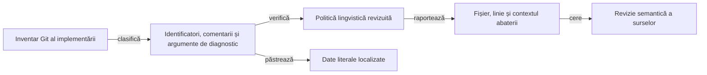

# Limba implementării

## Pe scurt

Implementarea folosește engleza pe ambele ramuri documentare. Identificatorii, comentariile, Javadoc, diagnosticele pentru dezvoltatori și explicațiile testelor respectă acest contract. Ghidurile românești și textele localizate ale jocului rămân date în română; schimbarea ediției documentare nu schimbă limba implementării.

## Perimetru și clasificare

[Verificatorul](../../atf-tests/tools/source-language.mjs) inventariază intrările de implementare versionate și neignorate, precum și sursele ignorate din responsabilitățile declarate din checkout-ul Git configurat. Verifică Java, JavaScript, PowerShell, Python, shell și scripturile de construire, plus comentariile din configurare, marcaj, CSS și `.gitignore`. 

Livrabilele de release rămân observații imuabile, nu implementarea curentă. Adaptorul iOS parcat este în afara calificării acestei iterații.

| Intrare | Tratare obligatorie |
|---|---|
| Identificatori | Engleză, inclusiv cuvintele din camelCase și snake_case. Numele proprii din domeniu își păstrează identitatea. |
| Comentarii și Javadoc | Explicații în engleză, cu diagnostic pe linia care conține abaterea. |
| Diagnostice pentru dezvoltatori | Erori, aserțiuni, descrieri de audit și explicații ale sarcinilor de construire în engleză, la limitele de apel recunoscute. |
| Literali localizați | Păstrați textele utilizatorului, numele, regulile YAML și fixture-urile citate ca date. Un literal de fixture nu exceptează restul fișierului. |
| Limbaj sau sintaxă necunoscută | Revizia semantică rămâne obligatorie; succesul lexical nu dovedește orice proză în engleză și nu substituie compilarea. |

## Fluxul verificării

Legendă: implementarea și datele localizate au responsabilități distincte

Clasificarea se face la limite lexicale, nu prin exceptarea unor fișiere întregi. Aceeași politică se aplică edițiilor documentare în engleză și în română.

## Comenzi și responsabilități

Rulați `node atf-tests/tools/source-language.mjs <checkout>` într-un mediu cu Node și Git. Codul de ieșire zero înseamnă lipsa abaterilor revizuite; doi înseamnă abateri în surse; unu înseamnă intrare invalidă sau eroare de execuție. JSON-ul conține inventarul real al fișierelor, diagnosticele și limita reviziei semantice.

[Politica](../../config/source-language-policy.json) conține vocabular românesc revizuit, inclusiv forme ASCII. Câmpurile necunoscute ale politicii, vocabularele goale, intrările indirecte și fișierele lipsă nu pot autoriza o scanare goală cu succes. Schimbările politicii lingvistice și ale implementării participă la revizia protejată a modificărilor de teste.

| Nivel | Responsabil și verificare independentă |
|---|---|
| Unitar | [Matricile lexicale](../../atf-tests/tools/source-language.test.mjs) acoperă comentarii, literali, interpolare, cuvinte din identificatori, argumente de diagnostic și respingerea politicilor fără Extent. |
| Componentă | [Admiterea checkout-ului](../../atf-tests/src/test/java/atf/tests/governance/source/language/SourceLanguageComponentTest.java) verifică inventare reale, acceptarea datelor localizate și respingerea textului de implementare în ambele ediții documentare. Extent păstrează intrările și comparațiile originale fără poze. |
| Guvernanță | [Controlul sursei curente](../../atf-tests/src/test/java/atf/tests/governance/source/language/SourceLanguageGovernanceTest.java) inspectează checkout-ul Git configurat explicit. Execuția din copia intermediară verifică separat identitatea sursei și modificările concurente. |

## Limitele reviziei

- Vocabularul revizuit detectează abateri cunoscute; nu poate recunoaște toate limbile, deduce intenția fiecărui literal sau analiza complet fiecare limbaj încorporat.
- Revizuiți sintaxa nouă și producătorii de mesaje pentru dezvoltatori înaintea declarării unei acoperiri suplimentare.
- Traduceți explicațiile implementării în locul slăbirii vocabularului sau adăugării unor excepții pe fișier.
- Păstrați comportamentul localizat prin contractele sale existente de componentă.
