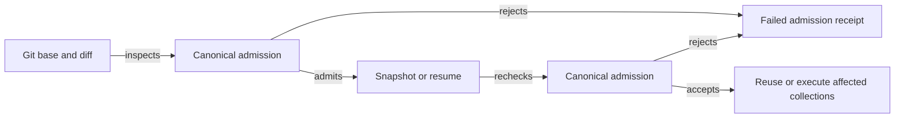

# Governance of test changes

## Overview

A change in the tests shall preserve the meaning of the contract and the reason for which an entry is admitted or refused. The change in implementation does not justify adjusting the expected result only to achieve success.

## Criteria

| Surface | Contract |
|---|---|
| Expected | Derived from requirement, invariant or independent oracle. |
| Control negative | The intended failure demonstrates that the test detects the defect concerned. |
| Identity | The case, sources, configuration and scope are explicit. |
| Verdict | Preserve the original cause through exception handling and report publication. |
| Population | Declare the selection and omissions; keep run counts out of generic guidance. |
| Results | Keep concrete runs and version comparisons in the external archive. |

## Revision of a change

1. Form general ownership and its borders.
2. Reproduce the defect in a small case with controlled data.
3. Check negative control failure and successful valid case.
4. Reconcile competing sources prior to qualification.
5. Update the collection, contract and documentation of the mechanism in the same revision.

[Governance of documentation](ATF_Documentation.md) · [Collections](../testing/ATF_Collections.md)

## Checking the Git diff

Run the [governance launcher](../../scripts/run-atf-governance.ps1) from the reviewed checkout. Select the shared commit before the change. The launcher checks tests on an isolated copy and reads the Git diff from the declared checkout.

```powershell
.\scripts\run-atf-governance.ps1 -TestChangeBaseRef $reviewBase
```

| Contract | Verification |
|---|---|
| Base | A local commit at or before `HEAD`. CI declares an explicit base that is an ancestor of `HEAD`. Without a local parameter, `HEAD` delimits only uncommitted changes. |
| Git inputs | Committed changes from the base, index, working tree and untracked files, including protected files ignored by Git. |
| Scope | Maven and Gradle tests and resources, POMs, Gradle configuration, suite selections, and executable governance or qualification inputs. |
| Authorization | Exactly one eligible record must match the exact path, base SHA and UTC review date. Expiry is inclusive. |
| Rejection | Missing or unrelated base, uncovered path, expired or ambiguous control, invalid metadata, or unsupported Git state. |
| Rename | A rename is evaluated as deletion of the old path plus addition of the new path. Deletion requires `allowDelete: true`. |

The launcher transmits the base through `atf.governance.testChanges.baseRef`. For component selection, set `ATF_TEST_CHANGE_BASE_REF` before launch. A branch review always uses a commit earlier than `HEAD`.

## Life cycle of control

| Step | Place and criterion |
|---|---|
| ACTIVE | The [feedback owner](../feedback/README.md) document keeps the reason, the order of the sample and the exact list of pathways. |
| VERIFIED | [Technical registry](ATF_TestChangesBaseline.md) keeps the same ID and sample selection. The current diff authorization requires verified proof, basis and expiration. |
| DRAFT AND CLOSED | The structured entry may record the proposal or closure. These states have zero eligibility. |
| Withdrawal | Compare the control against the review base. Remove it only when the targeted diff no longer needs it. |

- A YAML block may declare a `testChanges` list. Each item declares `id`, `status`, `base`, `expires`, `reason`, `proof` and `paths`. `allowDelete` is optional and defaults to `false`.
- Relative paths use `/`. IDs must be unique across the inspected documents.

The proof command declares the planned verification and runs separately. [Component tests](../../atf-tests/src/test/java/atf/tests/governance/source/changes/TestChangeReviewComponentTest.java) create local Git histories and qualify the mechanism without a device.

## Proof of verified control

### Early source-control admission

Both qualification launchers call the [admission adapter](../../scripts/AtfTestChangeAdmission.ps1) before copying or restoring a source snapshot, copying dependency caches, or starting Maven. A small standalone compiler builds the [CLI](../../atf-tests/src/main/java/atf/tests/testchange/TestChangeAdmissionCli.java) from the current tool sources and reads the pinned parser JARs from `-MavenCache`. The CLI calls the same `TestChangeReview` and `TestChangeProof` validators as final governance.

| Selector boundary | Admission and authority |
|---|---|
| Source eligibility | The [validator](../../atf-tests/src/main/java/atf/tests/testchange/selectors/StaticProofSelectors.java) parses literal Maven roots with the JDK, without application compilation or class loading. Each positive/negative `Class#method` identifies one declared instance `void @Test` method in component scope. Local composed annotations, inherited scope and non-static nested containers resolve from source; parameter injection is allowed, invocation multiplicity is not. |
| Early rejection | Dynamic factories/templates, repeated or parameterized tests, overloads, duplicate types, unresolved/cyclic annotation composition and ambiguous imports produce `TEST-CHANGE-SELECTOR-*`. Main-source classes and inherited-only methods cannot authorize selectors. Normal verification and proof-generation admission re-evaluate this contract after staging. |
| Final authority | Source eligibility is conservative and does not replace JUnit discovery of exactly one invocation per selector or the original passing outcomes. Disabled, aborted, missing or failing execution cannot produce a verified proof. [Component cases](../../atf-tests/src/test/java/atf/tests/governance/source/changes/TestChangeSelectorComponentTest.java) cover the static boundary; [launcher checks](../../atf-tests/src/test/java/atf/tests/governance/documentation/release/rag/scope/QualificationLauncherComponentTest.java) prove rejection before copying sources/caches and before Maven. |

| Mode | Admission contract |
|---|---|
| Normal governance or components | Verify eligible controls and all required original receipts, including ID, Git base, commit, raw diff, positive/negative selectors and HTML SHA-256. |
| Proof generation | Validate the clean committed diff, current controls and declared positive/negative selectors without requiring the not-yet-generated receipts. Only the explicit control-generation options select this mode. |
| After snapshot or resume | Recheck the same canonical contract before selecting or preparing executions; changed sources or proof bytes cannot borrow an earlier admission. |
| Rejection | Publish diagnostics and a failed admission timing phase without copying the source or dependency cache and without starting Maven. |



<details>
<summary>Legend: proof generation and normal authorization remain separate</summary>

The bootstrap writes only temporary utility classes under the configured external temporary root and removes them after each check. `test-change-admission.json`, `test-change-admission-recheck.json` and `timing.json` describe admission; test execution and its canonical Extent reports keep their own receipts. Generation-plan admission does not authorize a normal run without the required verified proofs.

</details>

Java 21 and the locally cached pinned JSON/YAML parser dependencies are required even when Maven compilation is reused. Source immutability and final governance still run after early admission; a receipt never disables their checks.

The hosted workflow prepares only the pinned JSON/YAML parser inputs from Maven Central over HTTPS, then admits the generation plan before preparing the Maven reactor. Failed parser preparation or plan admission prevents Maven; ordinary qualification still requires the subsequently generated original proofs.

### Generate and consume proof

Keep the control and its test selection in the reviewed commit. Write proof to a new directory outside the checkout. The launcher prepares an isolated copy and publishes evidence only after confirming that the inputs did not change.

```powershell
.\scripts\run-component-suites.ps1 -AllTestChangeControls -TestChangeBaseRef $reviewBase -RunRoot $runRoot
$env:ATF_TEST_CHANGE_PROOF_ROOT = Join-Path $runRoot 'proofs'
.\scripts\run-atf-governance.ps1 -TestChangeBaseRef $reviewBase
```

| Element | Contract |
|---|---|
| Selectors | Declare distinct `checks.positive` and `checks.negative` component methods in `package.Class#method` form. |
| Negative control | The test injects the defect and asserts the expected rejection. Both the valid case and the rejection case must pass at the JUnit level. |
| Identity | The receipt binds the control ID, base SHA, reviewed commit SHA and raw Git diff SHA-256, including blobs and file modes. |
| Diff batch | One compilation feeds all required `VERIFIED` controls. Each control has its own JVM, log and HTML report. Publish `proofs` only after every control passes and the source and selection are reconfirmed. |
| Execution | The launcher runs exactly the declared selectors and reconciles invocations with Extent. The receipt and HTML are stored together under the control ID. |
| Verification | A different commit, diff or control, missing selectors, or an HTML hash mismatch blocks `VERIFIED` authorization. A changed checkout requires a new candidate. |
| History | Keep prior controls in the register. A `VERIFIED` control applies only when its selection and proof match the reviewed diff. |

On failure or source change, inspect the per-control logs and the `proofs.pending` diagnostic directory. For a focused run, `-TestChangeControl` stores the receipt under `<RunRoot>/<ID>`. Reuse that receipt and report only for the same commit and diff.

## Transferring ownership of a check

The transfer of an implementation to a library shall keep all native contracts to the producer. The consumer shall retain the acceptance of the API used, the identity of the loaded JARs and the refusal of metadata or inconsistent deliveries.

- A transfer request identifies affected sources, the new owner, the equivalent replacement and independent acceptance criteria.
- Link the transfer and captures to delivery. Keep the Git base and affected paths in the technical register.
- Deleting a local copy does not remove a negative case or turn a library check into Android acceptance.
- Document ownership limits without retaining historical lists of deleted tests.

[Quality governance](README.md) checks the current perimeter and prohibits parallel sources of binary libraries.
