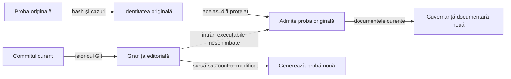
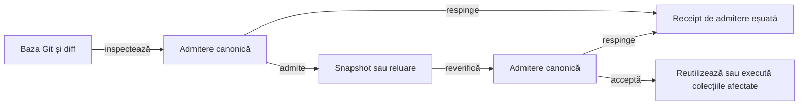
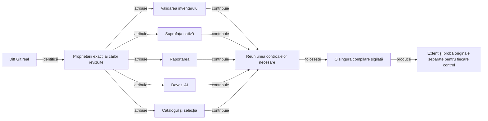

# Guvernanța schimbărilor în teste

## Pe scurt

O modificare a testelor păstrează sensul contractului și motivul pentru care o intrare este admisă sau refuzată. Schimbarea implementării nu justifică ajustarea rezultatului așteptat doar pentru a obține succes.

## Criterii

| Suprafață | Contract |
|---|---|
| Așteptat | Derivat din cerință, invariant sau oracol independent. |
| Control negativ | Eșecul intenționat demonstrează că testul detectează defectul vizat. |
| Identitate | Cazul, sursele, configurația și aria sunt explicite. |
| Verdict | Cauza originală este păstrată prin tratarea excepției și publicarea raportului. |
| Populație | Selecția și omisiunile sunt declarate; ghidul generic nu fixează numărători istorice. |
| Rezultate | Rulările concrete și comparațiile de versiuni se păstrează în arhiva externă. |

## Revizia unei schimbări

1. Formulați proprietatea generală și frontierele ei.
2. Reproduceți defectul într-un caz mic cu date controlate.
3. Verificați eșecul controlului negativ și succesul cazului valid.
4. Reconciliați sursele concurente înaintea calificării.
5. Actualizați colecția, contractul și documentația mecanismului în aceeași revizie.

[Guvernanța documentației](ATF_Documentation.md) · [Colecții](../testing/ATF_Collections.md)

## Verificarea diff-ului Git

Rulați [lansatorul de guvernanță](../../scripts/run-atf-governance.ps1) din checkout-ul revizuit. Selectați commitul comun de dinaintea schimbării. Lansatorul verifică testele într-o copie izolată și citește diff-ul Git din checkout-ul declarat.

```powershell
.\scripts\run-atf-governance.ps1 -TestChangeBaseRef $reviewBase
```

| Contract | Verificare |
|---|---|
| Bază | Un commit local cel mult egal cu `HEAD`. În CI, declarați explicit o bază strămoș a lui `HEAD`. Fără parametru local, `HEAD` delimitează doar schimbările necomise. |
| Intrări Git | Modificările comise față de bază, indexul, fișierele de lucru și fișierele neadăugate. Sunt incluse și intrările protejate, ignorate de Git. |
| Arie | Seturile Maven și Gradle de teste și resurse, POM-urile, configurarea Gradle, selecțiile de suite și intrările executabile de guvernanță sau calificare. |
| Autorizare | Trebuie să existe o singură înregistrare eligibilă pentru calea exactă, SHA-ul bazei și data UTC a revizuirii. Data expirării este inclusivă. |
| Refuz | Bază absentă sau fără legătură, cale neacoperită, control expirat ori ambiguu, metadate invalide sau stare Git neacceptată. |
| Redenumire | O redenumire este evaluată ca ștergerea căii vechi și adăugarea celei noi. Ștergerea cere `allowDelete: true`. |

Lansatorul transmite baza prin `atf.governance.testChanges.baseRef`. Pentru selecția componentelor, setați `ATF_TEST_CHANGE_BASE_REF` înainte de lansare. Revizuirea unei ramuri folosește întotdeauna un commit anterior lui `HEAD`.

## Ciclul de viață al controlului

| Etapă | Loc și criteriu |
|---|---|
| ACTIV | Documentul de [feedback responsabil](../feedback/README.md) păstrează motivul, comanda probei și lista exactă de căi. |
| VERIFICAT | [Registrul tehnic](ATF_TestChangesBaseline.md) păstrează același ID și aceeași selecție. Autorizarea diff-ului curent cere dovadă verificată, bază și expirare. |
| SCHIȚĂ și ÎNCHIS | Intrarea structurată poate consemna propunerea sau închiderea. Aceste stări nu sunt eligibile. |
| Retragere | Comparați controlul cu baza revizuirii. Eliminați intrarea doar când diff-ul vizat nu mai are nevoie de ea. |

- Un bloc YAML poate declara o listă `testChanges`. Fiecare element declară `id`, `status`, `base`, `expires`, `reason`, `proof` și `paths`. `allowDelete` este opțional și are implicit valoarea `false`.
- Căile relative folosesc `/`. ID-urile trebuie să fie unice în toate documentele inspectate.

Comanda de probă declară verificarea planificată și se execută separat. [Testele de componentă](../../atf-tests/src/test/java/atf/tests/governance/source/changes/TestChangeReviewComponentTest.java) creează istorii Git locale și califică mecanismul fără dispozitiv.

## Dovada controlului verificat

<a id="editorial-continuation-of-original-proofs"></a>

### Continuarea editorială a probelor originale

O probă originală rămâne legată de commitul, baza, diff-ul, selectorii și octeții Extent înregistrați la execuție. Un commit editorial ulterior nu devine o execuție nouă: [validatorul continuării](../../atf-tests/src/main/java/atf/tests/testchange/EditorialProofContinuation.java) admite reutilizarea păstrând identitatea originală. Cititorii auditului afișează atât commitul original, cât și cel admis și păstrează legăturile către raportul original.

| Graniță | Verificare necesară |
|---|---|
| Istoric | Commitul original există local și este strămoș prin cel mult 256 de commituri editoriale consecutive cu un singur părinte. Îmbinările sau istoriile fără înrudire cer probe noi. |
| Intrări executabile | Fiecare commit intermediar modifică numai Markdown fără rol în build ori `config/documentation-editions.json`. Codul, resursele, regulile împachetate ale jocului și alte configurări rămân neschimbate, inclusiv modificările ulterior anulate. |
| Diff protejat | Recalculează diff-ul Git brut integral al probei originale față de baza înregistrată și verifică hash-ul. Diff-ul brut protejat, inclusiv identitățile blob-urilor și modurile Git, trebuie să coincidă cu diff-ul protejat curent de la aceeași bază. |
| Controale | Metadatele `testChanges` din fiecare document modificat rămân semantic neschimbate, inclusiv motivele, comenzile, căile și selectorii pozitivi/negativi. Autorizarea și expirarea curente se aplică în continuare. |
| Fișiere și rezultate | Documentele sunt blob-uri Git obișnuite, neexecutabile. Cazurile originale trebuie să rămână exact populația declarată și trecută, iar hash-ul HTML-ului original trebuie să coincidă. Un checkout necurat rămâne blocat. |
| Proveniență | Receipt-ul admiterii expune `continuations`: commitul original, commitul admis, hash-ul diff-ului protejat și căile editoriale. Nici receipt-ul original, nici Extent nu sunt rescrise. |



<details>
<summary>Legendă — execuția păstrată și documentația curentă</summary>

- Reutilizarea probei autorizează contractul neschimbat al controlului sursei; nu califică documentația modificată și nu adaugă cazuri executate.
- Păstrează `ATF_TEST_CHANGE_PROOF_ROOT` către pachetul original și folosește lansatorul normal al colecțiilor cu `-ReuseFrom`. Ieșirile Maven neschimbate rămân admisibile independent; nu invoca `-AllTestChangeControls` când toate probele originale necesare sunt admise.
- Un control nou, o intrare executabilă modificată, un istoric nesuportat sau un rezultat original eșuat cere generarea probelor. [Cazurile de componentă](../../atf-tests/src/test/java/atf/tests/governance/source/changes/TestChangeEditorialProofComponentTest.java) exercită istorii Git reale și intrări simulate explicit la granița verificării probelor.

</details>

### Admiterea timpurie a controlului sursei

Ambele lansatoare de calificare apelează [adaptorul de admitere](../../scripts/AtfTestChangeAdmission.ps1) înaintea copierii sau restaurării snapshot-ului sursei, copierii cache-urilor de dependențe ori pornirii Maven. Un compilator autonom restrâns construiește [CLI-ul](../../atf-tests/src/main/java/atf/tests/testchange/TestChangeAdmissionCli.java) din sursele curente ale uneltelor și citește JAR-urile fixate ale parserelor din `-MavenCache`. CLI-ul apelează aceiași validatori `TestChangeReview` și `TestChangeProof` ca guvernanța finală.

| Granița selectorului | Admitere și autoritate |
|---|---|
| Eligibilitatea sursei | [Validatorul](../../atf-tests/src/main/java/atf/tests/testchange/selectors/StaticProofSelectors.java) parsează rădăcinile Maven literale cu JDK, fără compilarea aplicației sau încărcarea claselor ei. Fiecare `Class#method` pozitiv/negativ identifică o singură metodă de instanță `void @Test` declarată în perimetrul componentelor. Adnotările locale compuse, perimetrul moștenit și containerele imbricate nestatice se rezolvă din surse; injectarea parametrilor este permisă, multiplicitatea invocărilor nu. |
| Refuz timpuriu | Fabricile/șabloanele dinamice, testele repetate sau parametrizate, supraîncărcările, tipurile duplicate, compunerea nerezolvată/ciclică a adnotărilor și importurile ambigue produc `TEST-CHANGE-SELECTOR-*`. Clasele din sursele de producție și metodele numai moștenite nu pot autoriza selectori. Verificarea normală și admiterea generării probelor reevaluează contractul după pregătire. |
| Autoritate finală | Eligibilitatea sursei este conservatoare și nu înlocuiește descoperirea JUnit a exact unei invocări pe selector sau rezultatele originale trecute. Execuția dezactivată, abandonată, lipsă sau eșuată nu poate produce o probă verificată. [Cazurile de componentă](../../atf-tests/src/test/java/atf/tests/governance/source/changes/TestChangeSelectorComponentTest.java) acoperă granița statică; [controalele lansatoarelor](../../atf-tests/src/test/java/atf/tests/governance/documentation/release/rag/scope/QualificationLauncherComponentTest.java) dovedesc refuzul înaintea copierii surselor/cache-urilor și înainte de Maven. |

| Mod | Contractul admiterii |
|---|---|
| Guvernanță sau componente normale | Verifică eligibilitatea controalelor și toate receipt-urile originale necesare, inclusiv ID-ul, baza Git, commitul, diff-ul brut, selectorii pozitivi/negativi și SHA-256 al HTML-ului. |
| Generarea probelor | Validează diff-ul comis și curat, controalele actuale și selectorii pozitivi/negativi declarați, fără să ceară receipt-uri încă negenerate. Numai opțiunile explicite pentru generarea controalelor selectează acest mod. |
| După snapshot sau reluare | Reverifică același contract canonic înaintea selectării sau pregătirii execuțiilor; sursele sau octeții probelor schimbați nu pot împrumuta admiterea anterioară. |
| Refuz | Publică diagnostice și o etapă de admitere eșuată, fără copierea sursei ori a cache-ului de dependențe și fără pornirea Maven. |



<details>
<summary>Legendă: generarea probelor și autorizarea normală rămân distincte</summary>

Inițializarea scrie numai clase temporare ale utilitarului în rădăcina temporară externă configurată și le elimină după fiecare verificare. `test-change-admission.json`, `test-change-admission-recheck.json` și `timing.json` descriu admiterea; execuția testelor și rapoartele sale Extent canonice păstrează propriile receipt-uri. Admiterea planului de generare nu autorizează o rulare normală fără probele verificate necesare.

</details>

Java 21 și dependențele JSON/YAML fixate din cache-ul local sunt necesare inclusiv când compilarea Maven este reutilizată. Imuabilitatea sursei și guvernanța finală rulează și după admiterea timpurie; un receipt nu le dezactivează verificările.

Workflow-ul găzduit pregătește numai intrările JSON/YAML fixate ale parserului din Maven Central prin HTTPS, apoi admite planul generării înaintea pregătirii reactorului Maven. Eșecul pregătirii parserului sau al admiterii planului împiedică Maven; calificarea normală cere în continuare probele originale generate ulterior.

### Generarea și folosirea probei

Păstrați controlul și selecția de teste în commitul revizuit. Scrieți dovada într-un dosar nou, în afara checkout-ului. Lansatorul pregătește o copie izolată și publică dovada numai după ce confirmă că intrările nu s-au schimbat.

```powershell
.\scripts\run-component-suites.ps1 -AllTestChangeControls -TestChangeBaseRef $reviewBase -RunRoot $runRoot
$env:ATF_TEST_CHANGE_PROOF_ROOT = Join-Path $runRoot 'proofs'
.\scripts\run-atf-governance.ps1 -TestChangeBaseRef $reviewBase
```

| Element | Contract |
|---|---|
| Selectori | Declarați verificări `checks.positive` și `checks.negative` distincte, prin metode de componentă în forma `pachet.Clasă#metodă`. |
| Control negativ | Testul injectează defectul și verifică refuzul așteptat. Atât cazul valid, cât și cel de refuz trebuie să aibă verdict JUnit `PASS`. |
| Identitate | Chitanța leagă ID-ul controlului, SHA-ul bazei, SHA-ul commitului revizuit și SHA-256 al diff-ului Git brut, inclusiv bloburi și moduri de fișiere. |
| Lotul diff-ului | O singură compilare deservește toate controalele `VERIFIED` cerute. Fiecare control are JVM, jurnal și raport HTML proprii. Publicați `proofs` numai după trecerea tuturor controalelor și reconfirmarea sursei și a selecției. |
| Execuție | Lansatorul rulează exact selectorii declarați și reconciliază invocările cu Extent. Chitanța și HTML-ul se păstrează împreună, sub ID-ul controlului. |
| Verificare | O intrare executabilă, un diff protejat ori un control modificat, selectorii lipsă sau un hash HTML diferit blochează autorizarea `VERIFIED`. Numai un descendent editorial admis poate reutiliza proba commitului original. |
| Istoric | Păstrați controalele anterioare în registru. Un control `VERIFIED` se aplică numai dacă selecția și dovada corespund diff-ului revizuit. |

La eșec sau schimbarea sursei, inspectați jurnalele fiecărui control și dosarul diagnostic `proofs.pending`. Pentru o rulare focalizată, `-TestChangeControl` păstrează receipt-ul în `<RunRoot>/<ID>`. Reutilizați receipt-ul și raportul pentru commitul și diff-ul originale sau pentru o continuare editorială verificată care le păstrează identitatea.

### Domenii independente ale probelor

[Declarațiile revizuite pe domenii](ATF_TestChangesBaseline.md#current-domain-controls) sunt inventarul selecției. Fiecare control deține căi exacte și selectorii săi pozitivi și negativi; verificatorul Git existent selectează reuniunea proprietarilor atinși de diff.

| Domeniu | Deține | Nu programează singur |
|---|---|---|
| Validarea inventarului | Politica limbii surselor, inventarul complet și cazurile controlate de refuz | Geometria nativă sau randarea rapoartelor |
| Suprafața nativă | Conținutul măsurat, geometria comună între faze și refuzul pozițiilor deplasate | Inventarul limbii pentru toate sursele |
| Raportarea | Publicarea, proprietatea producătorilor, valorile complete și fixture-urile cu resurse limitate | Observațiile suprafeței native |
| Dovezi AI | Admiterea tranzacțională a eșantioanelor, frecvențe de model și oracole independente ale utilității | Randare nativă sau evaluarea forței de joc |
| Catalogul | Suitele primare, inventarele claselor, dependențele cititorilor și sigiliile | Corpurile neafectate ale testelor UI sau de resurse |
| Selecția | Rutarea pe domenii, gruparea probelor, eșecurile și modificarea sursei/planului | Execuția jocului sau a rendererului nativ |



<details>
<summary>Legendă: omiterea și reutilizarea au semnificații diferite</summary>

Un domeniu neschimbat lipsește din planul execuției; dovezile sale originale își păstrează commitul și perimetrul originale. Excluderea nu transformă acele dovezi într-o probă pentru un control sau o sursă nouă. Un diff mixt restabilește fiecare proprietar afectat, iar un proprietar lipsă sau ambiguu blochează calificarea.

</details>

- Folosiți controale coerente `RAG-DOMAIN-` și un ID/o bază nouă revizuite pentru o revizie nouă; păstrați imuabile declarațiile istorice calificate. Controalele expirate și baza Git incorectă rămân refuzuri.
- Metadatele comune ale selecției au verificări independente pentru proprietatea suitelor. O schimbare a sursei UI selectează suplimentar domeniul nativ; proprietatea catalogului nu o poate ascunde.
- [Componentele domeniilor](../../atf-tests/src/test/java/atf/tests/governance/source/changes/domains/TestChangeDomainComponentTest.java) citesc declarațiile live, păstrează verificările originale, resping proprietatea suprapusă și rezolvă diff-uri reale comise în fixture prin verificatorul de producție. Simbolurile lor de componente sunt stub-uri neexecutate, nu acceptanță UI.
- Un lot folosește în continuare o singură compilare și același classpath. Un control eșuat, sursa schimbată sau planul schimbat împiedică publicarea finală a probelor; separarea domeniilor nu relaxează aceste granițe.

### Reluarea unui control static al probei

Folosiți un director extern nou al rulării și rularea originală ca `-ResumeFrom`, împreună cu același `-TestChangeControl` și aceeași bază Git. Lansatorul admite întâi snapshot-ul complet sursă/release și compilarea verificată. Generarea unui lot nou rămâne separată; `-AllTestChangeControls` nu acceptă reluarea.

```powershell
.\scripts\run-component-suites.ps1 -TestChangeControl $control -TestChangeBaseRef $reviewBase -ResumeFrom $previousRun -RunRoot $newRun
```

| Frontieră | Contractul recuperării |
|---|---|
| Checkpoint | [Executorul probelor statice](../../atf-tests/src/test/java/atf/tests/execution/proofs/StaticProofRun.java) înregistrează invocările și rezultatele prin porturile comune de capturi neutre. |
| Identitate | Cereți același ID de control, bază Git, commit, diff brut, selectori pozitivi/negativi, ieșire compilată sigilată, classpath și identitate JVM/toolchain. |
| Descoperire | Descoperirea compilată curentă trebuie să coincidă exact cu populația statică originală de invocări. |
| Selecție | Executați numai corpurile eșuate sau lipsă. |
| Dovezi originale | Republicați comparațiile originale trecute și timpii fazelor cu hash-urile checkpoint-ului/raportului originale; o reluare eșuată rămâne eșuată. |
| Refuz | Capturile alterate, identitățile străine ori lipsă și containerele eșuate ale responsabilului nu pot autoriza o probă. |
| Publicare | Cereți reconcilierea completă Extent, reverificarea sursei/diff-ului și promovarea probei în așteptare de către lansator. |

[Componentele controlate de recuperare](../../atf-tests/src/test/java/atf/tests/execution/proofs/StaticProofRecoveryComponentTest.java) numără corpurile executate efectiv în JVM-uri copil, injectează întreruperea procesului și alterează dovezile. Acestea sunt componente offline fără poze; fixture-urile lor nu reprezintă acceptanță E2E a aplicației.

## Mutarea proprietății unei verificări

Transferul unei implementări într-o bibliotecă păstrează toate contractele native la producător. Consumatorul păstrează acceptarea API-ului folosit, identitatea JAR-ului încărcat și verificările negative pentru metadate sau livrări inconsistente.

- Cererea de transfer identifică sursele afectate, noul proprietar, înlocuirea echivalentă și criteriile independente de acceptare.
- Leagă probele și capturile transferului de livrare. Registrul tehnic păstrează baza Git și căile afectate.
- Ștergerea unei copii locale nu elimină un caz negativ și nu transformă verificarea bibliotecii în acceptanță Android.
- Documentați limitele de proprietate fără liste istorice ale testelor șterse.

[Guvernanța calității](README.md) verifică perimetrul curent și interzice sursele paralele ale bibliotecilor binare.
