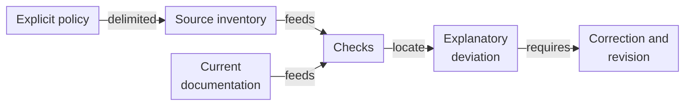

# ATF quality governance

## Overview

Governance converts the principles of structure into local executable checks. The suite inspects the sources, documents and contracts of the libraries consumed without device, tournament or access to external services.

## Complementary guides

- [Good documentation practices](ATF_Documentation.md): organization, drafting, legends, navigation and live revision.
- [Change of tests](ATF_TestChanges.md): independent expectations, negative control and responsibility transfer.
- [Package responsibilities](ATF_Packages.md): engine structure, application and tests, cohesion and dependency limits.

## Perimeter and responsibilities



<details>
<summary>Legend: a result has a perimeter</summary>

The inventory includes declared Maven roots and additional JVM roots from policy. Documentation validators inspect owner READMEs and Markdown guides, excluding generated directories.

</details>

[Local Suite](../../atf-tests/src/test/java/atf/tests/governance/AtfQualityGovernanceSuite.java) and [policy](../../config/atf-governance-policy.json) define the enforceable contract. Adaptation keeps the reusable rules of common verifiers; assumptions about other applications modules are not imported.

| Inventory | Input |
|---|---|
| Maven | The declared root and the responsible POM are kept together, including for nested modules; the metadata are not rebuilt from the first segments of the path. |
| Other roots | The module and path are explicit and `test` is Boolean; the root remains in its module. |
| Ownership | Each file has one owner and source set; overlaps are denied without any deduction that would conceal ambiguity. |

[Inventory contracts](../../atf-tests/src/test/java/atf/tests/governance/support/SourceInventoryContractTest.java) check both the valid source and the configurations that would lose the identity or change the owner.

## JVM Inventory via CLI

Start [inventory JVM](../../scripts/run-jvm-inventory.ps1) from the checkout that provides the tool. Parameter `-ProjectRoot` indicates the project inspected. `-ScratchRoot` indicates an existing directory outside both checkouts.

PowerShell 7, JDK 21 and local cache Jackson are required.

```powershell
.\scripts\run-jvm-inventory.ps1 -ProjectRoot $checkout -ScratchRoot $scratch
```

| Entry or verdict | Contract |
|---|---|
| Maven | `mavenModules` coincides with reactor modules and discovered POMs. An implicit missing root can be omitted. An explicitly configured root must exist. |
| Gradle and other source sets | `additionalSourceRoots` declares the module, the canonical relative path and role `test`. Roots outside the module and overlaps are refused even when the directories are empty. |
| Exceptions | `reviewedPackages` requires the exact inventory, motive and action. `productionBoundaryAdapters` requires the exact production file, the prohibited reason and the permitted references that still exist. |
| Output `0` or `2` | JSON with scheme version, modules, roots, roles, number of files and packages, declared and diagnosed exceptions. `0` indicates success and `2` indicates deviations in the complete inventory. |
| Exit `1` | Input or scope is invalid; details go to stderr. |

The CLI and suite apply the same package-path, import, cohesion and dependency rules. [Component samples](../../atf-tests/src/test/java/atf/tests/governance/support/JvmInventoryCliComponentTest.java) checks inventory and diagnostics on a separate project. Reactor compiling, test stratification and documentary governance have their own checks.

## Executable rules

| Area | Contract | Limit |
|---|---|---|
| Reactor | Source modules coincide with policy; common libraries remain binary | We are not copying the producer's implementation or regression infrastructure. |
| Packages | Declaration corresponds to path; cohesion is checked separately on module and set of sources | The number of files does not measure semantic quality alone. |
| Cohesion | Maximum eight Java files per package; current inventory does not use derogations | A build up of responsibilities requires separation without increasing the threshold. |
| Imports | No duplicate imports; comments and strings do not become code | Lexical verification uses the common parser. |
| Dependencies | Engine does not know Android, ATF or JUnit; infrastructure follows declared directions | Test Kit holds local JUnit integration; the implementation of the console and its native samples are consumed by binary delivery. |
| Levels | A Maven executable class has one level; the guide table corresponds to the code | The helping classes and Gradle modules have explicit policies. |
| Documentation | Structure, prose, style, diagrams, legends, links, fragments and relocatable paths | English wording and conceptual accuracy also require editorial review. |

The policy does not allow automatic threshold increase or the generation of derogations to achieve success. Negative evidence also checks the generic mechanism of exceptions: accurate identity of files, motive and separation action; an exception which is made unnecessary is rejected. These synthetic samples shall not enter derogations in the project.

## Test declarations

[Parser syntactic](../../atf-tests/src/test/java/atf/tests/governance/source/JavaTestDeclarations.java) uses active JDK in memory without class generation or annotation processing. [Layer rules](../../atf-tests/src/test/java/atf/tests/governance/source/TestLayerRules.java) consumes this structure and keeps separate the solution of compound annotations.

Each inspection owns and closes its JDK file manager, reusing it across sources in that inspection. Each source has a fresh parse task and diagnostic collector; a syntax error does not contaminate the following source, and the closed context cannot be used any longer.

| Border | Contract |
|---|---|
| Declaration | The annotation position to modifiers, qualified form and spacing shall not change the owner. |
| Declared execution | Type methods and containers `@Nested` identify execution; an inner class used as fixture does not automatically label the outside. |
| graph annotations | Explicit or wildcard imports, actual declarations and bounded cycles; ambiguities are denied. |
| Sources invalid | A syntax error produces a diagnostic with line and column without accepted empty inventory. |
| Limit | Inspection does not load application types or execute JUnit; it does not replace full compilation or inherited-method resolution. |

[Syntax components](../../atf-tests/src/test/java/atf/tests/governance/source/TestLayerSyntaxTest.java) verify rejected syntax and valid neighbouring cases, including Java examples in strings that should not be treated as declarations.

### Paired parser cost

The test-only [cost probe](../../atf-tests/src/test/java/atf/tests/governance/source/ParserCostProbe.java) compares the production parser with JDK default paths on the same frozen Maven Java inventory. Both stop at syntax parsing, without type analysis or application-class loading.

| Boundary | Measurement contract |
|---|---|
| Inputs | Read UTF-8 sources once, preserve paths and fingerprint the complete ordered inventory. |
| Ownership | A disposable measurement JVM has an explicit heap limit, declared processor count and process deadline; each trial owns one file manager and each source receives a fresh parse task and diagnostics. Compiler resources do not remain in the functional owner. |
| Reference | Both modes disable annotation processing; production uses empty class/processor paths and the reference uses JDK default paths. |
| Order | Warm both modes, then alternate the order of measured pairs. |
| Cost | Retain raw parse time separately from total ownership, AST normalization and hashing; record JDK, VM, OS and processor count. |
| Correctness | Require equal source counts and normalized AST fingerprints across every trial; refuse empty, duplicate or malformed inputs. |

Observed durations remain in the external audit. Configuration isolation is a correctness boundary; a speedup requires measured evidence and is never inferred from flags alone.

## Isolated execution

For a file or full documentary inventory, use [Documentation Client](ATF_Documentation.md#documentation-governance-cli). It tests the same editorial rules as the suite.

To verify the published evidence, use a checkout Git with the commit objects identified in the release notes. The suite reads those local objects, and a missing object causes error.

From the root of the project:

```powershell
.\scripts\run-atf-governance.ps1
```

The launcher compiles and checks the same temporary copy. [Qualification preflight](../testing/ATF_ReleaseQualification.md#snapshot-and-preflight-before-maven) confronts the artifacts and locks the sources and release folder separately. The changes in checkout or copy invalidate the result.

The run uses a Maven cache owned by its temporary workspace. The existing cache can initialize dependencies through `-MavenCache`; installing libraries in `lib` does not replace files used by other processes.

For a working copy already prepared, with the required libraries and modules:

```powershell
mvn -B '-Dmaven.repo.local=<depozit-Maven-propriu>' -pl atf-tests -am '-Dtest=AtfQualityGovernanceSuite' '-Dsurefire.failIfNoSpecifiedTests=false' test
```

`atf.governance.root` selects the inspected copy; `atf.governance.gitRoot` identifies the checkout used for [test-change diff review](ATF_TestChanges.md#checking-the-git-diff) and for historical objects of published evidence.

## Evidence and limits

- The native result keeps the class, rule and localised deviation.
- Negative evidence checks for an injection defect and acceptance of the healthy document next door.
- The inventory of sources does not ignore a valid package called `target` inside a compiled root.
- [Root hygiene](../../atf-tests/src/test/java/atf/tests/governance/source/workspace/WorkspaceHygieneGovernanceTest.java) refuses unrecognized directories, flattened local temporary paths and lost compiled files. Inspection is read-only; cleanup requires an inventory and resolved targets within the designated scope.
- [Single Strategy](../../atf-tests/src/test/java/atf/tests/governance/documentation/strategy/TestingStrategyGovernanceTest.java) keeps a regulatory owner, generic guides without results and an explanatory catalogue for each of the declared test roots.
- Documentary verification does not certify the game algorithm, Android rendering or compatibility of all libraries.
- Binary qualification remains the distinct contract of [integration of libraries](../platform/ATF_Integration.md).
- Semantic deficiencies and separation debt remain visible in [feedback](../feedback/ATF_Governance.md).
- [Retention of the evidence of the release](../../atf-tests/src/test/java/atf/tests/governance/documentation/release/ReleaseEvidenceRetentionGovernanceTest.java) refuses identical PNGs already incorporated. The presence of bytes does not certify the viewer, the autonomy of Android bodies or the integrity of APK; they have separate controls.
- [Delivery integrity](../../atf-tests/src/test/java/atf/tests/governance/documentation/release/ReleaseIntegrityGovernanceTest.java) checks the APK, checksum, CRC, file hash inventory and recorded JUnit cases. Negative fixtures also alter files and recompute their checksums to test validation of their contents. [Contract and limits](../platform/ATF_AndroidDelivery.md#integrity-of-files-and-results) explains the separate checks for file integrity, test execution, signing and provenance.

[Test architecture](../testing/ATF_Architecture.md) · [Documentation](ATF_Documentation.md) · [Change of tests](ATF_TestChanges.md)

## Semantic revision

Structural checks must be completed by checks on factual claims that have been enforceable. Semantic revision remains mandatory for rules, compatibility and limits described in several summaries.

- [Package responsibilities](ATF_Packages.md) calls for the status, dependencies and invariance of each mechanism; moving a file alone does not demonstrate cohesion.
- [Good documentation practices](ATF_Documentation.md) holds the editorial grid and the separation of the external result from the contract.
- [Governance feedback](../feedback/ATF_Governance.md#qualification-of-claims-and-launchers) keeps the still necessary factual control and required level prior to closure.
