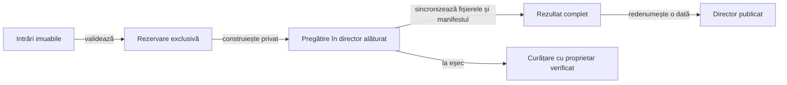

# Contractul corpusului de partide

## Pe scurt

Corpusul este o intrare externă pentru replay, selecție și analiză offline. Proiectul deține schema și validatoarele; fișierele partidelor, manifestele concrete și registrele loturilor rămân în depozitul extern configurat.

## Modelul datelor

| Entitate | Contract |
|---|---|
| Partidă | Identitate, partiție, profil de reguli, politici și ordinea mâinilor. |
| Mână | Dealer, distribuție, atu și carte întoarsă, licitații ordonate, levate și închiderea scorului. |
| Observație | Mâna actorului și prefixul public disponibil la decizie. |
| Manifest | Fișiere selectate, hash-uri, identitatea părintelui și scopul selecției. |
| Registru de lot | Separarea dezvoltării de evaluare și evidența intervalelor deja consumate. |


<details>
<summary>Legendă: accesul la date</summary>

Validatorul poate verifica proprietatea tuturor cărților după încheierea jocului. Politica primește proiecția permisă la decizie, iar analiza nu transformă mâinile adverse reale în intrări ale acelei politici.

</details>

## Partiții și integritate

- Development permite analiza și ajustarea; selecția activă citește numai manifestul declarat.
- Heldout este rezervat evaluării candidatului înghețat și se înregistrează ca expus la deschidere.
- Reference păstrează intrări de compatibilitate; ele nu justifică o afirmație despre puterea actuală a unei politici.
- Repetările aceleiași distribuții sau urme nu se numără drept observații independente.
- În schema partidei, seed-ul este șir zecimal exact; parserul nu îl convertește printr-un număr JavaScript care ar pierde precizia tipului Java long.
- Identitatea, partiția, căile și SHA-256 se verifică înainte de utilizare.

## Utilizare

[Configurația corpusului](../../config/learning-corpus.json) indică arhiva și pointerul activ. [Validatorul](../../whist-lab-app/ai-lab/tools/corpus/whist-corpus.mjs) verifică regulile și scorul, iar [selectorul activ](../../whist-lab-app/ai-lab/tools/corpus/whist-active-corpus.mjs) controlează selecția.

```powershell
$gamePath = Read-Host 'External replay JSON file'
$expectedSha256 = Read-Host 'SHA-256 declared in the source manifest'
node whist-lab-app/ai-lab/tools/corpus/whist-corpus-cli.mjs replay $gamePath $expectedSha256
node whist-lab-app/ai-lab/tools/corpus/whist-active-corpus.mjs verify-current
```

[Replay-ul](../../whist-lab-app/ai-lab/tools/corpus/whist-archive-replay.mjs) cere hash-ul așteptat înaintea citirii, compară octeții și apoi verifică regulile; o intrare lipsă, schimbată sau ilegală este refuzată. Hash-ul identifică fișierul, fără să demonstreze proveniența ori corectitudinea jocului. Sarcina Gradle `:ai-lab:replayArchive` acceptă aceleași intrări prin `-Pwhist.archive.file` și `-Pwhist.archive.sha256` și nu face parte din `check`.

Componentele implicite folosesc [date legale construite](../../whist-lab-app/ai-lab/tools/testing/legal-game-fixture.mjs), cu reguli de pregătire independente de validator. Arhiva externă este necesară numai pentru operațiile selectate asupra datelor păstrate.

[Criteriile selecției](ATF_Selection.md) și [protocolul evaluării](README.md) explică folosirea corpusului pentru îmbunătățirea politicilor.

## Publicarea atomică a uneltelor

[Curatorul activ](../../whist-lab-app/ai-lab/tools/corpus/whist-active-corpus.mjs) și [compozitorul loturilor pereche](../../whist-lab-app/ai-lab/tools/learning/whist-learning-batches.mjs) folosesc același [publicator de directoare](../../whist-lab-app/ai-lab/tools/qualification/atomic-directory.mjs). Apelantul furnizează un părinte existent și o destinație nouă în afara intrărilor imuabile; verificarea căilor canonice respinge și aliasurile către aceste intrări.



<details>
<summary>Legendă: vizibilitate și proprietate</summary>

Scriitorii cooperanți rezervă exclusiv aceeași destinație. Consumatorii văd fie absența directorului final, fie un rezultat complet; fișierele private și rezervarea nu sunt acceptate drept date publicate.

</details>

| Graniță | Contract |
|---|---|
| Destinație existentă | Refuză fișierele, legăturile și directoarele, inclusiv directoarele goale; nu combină și nu șterge un rezultat anterior. |
| Identitatea intrărilor | Păstrează octeții originali ai partidelor și invocărilor, hash-urile, populația perechilor și eșecurile înregistrate; numele pregătirii private nu devin identități ale rezultatului. |
| Finalizare | Sincronizează fiecare fișier, scrie manifestul ultimul și verifică din nou rezervarea, proprietatea directorului privat și absența destinației înainte de promovare. |
| Eșec tratat | Elimină numai pregătirea privată deținută și rezervarea originală; păstrează eroarea primară și eventualele eșecuri de curățare. Un eșec de curățare după promovare nu șterge rezultatul publicat. |
| Proces întrerupt | O oprire brutală poate lăsa o rezervare și pregătirea privată; nu este permisă expirarea automată ori preluarea rezervării. Confirmați oprirea scriitorului și verificați proprietatea și intrările originale înainte de recuperarea explicită. |

Publicarea folosește un director alăturat pe același sistem de fișiere. Este un contract între scriitori cooperanți, nu protecție împotriva unui proces ostil care înlocuiește căile între verificări ori garanție de durabilitate la căderea alimentării.

Testele unitare pure acoperă granițele sistemului de fișiere și păstrarea erorilor publicatorului. [Componentele auditabile de publicare](../../atf-tests/src/test/java/atf/tests/learning/publication/CorpusPublicationComponentTest.java) generează local partide legale, compară independent hash-urile surselor și ale rezultatelor și controlează scriitorii concurenți și eșecurile la scriere/promovare; nu cer nici arhivă externă, nici capturi de ecran.

O componentă focalizată măsoară selecția deterministă de tip set-cover pe intrări sintetice:

- **Populație:** 100, 1.000 și 5.000 de urme unice după o încălzire cu 128 de intrări; fiecare rând cere acoperire 64/64 a lecțiilor și respectă limita de 100 de partide.
- **Observații:** octeții intrării serializate, numărul selectat, hash-urile selecției în ordine directă/inversă, durata selectorului și memoria JavaScript reținută după colectarea explicită a gunoiului.
- **Limite:** procesul copil declară heap de 128 MiB și timeout de 60 de secunde. Memoria reținută nu este vârful de memorie; proba nu exercită parsarea arhivei, validarea/copierea/publicarea integrală sau recuperarea după oprire brutală.
