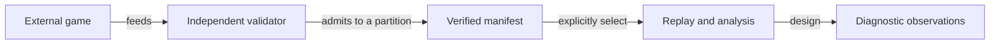
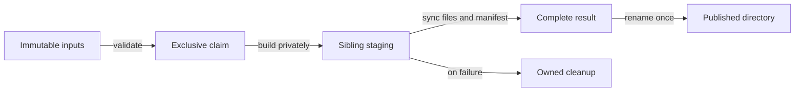

# Game corpus contract

## Overview

The corpus is an external entry for the replay, selection and offline analysis. The project has the schematics and validators; game files, concrete manifests and lot registers remain in the external warehouse configured.

## Data model

| entity | Contract |
|---|---|
| Party | Identity, partition, rule profile, policies and order of hands. |
| Hand | Dealer, distribution, trump card, orderly bids, tricks and closing score. |
| Observation | The actor's hand and the public prefix available at the decision. |
| Manifest | Selected files, hashes, parent identity and purpose of selection. |
| Lot Register | Separate evaluation development and record of already consumed ranges. |



<details>
<summary>Legend: access to data</summary>

The validator can check the property of all cards after the game is finished. The policy receives the projection allowed to the decision, and the analysis does not turn actual adverse hands into inputs of that policy.

</details>

## Partitions and integrity

- Development allows analysis and adjustment; active selection reads only the declared manifest.
- Heldout is reserved for the assessment of the frozen candidate and is registered as exposed to the opening.
- Reference keeps compatibility inputs; they do not justify a statement about the current power of a policy.
- Repeats of the same distribution or trace shall not be counted as independent observations.
- In the match scheme, the seedum is exactly decimal; the parser does not convert it by a JavaScript number that would lose the accuracy of the type Java long.
- The identity, partition, paths and SHA-256 shall be checked prior to use.

## Usage

[Body configuration](../../config/learning-corpus.json) indicates the archive and active pointer.[Validator](../../whist-lab-app/ai-lab/tools/corpus/whist-corpus.mjs) checks the rules and the score, and [selector active](../../whist-lab-app/ai-lab/tools/corpus/whist-active-corpus.mjs) controls the selection.

```powershell
$gamePath = Read-Host 'External replay JSON file'
$expectedSha256 = Read-Host 'SHA-256 declared in the source manifest'
node whist-lab-app/ai-lab/tools/corpus/whist-corpus-cli.mjs replay $gamePath $expectedSha256
node whist-lab-app/ai-lab/tools/corpus/whist-active-corpus.mjs verify-current
```

[Replay](../../whist-lab-app/ai-lab/tools/corpus/whist-archive-replay.mjs) requires the hash expected prior to reading, compares bytes and then checks the rules; a missing, changed or illegal entry is denied. The hash identifies the file without demonstrating the provenance or correctness of the game. The Gradle `:ai-lab:replayArchive` task accepts the same entries by `-Pwhist.archive.file` and `-Pwhist.archive.sha256` and is not part of `check`.

Default components use [legal data built](../../whist-lab-app/ai-lab/tools/testing/legal-game-fixture.mjs), with rules of training independent of validator. External archive is required only for selected operations on kept data.

[Selection criteria](ATF_Selection.md) and [evaluation protocol](README.md) explain the use of the body to improve policies.

## Atomic tool publication

The [active curator](../../whist-lab-app/ai-lab/tools/corpus/whist-active-corpus.mjs) and [paired-batch composer](../../whist-lab-app/ai-lab/tools/learning/whist-learning-batches.mjs) use one [directory publisher](../../whist-lab-app/ai-lab/tools/qualification/atomic-directory.mjs). The caller supplies an existing parent and a fresh destination outside immutable inputs; canonical path checks also reject aliases into those inputs.



<details>
<summary>Legend: visibility and ownership</summary>

Cooperating writers claim the same destination exclusively. Consumers see either no final directory or a complete result; private files and the claim are never accepted as published data.

</details>

| Boundary | Contract |
|---|---|
| Existing destination | Refuse files, links and directories, including empty directories; never merge or erase an earlier result. |
| Input identity | Preserve original game and invocation bytes, hashes, pair population and recorded failures; private staging names never become result identities. |
| Completion | Sync each file, write the manifest last and recheck the claim, private staging ownership and destination absence before promotion. |
| Handled failure | Remove only owned private staging and the original claim; retain the primary error and any cleanup failures. A cleanup failure after promotion does not erase the published result. |
| Interrupted process | A hard stop may leave a claim and private staging; no automatic expiry or claim takeover is permitted. Confirm the writer has stopped, the final destination is absent, the claim and stage still have their recorded ownership, and immutable input bytes still match before removing only that exact private stage and claim. Then restart publication from the original inputs. |

Publication uses a sibling on the same filesystem. This is a cooperative-writer contract, not protection against a hostile process replacing paths between checks, or a power-loss durability guarantee.

Pure unit tests cover the publisher's filesystem boundaries and error retention. Auditable [publication components](../../atf-tests/src/test/java/atf/tests/learning/publication/CorpusPublicationComponentTest.java) generate legal games locally, compare source and published hashes independently, and control concurrent writers and write/promotion faults; they require neither an external archive nor screenshots.

- **Hard-stop recovery:** a child test leaves the production claim and private stage in place. It proves that a live competitor is refused, observes child termination, rechecks the exact claim and source/copy hashes, then performs explicit owned cleanup and republishes.
- **Limit:** this qualifies the generic directory publisher. Archive-scale curator traversal and its peak-resource/recovery profile remain open.

A focused component measures deterministic set-cover selection on synthetic input:

- **Population:** 100, 1,000 and 5,000 unique traces after a 128-entry warm-up; every row requires 64/64 lesson coverage and respects the 100-game cap.
- **Observations:** serialized input bytes, selected count, forward/reverse selection hashes, selector elapsed time, and retained JavaScript heap after explicit garbage collection.
- **Limits:** the child process declares a 128 MiB heap and 60-second timeout. Retained heap is not peak memory; this probe does not exercise archive parsing, full validation/copy/publication, or hard-stop recovery.
