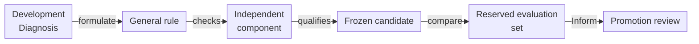

# Offline learning and evaluation

## Overview

Each candidate is an identified change to bidding or card selection. Before execution, the protocol fixes the evaluated role, sources, opponent families, scoring profile and deals.

- **Start:** [Building and improving AI](ATF_PolicyEvolution.md) follows the sequence of rule, context, focused regression, comparison and promotion. Policy changes are explicit; recomputing hand context does not rewrite accepted parameters.
- **Responsibilities:** [AI lab](../../whist-lab-app/ai-lab/README.md) owns experimental tools and sources; [shared launchers](../../scripts/README.md) select configuration and resources for an isolated run.

- [Corpus](ATF_Corpus.md) defines games and integrity of entries.
- [Selection](ATF_Selection.md) restricts analysis to distinct lessons.
- [Arena](ATF_Arena.md) compares policies on controlled deals and seats.
- [Retention](ATF_Retention.md) maintains the role and provenance of external data.
- [Transfer to another game](ATF_GameTransfer.md) delimits what we re-use and criteria of the first adapter.

## Qualification steps

| Step | What to check |
|---|---|
| Diagnostic | A public observation is drawn from a development match. A counterexample must be justified independently of the result recorded. |
| Component | Verify legal moves, remaining contract need, the returned card and counterexamples where the conclusion stops holding. |
| Development | Each pair uses identical deals and seats. Separate results by role, opponent family and hand size. |
| Held-out evaluation | Freeze sources before opening the range; the external registry retains used ranges. |
| Decision | The declared thresholds and the requirement for strict progress shall apply. Neutral and negative results remain available. |

## Interpretation

- A seed with rotated seats gives several correlated games.
- Read exact contracts, points and tie-split wins separately.
- Enumerated feasible worlds bound the proof’s domain. A probability additionally requires a distribution model.
- A different choice can change the bids and scores of subsequent hands. The first divergence shall be identified before attributing a gain.

## Reproduction

[Collections Launcher](../../scripts/run-whist-collection.ps1) selects the tournament from the protocol schema and verifies frozen sources. [Command guide](../testing/ATF_Collections.md#frozen-experiments-and-sources) holds the parameters, overlapping modes and actual preconditions.

- Identify an executed copy by its captured source and configuration; a live change does not requalify it retrospectively.
- Reproduction of an old evaluation uses its retained sources and does not create a fresh held-out evaluation.
- [Shared registry](ATF_EvaluationRegistry.md) checks ranges and historical exposure independently of the corpus. Development can replay distributions and the continuation retains identity; neither creates a fresh unexposed evaluation set.

## Stable rules and experimental data

[Rules and configuration of AI](../ai/ATF_RulesConfiguration.md) holds the inventory of the manifests and their executable effect. The code, scheme and parameters are identified; games, concrete selections and results belong to the external repository.

[Corpus contract](ATF_Corpus.md) defines the format and partitions, and [retention](ATF_Retention.md) defines the preservation of origin. Renaming or relocating a selection does not make exposed data unexposed again.

## The improvement cycle

[The procedure for evolution](ATF_PolicyEvolution.md) holds the steps and exit criteria. This map guides the reading; the arena, components and collections have specialized contracts.

Legend: protocol precedes evaluation

The roles, opponents, score, distributions, budgets and criteria are declared before the reserved lot. The result informs promotion without retrospectively changing the candidate or thresholds.

For first improvement, follow [focused diagnosis and regression](ATF_PolicyEvolution.md#from-a-game-to-a-focused-question), then [comparison of games](ATF_PolicyEvolution.md#how-do-we-compare-games) and [promotion](ATF_PolicyEvolution.md#when-we-promote). The protocol shall be established prior to the reserved assessment.

A defeat locates analysis without demonstrating a mistake on its own. Full hands are admitted to post-game audit, while policy remains limited to [permitted observation](../ai/ATF_DecisionModel.md#contract-of-a-decision).

[Arena](ATF_Arena.md) · [Components AI](../testing/ATF_AiComponents.md) · [Commands](../testing/ATF_Collections.md)
