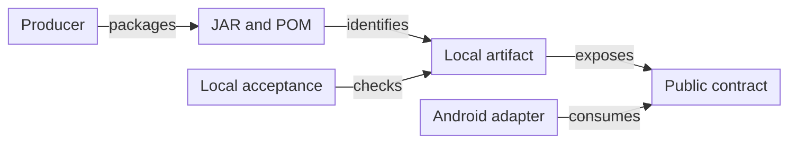

# Consumption of common libraries

## Overview

The project consumes Core, Reporting, Console, Mock and Test Kit as versioned JAR/POM pairs. Its reactor owns Validation, Android infrastructure and local integration checks; library implementation and native tests remain with the producer.

## Complementary guides

- [Library contracts and ownership](../../lib/README.md) explains the shared responsibility and the separate acceptance of consumers.
- [Integration contract](ATF_Integration.md) defines binary identity, adapters and synchronisation.
- [Android delivery](ATF_AndroidDelivery.md) explains APK build, publication and installation, including persistence. [Anonymous access verification](ATF_AndroidDelivery.md#anonymous-access-and-public-route) covers the public route and diagnosis of HTTP 404.
- [Release retention](ATF_ReleaseRetention.md) separates local candidate, publication and retirement of previous versions.

## Responsibilities

Legend: separate implementation and acceptance

The producer qualifies implementation and native tests. The consumer verifies delivered bytes and contracts used by its adapters; an offline result does not establish on-device interaction.

| Library | Responsibility | Dependency limit |
|---|---|---|
| Core | Common neutral contracts and mechanisms | It doesn't own the rules or the Whist interface. |
| Reporting | Publication and rendering of evaluated data | Preserves original comparisons and captures; the consumer owns game verdicts. |
| Console | Event formatting and JUnit cycle projection | JUnit integration has an optional Kit dependency; consumers declare Kit when using that integration. |
| Mock | Deterministic HTTP transport replacement and exact matching | The data and the scenario catalogue belong to the consumer; they do not simulate the engine of the game. |
| Test Kit | Execution configuration and JUnit extensions | Whist suites and selections remain local. |

Console and Mock do not depend on Reporting, Validation or application modules. The published POM fixes the dependence of the library, independent of the local reactor version.

## Identity and integrity

- [Root POM](../../pom.xml) selects the actual coordinates and versions.
- `lib` contains one physical JAR/POM pair for each library, directly in the directory, along with the README index and the five user guides.
- `library-provenance.json` keeps the hashes, producer's inputs, the catalogue of native tests and the reference of current acceptance.
- The JAR-embedded POM matches the adjacent published POM byte for byte.
- Parallel sources, additional versions, incomplete pairs and nested artifact stores are rejected.
- Delivery records and concrete checks remain external, preserving original integrity.

## Acceptance and governance

| Verification | Contract local |
|---|---|
| [PlatformLibraryContractTest](../../atf-tests/src/test/java/atf/libraries/PlatformLibraryContractTest.java) | Physical identity, independent POMs, isolation and use without prohibited infrastructure. |
| [PlatformLibraryIntegrityTest](../../atf-tests/src/test/java/atf/libraries/PlatformLibraryIntegrityTest.java) | Refusing altered artifacts or metadata, including when an external hash has been updated. |
| [CoreReportingConsumerContractTest](../../atf-tests/src/test/java/atf/tests/publishing/CoreReportingConsumerContractTest.java) | Configuration and artifacts actually loaded. |
| [LibraryReadmeExamplesIntegrationTest](../../atf-tests/src/test/java/atf/libraries/LibraryReadmeExamplesIntegrationTest.java) | Java examples extracted from delivered guides, compiled and executed against physical JARs with positive and negative cases. |
| [Quality suite](../../atf-tests/src/test/java/atf/tests/governance/AtfQualityGovernanceSuite.java) | Source perimeter, documentation, packages and library acceptance. |

Negative evidence builds identifiable synthetic artifacts. Physical acceptance uses real JARs and does not replace them with locally compiled production classes.

## Construction and update

| Activity | Contract |
|---|---|
| Isolated build | [Governance Launcher](../../scripts/run-atf-governance.ps1) prepares its own copy and Maven cache; `validate` installs the `lib` pairs before dependency resolution. |
| Development environment | The root POM and the Maven settings define the same dependencies; Kit is explicitly declared for the JUnit adapter that requires it. |
| Update | Identify the candidate, verify the API and establish local acceptance independently; Android scenarios also require a reserved device and declared initial state. |

[Integration of APIs](ATF_Integration.md) · [Test architecture](../testing/ATF_Architecture.md) · [Feedback owners](../feedback/README.md)
