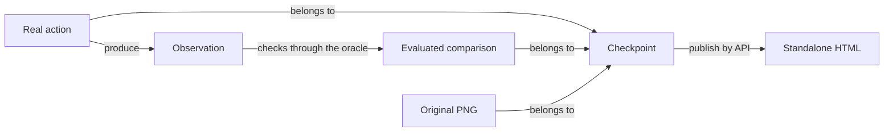

# Android and component reporting contract

## Overview

Publication provides a standalone presentation of the declared scope, original inputs and evaluated outcomes. The consumer owns domain semantics and typed records; the common library renders them through its public API.

## Responsibilities

Legend: data ownership

The action, observation, comparison and capture are distinct facts associated with the same claim and status. The renderer presents the evaluated outcome without rerunning the oracle or inferring success from a picture.

| Owner | Contract |
|---|---|
| Consumer | Capture, state extraction, independent oracle, rules, selection and composition. |
| Library | Neutral types, tables, disclosure, timing and image viewer. |
| Acceptor | Integrity, ownership, completeness and interactive verification of the declared scope. |

## Invocations and phases

| Level | Required content |
|---|---|
| Invocation | Actual class identity, method and parameters with effective profile. |
| Setup | Evaluated inputs and preconditions; setup does not replace assertions in the test body. |
| Body | Before state, input, after state, independent expected value, actual value and verdict. |
| Teardown | Actual cleaning and secondary cause without replacement of initial error. |
| Population | Cases, games, pairs, moves and comparisons delimited as distinct units. |

- Each executed invocation must be identifiable, including parameterized invocations of the same name.
- The set, context or aggregated statistics shall not generate fictitious PASS invocations.
- PASS, FAIL, ERROR and SKIP results are kept distinct.
- The partial capture at failure shall retain the last safe context and original cause.
- A JUnit outcome without captured comparisons cannot be repaired by inventing assertions in a later narrative.

## Action, observation and result

The action table shall keep the operation dispatched, the semantic target, wait, observation, duration and outcome. The comparison table shall keep ASSERTION, EXPECTED, ACTUAL and RESULT for the assessment performed once only.

- ADB is the source of the Android capture, and UI Automator provides the hierarchy.
- The browser inspecting HTML is the report auditor.
- An accepted command and a correct semantic transition have distinct criteria.
- OBSERVE describes a state without inventing an input.
- HTTP, SQL, component comparisons and UI actions use the semantic surface of the actual fact.
- Titles and summaries shall not substitute for detailed comparisons.

### Checkpoint transaction

The [coordinator](../../atf-test-android/src/test/java/atf/android/e2e/support/AndroidUiFlowTrace.java) fully validates a checkpoint before changing action ownership. The [journal](../../atf-test-android/src/test/java/atf/android/e2e/support/journal/AndroidUiFlowJournal.java) owns pure encoding and file replacement; serialization never reconstructs outcomes.

| Boundary | Preserved data |
|---|---|
| Rejected input | Pending actions, phases and the previous journal stay unchanged. |
| Write refused before replacement | Only the uncommitted checkpoint is withdrawn; actions can be retried without duplicate registration. |
| Replacement succeeds, then timing fails | Committed evidence keeps its owner; the original cause stays visible. |
| Replay and publication | Original identities, comparisons and failures reach the manifest and standalone HTML. |

The live trace captures the public Reporting settings once. Checkpoint admission and publication share the same assertion preview policy: an oversized expected or actual value is rejected before journal writes or action transfer, with its assertion name, field, limit and measured UTF-16 length. Original values remain untouched; complete diagnostics belong to observation bodies rather than truncated comparison summaries.

Legacy replay does not invent historical settings: it applies the effective publication policy and retains the original comparisons. The publisher independently checks these records before creating HTML. A bounded summary may be retried without losing or duplicating pending actions.

Units verify format, statuses and Unicode fields without Extent. Components verify refusal, interrupted writing, retry and publication without a device; they do not qualify Android pixels.

### Full bodies and display budget

Preview of the assertions and the body ceiling are independent settings. [EvidenceTextParts](../../atf-test-android/src/main/java/atf/android/evidence/text/EvidenceTextParts.java) divides the text already written into consecutive parts that respect the actual budget without separating a unicode pair.

- Each body must retain its source owner, hash and order `part i/N`; the concatenation of the parts shall fully reconstruct the admitted source text.
- The division does not increase the ceiling or reassess the comparisons. A character that does not fit into the budget produces explicit refusal without silent truncation.
- The same mechanism publishes component inputs, whole expected/actual and Android text annexes; tests include the tail of a hierarchy larger than the ceiling.

### Republishing without Android interaction

[CapturedAndroidFlow](../../atf-test-android/src/test/java/atf/android/e2e/support/replay/CapturedAndroidFlow.java) reads the existing manifest through the read-only publication contract. It keeps comparisons, verdicts, checkpoints and original intervals; it refuses unknown verdicts, artifacts outside the owning directory and times attributed to another stream.

The publication shall be labelled `offline-republication` and shall be made explicit. The new HTML does not become new Android execution; the original manifest remains unchanged and the browser checks the new presentation separately.
- A false assignment of the driver is refused even when the other values coincide.

## Capture and ownership

- Each published checkpoint may contain the original PNG of the entire physical screen, with orientation and edges preserved.
- The analysis of a region may derive a separate image without replacing the original capture.
- Base64 is incorporated into HTML; identical payloads can be canonical, with exact references for each checkpoint.
- The local status of the checkpoint is maintained; the final result does not retrospectively recolour all states.
- If more than one capture takes place, the window observed shall be explicitly declared.
- Components without device use status data and comparisons without manufactured Android captures.

The viewer keeps the image proportions and provides access to the original size. Returning from the viewer preserves the current owner, disclosure state, scroll position and focus; consumer checks compare the original payload with the exact reference.

## Autonomous content and budgets

HTML shall allow understanding of the verification without access to checkout: rule, units, comparative input, observation and limit of claim remain associated to the owner.

[Presentation policy](ATF_Presentation.md) owns selection of invocations, groups, fragments and budgets. The original capture and the values justifying the result are mandatory data; the optional diagnosis is explicitly framed.

A hash proves the identity of the bytes without replacing the oracle of the domain. An external link or summary of the reply shall not replace the comparisons necessary for the purpose published.

### Attachment capture

- [Capture text](../../atf-test-android/src/main/java/atf/android/evidence/text/CapturedTextEvidence.java) reads the bytes once and decodes strictly UTF-8; the fingerprint identifies the original, and the published body passes through the library’s redaction.
- The publisher shall incorporate the manifest, the annexes declared by checkpoints and additional entries, deduplicating identical bodies; the non-identifiable data shall be refused prior to the session.
- The incorporation on publication is labelled as such and does not rebuild the time of the Android capture.

## Time and status

[Timing contract](ATF_PhaseTiming.md) holds the original ranges, axes and treatment of incomplete logs. [Result handoff](ATF_Handoff.md) owns acceptance of a declared scope and republication identity.

- Failure to act, compare or capture is not cancelled by subsequent successful completion.
- The functional verdict and the result of the publication are distinct facts.
- Zero invocations, missing mandatory data or an all-SKIP result cannot qualify a scope as verified.

## Execution and verification

The data captured, published and audited shall have separate contracts:

| Owner | Contract |
|---|---|
| [AndroidUiFlowTrace](../../atf-test-android/src/test/java/atf/android/e2e/support/AndroidUiFlowTrace.java) | It shall maintain the order and ownership of the data prior to publication. |
| [AndroidUiFlowReportPublisher](../../atf-test-android/src/test/java/atf/android/e2e/support/AndroidUiFlowReportPublisher.java) | Render checkpoints through the library UI API and manage the publication session. |
| [AndroidUiFlowReportAudit](../../atf-test-android/src/test/java/atf/android/e2e/support/AndroidUiFlowReportAudit.java) | Confronts the resulting report with the checkpoints, actions, comparisons, ranges and PNGs captured; refuses incomplete or divergent associations. |

The controls shall follow the exact owner, multiplicity, the final comparison, the order of fragments and the PNG bytes. The global search for a value or hash does not demonstrate its association with the correct scenario.

- The reader shall be checked on additional attributes, keeping the same labels, orders and images; the delimitation follows the DOM nodes, without depending on the serialisation of a tag.
- Negative control changes the image link from the selected checkpoint using the exact position of the node in the source. The rest of the document shall be kept intact so that refusal demonstrates the specific association defect.
- The preview limit shall be read from the active configuration and shall be confronted with the metadata of the published comparisons. Timing tests check the configuration effect without fixing the default value of the library.

[Presentation policy](ATF_Presentation.md) · [Original timing](ATF_PhaseTiming.md) · [Publication audit](ATF_Audit.md) · [Responsibilities](../feedback/README.md)
