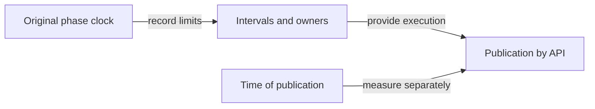

# Measurement of Android times

## Overview

A phase clock records the monotonic interval of the original activity. Command dispatch, capture, journal persistence and later publication have separate measurements.

## Time axes

| Axis | Source | Meaning |
|---|---|---|
| Original interval | Start and end from the same monotonic origin. | Full or interrupted interval, measured directly. |
| Original execution | The original interval minus capture and measured persistence. | Commands, waits, reads and domain checks in that phase. |
| ADB dispatch | Original ACTION records. | Command duration, as part of execution. |
| Capture | Interval controlled by the interaction adapter. | Obtaining PNG and hierarchy, including failed attempts. |
| Persistence | Writing the manifest in the phase range. | Operations of input/output kept separate from execution. |
| Publication | Start a new clock when projecting the checkpoint. | The current publication activity, separate from the final HTML save. |



<details>
<summary>Legend: activity captured and subsequent presentation</summary>

A range belongs to a flow, phase and position. Returning to a phase creates a separate interval; the time spent in another phase is not retroactively attributed to the first phase.

</details>

## Capture and association

[AndroidPhaseClock](../../atf-test-android/src/main/java/atf/android/evidence/timing/AndroidPhaseClock.java) measures monotonic time. [AndroidPhaseTiming](../../atf-test-android/src/main/java/atf/android/evidence/timing/AndroidPhaseTiming.java) validates ranges and axes; these components do not perform ADB commands or game checks.

- [AndroidUiFlowTrace](../../atf-test-android/src/test/java/atf/android/e2e/support/AndroidUiFlowTrace.java) opens the phase before the first action.
- Capture timing covers acquisition of the whole image and hierarchy; a subsequent checkpoint does not rebuild a missing beginning.
- Schema `phase.<ordinal>.timing` retains the identity of the flow, phase and order, ranges, length of capture and persistence, plus the COMPLETE/PARTIAL state.
- The additive schema keeps the journal format compatible with older readers.
- PNG bytes, actions and comparisons remain associated with the original checkpoint.

## Full, partial or absent data

| Entry point | Publication policy |
|---|---|
| Full original interval | Publish execution through the typed library API. |
| Interval interrupted | Keep PARTIAL and the original failure cause, including prior to the first capture. |
| Temporal data absent in an old journal | Display UNAVAILABLE; command durations do not substitute the complete interval. |
| Data declared RUNNING or invalid | Refuse full publication and alert corrupt metadata. |
| Interval assigned to another flow or phase | Refuse association before accepting the result. |

## Individual and aggregated disclosure

[AndroidPhaseReportTiming](../../atf-test-android/src/main/java/atf/android/evidence/timing/AndroidPhaseReportTiming.java) projects the ranges captured in the public API. The Android publisher and aggregate journal adapter use the same projection.

The record explains the original time axes; final HTML saving stays outside checkpoint projection time. The policy of preview shall be set up separately; the original captures shall retain their association.

## Verification of mechanism

| Limit | Checks |
|---|---|
| Clock | Axis separation, phase re-entry, backward time, interruption and overlapping captures. |
| Serialization | Exact round-trip conversion, missing scalars, impossible intervals and wrong owner. |
| Individual publication | The original execution, command dispatch and the publication shall be checked separately. |
| Aggregated publication | Same intervals through Extent and fallback presentation, with mutations of scalars and owners. |
| Interactive revision | The original duration, tables, folding sections and full PNGs shall remain accessible. |

```powershell
mvn -pl atf-test-android -am '-Dtest=AndroidUiFlowTimingComponentSuite' '-Dsurefire.failIfNoSpecifiedTests=false' test
mvn -pl atf-tests -am '-Dtest=GameReportComponentSuite' '-Dsurefire.failIfNoSpecifiedTests=false' test
```

Builds run in their own temporary copy. Checking a controlled clock or archived log has a distinct purpose from a new Android interaction.
