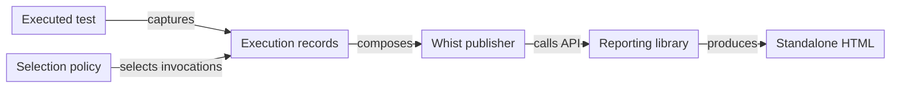

# Architecture of publication of results

## Overview

The consumer owns test selection, game semantics and publication inputs. Reporting turns captured execution records into a standalone presentation, preserving evaluated verdicts and the association between captures and their producing tests.

## Publication flow

Legend and limits

Application selection and comparisons belong to the consumer. The library preserves supplied verdicts, timing and attachments; the renderer does not infer a new result from text or images.

## Stable contracts

- Selection retains complete invocations, all failures and an inventory of omissions.
- Expected value, observed value and original case remain associated with the same assertion.
- Original Android captures are embedded as Base64 PNG and belong to their producing checkpoint.
- Components, simulated games, resumption and Android actions have distinct types and scopes.
- Republishing retains original execution identity; a missing captured interval remains explicit.
- Their results and references are published in the configured external repository.

## Configuration and responsibilities

| Mechanism | Owning contract |
|---|---|
| Selection, grouping and navigation | [Presentation policy](ATF_Presentation.md) |
| Actions, comparisons and images | [Android contract](ATF_Android.md) |
| Original execution and republishing | [Time measurement](ATF_PhaseTiming.md) |
| Recording and purpose-specific acceptance | [Result handoff](ATF_Handoff.md) |
| Integrity and access to content | [Publication audit](ATF_Audit.md) |

[Presentation policy](ATF_Presentation.md) defines the volume and selection of input data. [Android contract](ATF_Android.md) defines action–observation–comparison relationships, and [result handoff](ATF_Handoff.md) defines atomic publication.

Input defects are corrected by the consumer; generic library requirements go through [feedback](../feedback/README.md). Read binary identity from configured delivery provenance rather than copying versions or run results into this guide.

## Verification of contracts

| Question | Responsible verification |
|---|---|
| Are the failures and omissions declared? | [EvidenceSelectionContractTest](../../atf-tests/src/test/java/atf/tests/learning/EvidenceSelectionContractTest.java) checks selected, bounded and configured evidence capture. |
| Do the published values correspond to the entry? | [LearningRunReportContractTest](../../atf-tests/src/test/java/atf/tests/learning/LearningRunReportContractTest.java) checks deliberately distinct values and mutations. |
| Does each capture retain its checkpoint? | [AndroidInlineScreenshotReportContractTest](../../atf-tests/src/test/java/atf/tests/contracts/AndroidInlineScreenshotReportContractTest.java) checks inline PNG, including observations without invented assertions. |
| Can it be published for another game? | [Admission of domain](../learning/ATF_GameTransfer.md) requires a semantic adapter; a generic API does not define a new event’s domain meaning. |

[Focused verification](../../atf-tests/README.md#focused-verification) provides the starting command. Data contracts, HTML structure and browser interaction have distinct qualifications; a static result does not certify interactive navigation.
