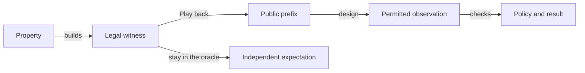

# Design of partial information policy tests

## Overview

A test checks a general property within its declared domain. An observed match guides analysis; the expected decision must follow rules, an invariant or an independent oracle.

## Construction of a valid situation

Legend: Witness and actor tested

The witness may contain the full distribution to demonstrate that the situation is possible. The policy only receives the observable projection of the actor and the comparison keeps the result separately.

## Family of properties

| Family | Contract |
|---|---|
| Legality | Deck without duplicates, undealt exposed card, bidding and every card played legally. |
| Information | Modification of actual opponent hands cannot change the same observation transmitted to policy. |
| Context | Controlled change of needs or opportunities may change choice with other fixed inputs. |
| Memory | Public cards and proven suit voids properly restrict the feasible worlds. |
| Score | Points, series and totals shall be calculated independently of the action selector. |
| Uncertain estimate | Comparing observations that differ by one factor: trump suit, exposed card, public bid or series. For Hard, the common translation of scores shall keep the entire vector of the estimate, including the budget consumed. |
| Certificate | Enumeration is complete, all relevant continuations are covered, and the exhausted budget keeps the fallback. |
| Comparison | Candidate actions use the same worlds and budgets; policies are compared on distributions and controlled places. |

## Verification level

[Test architecture](ATF_Architecture.md) defines the common classification. Pure calculations use unit tests, policy API as a component, and policy-policy-oracle collaboration through domain integration.

An Android path remains E2E only when performing new interactions in the installed application. The statistical comparison has its own protocol and does not replace these contracts.

## Scope of the claim

- The test of an ancillary function shall verify that limit; it shall not automatically certify the entire API for decision.
- A better average in a world is not domination in all worlds.
- Choices optimized separately after seeing each world can be incompatible with a single public action.
- A complete search per world and a universal certificate have different quantifiers.
- Reproducibility on the same observation does not automatically imply invariance when changing scores or symmetry between places.
- A statistical policy result and the correctness of a component have separate qualification criteria.

## Verification sources

| Source | Responsibility |
|---|---|
| [ContextualHonorDiscardTest](../../whist-lab-app/game-core/src/test/java/ro/whistlab/core/ai/engine/ContextualHonorDiscardTest.java) | Legal witnesses, trick needs and the effect of public cards. |
| [BidConditioningTest](../../whist-lab-app/game-core/src/test/java/ro/whistlab/core/ai/engine/BidConditioningTest.java) | Honor cover and ruff flexibility; soft likelihood with legal and forbidden final bids; completed/current-trick reconstruction; effective sample-size stopping; and neutral behavior for uncalibrated modes, schedules and table sizes. |
| [ContractEndgameTest](../../whist-lab-app/game-core/src/test/java/ro/whistlab/core/ai/engine/ContractEndgameTest.java) | Public void constraints, exact small endings, card counts, exposed-trump exclusion, and current-table evidence before a trick is scored. |
| [OfflinePerspectiveMatchTest](../../whist-lab-app/game-core/src/test/java/ro/whistlab/core/match/OfflinePerspectiveMatchTest.java) | Replays one fixed deal sequence in a selected ruleset with Normal-all, Hard-all, and each single-Hard seat; validates opaque deal commitments and the declared hand schedule within the matrix. |
| [BlindPolicyObservationTest](../../whist-lab-app/game-core/src/test/java/ro/whistlab/core/ai/information/BlindPolicyObservationTest.java) | Separating the actor’s own hand and public information before the call for policy. |
| [CertifiedContractRegressionTest](../../whist-lab-app/game-core/src/test/java/ro/whistlab/core/ai/engine/CertifiedContractRegressionTest.java) | Certificate, lack of guarantee and fallback. |
| [HardSalvageObjectiveTest](../../whist-lab-app/game-core/src/test/java/ro/whistlab/core/ai/contract/HardSalvageObjectiveTest.java) | The order of objectives when exact completion is publicly impossible. |
| [IndependentPlayerModelTest](../../whist-lab-app/game-core/src/test/java/ro/whistlab/coach/IndependentPlayerModelTest.java) | Feasibility and independent model. |
| [HumanUncertainBidComponentTest](../../whist-lab-app/app/src/test/java/ro/whistlab/app/bidding/HumanUncertainBidComponentTest.java) | Hard recommendation on public observation, trump, opponent bids, translation of score and independent formulas for configurable series. |

## Reading of archived observations

[ObservedPositionJson](../../whist-lab-app/game-core/src/test/java/ro/whistlab/core/testing/codec/ObservedPositionJson.java) adapts public captures to the current model without rewriting the original document. The absence of the penalty field retains the historical profile of five points; an explicit value remains explicit and an invalid one is refused.

[Adapter components](../../whist-lab-app/game-core/src/test/java/ro/whistlab/core/testing/codec/ObservedPositionJsonComponentTest.java) distinguish the absence, current value and data corruption. The compatibility of the capture is the responsibility of the archive reader and the engine remains independent of the JSON test parser.

## Organisation of collections

| Collection | Purpose | Boundary |
|---|---|---|
| Default regression | Small, stable, independent cases | Each case covers a distinct property or boundary. |
| Research, tournament and diagnostic | Explore unresolved behavior | Declare the purpose and budget; keep large game sets in the external corpus. [Focused selection](../learning/ATF_Selection.md) controls analysis cost. |
| `offlineMockMatchTest`, `offlinePerspectiveMatchTest` | Four-seat offline matches | Romanian 1–8–1 is the default; perspective runs accept every declared `GameMode` to check that Romanian rules do not leak into other variants. |

- `whist.offlineMatch.seed` selects the first deterministic seed; `whist.offlineMatch.mode` selects a `GameMode`; `whist.offlineMatch.roster` selects four `NORMAL`/`HARD` seats; `whist.offlineMatch.count` accepts 1–100 complete matches.
- `run-offline-perspectives.ps1 -Mode <GameMode> -Seed <seed>` compares all six seat rosters on the same private deal order. Its default is `ROMANIAN_WHIST`; alternate runs should be stored with their mode and paired seed under the external evidence root.
- One match writes its complete public bid/card trace. A batch writes compact per-match scores and contract-hit counts to `whist.offlineMatch.output`, which must point outside the checkout.
- Aggregates screen ideas; paired same-seed comparisons and component regressions are still required before promoting a policy change.

[Collections](ATF_Collections.md) · [Governance of changes](../governance/ATF_TestChanges.md) · [Decision model](../ai/ATF_DecisionModel.md)
