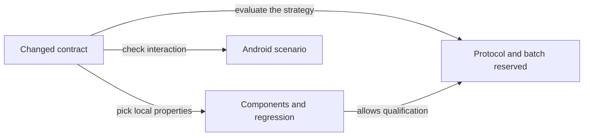
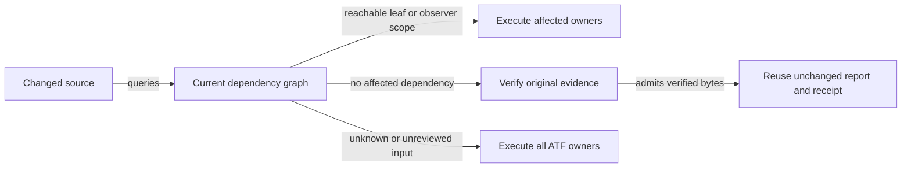
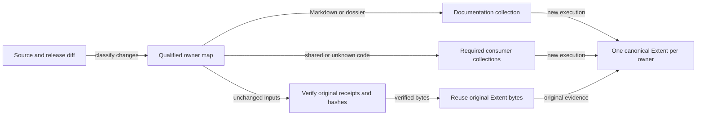
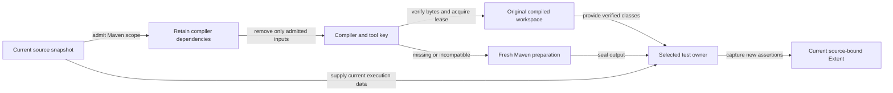
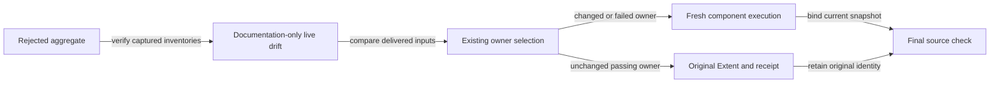

# Test collections

## Overview

[Catalogue of collections](../../config/test-collections.json), [runner](../../scripts/run-whist-collection.ps1) and [tasks Gradle](../../whist-lab-app/game-core/build.gradle) The number of cases is read from the native results of each run, not from an inventory fixed in the documentation.

[Test architecture](ATF_Architecture.md) defines the levels and executable matrix. The collection chooses the purpose and cost; its name does not change the level of verification.

## Collection choice



<details>
<summary>Legend: Selections for different purposes</summary>

The collection restricts cases to the changed property. The evaluation of a policy adds a protocol and reserved data, and the verification of Android adds a device; each keeps its own limits and result.

</details>

| Collection | Purpose | Execution |
|---|---|---|
| `cost` | Cost JVM for Normal, Hard and Independent at 2–8 cards | Proposed positions, CPU and explicit budgets |
| `context` | Honours, necessary levatates, returned attire or still on the table, legality of prefixes | Restricted JVM checks |
| `quick` | Rules, score, series, checkpoints and decision guards | Regression subset |
| `regression` | Full regression of domain, including restoration of status | JVM regression, no tournaments. [Session check](../../atf-tests/src/test/java/atf/tests/governance/source/game/GameSessionBoundaryComponentTest.java) also checks the continuation after checkpoint, at the public limit of the engine. |
| `strategy` | Small options and counterexamples for bidding and playing | Components JVM selected |
| `documentation` | Documented score and rules RO/EN | Excessive face-to-face with JUnit and bilingual aid generated |
| `learning` | Comparison between candidate and frozen policies | Full parts defined by protocol |
| `arena` | Distinguishing strategies at the same table and rotated places | Virtual League defined by protocol |
| `research` | Experimental models isolated from implicit regression | JVM explicitly activated research |

The catalogue also describes the acceptance of `e2e` separately. This uses Android runners; `e2e` is not an accepted value of parameter `-Collection`.

The `targetMinutes` estimates in the catalogue help plan. They shall not replace the measured time and shall not convert an incomplete execution into a successful result.

## Offline execution from the project root

```powershell
.\scripts\run-whist-collection.ps1 -Collection context
.\scripts\run-whist-collection.ps1 -Collection quick
.\scripts\run-whist-collection.ps1 -Collection regression
.\scripts\run-whist-collection.ps1 -Collection cost
```

Runner creates his own temporary copy and a new directory of results in the default external archive of the script. `-RunRoot` selects another external destination for the project and an existing destination is refused; `-JavaHome` selects JDK.

The [algorithm-build](../../whist-lab-app/algorithm-build/settings.gradle) build includes the engine and JVM laboratory; the dependence of the engine to the laboratory is for tests only. The construction of the Android app and the ADB access have separate entries, and Gradle's dependencies must be in cache for `--offline`.

Each execution shall keep the inventory of the SHA-256 of copied sources, the log, JUnit XML results and `collection-result.json`.

`cost` Copy prior to execution [cost profile](../../config/whist-ai-cost-profile.json), then measure the legal positions generated. `-CostProfile` be able to select another explicit profile; exact copy, environment and each measurement remains in the external result. [Cost contract](../ai/ATF_CostQualification.md) be in possession of the interpretation and limits of this qualification.

`-CaptureComponents` also calls for JSON captures of the case. The number of captures shall not be automatically the number of all tests carried out. A `quick` sub-set does not add up with full regression as if it were other cases.

## Summary of selection

[Test level](ATF_Architecture.md) and the name of the collection do not guarantee themselves that a case is discovered. The inventory shall be confronted with the results of the selected execution, including after the package has been moved or the compilation profile has changed.

- Keep the actual selector, configuration and identity `class + method + invocation`; include the inner classes and parametrizations. The suite containers are not additional cases.
- Run the entry point of the suite without selecting the included classes simultaneously. When compared to an individual launch, explicitly keep the overlap.
- Associate native XMLs with the selection and log of that execution. A file remaining in Surefire since its previous run does not prove participation in the current selection.
- For a move, keep the old-new mapping and relevant comparisons; a total unchanged can hide one lost case and another added unrelated.
- For an audited suite, face JUnit's and published claims. The existence of an HTML does not demonstrate that a new class has registered the audit adapter; [producer qualification](../reporting/ATF_Audit.md#governed-producer-inventory) maintains this control.

[Qualification folder](ATF_ReleaseQualification.md#release-dossier-readme) explains the selection required, the one executed and the limits. The orders of an execution and its totals remain in the result file, separately from this generic catalogue.

## Frozen experiments and sources

[Protocol offline](../learning/README.md#the-improvement-cycle) be qualified and criteria; here are the operational preconditions of the [runnerui](../../scripts/run-whist-collection.ps1).

| Entry point | Actual precondition |
|---|---|
| `learning` | `-Candidate`, `-CorpusRoot` and `-ProtocolFile`; the scheme declares roles, opponents, basic policies and phase interval. |
| `-CandidateOverlay` | External frozen candidate manifest with identity, role, paths and hashes; allowed in `regression` or in dedicated protocol of `learning`. |
| `-ResearchCandidate` | Unique entry into the research catalogue, allowed collection and compatible basis. |
| `-CasesFile` | Explicit selection for accepted protocol with identical sources between the composite lots. |
| `-Phase heldout` | Ask for `-CandidateFreeze`, with identity and hashes checked prior to booking. |

- **Sources: ** modes `CandidateOverlay` and `ResearchCandidate` are mutually exclusive. The overlay applies only to temporary copy and the changed base is refused; migration requires explicit qualification without simply replacing hashs.
- **Reservation:** [shared registry](../learning/ATF_EvaluationRegistry.md) check the overlaps independently of the corpus and the name of the lot. Development may reuse the distributions with declared exposure; the reserved assessment refuses contamination and an identical continuation retains the original identity.
- **Composition:** [verifier batches](../../whist-lab-app/ai-lab/tools/learning/whist-learning-batches.mjs) face the pairs and sources, keeping the failures closed. [Evaluator](../../whist-lab-app/ai-lab/tools/learning/whist-learning-evaluate.mjs) apply the criteria of the protocol separately from the reservation of data.

### Full identity of candidate base

[Source Validator](../../whist-lab-app/ai-lab/tools/qualification/WhistCandidateSource.psm1) confronts all the main Java files in the engine and laboratory. Each path and hash must coincide; the cardinality results from the inventory, without historical number fixed in the launcher.

| Manifest | Contract |
|---|---|
| `schemaVersion: 1` | Compatibility: `baselineGuards` still covers the full crowd and hashes of current sources. |
| `schemaVersion: 2` | Ask additional `baselineInventory`, with the internal version, the two roots and the canonical hash of the inventory. |

The declared roots are `game-core/src/main/java` and `ai-lab/src/main/java`. The canonical hash SHA-256 uses the UTF-8, ordinary sorted and row `cale`, TAB, the hash SHA-256 in small letters, LF; the directories and files symbolically linked are refused.

The fragment of a new base can be constructed from an accepted and identified copy:

```powershell
Import-Module .\whist-lab-app\ai-lab\tools\qualification\WhistCandidateSource.psm1
New-WhistCandidateBaseline -AppRoot '<accepted-copy>\whist-lab-app' | ConvertTo-Json -Depth 12
```

The result only provides `baselineGuards` and `baselineInventory`; the author of the manifest holds the identity of the candidate, the role, protocol and the proposed files. The building of the inventory does not promote a candidate or alter existing frozen manifests.

The launcher shall check the base prior to copying and in the temporary copy. After application, check all final hashes, including new files declared; unknown sources, duplicates and changes without declaration are refused and the evidence keeps the basis and candidate separately.

## From observation to regression

[Selection for learning](../learning/ATF_Selection.md) identifies the mechanisms implemented and the proposed extensions. [Design of components](ATF_AiComponents.md) has the reduction to a small legal situation with an independent observation and waiting.

Default regression receives justified properties and complete games and results remain in the external corpus. [Protocol offline](../learning/README.md) holds the transition from diagnosis to promotion.

## Project governance

The quality of the sources and documentation shall be checked separately from the game collections:

```powershell
.\scripts\run-atf-governance.ps1
```

[Governance contract](../governance/README.md) defines inventory, exceptions and negative controls. This check does not play games or command the emulator.

## Rules, help and Android

Collection `documentation` face bilingual aid and score table with engine. [Aid from the application](../../whist-lab-app/game-core/src/main/java/ro/whistlab/core/rules/HowToPlay.java) · [RO rules](../game/ATF_RulesRo.md) · [EN rules](../game/ATF_RulesEn.md)

- Component tests face distribution to 3–6 players, both Romanian programs, the trump, bid, levatates, score and game to 0 with the engine.
- Published guides shall be compared in full with the aid generated in the same language. Negative cases identify a modified rule on a point.
- The Extent report shall retain the entries, comparisons and refusal of the controlled changes.
- The report identifies the source inventory and faces JUnit's claims in the same execution.

For device infrastructure and explicit activation of UI flows, use [testarea Android](ATF_Android.md). JVM compiling, construction of an APK and execution on the device are separate checks.

## Independent ATF component owners

The [Maven suite catalog](../../config/atf-test-suites.json) binds each primary selector to a group; the [ATF owner inventory](../../config/atf-component-collections.json) lists its exact leaf classes. A module is a compilation unit, whereas a group owns an independent execution receipt and canonical Extent report. All selected Maven groups share one preparation and compilation.

| Group | Responsibility |
|---|---|
| `atf-tests` | Source quality, boundaries and suite ownership |
| `atf-tests-documentation` | Editorial governance, current guides and release payload integrity |
| `atf-tests-provenance` | Source attestations, immutable artifact integrity and versions |
| `atf-tests-android` | Mocked Android preflight and presentation contracts |
| `atf-tests-github` | Mocked distribution, publication and download contracts |
| `atf-tests-orchestration` | Launchers, checkpoints and portable execution |
| `atf-tests-reporting` | Captured comparisons, report publication and learning evidence |

- `run-component-suites.ps1 -Groups` accepts these group IDs independently of their shared Maven module. Each executable class has exactly one primary owner. Focused suites remain diagnostic views of declared primary parents; they never add coverage or replace a failed primary receipt.

- `component-evidence-scope.mjs` compares source inventories. With the same owner descriptor, Markdown-only changes select the documentation owner; bilingual game-rule guides also select the rules collection.
- Library-guide changes retain their source-integrity dependency. A changed release inventory invalidates the documentation owner. Shared framework code, selector changes and unknown paths conservatively invalidate their required consumers.

### Executable dependency selection

The [dependency policy](../../config/atf-component-dependencies.json) and [graph builder](../../atf-tests/tools/atf-component-dependencies.mjs) refine ATF ownership using the current source inventory. Java type and import references, executable Node imports and process inputs, and PowerShell module and function references form transitive edges. An owner is selected when one of its leaf classes reaches the changed input; cycles preserve every reachable consumer.

Repository-wide checks have explicit observer scopes, and generated imports name their producer inputs. These declarations distinguish a fixture that reads the live repository from a helper that reads an injected directory. Strings containing example paths do not, by themselves, establish executable Node dependencies.



<details>
<summary>Legend: conservative dependency admission</summary>

Edges describe executable dependencies at class or module granularity, not method-level runtime tracing. Mixed responsibilities may therefore select more consumers than one individual execution uses. Missing roots, changed policy, stale hashes, omitted sources, undeclared generated providers and unowned inputs select all ATF owners. A historical report without this policy cannot bootstrap selective dependency reuse.

</details>

The topology policy pins provider populations, executable edges, observer patterns and reader roles. The separate [reader-seal inventory](../../config/atf-component-reader-seals.json) pins reviewed bodies; its hash does not become a global dependency. Line endings are normalized only for body seals; source manifests and original evidence retain exact byte hashes.

| Change or admission boundary | Selection |
|---|---|
| Reviewed body and matching seal, with the same admitted topology | Changed reader consumers and observers of the seal inventory. |
| Several reviewed readers | Union of every affected consumer and inventory observer. |
| Changed topology policy, roots, edges, provider population or reader role | Complete ATF qualification. |
| Missing, stale or foreign seal; unknown consumer; unexplained inventory change | Complete ATF qualification. |
| Historical origin without the separate seal inventory | Conservative admission; never relabel old reports. |

The read-only proposal command uses a freshly captured source inventory and writes two new files outside the checkout:

```powershell
.\scripts\Get-AtfSourceInputs.ps1 -SourceRoot (Get-Location).Path -AsJson > '<scratch-root>/source-inputs.json'
node .\atf-tests\tools\atf-dependency-cli.mjs '<scratch-root>/source-inputs.json' '<scratch-root>/reader-policy-proposal.json'
```

Review the declared reader scopes and generated providers before adopting both proposals: the requested topology file and its sibling `atf-component-reader-seals.json`. The command neither updates the checked-in policy nor grants a qualification verdict; changed readers or selection machinery require the reviewed positive and negative test-change controls. The reuse plan records the topology hash, seal hash, changed readers and dependency chain or observer scope behind each selection; immutable receipt, JUnit identity and Extent admission remain mandatory.

- `prepare-component-reuse.mjs` verifies the original source, release snapshot, root run, JUnit identities and report hashes before copying unchanged bytes. The evaluator requires every new ATF owner whenever the candidate source contains the new descriptor, independently of the claimed release version. Historical sources without that descriptor retain the monolithic contract; their reports cannot be relabeled as partition evidence.



<details>
<summary>Legend: compilation, execution and reuse remain separate</summary>

One Maven compilation can serve several primary collections. A reused receipt retains its original invocation IDs and provenance; it is not a new execution. After partitioning, the suite-container prefix changes while the Jupiter leaf IDs and outcomes remain comparable. Measure preparation and collection execution separately, and disclose missing or newly added identities when checking parity.

</details>

Governance fixtures resolve the active release through `release/index.json` and use the same publication validator as delivery. A removed historical version or a new owner configuration must not silently change which precondition a negative control proves.

## Maven compiler reuse

Compilation and execution have separate identities. The [compiler inventory](../../atf-tests/tools/component-compiler-inputs.mjs) omits editorial Markdown, the bilingual review record and admitted Gradle-only test Java. The execution inventory remains complete.

| Boundary | Admission and outcome |
|---|---|
| Compiler key | Non-editorial source inventory, JDK binaries, Maven installation, user settings and supported environment options must match. Unknown external argument overrides disable reuse. |
| Maven scope | [Recipe admission](../../scripts/AtfCompilerIdentity.ps1) binds the policy and POM bytes, including literal source roots, build-helper additions and profile resources. Only Java inside a declared extra test root, outside every Maven compilation/resource root, may leave the compiler key. |
| Conservative boundary | Shared providers, resources, POMs, binaries, launchers and unknown files remain included. Unsupported plugins, extensions, nested reactors or unresolved roots retain the complete non-editorial key; unbound or indirect recipe files reject admission. |
| Compiled output | [Output admission](../../scripts/AtfComponentMaven.ps1) verifies classes, resources, dependency JAR/POM bytes, frozen input inventory and classpath destinations. Missing or altered data selects fresh preparation. |
| Another run | [Borrowing](../../scripts/AtfComponentMavenReuse.ps1) resolves the original compiler workspace inside the configured external temp root and holds its exclusive lease throughout execution. No repository or class tree is copied. |
| Proof generation | `-CompilerReuseFrom <compiler-run>` may borrow admitted compilation in single-control or batch generation. Every selected control runs freshly; no proof or report is borrowed. Failed or incomplete execution never promotes a proof. `-ReuseFrom` remains forbidden for proof generation. |
| Execution snapshot | The current source and release snapshots remain mandatory. Reusing compilation does not credit a test; owner selection and original report validation remain independent. |
| Lifetime | References work only while the verified compiler workspace survives. Busy, missing, indirect, foreign or legacy workspaces trigger fresh compilation; retained reports can still be reused independently. |

- Documentation and admitted Gradle-only test edits can preserve the Maven compiler while the affected owner still executes against its current snapshot. Byte seals and workspace leases remain mandatory; after workspace cleanup, preparation starts again from source.

The runner records compiler identity, cache admission and output sealing as named timing stages. A borrowed build has its original receipt and a hash-bound reference in the new workspace; neither source provenance nor old test reports are rewritten.

### Snapshot and compiler I/O

[Filesystem support](../../scripts/AtfFileDigest.ps1) reads fresh SHA-256 bytes and uses native directory enumeration; timestamps and file sizes never authorize reuse.

| Boundary | Contract |
|---|---|
| Copy admission | Validate the complete manifest, public-signing boundary and direct paths before creating directories or copying files; reject duplicate destinations. |
| Bounded batch | At most four copy workers recheck each source/destination path at use and independently hash written bytes. Windows uses buffered streams while preserving modification times and attributes; other platforms retain native copy semantics. |
| Fresh validation | Re-inventory staged and live source/release trees after copying and after compilation; additions, deletions, same-metadata changes and indirect paths remain refusals. |
| Compiler seal | Sort the same class, resource and dependency records ordinally and hash their exact content; no metadata cache substitutes for a read. |
| Observability | Record `snapshot.inventory`, `snapshot.copy`, `snapshot.verify`, `snapshot.artifact-preflight` and `components.post-compile-snapshot` separately. Snapshot child stages overlap their parent duration and must not be added twice. |
| Measurement | Compare identical manifests and compiler seals, disclose first-pass versus warm observations and OS-cache limits, and retain raw timings. A local I/O improvement is distinct from an end-to-end release speed claim. |

Inventory and sealing do not initialize the copy compiler. Batch initialization belongs to the measured copy phase; a copy or preflight failure retains its original cause and blocks qualification.



<details>
<summary>Legend: compiler reuse preserves independent execution evidence</summary>

ReuseFrom can reuse compilation across different execution snapshots. ResumeFrom still requires the same complete snapshot and its retained workspace. Unsupported environment overrides never borrow cached output; interrupted classpath generation can resume locally from admitted compilation. Preparation timing and test execution timing are reported separately.

</details>

### Recovery after scratch cleanup

| Retained input | Recovery boundary |
|---|---|
| Original report and execution receipt | Test evidence may be reused only for unchanged owner inputs and verified original bytes. A missing compiler workspace does not invalidate those reports. |
| Verified compiler workspace | A complete admitted classpath may be borrowed under its lease. An absent classpath preserves compilation only for its owning workspace; a borrower cannot use partial preparation. |
| Dependency cache | Speeds up fresh preparation but cannot supply a test verdict or qualify compiled output. Keep it separate from disposable snapshots. |
| No temporary workspace | Start a new run from the checkout and its explicit release inputs. Missing paths select cold preparation; a stale workspace pointer never authorizes reuse. |

The CLI and component adapter share the [temporary-root policy](../../atf-tests/tools/qualification-temp-root.mjs). An explicit scratch root still validates every configured OS temporary directory and physical checkout boundary. Local settings, signing identity and learning data are durable inputs, not build output.

## Readmission after concurrent documentation edits

A final snapshot check can reject an aggregate even when its isolated collections passed. Readmission retains that original `FAIL`; it admits each passing owner separately against the delivered inputs. It never rewrites the aggregate, invocation identities, execution receipts or Extent bytes.

| Boundary | Required evidence and decision |
|---|---|
| Capture | On drift, the runner writes `source-snapshot-check.json` and four observed inventories: staged/live source and staged/live release. The rejected aggregate binds the check by SHA-256; the check binds every observation and both expected inventories. Stable runs do not create these extra files. |
| Original execution | Staged source and both release observations must match the original inventories exactly. Observed differences must be recognized editorial Markdown and must equal the original diagnostics. Resource Markdown, code, unknown paths, inventory errors and incomplete or altered evidence reject readmission. |
| Owner selection | The existing dependency classifier compares the delivered source with the original execution. Changed owners run again; unaffected owners may reuse only passing, hash-verified reports with matching JUnit identities. A failed sibling cannot borrow another owner's result. Game-rule guides and library guides retain their additional consumers. |
| Transport | The reuse plan carries the original rejected aggregate and all bound observations under its original provenance identity. Release payloads declare these files; the RAG evaluator verifies the same contract and exposes `readmission` separately from the original verdict. Missing historical observations cannot be reconstructed from log messages. |

Owner selection always uses the complete delivered diff, including edits made after the original source check.



<details>
<summary>Legend: readmission preserves the rejected execution</summary>

The observation capture proves what changed at the original boundary. Owner selection then determines what the delivered source still needs. A new run must pass its own final snapshot check; readmission cannot hide another concurrent edit or qualify a failed collection.

</details>

Use `run-component-suites.ps1 -ReuseFrom <rejected-run> -RunRoot <new-external-run>` with the required `-Groups`, explicit Git review base and configured local tool/cache paths. `-ResumeFrom` remains restricted to identical complete snapshots; documentation edits require a new snapshot. Compiler reuse remains an independent byte-verified decision.
