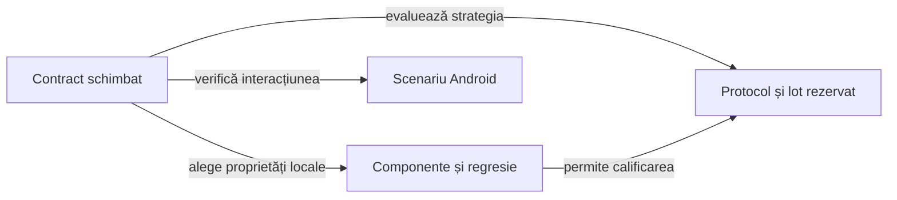
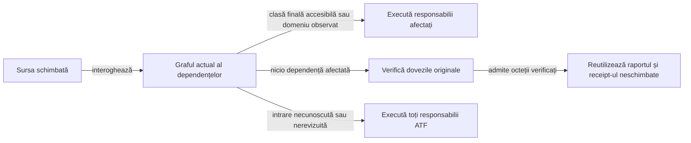
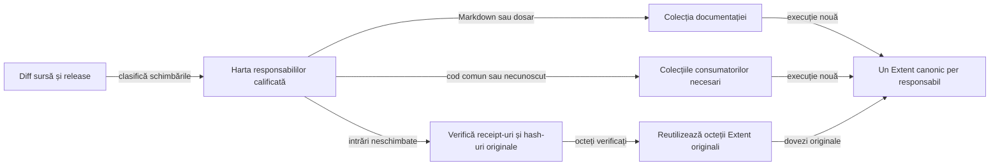
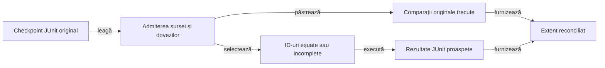
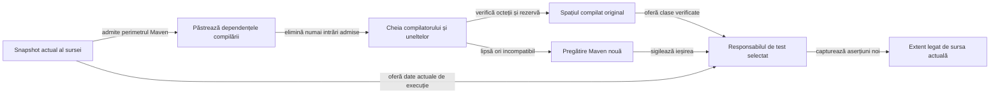
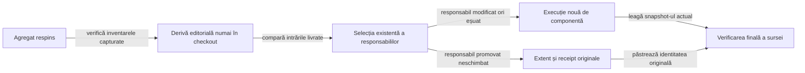

# Colecții de teste

## Pe scurt

[Catalogul colecțiilor](../../config/test-collections.json), [runnerul](../../scripts/run-whist-collection.ps1) și [task-urile Gradle](../../whist-lab-app/game-core/build.gradle) definesc execuția curentă. Numărul de cazuri se citește din rezultatele native ale fiecărei rulări, nu dintr-un inventar fixat în documentație.

[Arhitectura testării](ATF_Architecture.md) definește nivelurile și matricea executabilă. Colecția alege scopul și costul; numele ei nu schimbă nivelul verificării.

## Alegerea colecției



<details>
<summary>Legendă: selecții cu scop diferit</summary>

Colecția restrânge cazurile la proprietatea schimbată. Evaluarea unei politici adaugă un protocol și date rezervate, iar verificarea Android adaugă un dispozitiv; fiecare păstrează propriile limite și rezultat.

</details>

| Colecție | Scop | Execuție |
|---|---|---|
| `cost` | Cost JVM pentru Normal, Hard și independent la 2–8 cărți | Poziții generate, CPU și bugete din profil explicit |
| `context` | Onoruri, necesar de levate, atu întors sau încă pe masă, legalitatea prefixelor | Verificări JVM restrânse |
| `quick` | Reguli, scor, serii, checkpoint-uri și gărzi de decizie | Subset al regresiei |
| `regression` | Regresia completă de domeniu, inclusiv restaurarea stării | Regresie JVM, fără turnee. [Proba sesiunii](../../atf-tests/src/test/java/atf/tests/governance/source/game/GameSessionBoundaryComponentTest.java) verifică și continuarea după checkpoint, la limita publică a motorului. |
| `strategy` | Invariante și contraexemple mici pentru licitare și joc | Componente JVM selectate |
| `documentation` | Punctaj documentat și reguli RO/EN | Extent confruntat cu JUnit și ajutor bilingv generat |
| `learning` | Comparație între un candidat și politici înghețate | Partide complete definite prin protocol |
| `arena` | Strategii distincte la aceeași masă și locuri rotite | Ligă virtuală definită prin protocol |
| `research` | Modele experimentale izolate de regresia implicită | Cercetare JVM activată explicit |

Catalogul descrie separat și acceptanța `e2e`. Aceasta folosește runner-ele Android; `e2e` nu este o valoare acceptată de parametrul `-Collection`.

Estimările `targetMinutes` din catalog ajută planificarea. Ele nu înlocuiesc timpul măsurat și nu transformă o execuție incompletă într-un rezultat reușit.

## Rulare offline din rădăcina proiectului

```powershell
.\scripts\run-whist-collection.ps1 -Collection context
.\scripts\run-whist-collection.ps1 -Collection quick
.\scripts\run-whist-collection.ps1 -Collection regression
.\scripts\run-whist-collection.ps1 -Collection cost
```

Runnerul creează o copie temporară proprie și un director nou de rezultate în arhiva externă implicită din script. `-RunRoot` selectează o altă destinație externă proiectului, iar o destinație existentă este refuzată; `-JavaHome` selectează JDK-ul.

Build-ul [algorithm-build](../../whist-lab-app/algorithm-build/settings.gradle) include motorul și laboratorul JVM; dependența motorului către laborator este numai pentru teste. Construirea aplicației Android și accesul ADB au intrări separate, iar dependențele Gradle trebuie să fie în cache pentru `--offline`.

Fiecare execuție păstrează inventarul SHA-256 al surselor copiate, logul, rezultatele JUnit XML și `collection-result.json`.

`cost` copiază înaintea execuției [profilul de cost](../../config/whist-ai-cost-profile.json), apoi măsoară poziții legale generate. `-CostProfile` poate selecta un alt profil explicit; copia exactă, mediul și fiecare măsurare rămân în rezultatul extern. [Contractul costului](../ai/ATF_CostQualification.md) deține interpretarea și limitele acestei calificări.

`-CaptureComponents` solicită și capturile JSON ale cazurilor instrumentate. Numărul capturilor nu este automat numărul tuturor testelor executate. Un subset `quick` nu se adună cu regresia completă ca și cum ar reprezenta alte cazuri.

## Inventarul unei selecții

[Nivelul testului](ATF_Architecture.md) și numele colecției nu garantează singure că un caz este descoperit. Inventarul se confruntă cu rezultatele execuției selectate, inclusiv după mutarea pachetului sau schimbarea profilului de compilare.

- Păstrați selectorul efectiv, configurația și identitatea `clasă + metodă + invocare`; includeți clasele interioare și parametrizările. Containerele suitei nu sunt cazuri suplimentare.
- Rulați punctul de intrare suitei fără a selecta simultan încă o dată clasele incluse. La comparația cu o lansare individuală, păstrați explicit suprapunerea.
- Asociați XML-urile native cu selecția și logul acelei execuții. Un fișier rămas în Surefire de la rularea anterioară nu dovedește participarea la selecția curentă.
- Pentru o mutare, păstrați maparea vechi–nou și comparațiile relevante; un total neschimbat poate ascunde un caz pierdut și altul adăugat fără legătură.
- Pentru o suită auditată, confruntați invocările JUnit cu cele publicate. Existența unui HTML nu demonstrează că o clasă nouă a înregistrat adaptorul de audit; [calificarea producătorilor](../reporting/ATF_Audit.md#inventarul-guvernat-al-producătorilor) păstrează acest control.

[Dosarul de calificare](ATF_ReleaseQualification.md#readme-ul-dosarului) explică selecția cerută, cea executată și limitele. Comenzile unei execuții și totalurile ei rămân în dosarul rezultatului, separat de acest catalog generic.

## Experimente și surse înghețate

[Protocolul offline](../learning/README.md#ciclul-de-îmbunătățire) deține calificarea și criteriile; aici sunt precondițiile operaționale ale [runnerului](../../scripts/run-whist-collection.ps1).

| Intrare | Precondiție efectivă |
|---|---|
| `learning` | `-Candidate`, `-CorpusRoot` și `-ProtocolFile`; schema declară roluri, adversari, politici de bază și intervalul fazei. |
| `-CandidateOverlay` | Manifest extern de candidat înghețat, cu identitate, rol, căi și hash-uri; permis în `regression` sau în protocolul dedicat din `learning`. |
| `-ResearchCandidate` | Intrare unică în catalogul cercetării, colecție permisă și bază compatibilă. |
| `-CasesFile` | Selecție explicită pentru protocolul acceptat, cu surse identice între loturile compuse. |
| `-Phase heldout` | Cere și `-CandidateFreeze`, cu identitate și hash-uri verificate înaintea rezervării. |

- **Surse:** modurile `CandidateOverlay` și `ResearchCandidate` sunt mutual exclusive. Suprapunerea se aplică numai copiei temporare, iar baza schimbată este refuzată; migrarea cere calificare explicită, fără simpla înlocuire a hash-urilor.
- **Rezervare:** [registrul comun](../learning/ATF_EvaluationRegistry.md) verifică suprapunerile independent de corpus și de numele lotului. Dezvoltarea poate reutiliza distribuțiile cu expunere declarată; evaluarea rezervată refuză contaminarea, iar o continuare identică păstrează identitatea inițială.
- **Compoziție:** [verificatorul loturilor](../../whist-lab-app/ai-lab/tools/learning/whist-learning-batches.mjs) confruntă perechile și sursele, păstrând eșecurile închise. [Evaluatorul](../../whist-lab-app/ai-lab/tools/learning/whist-learning-evaluate.mjs) aplică criteriile protocolului, separat de rezervarea datelor.

### Identitatea completă a bazei candidatului

[Validatorul surselor](../../whist-lab-app/ai-lab/tools/qualification/WhistCandidateSource.psm1) confruntă toate fișierele Java principale din motor și laborator. Fiecare cale și fiecare hash trebuie să coincidă; cardinalitatea rezultă din inventar, fără număr istoric fixat în lansator.

| Manifest | Contract |
|---|---|
| `schemaVersion: 1` | Compatibilitate: `baselineGuards` acoperă în continuare mulțimea completă și hash-urile surselor curente. |
| `schemaVersion: 2` | Cere suplimentar `baselineInventory`, cu versiunea internă, cele două rădăcini și hash-ul canonic al inventarului. |

Rădăcinile declarate sunt `game-core/src/main/java` și `ai-lab/src/main/java`. Hash-ul canonic SHA-256 folosește UTF-8, căile sortate ordinal și câte un rând `cale`, TAB, hash-ul SHA-256 în litere mici, LF; directoarele și fișierele legate simbolic sunt refuzate.

Fragmentul unei baze noi se poate construi dintr-o copie acceptată și identificată:

```powershell
Import-Module .\whist-lab-app\ai-lab\tools\qualification\WhistCandidateSource.psm1
New-WhistCandidateBaseline -AppRoot '<accepted-copy>\whist-lab-app' | ConvertTo-Json -Depth 12
```

Rezultatul furnizează numai `baselineGuards` și `baselineInventory`; autorul manifestului deține identitatea candidatului, rolul, protocolul și fișierele propuse. Construirea inventarului nu promovează un candidat și nu modifică manifestele înghețate existente.

Lansatorul verifică baza înaintea copierii și în copia temporară. După aplicare, verifică toate hash-urile finale, inclusiv fișierele noi declarate; sursele necunoscute, duplicatele și schimbările fără declarație sunt refuzate, iar dovada păstrează separat baza și candidatul.

## Din observație în regresie

[Selecția pentru învățare](../learning/ATF_Selection.md) identifică mecanismele implementate și extinderile propuse. [Proiectarea componentelor](ATF_AiComponents.md) deține reducerea la o situație legală mică, cu observație permisă și așteptare independentă.

Regresia implicită primește proprietăți justificate, iar jocurile și rezultatele complete rămân în corpusul extern. [Protocolul offline](../learning/README.md) deține trecerea de la diagnostic la candidat și promovare.

## Guvernanța proiectului

Calitatea surselor și documentației se verifică separat de colecțiile jocului:

```powershell
.\scripts\run-atf-governance.ps1
```

[Contractul guvernanței](../governance/README.md) definește inventarul, excepțiile și controalele negative. Această verificare nu joacă partide și nu comandă emulatorul.

## Reguli, ajutor și Android

Colecția `documentation` confruntă ajutorul bilingv și tabelul de scor cu motorul. [Ajutorul din aplicație](../../whist-lab-app/game-core/src/main/java/ro/whistlab/core/rules/HowToPlay.java) · [Reguli RO](../game/ATF_RulesRo.md) · [Reguli EN](../game/ATF_RulesEn.md)

- Testele de componentă confruntă distribuirea la 3–6 jucători, ambele programe românești, atuul, licitarea, levatele, scorul și jocul la 0 cu motorul.
- Ghidurile publicate se compară integral cu ajutorul generat în aceeași limbă. Cazurile negative identifică punctual o regulă alterată.
- Raportul Extent păstrează intrările, comparațiile și refuzul modificărilor controlate.
- Raportul identifică inventarul sursei și se confruntă cu invocările JUnit în aceeași execuție.

Pentru infrastructura dispozitivului și activarea explicită a fluxurilor UI, folosește [testarea Android](ATF_Android.md). Compilarea JVM, construirea unui APK și executarea pe dispozitiv sunt verificări distincte.

## Responsabili independenți pentru componentele ATF

[Catalogul suitelor Maven](../../config/atf-test-suites.json) leagă fiecare selector primar de un grup; [inventarul responsabililor ATF](../../config/atf-component-collections.json) enumeră clasele sale finale exacte. Un modul este o unitate de compilare, iar un grup deține un receipt de execuție independent și un raport Extent canonic. Toate grupurile Maven selectate împart aceeași pregătire și compilare.

| Grup | Responsabilitate |
|---|---|
| `atf-tests` | Calitatea sursei, limite și proprietatea suitelor |
| `atf-tests-documentation` | Guvernanță editorială, ghiduri actuale și integritatea payload-ului release-ului |
| `atf-tests-provenance` | Atestări de sursă, integritatea artefactelor imuabile și versiuni |
| `atf-tests-android` | Preflight Android simulat și contracte de prezentare |
| `atf-tests-github` | Contracte simulate pentru distribuție, publicare și descărcare |
| `atf-tests-orchestration` | Lansatoare, checkpoint-uri și execuție portabilă |
| `atf-tests-reporting` | Comparații capturate, publicarea rapoartelor și dovezi de învățare |

- `run-component-suites.ps1 -Groups` acceptă acești identificatori de grup independent de modulul Maven comun. Fiecare clasă executabilă are exact un responsabil primar. Suitele focalizate rămân perspective de diagnostic ale părinților primari declarați; nu adaugă acoperire și nu înlocuiesc un receipt primar eșuat.

- `component-evidence-scope.mjs` compară inventarele sursei. Cu același descriptor de responsabilitate, schimbările numai în Markdown selectează responsabilul documentației; ghidurile bilingve ale regulilor selectează și colecția regulilor.
- Schimbările ghidurilor bibliotecilor păstrează dependența de integritatea sursei. Inventarul release-ului schimbat invalidează responsabilul documentației. Codul ATF comun, selectorii schimbați și căile necunoscute invalidează conservator consumatorii necesari.

### Selecția după dependențe executabile

[Politica dependențelor](../../config/atf-component-dependencies.json) și [constructorul grafului](../../atf-tests/tools/atf-component-dependencies.mjs) rafinează responsabilitatea ATF folosind inventarul actual al sursei. Referințele de tip și import Java, importurile executabile Node și intrările proceselor, precum și referințele la module și funcții PowerShell formează muchii tranzitive. Un responsabil este selectat când una dintre clasele sale finale ajunge la intrarea schimbată; ciclurile păstrează fiecare consumator accesibil.

Controalele întregului repository au domenii explicite de observare, iar importurile generate identifică intrările producătorului lor. Aceste declarații deosebesc un fixture care citește repository-ul live de un ajutor care citește un director injectat. Șirurile cu exemple de căi nu stabilesc, singure, dependențe executabile Node.



<details>
<summary>Legendă: admiterea conservatoare a dependențelor</summary>

Muchiile descriu dependențe executabile la nivel de clasă sau modul, nu urmărirea metodelor la execuție. Responsabilitățile mixte pot selecta, așadar, mai mulți consumatori decât folosește o singură execuție. Rădăcinile lipsă, politica schimbată, hash-urile învechite, sursele omise, furnizorii generați nedeclarați și intrările fără responsabil selectează toți responsabilii ATF. Un raport istoric fără această politică nu poate inițializa reutilizarea selectivă după dependențe.

</details>

Politica topologiei fixează populațiile furnizorilor, muchiile executabile, tiparele observatorilor și rolurile cititorilor. [Inventarul separat al sigiliilor](../../config/atf-component-reader-seals.json) fixează corpurile revizuite; hash-ul său nu devine o dependență globală. Sfârșiturile de linie se normalizează numai pentru sigiliile corpurilor; manifestele sursei și probele originale păstrează hash-urile octeților exacți.

| Schimbare sau limită de admitere | Selecție |
|---|---|
| Corp revizuit și sigiliu corespunzător, cu aceeași topologie admisă | Consumatorii cititorului schimbat și observatorii inventarului sigiliilor. |
| Mai mulți cititori revizuiți | Reuniunea tuturor consumatorilor afectați și observatorilor inventarului. |
| Politica topologiei, rădăcini, muchii, populație de furnizori sau rol de cititor schimbat | Calificare ATF completă. |
| Sigiliu lipsă, învechit sau străin; consumator necunoscut; inventar schimbat fără explicație | Calificare ATF completă. |
| Origine istorică fără inventarul separat al sigiliilor | Admitere conservatoare; rapoartele vechi nu se reetichetează. |

Comanda de propunere, numai pentru citire, folosește un inventar proaspăt al sursei și scrie două fișiere noi în afara checkout-ului:

```powershell
.\scripts\Get-AtfSourceInputs.ps1 -SourceRoot (Get-Location).Path -AsJson > '<scratch-root>/source-inputs.json'
node .\atf-tests\tools\atf-dependency-cli.mjs '<scratch-root>/source-inputs.json' '<scratch-root>/reader-policy-proposal.json'
```

Revizuiți domeniile declarate ale cititorilor și furnizorii generați înaintea adoptării ambelor propuneri: fișierul solicitat pentru topologie și fișierul vecin `atf-component-reader-seals.json`. Comanda nu actualizează politica versionată și nu acordă un verdict de calificare; cititorii sau mecanismele de selecție schimbate cer controalele pozitive și negative revizuite ale modificării testelor. Planul reutilizării înregistrează hash-ul topologiei, hash-ul sigiliilor, cititorii schimbați și lanțul de dependențe sau domeniul observatorului care justifică fiecare selecție; admiterea receipt-ului imuabil, a identității JUnit și a raportului Extent rămâne obligatorie.

- `prepare-component-reuse.mjs` verifică sursa originală, snapshot-ul release-ului, rularea rădăcină, identitățile JUnit și hash-urile rapoartelor înaintea copierii octeților neschimbați. Evaluatorul cere fiecare responsabil ATF nou atunci când sursa candidatului conține noul descriptor, indiferent de versiunea de release declarată. Sursele istorice fără descriptor păstrează contractul monolitic; rapoartele lor nu pot fi reetichetate drept dovezi ale partițiilor.



<details>
<summary>Legendă: compilarea, execuția și reutilizarea rămân separate</summary>

O singură compilare Maven poate servi mai multe colecții primare. Un receipt reutilizat își păstrează identificatorii invocărilor și proveniența originale; nu este o execuție nouă. După partiționare, prefixul containerului de suită se schimbă, iar identificatorii finali Jupiter și rezultatele rămân comparabile. Măsurați separat pregătirea și execuția colecțiilor și declarați identitățile lipsă sau nou adăugate la verificarea parității.

</details>

Fixture-urile de guvernanță determină release-ul activ prin `release/index.json` și folosesc același validator al publicării ca livrarea. O versiune istorică eliminată sau o configurație nouă a responsabililor nu trebuie să schimbe implicit precondiția dovedită de un control negativ.

## Reutilizarea compilării Maven

Compilarea și execuția au identități separate. [Inventarul compilatorului](../../atf-tests/tools/component-compiler-inputs.mjs) omite Markdown-ul editorial, revizia bilingvă și sursele Java admise numai pentru teste din afara rădăcinilor Maven. Inventarul execuției rămâne complet.

| Limită | Admitere și rezultat |
|---|---|
| Cheia compilării | Inventarul sursei needitoriale, binarele JDK, instalarea Maven, setările utilizatorului și opțiunile de mediu acceptate trebuie să corespundă. Parametrii externi necunoscuți dezactivează reutilizarea. |
| Perimetru Maven | [Admiterea rețetei](../../scripts/AtfCompilerIdentity.ps1) leagă octeții politicii și POM-urilor, inclusiv rădăcinile literale, adăugirile build-helper și resursele profilurilor. Numai Java dintr-o rădăcină suplimentară declarată de test, în afara tuturor rădăcinilor Maven de compilare/resurse, poate ieși din cheia compilării. |
| Graniță conservatoare | Furnizorii comuni, resursele, POM-urile, binarele, lansatoarele și fișierele necunoscute rămân incluse. Pluginurile, extensiile, reactoarele imbricate sau rădăcinile nerezolvate nesuportate păstrează cheia needitorială completă; rețetele nelegate de inventar sau indirecte sunt respinse. |
| Ieșirea compilată | [Admiterea ieșirii](../../scripts/AtfComponentMaven.ps1) verifică clasele, resursele, octeții dependențelor JAR/POM, inventarul înghețat al intrărilor și destinațiile classpath-ului. Datele lipsă sau alterate selectează pregătirea nouă. |
| Pointerul spațiului | [Contractul comun](../../scripts/AtfComponentWorkspace.ps1) leagă schema 2 de manifestele originale ale sursei/release-ului și contextul catalogului. Pointerele vechi schema 1 rămân explicite și nu pot primi context modern ori califica rezultate de teste reutilizate. |
| Altă rulare | [Împrumutul](../../scripts/AtfComponentMavenReuse.ps1) determină spațiul original al compilatorului în rădăcina temporară externă configurată și păstrează rezervarea exclusivă pe toată execuția. Nu se copiază depozitul sau arborele claselor. |
| Generarea probelor | `-CompilerReuseFrom <compiler-run>` poate împrumuta compilarea admisă la generarea unui control sau a lotului. Fiecare control selectat rulează din nou; nicio probă sau raport nu se împrumută. Execuția eșuată ori incompletă nu promovează o probă. `-ReuseFrom` rămâne interzis la generarea probelor. |
| Snapshot-ul execuției | Snapshot-urile actuale ale sursei și release-ului rămân obligatorii. Reutilizarea compilării nu creditează un test; selecția responsabililor și validarea rapoartelor originale rămân independente. |
| Durata de viață | Referințele funcționează numai cât supraviețuiește spațiul verificat al compilatorului. Spațiile ocupate, lipsă, indirecte ori străine și recipisele nesigilate declanșează compilarea nouă; rapoartele păstrate se pot reutiliza independent. |

- Modificările de documentație și de teste exclusive Gradle admise pot păstra compilatorul Maven, iar responsabilul afectat rulează pe snapshot-ul actual. Sigiliile octeților și rezervările spațiului rămân obligatorii; după curățare, pregătirea reîncepe din sursă.

Runnerul înregistrează identitatea compilatorului, admiterea cache-ului și sigilarea ieșirii ca etape de timp distincte. Împrumutul refuzat înregistrează motivul înaintea pregătirii noi; compilarea împrumutată păstrează recipisa originală și referința legată prin hash. Contextul curent al sursei/catalogului și execuția nouă a controalelor rămân independente de contextul original al compilării.

### Reluarea în interiorul unei selecții Maven

[Lansatorul componentelor](../../scripts/run-component-suites.ps1) admite același snapshot de sursă/release prin `-ResumeFrom` înaintea citirii checkpoint-urilor invocărilor. Responsabilii complet trecuți își păstrează rapoartele originale. Într-un responsabil Maven eșuat, [contractul reluării](../../atf-tests/src/test/java/atf/tests/execution/recovery/InvocationRecovery.java) admite exact ID-urile JUnit, observațiile neutre și sigiliile originale ale octeților înaintea păstrării invocărilor trecute.



<details>
<summary>Legendă: execuția și republicarea rămân distincte</summary>

- Invocările finalizate păstrează intrările neutre, comparațiile evaluate, temporizarea originală a fazelor și diagnosticele în fișiere de captură imuabile. Un checkpoint JUnit independent sigilează acei octeți după evenimentele de înregistrare și rezultat.
- Reluarea execută numai ID-urile unice nerezolvate. Descoperirea suitei curente admite populația originală, inclusiv identitățile parametrizate și imbricate; populațiile dinamice necunoscute, capturile lipsă, schimbările sursei și erorile responsabilului refuză reluarea.
- [Publicatorul](../../atf-tests/src/test/java/atf/tests/execution/recovery/RecoveryPublication.java) republică valorile originale admise prin Reporting, alături de rezultatele proaspete ale reluării. O reluare eșuată rămâne FAIL; raportul original nu este editat niciodată.
- Extent-ul canonic rămâne autonom, cu valori complete și hash-urile provenienței. Indexul însoțitor leagă încercările imuabile prin căi relative; un prefix reconstruit după întreruperea procesului este etichetat explicit ca republicare.
- Reutilizarea unui responsabil recuperat și trecut verifică și păstrează artefactele sigilate ale încercărilor. Compilarea, responsabilul complet și invocările au reguli separate de reutilizare; generarea probelor testChanges execută în continuare proaspăt fiecare control declarat.

</details>

[Componentele controlate](../../atf-tests/src/test/java/atf/tests/execution/recovery/InvocationRecoveryComponentTest.java) folosesc JVM-uri copil, contoare independente ale corpurilor, întrerupere reală de proces și fișiere corupte. Califică reluarea fără interacțiune Android sau poze.

Rulările istorice fără checkpoint-uri de invocare păstrează reluarea selecției întregi. Gradle păstrează protocolul checkpoint-urilor pe task; acest contract se aplică invocărilor Maven/Jupiter.

### I/O pentru snapshot și compilator

[Suportul pentru fișiere](../../scripts/AtfFileDigest.ps1) citește octeții SHA-256 din nou și folosește enumerarea nativă a directoarelor; data și mărimea fișierelor nu autorizează reutilizarea.

| Graniță | Contract |
|---|---|
| Admiterea copierii | Validați manifestul complet, granița semnării publice și căile directe înainte de directoare sau copiere; respingeți destinațiile duplicate. |
| Lot limitat | Cel mult patru lucrători reverifică sursa/destinația la utilizare și calculează independent hash-ul octeților scriși. Windows folosește fluxuri cu buffer, păstrând data modificării și atributele; celelalte platforme păstrează copierea nativă. |
| Validare nouă | Reinventariați sursele/release-urile din staging și live după copiere și după compilare; adăugările, ștergerile, schimbările cu metadate identice și căile indirecte rămân refuzuri. |
| Sigiliul compilării | Sortați ordinal aceleași înregistrări de clase, resurse și dependențe și calculați hash-ul conținutului exact; un cache de metadate nu înlocuiește citirea. |
| Observabilitate | Înregistrați separat `snapshot.inventory`, `snapshot.copy`, `snapshot.verify`, `snapshot.artifact-preflight` și `components.post-compile-snapshot`. Etapele copil ale snapshotului se suprapun cu durata părintelui și nu se adună de două ori. |
| Măsurare | Comparați manifeste și sigilii identice, declarați prima trecere față de citirile repetate și limitele cache-ului OS, păstrând timpii originali. Un câștig I/O local este distinct de accelerarea întregului release. |

Inventarierea și sigilarea nu inițializează compilatorul copierii. Inițializarea lotului aparține etapei măsurate de copiere; un eșec de copiere sau preflight păstrează cauza originală și blochează calificarea.



<details>
<summary>Legendă: reutilizarea compilatorului păstrează dovezile independente de execuție</summary>

ReuseFrom poate reutiliza compilarea între snapshot-uri de execuție diferite. ResumeFrom cere în continuare același snapshot complet și spațiul său păstrat. Parametrii de mediu neacceptați nu împrumută ieșiri din cache; generarea întreruptă a classpath-ului se poate relua local din compilarea admisă. Timpul de pregătire și execuția testelor se raportează separat.

</details>

### Recuperarea după curățarea fișierelor temporare

| Intrare păstrată | Limita recuperării |
|---|---|
| Raportul original și receipt-ul execuției | Dovezile testelor se reutilizează numai pentru intrări neschimbate ale responsabilului și octeți originali verificați. Lipsa spațiului compilatorului nu invalidează aceste rapoarte. |
| Spațiul verificat al compilatorului | Un classpath complet admis poate fi împrumutat sub rezervare. Lipsa classpath-ului păstrează compilarea numai pentru spațiul care o deține; consumatorul nu poate împrumuta pregătire parțială. |
| Cache-ul dependențelor | Accelerează pregătirea nouă, dar nu poate furniza verdictul unui test sau califica ieșirea compilată. Păstrați-l separat de snapshot-urile temporare. |
| Niciun spațiu temporar | Porniți o rulare nouă din checkout și intrările explicite ale release-ului. Căile lipsă selectează pregătirea nouă; un pointer vechi către spațiu nu autorizează reutilizarea. |

CLI-ul și adaptorul de componentă folosesc aceeași [politică a rădăcinilor temporare](../../atf-tests/tools/qualification-temp-root.mjs). O rădăcină explicită de lucru verifică în continuare fiecare director temporar configurat al sistemului și limita fizică a checkout-ului. Setările locale, identitatea de semnare și datele de învățare sunt intrări durabile, nu ieșiri ale compilării.

## Readmiterea după editări concurente ale documentației

Verificarea finală a snapshot-ului poate respinge un agregat chiar dacă au trecut colecțiile sale izolate. Readmiterea păstrează acel `FAIL` original; admite separat fiecare responsabil promovat, pe baza intrărilor livrate. Nu rescrie agregatul, identitățile invocărilor, receipt-urile execuțiilor sau octeții Extent.

| Limită | Dovezi obligatorii și decizie |
|---|---|
| Captură | La derivă, runnerul scrie `source-snapshot-check.json` și patru inventare observate: sursă și release din staging/checkout. Agregatul respins leagă verificarea prin SHA-256; verificarea leagă fiecare observație și ambele inventare așteptate. Rulările stabile nu creează aceste fișiere suplimentare. |
| Execuție originală | Sursa din staging și ambele observații ale release-ului trebuie să coincidă exact cu inventarele originale. Diferențele observate trebuie să fie Markdown editorial recunoscut și să coincidă cu diagnosticele originale. Markdown-ul folosit ca resursă, codul, căile necunoscute, erorile de inventariere și dovezile incomplete ori alterate resping readmiterea. |
| Selecția responsabililor | Clasificatorul existent de dependențe compară sursa livrată cu execuția originală. Responsabilii modificați rulează din nou; cei neafectați pot reutiliza numai rapoarte promovate, verificate prin hash și identități JUnit corespunzătoare. Un responsabil eșuat nu poate împrumuta rezultatul altuia. Ghidurile regulilor de joc și ale bibliotecilor păstrează consumatorii suplimentari. |
| Transport | Planul de reutilizare păstrează agregatul respins original și toate observațiile legate sub identitatea originală de proveniență. Payload-urile release-ului declară aceste fișiere; evaluatorul RAG verifică același contract și expune `readmission` separat de verdictul original. Observațiile istorice lipsă nu se reconstruiesc din mesaje de log. |

Selecția responsabililor folosește întotdeauna diff-ul complet al reviziei livrate, inclusiv editările ulterioare verificării originale a sursei.



<details>
<summary>Legendă: readmiterea păstrează execuția respinsă</summary>

Captura observațiilor demonstrează ce s-a schimbat la limita originală. Selecția responsabililor determină apoi ce mai trebuie verificat pe sursa livrată. O rulare nouă trebuie să treacă propria verificare finală a snapshot-ului; readmiterea nu poate ascunde încă o editare concurentă sau califica o colecție eșuată.

</details>

Folosiți `run-component-suites.ps1 -ReuseFrom <rejected-run> -RunRoot <new-external-run>` cu selecțiile `-Groups` necesare, baza Git explicită pentru revizie și căile locale configurate ale uneltelor/cache-ului. `-ResumeFrom` rămâne limitat la snapshot-uri complete identice; editarea documentației cere un snapshot nou. Reutilizarea compilatorului rămâne o decizie independentă, verificată la nivel de octeți.
