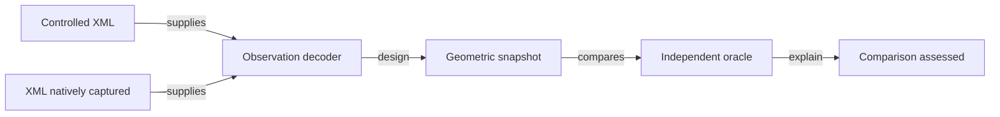
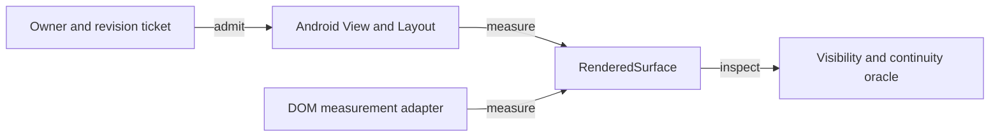

# Display verification through component tests

## Overview

The offline collection checks sizing policies, Android observation decoding, geometry and raster oracles. Controlled inputs remain explicit; installed-app acceptance keeps a narrow native verification.

## Architecture



<details>
<summary>Legend: same verification path for simulated and captured data</summary>

The fixture describes measured regions without calling the application layout algorithm. The decoder consumes one XML document; E2E owns capture, while components own interpretation.

</details>

## What moves into the components

The [shared UI module](../../whist-lab-app/atf-card-table-ui/README.md) owns JVM tests for menus, name editing, geometry and dependency boundaries. Whist retains adapter and table tests with independent oracles; native widgets and pixels require separate acceptance.

| Level | Controlled input | Owned checks | Owner |
|---|---|---|---|
| Integer geometry | Fractional CSS heights from zoom or browser controls | Floor a valid measured height once before compact-policy decisions and the integer Java boundary; malformed and non-positive input must retain an explicit error | Web geometry adapter |
| Visible coordinates | DOM rectangles and observed visual-viewport offsets | Compare positions relative to the visible viewport when zoom or the keyboard pans the layout viewport; retain raw offsets with the observation | Platform observation adapter |
| Application policies | Width, height, density, font, number of players and cards | Distribution of regions, minimum dimensions, available space, rounding and settings calculated | `app.table`, `app.hand`, `app.window` |
| Name and action | Measured or simulated text heights, box contents and equalized place | Full action above the name, reserved space between shifts, enlarged text without repeated scaling | `app.seat` |
| Trump | Glyph widths from [Android and Web fixture](../../whist-lab-app/app/src/test/resources/whist-trump-text-fit.tsv) | Framing in the same box for card, symbol and text without trump, including enhanced font. [Reference palette](../../whist-lab-app/app/src/test/resources/whist-trump-palette.properties) and geometry is kept when AutoPlay is activated and stopped and during trick collection | [TrumpTileMetrics](../../whist-lab-app/card-table-core/src/main/java/ro/cardtable/ui/table/trump/TrumpTileMetrics.java) |
| History | Useful window, number of seats, density and font | Full spread width, minimum legible, headers aligned, vertical budget for legend and red diagonal limited to failed bids | `app.score` |
| Trick collection | Centers, actor, public history, clock, viewport and controlled scene events | Complete trick, convergence, pause/resume and exactly one cleanup; rebuild after resize, wait for dialogs to close and reject stale callbacks without mutating the match | `app.animation`, `app.lifecycle`, `app.navigation`, `app.presentation` |
| Observation decoding | XML and display profile | Semantic association, card faces, frames, title, trump and content window | [TableViewportObservation](../../atf-test-android/src/test/java/atf/android/e2e/display/support/TableViewportObservation.java) |
| Geometric oracle | Snapshot with injected defects | Number, completeness, capping, framing and absence of overlaps | [TableViewportAudit](../../atf-test-android/src/main/java/atf/android/whist/evidence/TableViewportAudit.java) |
| Oracle raster | Synthetic and logical coordinates | Change of scale, dominant colour, contrast and tolerances | [Components display](../../atf-test-android/src/test/java/atf/android/e2e/display/component/) |

## Mock contract

- [Synthetic hierarchy](../../atf-test-android/src/test/java/atf/android/e2e/display/component/SyntheticTableHierarchy.java) maintains a valid base and explicitly changes the region to be rejected.
- [Parametrized matrix](../../atf-test-android/src/test/java/atf/android/e2e/display/component/TableViewportObservationComponentTest.java) combines profiles and heights measured for different text scales; does not render Android fonts.
- The controlled transport rejects every device command or capture. An accidental device call fails the component test.
- JVM execution uses real Java dependencies before SDK stubs when the names of the classes coincide. Classpath provenance is preserved; an infrastructure failure cannot become a product verdict.
- The presence of a node does not prove its visibility; the areas without surface and the elements outside the window are rejected.
- The window uses `android:id/content` when available; captures without this region have explicit fallback to the declared profile.
- Full decaying of fixtures uses the EN signals and the action check has explicit contracts RO/EN. Change of language does not allow shortening of the label or loss of association with the active player.
- [PlayerSeatMetrics](../../whist-lab-app/app/src/main/java/ro/whistlab/app/seat/PlayerSeatMetrics.java) receives the full action height; Android measures it with the actual text and the component injects extensions for the larger text and more. The model does not limit the number of rows and does not deduce legibility from the text's presence in XML.
- The check of the action of [decoder](../../atf-test-android/src/test/java/atf/android/e2e/display/support/TableViewportObservation.java) is common to simulated observations and E2E game and bidding checkpoints. Negative controls remove the action, change the text or move it over the name; the break has clearly zero active actions.
- The distance to the player shall be measured from the box meeting and its action. A free space up to the box does not allow a control to cover the label above.
- The declared dimensions of the played edge and faces have comparisons in pixels and rounding tolerance. A face higher than the one required does not pass simply because it exceeds a minimum threshold.
- [ScoreHistoryMeasure](../../whist-lab-app/app/src/main/java/ro/whistlab/app/score/ScoreHistoryMeasure.java) receives separately the measurements of the font and header. Components check the entire table, including the last cell, signs, unknown values, long names and increased text; Android provides the glyph-measurement implementation.
- [HistoryViewportComponentTest](../../whist-lab-app/app/src/test/java/ro/whistlab/app/score/layout/HistoryViewportComponentTest.java) checks the vertical budget, the return to a larger window, fractional densities and invalid measures. Policy does not substitute the rendering of Android font.
- [HistoryLegendAuditComponentTest](../../atf-test-android/src/test/java/atf/android/e2e/records/legend/HistoryLegendAuditComponentTest.java) reproduces the wrong property in the horizontal container, empty or intersected regions and missing evidence. The full text of XML is not enough for PASS.
- [LegendProfilesComponentTest](../../atf-test-android/src/test/java/atf/android/e2e/records/legend/LegendProfilesComponentTest.java) qualifies offline default plan, focused selection, canonical identities and refusal of invalid configurations. E2E consumes typed cases and performs only the selected native sample.
- [RecordsRunContractComponentTest](../../atf-test-android/src/test/java/atf/android/e2e/records/RecordsRunContractComponentTest.java) checks the selection of visible text with one observation, the re-reading after disclosure and the identity of the error. The display keeps the driver's fresh reading and a single tap; redundant reads are not used as a synchronization mechanism.
- History measures the total bid and score of each line; the difference in points of hand remains in the register and in the assisted reading. The components shall be weighed against the balances of all places, including zero, negative totals and the limit of the old prefix; series markings shall be compared to an independent arithmetic oracle after reloading, and the native rendering of the rectangle shall be distinct from the projection.
- The `score.award` family keeps the exclusive rectangle in cell `P`; the number, font and contour participate in the measurement. The components cover the set-up bonuses and penalties, payment on the last eligible hand, disabled series, change of meaning of the series and complete history after resumption, at 3–6 places.
- The `score.raster` test family is providing real projection and geometry with JVM fonts without a device. The oracle compares pixels with an identical image without contours: bids, headers and neighboring cells must remain identical and each marking must have four sides and the colour of the series adjustment.
- Raster recovery writes and reads JSON checkpoints through the application codec, then fully compares PNG pixels decoded before and after restoration. At 3–6 seats, RO/EN and enlarged text, check the keeping of historical markings in the bidding, game, closing of hand and end of match. The last row and last eligible payment shall be checked separately when the final hand has a single card; the file saving does not qualify the port of Android `SharedPreferences`.
- The thickness of the separators has a target of 2,1 dp, with 30% below 3 dp; conversion to whole pixels can change the percentage observed on a profile. Components check raster thickness for each density, separate from Android readability and rendering.
- The columns of zero pixels, numerical overruns and negative measurements are rejected prior to the construction of the view. A font-provider failure retains the original cause and does not become a zero measurement.

- [TrumpIndicatorComponentTest](../../whist-lab-app/app/src/test/java/ro/whistlab/app/table/TrumpIndicatorComponentTest.java) checks the same projection of the asset in all ways and languages, the lack of redundant row, two regions of complete font and the separation of the contour of the button from the tactile target. Injected measurements shall not replace the rendering of the Android font.
- [CardFaceMetrics](../../whist-lab-app/whist-presentation/src/main/java/ro/whistlab/app/cards/CardFaceMetrics.java) holds the proportion 5: 7: 63×88 dp in hand, respectively 46×64 or 50×70 dp per table. The components check the height reduction by 10%, rounding up, lifting and identical sizes to 1–13 cards and 3–6 seats.
- [Order seats](../../whist-lab-app/app/src/test/java/ro/whistlab/app/table/TableSeatOrderComponentTest.java) confronts names and cards with the same circular scroll; a test uses the bid and the first effective trick from the engine for each variant and number of players. At four places, the bow of the opponents releases the full width of the trick.
- [Java API Governance](../../atf-tests/src/test/java/atf/tests/governance/source/android/AndroidJavaApiGovernanceTest.java) rejects terminal `Stream.toList()` in Android sources; allows compatible collectors and ignores comments and texts. The JDK of tests does not prove the method's availability on the device.
- Oracle keeps independent expectations: the height of each card and the width of the last uncovered face have a pixel tolerance. For overlapping cards, the Android XMLs describe the exposed tape, which must be positive and at most the standard face; it does not prove the width hidden under the neighbor. The components shall verify separately the full width of all faces. The negative samples cover the thin final face, the null or too wide tape and the deformed faces.
- The rank measurement adds padding directly in pixels, without converting from pixels to dp and back. The case with density 2.25 and 13 cards checks both edges of the fan, including rounding of the measured strip.

## Collections and commands

For a change limited to historical, JVM selection may be restricted to `:app:testDebugUnitTest --tests 'ro.whistlab.app.score.ScoreHistory*Test' --tests 'ro.whistlab.app.score.layout.*'`. The extended display collection subsequently qualifies for the common composition; the training tests and the emulator are not preconditions for the measurement policy.

| Collection | Preconditions | Result |
|---|---|---|
| `AndroidDisplayComponentSuite` | Java 21, Maven and already available dependencies | JUnit XML and Extent with audit of selected invocations. Without ADB or SDK Android; includes the native plan. |
| `whist.displayComponents=true` | Java, Gradle and SDK Android for compilation | JVM components of the application; without installation or emulator. |
| `:app:historyRasterTest` | Full JDK, Gradle and SDK compiled application classes | Projection of totals and component images without graphics libraries in Android compilation. |

The application selection includes the levatee collection model, the `presentation` recovery line and the `CompletedTrick*` time window, alongside static geometry. Navigation and configuration have their own components in the complete local selection; models do not qualify the Android animator or the rendering pixels.

The stage port allows explicit delivery of layout, frames and completion events, including after cancellation or during registration. The composition uses the actual navigation and engine; a suspended time is not the animator's latency and a real subprocess or sleep does not replace the controlled order of events.

- **Recovery: ** the tail reads the last geometry after the release of the previous scene; the components vary the width and height for each winner at 3–6 places.
- **Order: ** budget is kept even before the score, and the old events are delivered after the replacement; only the last valid closing of the dialogues allows resumption in the first-plan.
- **Limit: ** evidence retains portrait policy and does not qualify for transition or native fluidity.

From the root of the project:

```powershell
pwsh -NoProfile -File .\scripts\run-whist-responsive-sanity.ps1 -ComponentsOnly
```

The launcher prepares a temporary copy and a private Maven repository. `-MavenRepository` indicates the source of the cache; ATF JARs are installed and confronted in the copy of the execution without replacing those read by another process.

The competing regression keeps an JAR open for reading in the source cache and requires successful bootstrap in private copy with the source intact. The hashes of the resolved libraries must coincide with those of the source copy; a botstrap failure remains distinct from the interface verdict.

A temporary copy of the application with prepared dependencies:

```powershell
.\gradlew.bat :app:testDebugUnitTest -Pwhist.displayComponents=true --offline --no-daemon
```

For historical component images, optional property shall indicate an external directory; tests shall also be carried out without export in their own temporary guidelines:

```powershell
$historyRasterOutput = Join-Path ([IO.Path]::GetTempPath()) 'whist-history-raster'
.\gradlew.bat :app:historyRasterTest "-Pwhist.historyRasterOutput=$historyRasterOutput" --offline --no-daemon
```

The exported PNG is a component-controlled rendering, not an Android capture. Labels and values come from the application projection and fonts and graphical adapter belong to the test JVM.

The sources in `src/rasterTest/java` use the JDK completely through a separate compilation task; the compilation of Android units keeps the SDK surface. `historyRasterTest` consumes the same application classes and legal fixtures already compiled; the check `check` includes both collections.

## Reporting of historical components

[AndroidHistoryComponentSuite](../../atf-test-android/src/test/java/atf/android/suites/AndroidHistoryComponentSuite.java) selects the oracles of legend and the profiling plan. Actual component inputs and comparisons assessed shall be captured during the declaration; subsequent publication shall not reperform the tests and shall not reconstruct values in JUnit XML.

| Owner | Contract |
|---|---|
| Test Kit | `ComponentAuditExtension` keeps the phases, duration and original cause; `TEST_BODY` requires an audited assertion. |
| Test | Use `AuditedAssertions` and declare inputs via `ComponentInputs`; the fixture is not presented as an Android capture. |
| Android adapter | [Composition](../../atf-test-android/src/main/java/atf/android/evidence/component/AndroidComponentReports.java) captures settings once; [owner](../../atf-test-android/src/main/java/atf/android/evidence/component/AndroidComponentRun.java) publishes full inputs and comparison in HTML. |
| Reporting | The `AssertionAuditReport.publishStep` binary API provides the standard folding group; Extent and fallback have the same comparisons captured. |

With a copy of TMP, with his own Maven repository already prepared:

```powershell
mvn -B -o -pl atf-test-android -am -Phistory-components '-Dtest=AndroidHistoryComponentSuite' '-Dsurefire.failIfNoSpecifiedTests=false' test
```

- **Individual:** the `HistoryLegendAuditComponentTest` selector produces class report; the suite uses `atf.test.run.scope=suite` and only one owner.
- **Output: ** default `%TEMP%/whist-component-reports`; `atf.android.component.report-directory` accepts an absolute path. The sole name shall keep separate claims without overwriting an open report.
- **Renderer: ** `atf.android.component.renderer=extent` is default; `fallback` allows checking the same contract without Extent.
- **Context: ** XMLs and profile selections are complete, collapsible text bodies; external copies are not required for this selection. The preview of the assertions uses the captured reporting setting after the drafting.
- **Long values:** expected and current above the preview are published in full in observations after redaction, without reassessing the comparison. The unique identity JUnit allows each parameterized or nested invocation to be confronted with the XML result.
- **Budget of bodies: ** numbered parts keep the text entirely right above the display ceiling; concatenation and last character have component controls, separate from the forecast of assertions.
- **Time: ** phases keep the duration measured by Kit; the start of the HTML session identifies subsequent publication without inventing an Android time.

### Families using the same audit

| Suite | Responsibility |
|---|---|
| `AndroidDisplayComponentSuite` | Geometry, hierarchy, screen plans, driver and fixtures of history. |
| `AndroidComponentSuite` | Primary input for all Maven components of the adapter, including the focused selections below. |
| `AndroidUiFlowTimingComponentSuite` | Trace, publication, read-only republication and separation of the time of publication execution. |
| `GameReportComponentSuite` | Consumer contracts for bodies, policies and reporting. |

The classes use audited assertions and [Aggregate launcher](../reporting/ATF_Audit.md#aggregation-of-components-on-live-source) only complete the adapter when there is no explicit one. Display, historical and timekeeping suites are focused selections; they do not gather over the primary entry population.

Gradle selection of the application, engine and graphic library uses [Gradle audit bridge](ATF_GradleComponents.md) and are not implicitly included in the Maven aggregate. Each task publishes its own canonical HTML and reconciles invocations with temporary JUnit results; the presence of another selection report does not qualify for audit.

- **Contract:** [Jupiter producer controls](../../atf-test-android/src/test/java/atf/android/component/AndroidComponentReportContractTest.java) and [Gradle bridge controls](../../whist-lab-app/test-audit/src/test/java/atf/gradle/audit/GradleAuditBridgeComponentTest.java) qualify shared ownership, original failures, aborted runs, missing assertions and full long values. [Producer qualification](../reporting/ATF_Audit.md#governed-producer-inventory) remains separate from historical execution migration.

- **Launcher:** `-ComponentsOnly -ComponentSuite History` and `-ComponentRenderer fallback` restrict selection; `Display` is implicit. The report appears in `component-reports` of the external run, and `WORKING_STATE.json` identifies the snapshot and scope.
- **Compilation:** Maven profiles select tests on execution; the broad profile does not omit the historical sources in compilation.

## Measured renderer observations

`AndroidSurfaceObservation` reads laid-out Views, visible rectangles and `TextView.Layout` lines. `BoardLayout.observeSurface` supplies the actual seat Views; the caller binds header, fact-row, trump and card content explicitly. It does not submit expected layout plans as observations.



<details>
<summary>Legend: observation and expectation remain independent</summary>

The portable observation retains pixel frames, visible regions, text-line bounds and ellipsis. Density normalizes continuity once. The oracle rejects clipped content even when the expected and actual frame plans are equal.

</details>

- Capture on the Android main thread after layout. Pending layout, hidden or foreign Views and missing text layout are explicit failures.
- Keep the original `SurfaceEpoch` ticket in delayed callbacks. Replacing or disposing an owner invalidates it; ownership is checked before and after reading Views.
- Units own normalization and invalid-value combinations without Extent. Components execute the production Android adapter against controlled API responses and retain the measured fields and original refusals, without screenshots.
- API compilation and controlled responses do not certify Android glyph ink, fallback fonts or a consumer APK. Native acceptance remains required for the identified device, language and font profile.

## What keeps the native check

[Native graphical components](../../whist-lab-app/app/src/androidTest/README.md) checks the Android class drawing in a real parent, no activity or match. Distinguishing between JVM and E2E flows; the internal text shall be applied prior to the evaluation of the pixels of the markings.

| Property | Remaining check on Android |
|---|---|
| Font and glyph | Actual measurement, fallback, increased text, clipping and a legible capture. |
| Window | Effective consumption of the insets, keyboard, clipping and navigation of the system on the target API. |
| Interaction | Tap accepted, focus, hit testing, animation and transition observed. |
| Composition | The same state contains all the necessary regions in the real raster. |

A formula change first runs the components; a change of rendering or integration with the system adds [focused native sanity checks](ATF_Display.md). The results are external and identify the sources verified.

## Frontier of reusable UI components

[atf-card-table-ui](../../whist-lab-app/atf-card-table-ui/README.md) has its own components for geometry, menu, editing and visible table models. Source Guards shall refuse to import engines or sessions into joint production and tests.

| Shared | Whist integration, maintained in the Whist app |
|---|---|
| Proportions, centering, regions and spacing | The order of the engine actors and the legality of the card. |
| Ordered and immutable acts, markings and identities | Bidding, trump, trick, score and restoration. |
| Widgets and selection ports | Snapshot → projection, original command and lifecycle. |

Same Whist tests run before / after extraction with preserved sources and identities. The rules and projections belong to the adapter of each game; the Whist bid or score classes do not move into the common suite just to reuse the drawing.
