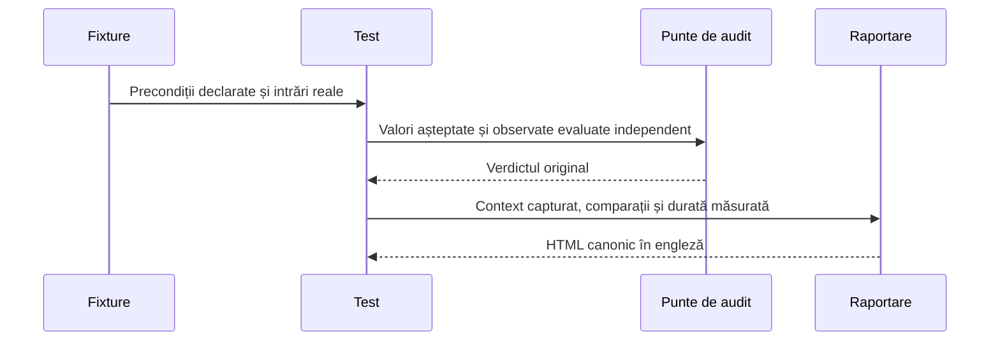

# Componentele Gradle și auditul lor

## Pe scurt

Gradle separă unitarele izolate, componentele auditate și observațiile opționale de platformă. Testele dețin oracolele; [puntea de audit](../../whist-lab-app/test-audit/README.md), folosită numai la testare, capturează comparațiile evaluate, iar biblioteca de raportare produce rapoarte Extent canonice în engleză.

## Responsabilități și niveluri

| Responsabil | Selecție primară | Graniță |
|---|---|---|
| Prezentare portabilă | `:card-table-core:test` | Geometrie, conținut, roluri de text, feedbackul mâinii și efecte deterministe; fără pornire Android sau browser. |
| Unitare izolate | `:card-table-core:unitTest` | Normalizare, snapshoturi imuabile și intrări invalide; numai JUnit, fără Extent sau dependențe de raportare. |
| Renderer Android | `:card-table-android:testDebugUnitTest` | Contractele adaptorului nativ și proprietatea surselor; widgeturile reale cer instrumentare separată. |
| Proiecții Whist | Colecțiile de componentă ale aplicației și contractele browserului | Conținutul comun al jocului, configurarea, realizările și codec-urile checkpointurilor din `whist-presentation`. |
| Motorul jocului | Colecțiile de reguli ale release-ului | Comenzi legale, punctaj, checkpointuri și programe de joc; măsurătorile AI rămân separate. |
| Jucător independent | `:ai-lab:test` | Observații publice, decizii legale și izolarea politicilor. |
| Suport de audit | `:test-audit:test` | Ciclul capturii, verdictele originale, identitățile parametrilor și publicarea. |

Directorul fizic al proiectului Android rămâne `atf-card-table-ui`; identitatea Gradle este `card-table-android`. Core deține clasele portabile și fixture-urile neutre de testare. Web depinde de core; launcherul construiește JAR-uri de module din rădăcini complete de surse, fără liste individuale de surse comune.

- [Catalogul aplicației](../../config/gradle-app-collections.properties) atribuie fiecare pachet unei singure colecții primare: `testDebugCommandsComponents`, `testDebugBiddingComponents`, `testDebugHistoryComponents`, `testDebugDisplayComponents` sau `testDebugAchievementsComponents`. Taskul original `testDebugUnitTest` deleagă către acestea fără să execute o populație duplicată.

- Responsabilul istoricului include atât testele modelului, cât și întreaga populație `src/rasterTest`; `historyRasterTest` deleagă către el. O singură recipisă Extent acoperă contractele stării și desenării JVM fără o a doua execuție raster.

## Captura contextului

Legendă — captura nu repetă operația

Înregistrați argumentele constructorului, salvării și comenzilor înainte de evaluare. Capturați valorile așteptate și observate o singură dată, păstrând excepția și verdictul original. Un fixture sau mock furnizează condiții declarate; nu poate inventa o execuție de platformă.

`GradleInputs.created` întoarce valoarea furnizată și înregistrează intrările ei. `GradleInputs.fixture` înregistrează datele relevante ale cazului înainte de comparație. Aserțiunile evaluate păstrează corpurile structurate complete, fără să le înlocuiască printr-un rezumat PASS.

## Proprietatea publicării

Taskurile auditate de componentă și guvernanță produc câte un Extent canonic. Taskurile izolate `unitTest` păstrează diagnostice JUnit și nu creează Extent. Matricele de continuitate și afișaj nu au capturi; o observație randată separată poate include un raster identificat explicit sau o captură E2E inline.

Ieșirea JUnit este un oracol temporar independent al populației. Verificatorul reconciliază identitățile exacte și verdictele invocărilor cu HTML-ul; XML-ul temporar nu se livrează drept alt raport final. Fila `Overview` standard aparține bibliotecii Reporting și nu este înlocuit cu o galerie proprie de dovezi.

## Acceptanță și retenție

### Matrice exhaustive cu inputuri de audit limitate

[Registrul matricii](../../whist-lab-app/test-audit/src/testFixtures/java/atf/gradle/audit/matrix/ExhaustiveMatrixChecks.java) evaluează fiecare pereche așteptat/observat și agregă comparațiile reușite după invariantul denumit.

| Graniță | Contract obligatoriu |
|---|---|
| Precondiții | Înregistrează axele, configurarea deterministă și populația așteptată independent. |
| Acoperire | Compară populația așteptată cu numărul evaluat; respinge parcurgerea goală sau nepotrivirea capturată. |
| Eșec | Eșuează imediat cu poziția și valorile așteptate/observate complete ale primei nepotriviri. |
| Identitate | Păstrează identitățile invocărilor și octeții rapoartelor calificate; inputurile schimbate produc dovezi noi. |
| Dimensiune | Măsoară corpurile decodificate și numărul comparațiilor separat de resursele HTML comune încorporate. |
| Niveluri | Unitarele verifică izolat calcule, fără Extent; componentele păstrează contractele auditate, oracolele independente, acoperirea și cazurile negative. |

[Catalogul nivelurilor](../../config/gradle-audit-collections.properties) declară fiecare responsabil executabil. Mutarea unei clase îi păstrează identitatea cazurilor. Contractele comune și controalele negative trebuie să treacă înainte să retragem o verificare duplicată de platformă.

RAG înregistrează independent fiecare task validat înainte să înceapă următorul. Refolosirea cere intrări de producție relevante, dependențe tranzitive, teste, resurse, unelte și selecție neschimbate. Un caz eșuat se rerulează după corecție; colecțiile valide neafectate rămân reutilizabile. [Checkpoint și reutilizare](ATF_ReleaseQualification.md#reluarea-etapelor-validate)

## Reguli, politici și memorie

Partidele offline complete și verificările combinatorii ale regulilor aparțin colecțiilor de componentă, cu configurări legale și motor real. Învățarea AI și loturile rezervate de evaluare sunt opționale; o metrică a politicii este distinctă de oracolul jocului legal.

| Proces | Contractul declarat de resurse |
|---|---|
| Worker de test | Un worker, heap 512 MiB, fără oprire timpurie care ascunde invocările ulterioare. |
| Verificatorul raportului | Heap 384 MiB pentru reconcilierea JUnit/HTML originală. |
| Matricea de componentă | Agregă comparațiile exhaustive și prima nepotrivire precisă; nu emite milioane de rânduri PASS. |

## Rulare și limite

Folosiți un director extern pentru build și cache. `whist.auditOutput` selectează locul dovezilor, iar `whist.auditSource` identifică contextul sursei. Grupați taskurile afectate într-o singură invocare Gradle și păstrați checkpointuri la nivel de task.

[Strategia de testare](README.md) · [Matrice modul × nivel](ATF_TestingGuide.md) · [Continuitatea comună a mesei](ATF_TableContinuity.md) · [Suite Web curente](../../release/WEB/README.md)

## Intrări limitate pentru matrice

Matricele reușite agregă comparațiile pe invariantă.

- Păstrați fiecare buclă originală, identitatea cazului și oracolul independent; verificați separat populația planificată.
- Înghețați contextul mutabil înaintea evaluării și publicați-l complet la prima abatere.
- Matricele de înregistrări, geometrie fină, animație și pixeli rămân componente, fără imagini de produs sau ale desenărilor sintetice; verificările pixelilor se execută în continuare pe rastere în memorie sau trecute prin fișier.
- Unitarele izolate păstrează diagnosticele JUnit fără Extent.
