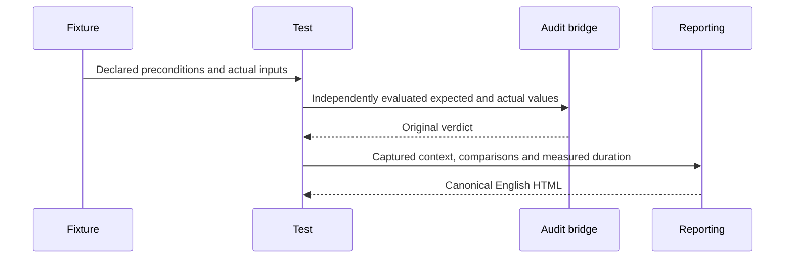

# Gradle components and their audit

## Overview

Gradle separates isolated units, audited components and optional platform observations. Tests own their oracles; the test-only [audit bridge](../../whist-lab-app/test-audit/README.md) captures evaluated comparisons and the reporting library produces canonical English Extent reports.

## Responsibilities and levels

| Owner | Primary selection | Boundary |
|---|---|---|
| Portable presentation | `:card-table-core:test` | Geometry, content, text roles, hand feedback and deterministic effects; no Android or browser startup. |
| Isolated units | `:card-table-core:unitTest` | Normalization, immutable snapshots and invalid inputs; JUnit only, without Extent or reporting dependencies. |
| Android renderer | `:card-table-android:testDebugUnitTest` | Native adapter contracts and source ownership; real widgets require separate instrumentation. |
| Whist projections | Application component collections and browser contracts | Shared game content, setup, achievements and checkpoint codecs from `whist-presentation`. |
| Game engine | Release rule collections | Legal commands, scoring, checkpoints and game schedules; AI measurements remain separate. |
| Independent player | `:ai-lab:test` | Public observations, legal decisions and policy isolation. |
| Audit support | `:test-audit:test` | Capture lifecycle, original verdicts, parameter identities and publication. |

The Android project's physical directory remains `atf-card-table-ui`; its Gradle identity is `card-table-android`. Core owns portable classes and neutral test fixtures. Web depends on core; the launcher builds module JARs from complete source roots rather than maintaining individual shared-source lists.

- The [application catalog](../../config/gradle-app-collections.properties) assigns each package to one primary collection: `testDebugCommandsComponents`, `testDebugBiddingComponents`, `testDebugHistoryComponents`, `testDebugDisplayComponents` or `testDebugAchievementsComponents`. The original `testDebugUnitTest` delegates to these tasks without executing a duplicate population.

- The history owner includes both model tests and the complete `src/rasterTest` population; `historyRasterTest` delegates to that owner. One Extent receipt therefore covers the state and rendered JVM contracts without a second raster execution.

## Context capture

Legend — capture does not repeat the operation

Record constructor, save and command arguments before evaluation. Capture expected and actual values once, preserving the original exception and verdict. A fixture or mock supplies declared conditions; it cannot invent a platform execution.

`GradleInputs.created` returns the supplied value while recording its inputs. `GradleInputs.fixture` records relevant case data before comparison. Evaluated assertions retain complete structured bodies rather than replacing them with a PASS summary.

## Reporting profile

Audited component and governance tasks produce one canonical Extent each. Isolated `unitTest` tasks keep JUnit diagnostics and do not create Extent. Continuity and display matrices have no screenshots; a separate rendered observation may carry an explicitly identified raster or inline E2E capture.

JUnit output is a temporary independent population oracle. The verifier reconciles exact invocation identities and outcomes against HTML; temporary XML is not delivered as another final report. The standard Overview belongs to Reporting and is not replaced with a custom evidence gallery.

## Acceptance and retention

### Exhaustive matrices with bounded audit inputs

The [matrix ledger](../../whist-lab-app/test-audit/src/testFixtures/java/atf/gradle/audit/matrix/ExhaustiveMatrixChecks.java) evaluates every expected/actual pair and aggregates passing comparisons by named invariant.

| Boundary | Required contract |
|---|---|
| Preconditions | Record axes, deterministic setup and the independently expected population. |
| Coverage | Compare the expected population with the evaluated count; reject an empty scan or a swallowed mismatch. |
| Failure | Fail immediately with the location and complete expected/actual values of the first mismatch. |
| Identity | Preserve invocation identities and qualified report bytes; changed inputs produce new evidence. |
| Size | Measure decoded input bodies and comparison counts separately from shared embedded HTML resources. |
| Levels | Units verify isolated calculations without Extent; components retain audited adapter contracts, independent oracles, coverage and negative cases. |

The [layer catalog](../../config/gradle-audit-collections.properties) declares every executable owner. Moving a class preserves its case identity. Shared contracts and negative controls must pass before retiring a duplicate platform check.

RAG records each validated task independently before starting the next task. Reuse requires unchanged relevant production inputs, transitive dependencies, tests, resources, toolchain and selection. A failed case is rerun after correction; unrelated valid collections remain reusable. [Checkpoint and reuse](ATF_ReleaseQualification.md#resume-validated-steps)

## Rules, policies and memory

Full offline games and combinatorial rule checks belong to component collections with legal setups and the real engine. AI learning and reserved evaluation lots are opt-in; a policy metric is distinct from a legal-game oracle.

| Process | Declared resource contract |
|---|---|
| Test worker | One worker, 512 MiB heap, no early failure hiding later invocations. |
| Report verifier | 384 MiB heap for original JUnit/HTML reconciliation. |
| Component matrix | Aggregate exhaustive comparisons and the first precise mismatch; do not emit millions of PASS rows. |

## Execution and limits

Use an external build/cache directory. `whist.auditOutput` selects the evidence location and `whist.auditSource` identifies the source context. Group affected tasks in one Gradle invocation and retain task-level checkpoints.

[Testing strategy](README.md) · [Module × level matrix](ATF_TestingGuide.md) · [Shared table continuity](ATF_TableContinuity.md) · [Current Web suites](../../release/WEB/README.md)

## Bounded matrix inputs

Passing matrices aggregate comparisons by invariant.

- Preserve every original loop, case identity and independent oracle; assert the planned population independently.
- Freeze mutable fixture context before evaluation and publish it completely on the first mismatch.
- Record, fine-layout, animation and pixel matrices remain components, without product or rendered-fixture images; pixel checks still execute against their in-memory or file-round-tripped rasters.
- Isolated units retain JUnit diagnostics without Extent.
