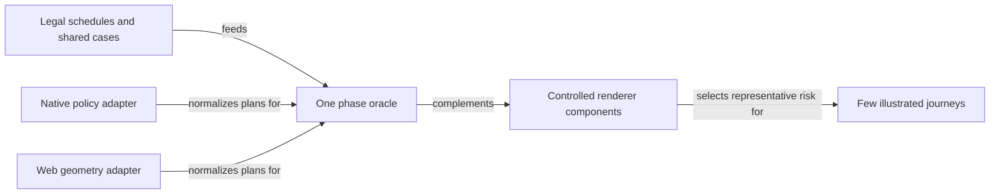

# Shared APK and Web table continuity

## Overview

One executable matrix and one oracle govern Whist seat stability. Platform adapters measure their own policies; controlled DOM components and a few illustrated journeys verify renderer integration separately.

## Ownership

Legend: shared assertions and separate renderers

The [shared contract](../../whist-lab-app/app/src/test/java/ro/whistlab/app/table/TablePhaseContract.java) owns the population and assertions. The APK test calls it directly; the Web fixture imports the same source and supplies both adapters. No Android widgets, font rasterization or emulator are simulated by this policy comparison.

## Finite component matrix

| Dimension | Contract |
|---|---|
| Variant and players | Every `GameMode`, with three through six players. |
| Cards | Every distinct legal hand size from `GameRules.handSizes`; invalid variant/deal combinations are not presented as legal games. |
| Logical width | 280, 320, 414, 560 and 760 units. |
| Useful height and text | 568, 896 and 1280 units; 1.0×, 1.3× and 2.0× text. |
| Actors and winners | Every seat bids, plays and wins collection in controlled observations; all frames are compared, including the lower five/six-player seats. |
| Phases | Bidding, play, collection and after collection, including transitions across hand sizes in one schedule. |
| Measurements | Supplied logical frame demand is explicit. Existing density/rounding and hand-face contracts retain their own ownership. |
| Negative controls | Move each seat by one pixel in every phase and remove a seat; the common oracle must reject each mutation. |

The oracle compares every ordered seat against the same match baseline, checks population, positive bounds and separation from controls. Controlled renderer fixtures additionally measure all six anchor classes and preserve fitted rows and mounted nodes. Components have preconditions, captured values and assertions without screenshots.

## E2E and audit organization

| Layer | APK and Web organization |
|---|---|
| Source index | [Android display](../../atf-test-android/src/test/java/atf/android/e2e/display/README.md) and [browser tests](../../atf-ui-browser/tests/README.md) use the same contract marker, levels and Given/When/Then audit roles. |
| Components | One Extent per selected collection, with original input and expected/observed comparisons; no product images in continuity components. |
| E2E | Few journeys at one readable viewport; preserve before/after deposits, AI-to-human transitions, collection, individual assertions and inline images. |
| Delivery | A README index uses relative links to canonical HTML. Reused evidence keeps its identity, scope and original verdict; never relabel a policy result as installed-APK acceptance. |

The [current Web dossier](../../release/WEB/README.md) separates component and E2E artifacts. The [Android catalog](../../release/README.md) retains immutable release evidence; an unexecuted native flow remains explicitly unexecuted. Runtime parity and artifact identity are separate from the validator revision.
