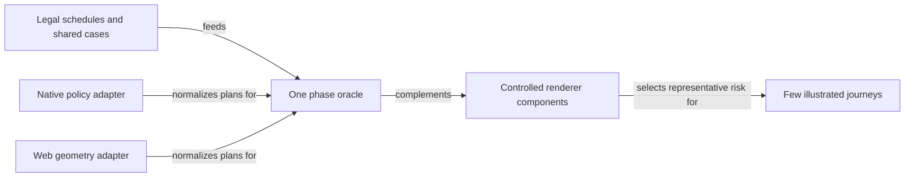

# Shared APK and Web table continuity

## Overview

One executable matrix and one oracle govern Whist seat stability. Platform adapters measure their own policies; controlled DOM components and a few illustrated journeys verify renderer integration separately.

## Ownership

Legend: shared assertions and separate renderers

The neutral [observation port](../../whist-lab-app/card-table-core/src/testFixtures/java/ro/cardtable/testing/SurfaceObservation.java) and [continuity oracle](../../whist-lab-app/card-table-core/src/testFixtures/java/ro/cardtable/testing/SurfaceContinuity.java) live in core test fixtures. The game-owned [shared contract](../../whist-lab-app/app/src/test/java/ro/whistlab/app/table/TablePhaseContract.java) owns the population and assertions. The APK test calls it directly; the Web fixture imports the same source and supplies both adapters. No Android widgets, font rasterization or emulator are simulated by this policy comparison.

## Finite component matrix

| Dimension | Contract |
|---|---|
| Variant and players | Every `GameMode`, with three through six players. |
| Cards | Every distinct legal hand size from `GameRules.handSizes`; invalid variant/deal combinations are not presented as legal games. |
| Logical width | 280, 320, 414, 560 and 760 units. |
| Useful height and text | 568, 896 and 1280 units; 1.0×, 1.3× and 2.0× text. |
| Actors and winners | Every seat bids, plays and wins collection in controlled observations; all frames are compared, including the lower five/six-player seats. |
| Phases | Bidding, play, collection and after collection, including transitions across hand sizes in one schedule. |
| Measurements | Supplied logical frame demand is explicit. Existing density/rounding and hand-face contracts retain their own ownership. |
| Negative controls | Move each seat by one pixel in every phase and remove a seat; the common oracle must reject each mutation. |

The oracle compares every ordered seat against the same match baseline, checks population, positive bounds and separation from controls. Controlled renderer fixtures additionally measure all six anchor classes and preserve fitted rows and mounted nodes. Components have preconditions, captured values and assertions without screenshots.

## E2E and audit organization

| Layer | APK and Web organization |
|---|---|
| Source index | [Android display](../../atf-test-android/src/test/java/atf/android/e2e/display/README.md) and [browser tests](../../atf-ui-browser/tests/README.md) use the same contract marker, levels and Given/When/Then audit roles. |
| Components | One Extent per selected collection, with original input and expected/observed comparisons; no product images in continuity components. |
| E2E | Few journeys at one readable viewport; preserve before/after deposits, AI-to-human transitions, collection, individual assertions and inline images. |
| Delivery | A README index uses relative links to canonical HTML. Reused evidence keeps its identity, scope and original verdict; never relabel a policy result as installed-APK acceptance. |

The [current Web dossier](../../release/WEB/README.md) separates component and E2E artifacts. The [Android catalog](../../release/README.md) retains immutable release evidence; an unexecuted native flow remains explicitly unexecuted. Runtime parity and artifact identity are separate from the validator revision.

## E2E budget and suite ownership

Whole games belong to game components: real engine, legal setup and controlled external dependencies. UI core verifies projections and display matrices; adapters add only their platform checks.

Delivery policy requires one or two hands per E2E game at one readable viewport. Resolution, density, text, actor and variant matrices belong to shared screenshot-free components; E2E verifies real window transitions and retains inline captures.

| Scope | Contract |
|---|---|
| Shared scenario | The same IDs, preconditions, outcomes and Given/When/Then steps execute through APK/Web drivers. |
| Match completion | Use a legal near-final checkpoint validated in components, then play the real last hand. |
| Suite delivery | The current `release/` index links canonical component, renderer, governance and E2E reports by relative path, with explicit selection and provenance. |
| Historical references | Preserve original outcomes and bytes; an older over-budget journey does not become current primary qualification. |
| Image selection | Both adapters and publishers enforce at most four normal captures and one terminal failure image. Semantic checkpoints retain original actions, observations and assertions without adding an image. |
| Shared executable intent | [Sanity plan](../../config/table-sanity-plan.json) supplies the scenario ID, ordered roles, two one-card hands and image ownership to the Java and Web drivers. Admission precedes device or browser interaction. |

### Paired sanity roles

| Role | Actual transition | Capture |
|---|---|---|
| `bidding` | Start Romanian 1–8–1, four players, Hard, manual control. | Yes |
| `before-human` | Submit a legal bid and wait for the human's legal card. | Yes |
| `after-human` | Play the real card and reach the durable score screen. | Yes |
| `manual-score` | Record the completed first hand. | No |
| `auto-bidding` | Continue to the second one-card hand with AutoGame unchecked. | No |
| `auto-score` | Enable AutoGame and reach the second score screen. | Yes |
| `return-control` | Continue to manual bidding without playing a third hand. | No |

- Drivers supply platform observations; they do not inject a completed score screen.
- Optional achievement notices preserve their own semantic observations.
- A failed run keeps the completed prefix, original cause and first diagnostic image; publication cannot turn it into a complete passing flow.

The native journal carries its original plan through replay. Missing, extra, reordered or misassigned frames are refused before the next journal mutation or final HTML publication. Components test these controls without a device; an illustrated journey qualifies only its actual platform and viewport.

[Implementation and remaining acceptance](../feedback/ATF_CardUi_Extraction.md#ui-three-module-plan) separate portable core, Android adapter and Web adapter. Game-specific cases remain with the game; neutral fixture/oracle support belongs to core tests.
