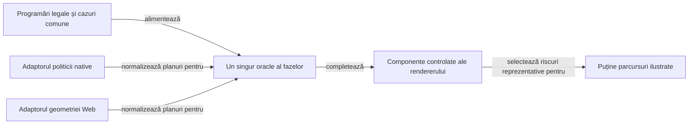

# Continuitatea comună a mesei APK și Web

## Pe scurt

O singură matrice executabilă și un singur oracle guvernează stabilitatea locurilor Whist. Adaptoarele măsoară politicile propriei platforme; componentele DOM controlate și puține parcursuri ilustrate verifică separat integrarea rendererului.

## Responsabilități

Legendă: aserțiuni comune și renderere separate

[Portul neutru de observații](../../whist-lab-app/card-table-core/src/testFixtures/java/ro/cardtable/testing/SurfaceObservation.java) și [oracolul de continuitate](../../whist-lab-app/card-table-core/src/testFixtures/java/ro/cardtable/testing/SurfaceContinuity.java) sunt în fixture-urile core. [Contractul comun al jocului](../../whist-lab-app/app/src/test/java/ro/whistlab/app/table/TablePhaseContract.java) deține populația și aserțiunile. Testul APK îl apelează direct; fixture-ul Web importă aceeași sursă și furnizează ambele adaptoare. Această comparație de politici nu simulează widgeturile Android, rasterizarea fonturilor sau emulatorul.

## Matricea finită de componente

| Dimensiune | Contract |
|---|---|
| Variantă și jucători | Fiecare `GameMode`, cu trei până la șase jucători. |
| Cărți | Fiecare mărime legală distinctă din `GameRules.handSizes`; combinațiile invalide de variantă/distribuire nu sunt prezentate ca jocuri legale. |
| Lățime logică | 280, 320, 414, 560 și 760 de unități. |
| Înălțime utilă și text | 568, 896 și 1280 de unități; text 1.0×, 1.3× și 2.0×. |
| Actori și câștigători | Fiecare loc licitează, joacă și câștigă colectarea în observații controlate; se compară toate chenarele, inclusiv cele de jos la cinci/șase jucători. |
| Faze | Licitare, joc, colectare și după colectare, inclusiv trecerile între mărimile mâinilor aceleiași programări. |
| Măsurători | Cerința logică furnizată a chenarului este explicită. Contractele existente de densitate/rotunjire și fețe ale mâinii își păstrează responsabilitatea. |
| Controale negative | Deplasați fiecare loc cu un pixel în fiecare fază și eliminați un loc; oracle-ul comun trebuie să respingă fiecare mutație. |

Oracle-ul compară fiecare loc ordonat cu aceeași referință a partidei și verifică populația, limitele pozitive și separarea de controale. Fixture-urile controlate ale rendererului măsoară suplimentar toate cele șase clase de ancore și păstrează rândurile încadrate și nodurile montate. Componentele au precondiții, valori capturate și aserțiuni fără poze.

## E2E și organizarea auditului

| Nivel | Organizare APK și Web |
|---|---|
| Indexul surselor | [Afișaj Android](../../atf-test-android/src/test/java/atf/android/e2e/display/README.md) și [teste browser](../../atf-ui-browser/tests/README.md) folosesc același marcaj al contractului, niveluri și roluri de audit Given/When/Then. |
| Componente | Un Extent pentru fiecare colecție selectată, cu intrarea originală și comparații așteptat/observat; fără imagini ale produsului în componentele de continuitate. |
| E2E | Puține parcursuri la un singur viewport lizibil; păstrați depunerile înainte/după, trecerile AI–om, colectarea, aserțiunile individuale și imaginile inline. |
| Livrare | Indexul README folosește legături relative spre HTML-ul canonic. Dovezile refolosite păstrează identitatea, domeniul și verdictul original; nu redenumiți un rezultat de politică drept acceptanță a APK-ului instalat. |

[Dosarul Web curent](../../release/WEB/README.md) separă artefactele componentelor de E2E. [Catalogul Android](../../release/README.md) păstrează dovezile imuabile ale release-urilor; un parcurs nativ neexecutat rămâne explicit neexecutat. Paritatea runtime și identitatea artefactelor sunt separate de revizia validatorului.

## Bugetul E2E și proprietatea suitei

Partidele complete aparțin componentelor jocului: motor real, setup legal și dependențe externe controlate. Core UI verifică proiecțiile și matricele de afișaj; adaptoarele adaugă numai verificările propriei platforme.

Politica de livrare cere una sau două mâini per joc E2E, la un singur viewport lizibil. Matricele de rezoluție, densitate, text, actori și variante aparțin componentelor comune fără poze; E2E verifică tranzițiile reale între ferestre și păstrează capturi inline.

| Domeniu | Contract |
|---|---|
| Scenariu comun | Aceleași ID-uri, precondiții, rezultate și pași Given/When/Then sunt executate prin drivere APK/Web. |
| Final de partidă | Folosiți un checkpoint legal aproape de final, validat în componente, apoi jucați mâna finală reală. |
| Livrarea suitei | Indexul curent din `release/` leagă prin căi relative rapoartele canonice ale componentelor, rendererelor, guvernanței și E2E, cu selecție și proveniență explicite. |
| Referințe istorice | Păstrați verdictele și octeții originali; un parcurs vechi peste buget nu devine o calificare primară curentă. |
| Selecția imaginilor | Ambele adaptoare și publicatoare impun cel mult patru capturi normale și o imagine terminală de eșec. Checkpoint-urile semantice păstrează acțiunile, observațiile și aserțiunile originale fără o imagine suplimentară. |
| Intenție executabilă comună | [Planul sanity](../../config/table-sanity-plan.json) furnizează ID-ul scenariului, rolurile ordonate, două mâini de câte o carte și proprietatea imaginilor pentru driverele Java și Web. Admiterea precedă interacțiunea cu dispozitivul sau browserul. |

### Rolurile sanity pereche

| Rol | Tranziție reală | Captură |
|---|---|---|
| `bidding` | Pornește Românesc 1–8–1, patru jucători, Dificil, control manual. | Da |
| `before-human` | Depune o licitație legală și așteaptă cartea legală a omului. | Da |
| `after-human` | Joacă efectiv cartea și ajunge la ecranul stabil de scor. | Da |
| `manual-score` | Înregistrează prima mână încheiată. | Nu |
| `auto-bidding` | Continuă la a doua mână de o carte, cu AutoGame debifat. | Nu |
| `auto-score` | Activează AutoGame și ajunge la al doilea ecran de scor. | Da |
| `return-control` | Continuă la licitația manuală fără să joace o a treia mână. | Nu |

- Driverele furnizează observațiile platformei; nu injectează un ecran de scor finalizat.
- Notificările opționale de realizări păstrează propriile observații semantice.
- O rulare eșuată păstrează prefixul încheiat, cauza originală și prima imagine de diagnostic; publicarea nu o poate transforma într-un parcurs complet trecut.

Jurnalul nativ păstrează planul original la reluare. Cadrele lipsă, suplimentare, reordonate sau atribuite greșit sunt refuzate înaintea următoarei modificări a jurnalului ori publicării HTML finale. Componentele verifică aceste controale fără dispozitiv; un parcurs ilustrat califică numai platforma și viewport-ul executate efectiv.

[Implementare și acceptanță rămasă](../feedback/ATF_CardUi_Extraction.md#ui-three-module-plan) separă core portabil, adaptorul Android și adaptorul Web. Cazurile specifice jocului rămân la joc; suportul neutru pentru fixture-uri și oracle-uri aparține testelor core.
