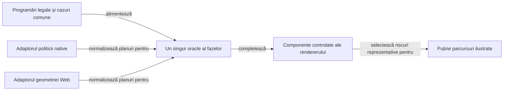

# Continuitatea comună a mesei APK și Web

## Pe scurt

O singură matrice executabilă și un singur oracle guvernează stabilitatea locurilor Whist. Adaptoarele măsoară politicile propriei platforme; componentele DOM controlate și puține parcursuri ilustrate verifică separat integrarea rendererului.

## Responsabilități

Legendă: aserțiuni comune și renderere separate

[Contractul comun](../../whist-lab-app/app/src/test/java/ro/whistlab/app/table/TablePhaseContract.java) deține populația și aserțiunile. Testul APK îl apelează direct; fixture-ul Web importă aceeași sursă și furnizează ambele adaptoare. Această comparație de politici nu simulează widgeturile Android, rasterizarea fonturilor sau emulatorul.

## Matricea finită de componente

| Dimensiune | Contract |
|---|---|
| Variantă și jucători | Fiecare `GameMode`, cu trei până la șase jucători. |
| Cărți | Fiecare mărime legală distinctă din `GameRules.handSizes`; combinațiile invalide de variantă/distribuire nu sunt prezentate ca jocuri legale. |
| Lățime logică | 280, 320, 414, 560 și 760 de unități. |
| Înălțime utilă și text | 568, 896 și 1280 de unități; text 1.0×, 1.3× și 2.0×. |
| Actori și câștigători | Fiecare loc licitează, joacă și câștigă colectarea în observații controlate; se compară toate chenarele, inclusiv cele de jos la cinci/șase jucători. |
| Faze | Licitare, joc, colectare și după colectare, inclusiv trecerile între mărimile mâinilor aceleiași programări. |
| Măsurători | Cerința logică furnizată a chenarului este explicită. Contractele existente de densitate/rotunjire și fețe ale mâinii își păstrează responsabilitatea. |
| Controale negative | Deplasați fiecare loc cu un pixel în fiecare fază și eliminați un loc; oracle-ul comun trebuie să respingă fiecare mutație. |

Oracle-ul compară fiecare loc ordonat cu aceeași referință a partidei și verifică populația, limitele pozitive și separarea de controale. Fixture-urile controlate ale rendererului măsoară suplimentar toate cele șase clase de ancore și păstrează rândurile încadrate și nodurile montate. Componentele au precondiții, valori capturate și aserțiuni fără poze.

## E2E și organizarea auditului

| Nivel | Organizare APK și Web |
|---|---|
| Indexul surselor | [Afișaj Android](../../atf-test-android/src/test/java/atf/android/e2e/display/README.md) și [teste browser](../../atf-ui-browser/tests/README.md) folosesc același marcaj al contractului, niveluri și roluri de audit Given/When/Then. |
| Componente | Un Extent pentru fiecare colecție selectată, cu intrarea originală și comparații așteptat/observat; fără imagini ale produsului în componentele de continuitate. |
| E2E | Puține parcursuri la un singur viewport lizibil; păstrați depunerile înainte/după, trecerile AI–om, colectarea, aserțiunile individuale și imaginile inline. |
| Livrare | Indexul README folosește legături relative spre HTML-ul canonic. Dovezile refolosite păstrează identitatea, domeniul și verdictul original; nu redenumiți un rezultat de politică drept acceptanță a APK-ului instalat. |

[Dosarul Web curent](../../release/WEB/README.md) separă artefactele componentelor de E2E. [Catalogul Android](../../release/README.md) păstrează dovezile imuabile ale release-urilor; un parcurs nativ neexecutat rămâne explicit neexecutat. Paritatea runtime și identitatea artefactelor sunt separate de revizia validatorului.
