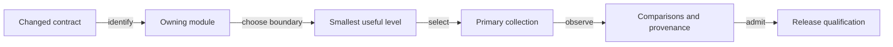

# Testing guide

## Overview

Choose a test by the boundary that can fail, then select the collection that owns it. This guide maps Whist's modules to executable verification, including the different conventions used by Maven, Gradle and the browser adapter. The [test strategy](README.md) remains the normative owner of risk and acceptance policy; this matrix provides the implementation map.

Android and Web are active. Native iOS qualification is parked. A local JVM test of the bridge does not qualify an iOS application.

Legend — ownership before execution

- A source change selects its consumers through the [dependency contract](ATF_Collections.md#executable-dependency-selection), rather than through a list inferred from filenames.
- Reused evidence retains its original invocation identities and report bytes. A fresh execution has a new source-bound receipt.
- A component result proves the exercised boundary. Fonts, touch behavior and system callbacks require separate rendered acceptance when their contracts change.

## Levels and environments

| Level | Boundary and suitable inputs | What it does not establish |
|---|---|---|
| Unit | One calculation or policy; typed examples, controlled time and independently derived expectations. | Collaboration across modules or platform rendering. |
| Component | A public module or adapter boundary; real local implementation with controlled collaborators, legal fixtures and negative cases. | A newly installed app or a live browser journey. |
| Integration | Real collaboration between modules, physical binaries or execution and publication infrastructure. | Every variant of an already isolated component contract. |
| E2E | A user command through the rendered application to its observable effect and persistence. | Exhaustive rule, policy or geometry coverage. |

The environment is a separate dimension. A component may launch Git, Node or a controlled subprocess without using Android. A saved screenshot, a mock ADB response or an archived journal does not become an E2E execution.

## Detailed module × test level matrix

### Maven declarations

- `✅` means that live executable classes declare that level, directly or through a composed annotation.
- `—` means that no such executable declaration exists. It does not request an artificial suite or imply missing coverage.
- [Matrix governance](../../atf-tests/src/test/java/atf/tests/governance/source/TestLayerGovernanceTest.java) compares these rows with the JDK-parsed source inventory and rejects missing, duplicated or incorrect module entries.

<!-- atf-maven-level-matrix -->

| Module | Unit | Component | Integration | E2E | Owner and primary purpose |
|---|---|---|---|---|---|
| `atf-validation` | ✅ | ✅ | — | — | [Validation](../../atf-validation/README.md): public rule and evidence oracles; no application dependency. |
| `atf-test-android` | ✅ | ✅ | ✅ | ✅ | [Android verification](../../atf-test-android/README.md): clocks, ADB adapters, observations, report integration and installed-app journeys. |
| `atf-tests` | ✅ | ✅ | ✅ | — | [ATF verification](../../atf-tests/README.md): binary consumers, adapter contracts, source/documentation governance and release qualification. |

<!-- /atf-maven-level-matrix -->

Each executable Maven class owns exactly one level. Suite classes describe selections; helpers, fixtures and publishers are not additional test invocations. The [syntax contract](../governance/README.md#test-declarations) defines how nested classes and composed annotations are inspected without running application code.

### Gradle and browser boundaries

These rows describe executable boundaries, not Maven annotations. Source-set ownership determines the reporting contract; the word “unit” in Android's host task name does not turn its component cases into isolated units.

| Module | Unit | Component | Integration | E2E | Ownership and executable selection |
|---|---|---|---|---|---|
| `card-table-core` | ✅ | ✅ | — | — | `unitTest` checks isolated normalization and snapshot ownership; `test` owns portable models, geometry, text roles and negative controls. [Core](../../whist-lab-app/card-table-core/README.md) |
| `card-table-android` | — | ✅ | ✅ | — | `testDebugUnitTest` checks native adapter contracts. Focused instrumentation qualifies real widgets separately; no full resolution E2E matrix. [Android renderer](../../whist-lab-app/atf-card-table-ui/README.md) |
| `card-table-web` | — | ✅ | ✅ | ✅ | Shared Java projection plus controlled DOM/clock components; one explicit short browser sanity flow checks wiring. [Web renderer](../../atf-ui-browser/README.md#verification) |
| `whist-presentation` | — | ✅ | — | — | Game-specific portable projection; existing APK/Web component providers preserve catalog, checkpoint and presentation case identities. |
| `whist-lab-app/app` | — | ✅ | — | — | Commands, bidding, display, history and achievement primary tasks test Whist projections and lifecycle without a device. Installed-app journeys are owned by Maven's Android E2E module. |
| `whist-lab-app/game-core` | ✅ | ✅ | — | — | Rules, score and checkpoints; release rule collections exclude AI learning experiments. |
| `whist-lab-app/ai-lab` | — | ✅ | — | — | Independent player and offline policy comparisons on legal fixtures and reserved deals. |
| `test-audit` | — | ✅ | — | — | Capture, evaluated assertions and report/JUnit reconciliation; test-only dependency. |

| Shared responsibility | Executable contract |
|---|---|
| Module mapping | Android maps to the existing `atf-card-table-ui` directory; Web maps to `atf-ui-browser`. Java packages remain stable. |
| Neutral fixtures | Core's immutable logical observations and continuity oracle contain no game rules. Whist supplies legal schedules and public projections. |
| Unit output | Isolated `unitTest` cases keep JUnit diagnostics without Extent. |
| Component output | Capture preconditions and evaluated expected/actual comparisons in canonical Extent; no continuity pictures. |
| Component matrix | Resolution, density, text scale, language, legal hand sizes, actors and winners. |
| E2E selection | One explicit sanity flow and one readable viewport, at most two hands and four normal captures; preserve the first failure separately. |
| Admission and publication | Reject matrices or long plans before startup, then reconcile actual rounds and image references before HTML publication. |
| Rendering limit | Equal policy plans do not qualify native font painting. [Continuity and adapter contract](ATF_TableContinuity.md) |

### Consumed binary libraries

| Library | Local verification | Ownership limit |
|---|---|---|
| Core | Public API and binary identity through Maven consumers. | Producer unit/component suites are outside the local reactor. |
| Reporting | Captured inputs, original comparisons, English Extent structure and exact invocation coverage. | HTML presence alone does not prove interactive readability or a fresh application journey. |
| Console | Consumer integration and diagnostics. | Consumer tests do not replace the producer's source tests. |
| Mock | Consumer behavior with deliberately controlled boundaries. | Mocked outcomes remain explicit inputs, never fabricated live evidence. |
| Test Kit | Layer, assertion and suite contracts through local consumers. | The versioned JAR/POM pair defines the local dependency. |

The [binary library index](../../lib/README.md) owns versions and provenance. Shared UI source modules remain in this checkout; exported AAR/JAR consumers verify the same delivered bytes and test archive instead of copying producer sources.

## Shared Android–Web contracts

| Property | Common component proof | Remaining platform acceptance |
|---|---|---|
| Table placement and scaling | Shared placement policies with explicit available regions, text scale and legal player/card populations; verify containment and fixed seats across phases. | Native insets, adaptive browser viewport and actual font measurements. |
| Card feedback and collection | Same gesture sequence, rejected/recommended card and cancellation cases; controlled time verifies event order. | Touch targets, rendered card faces and intermediate animation frames. |
| Profile and resumed game | Real codec, legal engine checkpoints, cancellation, invalid inputs and idempotent restoration. | Storage reopening and platform lifecycle callbacks through visible controls. |
| Bidding and score history | Shared rule inputs, manual selection, total score, series markers and localized models. | The visible confirmation, readable final rows and accessible controls. |

Use the [adapter contract](ATF_DisplayComponents.md) to identify the same cases on both platforms. Sharing expected values without exercising each adapter is insufficient; comparing a mock screenshot with another mock does not establish rendered parity.

## Selections, reuse and test-change admission

1. Identify changed source paths and the owning collection through the real Git diff and dependency model.
2. Review protected test changes against their exact base and paths. Admit the source declarations of positive and negative proof selectors before copying sources or dependency caches and before Maven.
3. Require one unambiguous declared instance `void @Test` method in component scope. Dynamic factories/templates, parameterized/repeated tests, overloads and unresolved annotation composition are not static proof selectors. See [selector admission](../governance/ATF_TestChanges.md#early-source-control-admission).
4. Compile once for the required controls, then reconcile actual JUnit discovery and outcomes with each declared selector. Source eligibility does not authorize missing, skipped or failing invocations.
5. Reuse only admitted evidence for unchanged owners. Reassess documentation-only drift against both snapshots; retain a failed aggregate and its original cause.
   Original source-control proofs may continue across admitted editorial commits without changing their execution identity; current documentation governance still runs. [Proof continuation](../governance/ATF_TestChanges.md#editorial-continuation-of-original-proofs)
6. Execute missing or invalidated owners, publish their comparisons and let the read-only RAG evaluator decide whether the required population is qualified.

Primary suites own disjoint populations. Focused selections retain their primary parents; running a case through both entry points does not create two unique cases. The [suite catalog](../../config/atf-test-suites.json) and [component-owner inventory](../../config/atf-component-collections.json) are executable inputs, not historical result lists.

## Execution and audit

Configure the [external evidence and temporary roots](../../scripts/README.md) before invoking a launcher. Build output, test profiles and intermediate snapshots stay outside the checkout; use machine-local settings rather than hard-coded paths. [Collections and commands](ATF_Collections.md) lists the supported launchers and per-owner selection.

- Component and E2E gates publish separate canonical English Extent reports through the reporting library. Capture inputs, expected/actual comparisons, original causes and invocation identities during execution.
- Inline Base64 images belong to a real raster or browser observation. A numeric layout check is reported as a component assertion, without inventing a screenshot.
- JUnit output reconciles the executed population. Republishing or replaying an archived journal does not qualify a new interaction.
- Record concrete counts, hashes, timings, failures and reuse decisions in the external audit. Generic guides describe mechanisms and remain valid for future releases.

[Test architecture](ATF_Architecture.md) · [Reporting contract](../reporting/ATF_Audit.md) · [Release qualification](ATF_ReleaseQualification.md) · [Quality governance](../governance/README.md)
