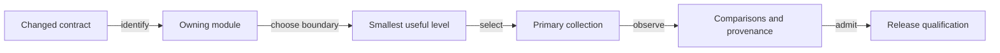

# Testing guide

## Overview

Choose a test by the boundary that can fail, then select the collection that owns it. This guide maps Whist's modules to executable verification, including the different conventions used by Maven, Gradle and the browser adapter. The [test strategy](README.md) remains the normative owner of risk and acceptance policy; this matrix provides the implementation map.

Android and Web are active. Native iOS qualification is parked. A local JVM test of the bridge does not qualify an iOS application.

Legend — ownership before execution

- A source change selects its consumers through the [dependency contract](ATF_Collections.md#executable-dependency-selection), rather than through a list inferred from filenames.
- Reused evidence retains its original invocation identities and report bytes. A fresh execution has a new source-bound receipt.
- A component result proves the exercised boundary. Fonts, touch behavior and system callbacks require separate rendered acceptance when their contracts change.

## Levels and environments

| Level | Boundary and suitable inputs | What it does not establish |
|---|---|---|
| Unit | One calculation or policy; typed examples, controlled time and independently derived expectations. | Collaboration across modules or platform rendering. |
| Component | A public module or adapter boundary; real local implementation with controlled collaborators, legal fixtures and negative cases. | A newly installed app or a live browser journey. |
| Integration | Real collaboration between modules, physical binaries or execution and publication infrastructure. | Every variant of an already isolated component contract. |
| E2E | A user command through the rendered application to its observable effect and persistence. | Exhaustive rule, policy or geometry coverage. |

The environment is a separate dimension. A component may launch Git, Node or a controlled subprocess without using Android. A saved screenshot, a mock ADB response or an archived journal does not become an E2E execution.

## Detailed module × test level matrix

### Maven declarations

- `✅` means that live executable classes declare that level, directly or through a composed annotation.
- `—` means that no such executable declaration exists. It does not request an artificial suite or imply missing coverage.
- [Matrix governance](../../atf-tests/src/test/java/atf/tests/governance/source/TestLayerGovernanceTest.java) compares these rows with the JDK-parsed source inventory and rejects missing, duplicated or incorrect module entries.

<!-- atf-maven-level-matrix -->

| Module | Unit | Component | Integration | E2E | Owner and primary purpose |
|---|---|---|---|---|---|
| `atf-validation` | ✅ | ✅ | — | — | [Validation](../../atf-validation/README.md): public rule and evidence oracles; no application dependency. |
| `atf-test-android` | ✅ | ✅ | ✅ | ✅ | [Android verification](../../atf-test-android/README.md): clocks, ADB adapters, observations, report integration and installed-app journeys. |
| `atf-tests` | ✅ | ✅ | ✅ | — | [ATF verification](../../atf-tests/README.md): binary consumers, adapter contracts, source/documentation governance and release qualification. |

<!-- /atf-maven-level-matrix -->

Each executable Maven class owns exactly one level. Suite classes describe selections; helpers, fixtures and publishers are not additional test invocations. The [syntax contract](../governance/README.md#test-declarations) defines how nested classes and composed annotations are inspected without running application code.

### Gradle and browser boundaries

These rows describe exercised boundaries and their executable owners. Gradle's JUnit tests and Node contracts do not declare the Maven ATF layer annotations. A task name or a JavaScript filename therefore does not extend the annotation matrix above.

| Module or surface | Unit boundary | Component boundary | Integration or rendered boundary | Entry point and limit |
|---|---|---|---|---|
| `whist-lab-app/game-core` | Legal cards, scoring, series, bidding limits and policy calculations. | Session commands, checkpoints, achievements and allowed AI observations. | Complete offline games compare policies and independent invariants; no UI acceptance. | [Engine tests](../../whist-lab-app/game-core/src/test/README.md); release rules use `:game-core:releaseRulesComponents`. Learning and calibration have separate populations. |
| `whist-lab-app/ai-lab` | Evaluation data and deterministic research helpers. | Legal generated fixtures, corpus and experiment-tool contracts. | Controlled policy comparisons belong to research, not to installed-app qualification. | [Laboratory](../../whist-lab-app/ai-lab/README.md); `:ai-lab:check` includes local JVM and Node checks. |
| `whist-lab-app/app` | Presentation calculations, labels and persisted values. | Controllers, preferences, navigation, bidding and score-history behavior with controlled Android collaborators. | Native interaction, raster output and process restoration have separate Android acceptance. | [App tests](../../whist-lab-app/app/src/test/README.md); primary owners are achievements, bidding, commands, display and history. |
| `whist-lab-app/atf-card-table-ui` | Portable table geometry, typography and card-face metrics. | Shared controls, menus and animation lifecycle. | Native font and rendering acceptance remains separate from arithmetic agreement. | [UI tests](../../whist-lab-app/atf-card-table-ui/src/test/README.md); `:atf-card-table-ui:testDebugUnitTest`. |
| `whist-lab-app/card-table-names` | Deterministic display-name policy. | Consumer contracts exercise the names in the real engine. | No independent native journey is claimed. | [Name library](../../whist-lab-app/card-table-names/README.md); JVM compilation and engine consumers. |
| `whist-lab-app/test-audit` | Audit-model and comparison calculations. | Shared reporting fixtures validate captured comparisons and output. | Consumer suites establish integration with their real reporting binary. | [Audit fixtures](../../whist-lab-app/test-audit/README.md); test support is not shipped in the application. |
| `whist-lab-app/ios-bridge` | JVM bridge policies. | Engine projection and command mapping. | Native iOS is parked; bridge tests do not establish IPA or simulator acceptance. | [Bridge scope](../platform/ATF_iOSDelivery.md); excluded from the active JVM-only build. |
| `atf-ui-browser` | Portable viewport, menus, gestures and rendering-contract calculations. | Exported runtime/test JAR contracts and shared adapter cases. | Browser font, zoom, focus and keyboard behavior require browser observations. | [Shared adapter](../../atf-ui-browser/README.md); [Node contract runner](../../atf-ui-browser/tests/run-components.mjs). |
| `atf-ui-browser/whist` | Whist projection and browser-facing values. | Engine commands, layout and interaction adaptation. | A real browser journey verifies a rendered hand and storage reopening. | [Whist adapter](../../atf-ui-browser/README.md); [adapter component owner](../../atf-tests/src/test/java/atf/tests/governance/documentation/release/rag/nativeproof/WhistSurfaceAdapterComponentTest.java). |
| `atf-ui-browser/pages` | Local-storage codecs and client state policies. | Compiled-engine controls, navigation, history and effects with controlled storage or time. | Playwright scripts exercise the produced site; mocked browser state is identified separately from native acceptance. | [Pages](../../atf-ui-browser/README.md#verification); `verify.mjs`, `verify-controls.mjs`, `verify-records.mjs`, `verify-navigation.mjs` and `verify-effects.mjs` have distinct purposes. |

The [module map](../../README.md#module-map) owns build membership and dependency scopes. The [collection catalog](ATF_Collections.md) owns executable selections, budgets and commands. The matrix maps those owners; it does not duplicate their task definitions.

### Consumed binary libraries

| Library | Local verification | Ownership limit |
|---|---|---|
| Core | Public API and binary identity through Maven consumers. | Producer unit/component suites are outside the local reactor. |
| Reporting | Captured inputs, original comparisons, English Extent structure and exact invocation coverage. | HTML presence alone does not prove interactive readability or a fresh application journey. |
| Console | Consumer integration and diagnostics. | Consumer tests do not replace the producer's source tests. |
| Mock | Consumer behavior with deliberately controlled boundaries. | Mocked outcomes remain explicit inputs, never fabricated live evidence. |
| Test Kit | Layer, assertion and suite contracts through local consumers. | The versioned JAR/POM pair defines the local dependency. |

The [binary library index](../../lib/README.md) owns versions and provenance. Shared UI source modules remain in this checkout; exported AAR/JAR consumers verify the same delivered bytes and test archive instead of copying producer sources.

## Shared Android–Web contracts

| Property | Common component proof | Remaining platform acceptance |
|---|---|---|
| Table placement and scaling | Same logical frame, regions, text scale and legal player/card populations; verify containment and fixed seats across phases. | Native insets, browser viewport/zoom and actual font measurements. |
| Card feedback and collection | Same gesture sequence, rejected/recommended card and cancellation cases; controlled time verifies event order. | Touch targets, rendered card faces and intermediate animation frames. |
| Profile and resumed game | Real codec, legal engine checkpoints, cancellation, invalid inputs and idempotent restoration. | Storage reopening and platform lifecycle callbacks through visible controls. |
| Bidding and score history | Shared rule inputs, manual selection, total score, series markers and localized models. | The visible confirmation, readable final rows and accessible controls. |

Use the [adapter contract](ATF_DisplayComponents.md) to identify the same cases on both platforms. Sharing expected values without exercising each adapter is insufficient; comparing a mock screenshot with another mock does not establish rendered parity.

## Selections, reuse and test-change admission

1. Identify changed source paths and the owning collection through the real Git diff and dependency model.
2. Review protected test changes against their exact base and paths. Admit the source declarations of positive and negative proof selectors before copying sources or dependency caches and before Maven.
3. Require one unambiguous declared instance `void @Test` method in component scope. Dynamic factories/templates, parameterized/repeated tests, overloads and unresolved annotation composition are not static proof selectors. See [selector admission](../governance/ATF_TestChanges.md#early-source-control-admission).
4. Compile once for the required controls, then reconcile actual JUnit discovery and outcomes with each declared selector. Source eligibility does not authorize missing, skipped or failing invocations.
5. Reuse only admitted evidence for unchanged owners. Reassess documentation-only drift against both snapshots; retain a failed aggregate and its original cause.
6. Execute missing or invalidated owners, publish their comparisons and let the read-only RAG evaluator decide whether the required population is qualified.

Primary suites own disjoint populations. Focused selections retain their primary parents; running a case through both entry points does not create two unique cases. The [suite catalog](../../config/atf-test-suites.json) and [component-owner inventory](../../config/atf-component-collections.json) are executable inputs, not historical result lists.

## Execution and audit

Configure the [external evidence and temporary roots](../../scripts/README.md) before invoking a launcher. Build output, test profiles and intermediate snapshots stay outside the checkout; use machine-local settings rather than hard-coded paths. [Collections and commands](ATF_Collections.md) lists the supported launchers and per-owner selection.

- Component and E2E gates publish separate canonical English Extent reports through the reporting library. Capture inputs, expected/actual comparisons, original causes and invocation identities during execution.
- Inline Base64 images belong to a real raster or browser observation. A numeric layout check is reported as a component assertion, without inventing a screenshot.
- JUnit output reconciles the executed population. Republishing or replaying an archived journal does not qualify a new interaction.
- Record concrete counts, hashes, timings, failures and reuse decisions in the external audit. Generic guides describe mechanisms and remain valid for future releases.

[Test architecture](ATF_Architecture.md) · [Reporting contract](../reporting/ATF_Audit.md) · [Release qualification](ATF_ReleaseQualification.md) · [Quality governance](../governance/README.md)
