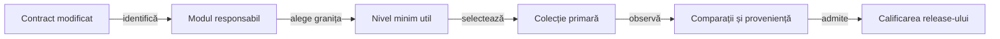

# Ghid de testare

## Pe scurt

Alege testul după granița care poate eșua, apoi selectează colecția responsabilă. Ghidul mapează modulele Whist la verificările executabile, inclusiv convențiile diferite folosite de Maven, Gradle și adaptorul browser. [Strategia de testare](README.md) rămâne proprietarul normativ al politicii de risc și acceptare; matricea oferă harta implementării.

Android și Web sunt active. Calificarea iOS nativă este suspendată. Un test JVM local al punții nu califică o aplicație iOS.

Legendă — responsabilitate înainte de execuție

- O modificare de sursă selectează consumatorii prin [contractul dependențelor](ATF_Collections.md#selecția-după-dependențe-executabile), nu printr-o listă dedusă din numele fișierelor.
- Dovezile reutilizate își păstrează identitățile invocărilor și octeții raportului original. O execuție nouă are un certificat nou legat de surse.
- Rezultatul unei componente dovedește granița exercitată. Fonturile, interacțiunea tactilă și callback-urile sistemului necesită acceptare randată separată când li se modifică contractele.

## Niveluri și medii

| Nivel | Graniță și date potrivite | Ce nu stabilește |
|---|---|---|
| Unitar | Un calcul sau o politică; exemple tipizate, timp controlat și așteptări derivate independent. | Colaborarea între module sau randarea platformei. |
| Componentă | Granița publică a unui modul sau adaptor; implementare locală reală cu colaboratori controlați, fixture-uri legale și cazuri negative. | O aplicație nou instalată sau un parcurs într-un browser real. |
| Integrare | Colaborare reală între module, binare fizice ori infrastructura de execuție și publicare. | Fiecare variantă a unui contract de componentă deja izolat. |
| E2E | O comandă a utilizatorului prin aplicația randată până la efectul observabil și persistența lui. | Acoperirea exhaustivă a regulilor, politicilor sau geometriei. |

Mediul este o dimensiune separată. O componentă poate lansa Git, Node sau un subproces controlat fără Android. O captură salvată, un răspuns ADB simulat sau un jurnal arhivat nu devine execuție E2E.

## Matrice detaliată modul × nivel de testare

### Declarații Maven

- `✅` înseamnă că clasele executabile live declară nivelul, direct sau printr-o adnotare compusă.
- `—` înseamnă că nu există o asemenea declarație executabilă. Nu solicită o suită artificială și nu implică acoperire lipsă.
- [Guvernanța matricei](../../atf-tests/src/test/java/atf/tests/governance/source/TestLayerGovernanceTest.java) compară rândurile cu inventarul surselor parsate prin JDK și respinge modulele lipsă, duplicate sau incorecte.

<!-- atf-maven-level-matrix -->

| Modul | Unitar | Componentă | Integrare | E2E | Responsabil și scop principal |
|---|---|---|---|---|---|
| `atf-validation` | ✅ | ✅ | — | — | [Validare](../../atf-validation/README.md): oracole pentru contractele publice ale regulilor și dovezilor; fără dependență de aplicație. |
| `atf-test-android` | ✅ | ✅ | ✅ | ✅ | [Verificare Android](../../atf-test-android/README.md): ceasuri, adaptoare ADB, observații, integrarea raportării și parcursuri în aplicația instalată. |
| `atf-tests` | ✅ | ✅ | ✅ | — | [Verificare ATF](../../atf-tests/README.md): consumatori de binare, contracte ale adaptoarelor, guvernanța surselor/documentației și calificarea release-ului. |

<!-- /atf-maven-level-matrix -->

Fiecare clasă Maven executabilă are exact un nivel. Clasele de suită descriu selecții; ajutoarele, fixture-urile și publicatorii nu sunt invocări suplimentare de test. [Contractul sintactic](../governance/README.md#declarațiile-testelor) definește inspectarea claselor imbricate și adnotărilor compuse fără executarea codului aplicației.

### Granițe Gradle și browser

Rândurile descriu granițe executabile, nu adnotări Maven. Proprietatea setului de surse determină raportarea; cuvântul „unit” din taskul de gazdă Android nu transformă cazurile sale de componentă în unitare izolate.

| Modul | Unitar | Componentă | Integrare | E2E | Proprietate și selecție executabilă |
|---|---|---|---|---|---|
| `whist-lab-app/card-table-core` | ✅ | ✅ | — | — | `unitTest` verifică normalizarea izolată și proprietatea snapshoturilor; `test` deține modelele portabile, geometria, rolurile de text și controalele negative. [Core](../../whist-lab-app/card-table-core/README.md) |
| `whist-lab-app/atf-card-table-ui` | — | ✅ | ✅ | — | `testDebugUnitTest` verifică contractele adaptorului nativ. Instrumentarea focalizată califică separat widgeturile reale; fără matrice E2E completă de rezoluții. [Renderer Android](../../whist-lab-app/atf-card-table-ui/README.md) |
| `atf-ui-browser` | — | ✅ | ✅ | ✅ | Proiecție Java comună și componente cu DOM/ceas controlat; un parcurs browser scurt, explicit, verifică legăturile. [Renderer Web](../../atf-ui-browser/README.md#verificare) |
| `whist-lab-app/whist-presentation` | — | ✅ | — | — | Proiecție portabilă specifică jocului; furnizorii existenți de componente APK/Web păstrează identitățile cazurilor de catalog, checkpoint și prezentare. |
| `whist-lab-app/app` | — | ✅ | — | — | Taskurile primare de comenzi, licitare, afișare, istoric și realizări verifică proiecțiile Whist și ciclul de viață fără dispozitiv. Parcursurile aplicației instalate aparțin modulului E2E Android din Maven. |
| `whist-lab-app/game-core` | — | ✅ | — | — | Reguli, punctaj și checkpointuri; colecțiile de reguli pentru release exclud experimentele de învățare AI. |
| `whist-lab-app/ai-lab` | — | ✅ | — | — | Jucător independent și comparații offline ale politicilor pe fixture-uri legale și distribuiri rezervate. |
| `whist-lab-app/test-audit` | — | ✅ | — | — | Captură, aserțiuni evaluate și reconciliere raport/JUnit; dependență folosită numai la testare. |
| `atf-ui-browser/pages` | — | ✅ | — | — | Motorul pentru găzduire statică și stocarea în browser, prin colecția Maven a adaptorului; nu califică iOS nativ. |
| `atf-ui-browser/whist` | — | ✅ | — | — | Contractele motorului Web Whist, proiecției și stocării prin componentele adaptorului Maven. |
| `whist-lab-app/card-table-names` | — | — | — | — | Vocabularul comun de nume verificat prin consumatorii game-core; fără suită proprie declarată. |
| `whist-lab-app/ios-bridge` | — | ✅ | — | — | Contractele portabile JVM ale punții prin colecția de reguli; livrarea nativă iOS rămâne parcată. |

| Responsabilitate comună | Contract executabil |
|---|---|
| Maparea modulelor | Android se mapează la directorul existent `atf-card-table-ui`; Web se mapează la `atf-ui-browser`. Pachetele Java rămân stabile. |
| Fixture-uri neutre | Observațiile logice imuabile și oracolul de continuitate din core nu conțin reguli de joc. Whist oferă programele legale și proiecțiile publice. |
| Rezultatul unitarelor | Cazurile izolate `unitTest` păstrează diagnostice JUnit fără Extent. |
| Rezultatul componentelor | Capturează precondiții și comparații evaluate așteptat/observat în Extent canonic; fără poze de continuitate. |
| Matricea componentelor | Rezoluție, densitate, scară de text, limbă, mărimi legale ale mâinii, actori și câștigători. |
| Selecția E2E | Un parcurs scurt explicit și un viewport lizibil, cel mult două mâini și patru capturi normale; păstrează separat primul eșec. |
| Admitere și publicare | Respinge matricele sau planurile lungi înainte de pornire, apoi reconciliază rundele reale și referințele imaginilor înaintea publicării HTML. |
| Limita randării | Planurile egale ale politicii nu califică desenarea nativă a fonturilor. [Continuitate și contractul adaptoarelor](ATF_TableContinuity.md) |

### Biblioteci binare consumate

| Bibliotecă | Verificare locală | Limita responsabilității |
|---|---|---|
| Core | API public și identitate binară prin consumatorii Maven. | Suitele unitare/de componentă ale producătorului sunt în afara reactorului local. |
| Reporting | Date capturate, comparații originale, structura Extent în engleză și acoperirea exactă a invocărilor. | Prezența HTML nu dovedește singură lizibilitatea interactivă sau un parcurs nou în aplicație. |
| Console | Integrarea consumatorilor și diagnostice. | Testele consumatorului nu înlocuiesc testele surselor producătorului. |
| Mock | Comportamentul consumatorului la granițe controlate deliberat. | Rezultatele simulate rămân intrări explicite, niciodată dovezi live fabricate. |
| Test Kit | Contracte de nivel, aserțiuni și suite prin consumatorii locali. | Perechea JAR/POM versionată definește dependența locală. |

[Indexul bibliotecilor binare](../../lib/README.md) deține versiunile și proveniența. Modulele sursă UI comune rămân în checkout; consumatorii AAR/JAR-urilor exportate verifică aceiași octeți livrați și arhiva de teste, în loc să copieze sursele producătorului.

## Contracte comune Android–Web

| Proprietate | Probă comună de componentă | Acceptare rămasă pe platformă |
|---|---|---|
| Așezarea mesei și scalarea | Politici comune de așezare cu regiuni disponibile explicit, scară de text și populații legale de jucători/cărți; verifică încadrarea și locurile fixe între faze. | Insets native, viewport browser adaptiv și măsurători ale fontului real. |
| Reacția cărții și colectarea | Aceeași secvență de gesturi, carte respinsă/recomandată și cazuri de anulare; timpul controlat verifică ordinea evenimentelor. | Ținte tactile, fețele cărților randate și cadrele intermediare ale animației. |
| Profilul și partida reluată | Codec real, checkpoint-uri legale ale motorului, anulare, intrări invalide și restaurare idempotentă. | Redeschiderea stocării și callback-uri de ciclu de viață prin controale vizibile. |
| Licitarea și istoricul scorului | Intrări comune ale regulilor, selecție manuală, totaluri, marcaje de serie și modele localizate. | Confirmarea vizibilă, ultimele rânduri lizibile și controale accesibile. |

Folosește [contractul adaptorului](ATF_DisplayComponents.md) pentru a identifica aceleași cazuri pe ambele platforme. Valorile așteptate comune fără exercitarea fiecărui adaptor sunt insuficiente; compararea unei capturi simulate cu alta nu stabilește paritatea randării.

## Selecții, reutilizare și admiterea schimbărilor de teste

1. Identifică sursele modificate și colecția responsabilă prin diff-ul Git real și modelul dependențelor.
2. Revizuiește modificările protejate ale testelor față de baza și căile exacte. Admite declarațiile sursă ale selectorilor pozitivi și negativi înainte de copierea surselor sau cache-urilor de dependențe și înainte de Maven.
3. Solicită o singură metodă de instanță `void @Test` declarată neambiguu în perimetrul componentelor. Fabricile/șabloanele dinamice, testele parametrizate/repetate, supraîncărcările și compunerea nerezolvată a adnotărilor nu sunt selectori statici de probă. Vezi [admiterea selectorilor](../governance/ATF_TestChanges.md#admiterea-timpurie-a-controlului-sursei).
4. Compilează o singură dată pentru controalele necesare, apoi reconciliază descoperirea și rezultatele JUnit reale cu fiecare selector declarat. Eligibilitatea sursei nu autorizează invocări lipsă, omise sau eșuate.
5. Reutilizează numai dovezi admise pentru responsabili nemodificați. Reevaluează deriva exclusiv documentară față de ambele snapshot-uri; păstrează agregatul eșuat și cauza originală.
   Probele originale ale controlului sursei pot continua după commituri editoriale admise fără schimbarea identității execuției; guvernanța documentației curente rulează în continuare. [Continuarea probelor](../governance/ATF_TestChanges.md#editorial-continuation-of-original-proofs)

6. Execută responsabilii lipsă sau invalidați, publică comparațiile și lasă evaluatorul RAG doar în citire să decidă dacă populația necesară este calificată.

Suitele primare dețin populații disjuncte. Selecțiile focalizate își păstrează părinții primari; rularea unui caz prin ambele puncte de intrare nu creează două cazuri unice. [Catalogul suitelor](../../config/atf-test-suites.json) și [inventarul responsabililor componentelor](../../config/atf-component-collections.json) sunt intrări executabile, nu liste istorice de rezultate.

## Execuție și audit

Configurează [rădăcinile externe pentru dovezi și fișiere temporare](../../scripts/README.md) înainte de lansare. Rezultatele build-ului, profilurile de test și snapshot-urile intermediare rămân în afara checkout-ului; folosește setări locale mașinii în locul căilor fixe. [Colecțiile și comenzile](ATF_Collections.md) enumeră lansatoarele acceptate și selecția pe responsabil.

- Porțile de componentă și E2E publică rapoarte Extent canonice separate, în engleză, prin biblioteca de raportare. Capturează intrările, comparațiile așteptat/obținut, cauzele originale și identitățile invocărilor în timpul execuției.
- Imaginile Base64 inline aparțin unei observații reale raster sau în browser. O verificare numerică de geometrie este raportată ca aserțiune de componentă, fără inventarea unei capturi.
- Rezultatele JUnit reconciliază populația executată. Republicarea sau reluarea unui jurnal arhivat nu califică o interacțiune nouă.
- Păstrează numerele concrete, hash-urile, timpii, eșecurile și deciziile de reutilizare în auditul extern. Ghidurile generice descriu mecanisme și rămân valabile pentru release-uri viitoare.

[Arhitectura testelor](ATF_Architecture.md) · [Contractul auditului](../reporting/ATF_Audit.md) · [Calificarea release-ului](ATF_ReleaseQualification.md) · [Guvernanța calității](../governance/README.md)
