# Whist Lab test strategy

<!-- atf-testing-strategy-owner -->

## Overview

Testing separates the correctness of a rule, component collaboration, quality of policy and interactions on Android and Web.
The level describes the boundary checked; the collection selects cases and execution cost.

## Choice of verification

| Question | Guide |
|---|---|
| Which module owns the test, and which level is declared? | [Testing guide and detailed matrix](ATF_TestingGuide.md) |
| Which boundary belongs at unit, component, integration or E2E level? | [Test architecture](ATF_Architecture.md) |
| What selection do I run for my change? | [Collections and commands](ATF_Collections.md) |
| How do I justify an AI decision without opponents’ actual hands? | [Components and oracles](ATF_AiComponents.md) |
| How do I transfer lessons to another game or a new product? | [Lessons, mocks and adapters](../learning/ATF_PolicyEvolution.md#lessons-to-other-games-and-products) |
| How do I check the rules and score of a game? | [Game verification](ATF_Gameplay.md) |
| How do I prepare and control the device? | [Android testing](ATF_Android.md) |
| How do I check geometry, scrolling and captures? | [Screen profiles](ATF_Display.md) |
| In what order are release checks and evidence prepared? | [Qualification workflow](ATF_ReleaseQualification.md) |
| What can I check about the display without the emulator? | [Display components](ATF_DisplayComponents.md) |
| How do I check the game, geometry and gestures in the browser? | [Adapter and Playwright Components](../../atf-ui-browser/README.md#verification) |
| How do APK and Web reuse every-seat phase assertions? | [Shared table continuity](ATF_TableContinuity.md) |
| How do I audit Gradle components without parallel reports? | [Gradle capture and collections](ATF_GradleComponents.md) |

## From property to result

```mermaid
%%{init: {"themeVariables":{"fontSize":"15px"},"themeCSS":".edgeLabel, .edgeLabel p { font-size: 12px !important; } .node rect { rx: 6px; ry: 6px; }","flowchart":{"curve":"linear","nodeSpacing":24,"rankSpacing":22,"padding":6},"sequence":{"mirrorActors":false,"messageMargin":24,"wrap":true}}}%%
flowchart LR
    CONTRACT["Property"] -->|bounds| LEVEL["Minimum level"]
    LEVEL -->|selects| SUITE["Cases and resources"]
    SUITE -->|checks through| ORACLE["Independent oracle"]
    ORACLE -->|justifies| RESULT["Result and limits"]
```

Legend: expectations precede presentation

The test derives expectations from a rule, invariant or independent implementation. Publication preserves captured results without rerunning the game or oracle.

A policy change adds [reserved assessment](../learning/README.md) after domain regressions. A change of publication requires [results audit](../reporting/ATF_Audit.md), and reorganisation shall be verified by [Governance](../governance/README.md).

For another game, [admission of domain](../learning/ATF_GameTransfer.md) requires confirmed rules, permitted observation and oracle before the first components. The Whist collections and their mock retain the domain for which they were built; the new adapter qualifies for its own states and transitions.

## Common strategy

This guide owns the common test strategy. Area guides explain its application and test READMEs define selections and prerequisites; releases use the same strategy.

| Change | Main verification | Required completion |
|---|---|---|
| Rule, score or persistence | Unit and component checks with controlled inputs and negative cases. | Replay of a registered game if the historical interpretation changes. |
| Geometry and display | Components for boundaries, intersections, centers and extreme populations. | Native sanity on distinct risk profiles: minimum/maximum hand, table seats and bidding. |
| Navigation or interaction | A representative path through the displayed items. | The additional matrix checks the display; repeating the full game requires a new risk. |
| Serialization and publication | Format contracts, negative evidence and offline replica. | The result identity, the Extent rendering and the availability of fallback shall be qualified separately. |
| Documentation and archiving | Governance, local links and integrity of the evidence moved. | Separately check the published version address and presentation snapshots. |

Components use an oracle independent of the calculation under test. Replay reads an existing trace and preserves its identity; republishing is not a new Android execution.

The selection follows the observable risk. [Display matrix](ATF_Display.md#minimum-matrix-by-risk) keeps geometric variations in the components and adds Android for font, gestures and actual composition; a new combination is added when it can distinguish a defect.

- **Isolation:** build in TMP and keep intermediate runs in the configured external store; native scenarios require exclusive reservation, an explicit initial state and data restoration.
- **Audit:** bind each verdict to sources, dependencies and executed binaries; checkpoints retain actions, expected/observed values, assertions and captures appropriate to the test level.
- **Rendering:** compare steps, disclosures and images with the trace; distinguish static inspection from actual browser interaction.
- **Limits:** an omitted test, incomplete diagnosis or publication failure remains explicit in the result file; it is not converted into functional PASS.

### Transfer of checks

- Identify the property and inputs that can falsify it.
- Run the matrix on the actual component implementation. Add a negative check for every refusal you transfer.
- Keep an Android route for each distinct link between visible control, engine effect and platform storage. [Transfer matrix](ATF_Architecture.md#moving-the-checks-from-e2e-to-components)

## What does it mean checked

| Verdict | Evidence | Limit |
|---|---|---|
| Execution | Actual cases evaluated the contract and relevant refusals, preserving the original cause and cleanup. | A green test does not prove that all its comparisons have been published. |
| Published data | Captured invocations and comparisons remain with their correct owner, including the inputs and observations needed to understand them. | The presence in HTML does not prove that the data are accessible in the report interface. |
| Rendering | HTML identified by hash is checked detached: folding sections, last row, navigation and full image when there is. | The report review does not reexecute the application or the oracle. |

The [audit contract](../reporting/ATF_Audit.md) owns these checks. Each run verdict declares its scope; static inspection or a probe of one owner does not qualify the entire interactive tree.

- **Population:** class, method and parameterized invocation identify a case; assertions, checkpoints and played hands are distinct units.
- **Overlap:** running a class individually and through a suite, or publishing the same selection in Extent and fallback, does not add unique cases.
- **Reporting:** component selections and E2E publish aggregate Extent reports on the suite or stated purpose, with comparisons captured during the test. JUnit results and captures are part of the selection audit without replacing the comparison data; unit tests remain a separate category.
- **Closure:** reconcile executed and requested selections; a missing case, an abort or a relevant omission is explained prior to the qualification.

## Results on versions

| Entry point | Responsibility |
|---|---|
| Strategy and matrix | Minimum level, risk selection, owner and acceptance conditions; no results of execution. |
| Test README | Selected classes or suites, preconditions, controls and interpretation of the result. |
| Release dossier | The actual verified identities, aggregated reports and the status of each selection coverage. |

A canonical report is an identified selection. Focused suites are declared subsets of primary selection; the same invocation executed through multiple entries is counted once in the single population.

- **Navigation:** component and E2E have distinct entries to canonical HTMLs of the selections.
- **Content:** PNG remains inline Base64; the XML or JSON required for the audit is incorporated with identity and provenance.
- **Retention:** remove separate copies after data reconciliation and detached-HTML verification. Unique unmigrated data blocks final acceptance and remains explicitly identified.

- **Version:** [Release catalog](../../release/README.md) links results, captures and limits; this guide keeps the generic strategy. History follows [retention policy](../platform/ATF_ReleaseRetention.md).

- **Process:** [delivery index](../../release/index.json) selects the active dossier. [Delivery contract](../platform/ATF_AndroidDelivery.md#folder-of-a-version) owns structure and publication; the matrix above owns executable selections.
