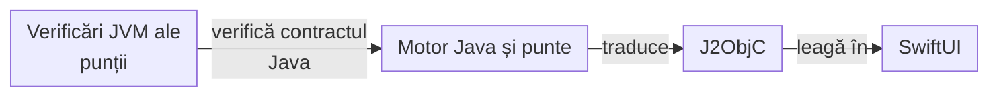

# Aplicația iOS Whist Lab

## Pe scurt

Ținta nativă iOS este separată de APK-ul Android și necesită calificare pe Xcode și simulator înainte de distribuire.




<details>
<summary>Legendă — responsabilitate și limita verificării</summary>

Traseul traducerii native este suspendat. Verificările JVM ale punții exercită contractul Java; nu demonstrează execuție pe simulator, build IPA sau distribuție iOS. Reia calificarea nativă numai față de un toolchain Apple și un scop de platformă revizuite explicit.

</details>

## Stare

Ținta nativă iOS este pusă în așteptare. Proiectul păstrează un adaptor SwiftUI și o
cale de traducere J2ObjC pentru motorul Java comun, astfel încât regulile și licitațiile,
scorul, adversarii și validarea acțiunilor să rămână într-o singură implementare; această
arhitectură nu reprezintă o aplicație suportată sau calificată pentru release. Adaptorul expune doar starea publică și acțiunile omului.

Valorile deployment și simulator din fișiere sunt setări de implementare, nu o matrice
curentă de suport. Release-urile active nu includ un runner iOS, simulator, dispozitiv
fizic, IPA semnat sau rezultat de distribuție. Reluăm platforma numai după revizuirea
scopului și a unei baze curente de toolchain Apple, apoi după trecerea workflow-ului de calificare.

## Structură

| Cale | Rol |
|---|---|
| `WhistLab/` | Interfața SwiftUI, modelul ecranului, checkpoint-ul local și puntea Objective-C. |
| `WhistLabTests/` | Smoke test pe motorul tradus, rulat în simulator. |
| `project.yml` | Configurația XcodeGen, identificatorul iOS și deployment target-ul. |
| `scripts/prepare-shared-core.sh` | Traduce sursele Java și verifică artefactele J2ObjC. |
| `../whist-lab-app/ios-bridge/` | API-ul iOS și testele JVM pentru contractul punții. |

## Dezvoltare și verificare

- **Cerințe:** macOS, Xcode 27.2, JDK 21, Homebrew, XcodeGen și J2ObjC 3.1.
  Mașina Windows de dezvoltare nu include Xcode.
- **Workflow:** repository-ul păstrează o cale CI iOS separată pentru verificări ale motorului comun.
  Rezultatul nu este obligatoriu pentru release-urile Android și nu califică suportul sau distribuția iOS.
- **Dependențe native:** proiectul leagă `libjre_emul` și `libiconv`, necesare
  runtime-ului J2ObjC. Vezi [ghidul iOS](../docs/platform/ATF_iOSDelivery.md).

```sh
cd whist-lab-app
./gradlew :game-core:test :ios-bridge:test
```

- Build-ul simulatorului nu este un IPA semnat și nu îl instalează pe un iPhone.
- Publicarea prin TestFlight sau App Store necesită arhivare și semnare Apple;
  pașii de distribuție iOS rămân separați de APK-ul Android.
