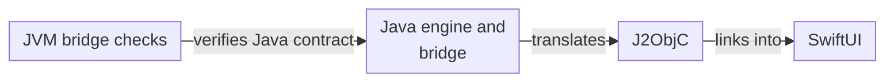

# Application iOS Whist Lab

## Overview

The native target iOS is separated from the Android APK and requires qualification on Xcode and simulator prior to distribution.




<details>
<summary>Legend — ownership and verification boundary</summary>

The native translation route is parked. JVM bridge checks exercise the Java contract; they do not establish simulator execution, an IPA build or iOS distribution. Resume native qualification only against an explicitly reviewed Apple toolchain and platform scope.

</details>

## Status

The native iOS target is parked. The project records a SwiftUI adapter and a J2ObjC
translation path for the shared Java engine, keeping rules, bids, scoring, opponents
and action validation single-sourced. This design is not a supported or
release-qualified application; the adapter exposes only public state and human actions.

The deployment and simulator values in project files are implementation settings, not a
current support matrix. No iOS runner, simulator, physical device, signed IPA or distribution
result is included in active releases. Resume this platform only after its scope and a current
Apple toolchain baseline are reviewed and the qualification workflow passes.

## Structure

| Path | Role |
|---|---|
| `WhistLab/` | SwiftUI interface, screen model, local checkpoint and Objective-C bridge. |
| `WhistLabTests/` | Smoke tests for the translated engine, intended for the simulator. |
| `project.yml` | XcodeGen configuration, iOS identifier and deployment target. |
| `scripts/prepare-shared-core.sh` | Translate Java sources and check J2ObjC artifacts. |
| `../whist-lab-app/ios-bridge/` | API iOS and JVM tests for the bridge contract. |

## Development and verification

- **Requirements:** macOS, Xcode 27.2, JDK 21, Homebrew, XcodeGen and J2ObjC 3.1.
  Windows Development Machine does not include Xcode.
- **Workflow:** the repository retains a separate iOS CI path for shared-engine checks.
  Its result is not required by Android releases and does not qualify iOS support or distribution.
- **Native dependencies:** project connects `libjre_emul` and `libiconv`, necessary
  J2ObjC runtime. See [Guide iOS](../docs/platform/ATF_iOSDelivery.md).

```sh
cd whist-lab-app
./gradlew :game-core:test :ios-bridge:test
```

- A simulator build is not a signed IPA and does not install on an iPhone.
- Publication via TestFlight or App Store requires Apple archiving and signing;
  distribution steps iOS remain separate from Android APK.
