# Unelte de release

## Pe scurt

`release-tools` este granița deținută de Maven pentru politica de release, porți și adaptoarele de livrare. Este punctul unic de operare pentru revizia RAG, pregătirea APK-ului semnat, publicare, verificarea descărcării și proiecția release-ului local. Apelează motoarele ATF comune prin interfețele proprietarilor lor; nu copiază și nu absoarbe lansatorul de teste, infrastructura dispozitivelor Android, modulele jocurilor sau biblioteca de raportare.

```mermaid
flowchart LR
    SOURCE["Surse fixate și candidat"] -->|califică| RUNNER["Lansator comun de calificare ATF"]
    RUNNER -->|sigilează dovezile| EVIDENCE["Dovezi de test și release"]
    EVIDENCE -->|evaluează| ENGINE["Motor comun de dovezi RAG"]
    ENGINE -->|citează| VERDICT["Verdict consultativ"]
    VERDICT -->|verifică| JAVA["Porți Java de admitere"]
    JAVA -->|prezintă| HUMAN["Revizie umană"]
    HUMAN -->|autorizează| SIGN["Construire APK și verificare semnare"]
    HUMAN -->|autorizează| PUBLISH["Adaptor publicare GitHub"]
    PUBLISH -->|expune| DOWNLOAD["Verificare descărcare"]
    DOWNLOAD -->|proiectează| SYNC["Proiecție locală verificată"]
```



<details>
<summary>Legendă — granițele din diagramă</summary>

- Evaluatorul Node existent deține selecția după diff, citarea dovezilor și evaluarea agregată fără efecte laterale.
- Poarta Java pentru dovezi verifică inventarul declarat în manifest înaintea rulării evaluatorului RAG. Poarta RAG Java verifică legarea candidatului, sursei și planului. Ea admite doar `READY_FOR_HUMAN_REVIEW` sau `BLOCKED`; nu poate semna, promova sau publica.
- Poarta pentru dovezi verifică fiecare cale declarată, numărul de octeți și SHA-256 și refuză traversarea, linkurile și materialul privat de semnare.
- Intrările PowerShell apelează porțile Java de admitere și motoarele deținute separat pentru construire, publicare, descărcare și sincronizare locală. Ele nu schimbă verdictul RAG.
- Algoritmii jocului și scenariile Android rămân în modulele jocului sau ale dispozitivului care le dețin.

</details>

## Harta modulului

| Zonă | Proprietar |
|---|---|
| Implementare Maven | `src/main/java/atf/release/tools` |
| Teste de componentă și respingere | `src/test/java/atf/release/tools` |
| Adaptoare pentru operațiile de release | [scripturi](scripts/README.md) |
| Politica RAG a release-ului | [configurație](config/README.md) |
| Contract public de semnare și identitate locală ignorată de Git | [.atf-signing](.atf-signing/README.md) |
| Proprietatea comună a suitelor, surselor și guvernanței | [configurația comună](../config) din rădăcină |
| Selectorul comun de diff, motoarele de dovezi și instrumentele de test | [atf-tests/tools](../atf-tests/tools/README.md) |
| Lansatoarele comune pentru suite, guvernanță și Android | [scripts din rădăcină](../scripts/README.md) |
| APK-ul și dovezile de release livrate | [release](../release/README.md) |

- Politica de release are un singur proprietar în acest modul; preflight-ul Android și calificarea citesc același fișier.
- `release-tools/` deține deciziile și comenzile specifice release-ului. `scripts/` din rădăcină deține lansatoarele folosite între module, `atf-tests/tools/` deține motoarele reutilizabile pentru teste și dovezi, iar `config/` din rădăcină deține guvernanța comună a suitelor și surselor.
- Aceste dependențe sunt referite o singură dată, nu copiate într-o a doua implementare. Modulele de joc, Android, UI comun și raportare își păstrează proprietarii existenți.

## Granița responsabilităților

| Responsabilitate | Proprietar | Ce rămâne în afara `release-tools/` |
|---|---|---|
| Politica de release, porțile consultative, continuitatea semnării și acțiunile operatorului | `release-tools/` | Fără duplicarea politicii sau a implementării cheii private. |
| Selecția suitelor, staging extern, reluare/checkpoint și preflight comun al lansatorului | `scripts/` și `config/` din rădăcină | Coordonează toate domeniile ATF, nu doar release-ul. |
| Selecție reutilizabilă după diff, parsarea dovezilor, proveniență, protocol de publicare și utilitare de test | `atf-tests/tools/` | Adaptoarele release apelează motoarele comune testate. |
| Fluxuri Android, dispozitive, logica jocurilor și randarea Extent | Modulele ATF existente | Fără ramificare specifică release-ului sau duplicarea suitelor. |

Checkoutul rămâne proiectul complet și executabil. `release-tools/` deține fluxul de release; nu este o copie detașată a infrastructurii ATF.

## Intrări

| Operație | Adaptor | Graniță |
|---|---|---|
| Evaluare RAG și admiterea independentă a verdictului | `scripts/Invoke-ReleaseRag.ps1` → `scripts/Invoke-ReleaseToolsJavaGate.ps1` | Intrări doar pentru citire; ieșire în afara sursei și candidatului; necesită revizie umană. |
| Construire APK și continuitatea certificatului | `scripts/Build-SignedReleaseApk.ps1` → `scripts/Invoke-ReleaseToolsJavaGate.ps1` | Snapshot extern al sursei fixate, identitate păstrată, ieșire externă. |
| Publicarea release-ului GitHub | `scripts/Publish-GithubRelease.ps1` | Candidat calificat și verdict RAG; jurnal de reluare în afara checkoutului. |
| Descărcarea release-ului și a asset-urilor la distanță | `scripts/Verify-GithubReleaseDownload.ps1` | Observație autentificată pentru ultimele două release-uri din catalog și octeții descărcați exacți. |
| Sincronizarea release-ului local | `scripts/Sync-LocalRelease.ps1` | Payload Git publicat, verdict după publicare și proiecție verificată a release-ului. |

Folosește `-ProjectRoot` sau `ATF_PROJECT_ROOT` când checkoutul nu este detectat din calea scriptului. Rădăcina aleasă trebuie să conțină POM-ul reactorului, politica activă de release și catalogul. Căile relative se rezolvă din proiectul ales, nu dintr-o literă de unitate specifică unui dezvoltator.

Pentru calificare, folosește mai întâi lansatorul comun din rădăcină: acesta rezolvă proprietarii suitelor afectate, validează rădăcinile externe temp/dovezi, pregătește sursa fixată și produce receipt-uri legate de sursă. Apelează `Invoke-ReleaseRag.ps1` doar după ce dovezile și planul există. Ordinea face parte din contractul fluxului, nu este un efect implicit al adaptorului RAG.

Rădăcina sursă a testelor de componentă are un catalog scurt în [src/test](src/test/README.md), cu trimitere la strategia comună de testare.

## Identitatea de semnare

- Keystore-ul privat existent pentru ediția de test a fost mutat octet cu octet în `release-tools/.atf-signing/`, fără regenerare.
- Numai certificatul public, amprenta, ghidul și fișierul de ignorare intră în Git sau în inventarele sursei. Keystore-ul local și copiile sale de siguranță rămân ignorate.
- Adaptorul APK cere octeții locali de semnare și certificatul APK-ului rezultat cu aceeași amprentă publică. Identitatea lipsă sau schimbată și căile de semnare legate prin link blochează operația; adaptorul nu creează și nu înlocuiește cheia.
- Certificatul de test nu este o cheie administrată pentru producție. Manifestele release-ului păstrează canalul de distribuție declarat și identitatea certificatului.

## Testare și calificare

`ReleaseToolsComponentSuite` este selecția primară de componentă. Ea verifică rezolvarea portabilă a rădăcinii, octeții exacți ai dovezilor, admiterea RAG consultativă, căile negative și granița fără efecte laterale a reviziei. Schimbările din acest modul selectează grupul său de componente Maven și guvernanța release-tools; nu selectează automat E2E pentru fluxurile jocului.

```powershell
pwsh -NoProfile -File .\scripts\run-component-suites.ps1 -Groups release-tools
```

Grupul publică un raport Extent legat de sursă și reconcilierea JUnit prin proprietarul de raportare configurat. Comparațiile și motivele respingerii din teste de componentă sunt în Extent.
